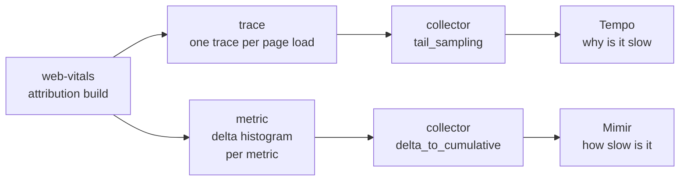

## Table of Contents

## RUM That Keeps Only the Value

The dashboard could tell me that the LCP p75 of a screen opened inside the app webview had gotten worse. But which element had been the LCP was recorded nowhere. The existing collection sent only the `value`, `rating` and `id` that web-vitals provides, and the dashboard showed values pre-aggregated by label, so there was no place to put an element name at all. I could tell it was slow, but not what was slow, until I reproduced it by hand.

So I rebuilt the collection. It measures the attribution breakdown of the five Core Web Vitals (CWV from here on) with the attribution build of web-vitals and sends them to two places through OpenTelemetry (OTel from here on): traces for root-cause analysis go to Grafana Tempo, and metrics for production monitoring go to Grafana Mimir. [Part 2](/2026/10/cwv-send-on-page-leave) covered the shape of the collection code and the send at the moment the page is left. This post covers the points where those values disappeared on their way through the app webview and the shared observability infrastructure.

The work came with a few constraints from the start. The observability infrastructure after the collector is shared by many teams, so I could not change its settings. The end of that collector has tail sampling, and spanmetrics, which derives metrics from traces, is not accepted because of its resource cost. Production metrics may carry only a fixed set of labels, and labels whose cardinality grows without bound, such as an element selector, are forbidden. And the screens open inside the webviews of the iOS and Android apps. Most sections of this post came out of one of these constraints.

> The numbers in this post are, by default, measured in the public reproduction environment ([blog-experiments/cwv-otel-grafana](https://github.com/yceffort/blog-experiments/tree/de1d59f0e390298ec78b7f4c6a8aade1dc4250ae/cwv-otel-grafana), commit `de1d59f`). Only the behavior of the iOS webview, which the reproduction environment does not have, was checked by hand in the real app, and the post says so where it applies. Code quotes are also from this commit, and the code of the first approach is marked separately with the tag `cwv-otel-grafana-v1`.
>
> The versions in the reproduction environment are web-vitals 6.2.3, OTel JS 2.12.0 (OTLP exporter 0.223.0), OpenTelemetry Collector contrib 0.162.0, Tempo 3.1.0, Mimir 3.2.2 and Grafana 13.2.4. The experiments where several browsers write to one series (E9, E10) were measured on collector contrib 0.163.1, and E1 and E4, measured on 0.162.0, were run again on 0.163.1 with the same results. The gateway experiment (E11) ran on Node.js 24.20.0. The browser was Chromium 156 from Playwright 1.64.1. Tempo 2.10.8 was run alongside when checking version differences. All quoted sources are pinned to the tags of these versions.

## Why It Splits into Two Paths

If one trace could answer every question, that would have been simplest. Make one trace per page load, hang one span per metric under it, carry the attribution values as attributes, and TraceQL can filter anything. For finding causes, this was in fact the most convenient way. The problem was production. The shared infrastructure mentioned above was not designed to take the volume of traces a browser sends on every page load, and it did not accept spanmetrics, which extracts metrics from traces, either. I therefore split the configuration into metrics built and sent directly by the browser, and traces used to investigate causes in the verification environment.



Metrics are aggregated before they are sent, so the questions you can ask are fixed at collection time, and that has to be accepted. Mimir can answer "what is the LCP p75 of this screen, and has it gotten worse", but not "what was the LCP element on that screen". That question has to be reproduced in staging and then narrowed down with Tempo. The metrics alone still cannot identify the LCP element, but this division gives each path a role within the constraints of the shared infrastructure.

## The Webview Does Not Say It Is Leaving

As part 2 showed, CLS is reported for the first time at the moment the page is left on every page load that reported FCP, INP when there was a processed interaction, and LCP when the page is left without any input. The signal web-vitals uses to notice that moment is the hidden state of `visibilitychange`. In the app webview, there were cases where this signal never came.

I opened a screen in the iOS app webview, touched nothing for 5 seconds, and left in four different ways. I also recorded the pause event the app passes to the webview (pause in the table below). As [part 1](/2026/10/web-vitals-report-timing) showed, WebKit reports LCP and INP from iOS 26.2 and does not report CLS, so the LCP column below was checked in webviews on iOS 26.2 or later, and iOS has no CLS to begin with.

| How the page was left                | Signals received | LCP                                    |
| ------------------------------------ | ---------------- | -------------------------------------- |
| Put the app in the background        | pause, hidden    | yes                                    |
| Switch to another tab inside the app | hidden, pause    | yes                                    |
| Kill the app from the app switcher   | pause only       | no                                     |
| Push a new screen                    | pause only       | yes (tapped first, which finalized it) |

> Checked by hand in the iOS webview of the real app.

When the app was killed from the app switcher or a new screen was pushed over the webview, neither `visibilitychange`, nor `pagehide`, nor window `blur` arrived. There was no way to know the page had been left through web standard events. pause is an app bridge event that has to be registered per service, so I did not use it as the basis for finalizing. Nor was this something a support table could have told me in advance. MDN's browser compatibility data (BCD) says `visibilitychange` is supported from iOS Safari 14.5, but what a support table tells you is that the event exists, not that it arrives on this path.

So I had to decide on a separate way to finalize LCP. There were four criteria: use only web standard signals, keep one LCP per page, do not cut off the value of a slow page midway, and catch sessions that leave after a short stay. The threshold for a short stay was set at 8 seconds.

| Approach                                     | Why it did not fit                                                                                                       |
| -------------------------------------------- | ------------------------------------------------------------------------------------------------------------------------ |
| Finalize after a fixed 10 seconds            | If the process ends at 8 seconds, the timer never fires                                                                  |
| Finalize after a fixed 3-5 seconds           | Pages whose LCP is slower than that are cut off at an intermediate candidate, skewing the numbers toward good            |
| Send on every candidate change               | Several spans per page, and the metric side cannot pick the last candidate                                               |
| Accept the loss                              | Sessions that leave quickly drop out, which can skew the iOS numbers toward good                                         |
| Network idle for 1 second, cap at 30 seconds | The screens have websockets and polling, so idle was unlikely to come, and a 30-second cap misses the 8-second departure |

The approach I chose finalizes a candidate when it has not changed for 3 seconds. A new candidate restarts the timer. Unlike a fixed timer, it waits again every time the candidate changes, so I expected slow LCPs not to be cut off, and since exporting within 8 seconds leaves only a few seconds to wait after the last candidate, I set it at 3 seconds. That this judgment was wrong becomes clear in the next section. If web-vitals finalizes first, its value is used; if the quiet timer finishes first, that value is used; either way, one export per page. The code that ported this approach to the reproduction environment is at the tag `cwv-otel-grafana-v1`.

```ts
// cwv-otel-grafana/demo-web/src/telemetry/lcp-gate.ts (태그 cwv-otel-grafana-v1)
export function createLcpGate(
  emit: (metric: LCPMetricWithAttribution, finalizedBy: LcpFinalizer) => void,
  quietMs = 3000,
) {
  let settled = false;
  let timer: ReturnType<typeof setTimeout> | undefined;

  const settle = (metric: LCPMetricWithAttribution, by: LcpFinalizer) => {
    if (settled) return;
    settled = true;
    clearTimeout(timer);
    emit(metric, by);
  };

  return {
    /** `onLCP(..., { reportAllChanges: true })` 의 후보 */
    candidate(metric: LCPMetricWithAttribution) {
      if (settled) return;
      clearTimeout(timer);
      timer = setTimeout(() => settle(metric, 'quiet'), quietMs);
    },
    /** `onLCP(...)` 의 정식 확정값 */
    final(metric: LCPMetricWithAttribution) {
      settle(metric, 'web-vitals');
    },
  };
}
```

Candidates come in through `onLCP(gate.candidate, { reportAllChanges: true })` and the final value through `onLCP(gate.final)`. The reason for subscribing twice is that with `reportAllChanges` on, the callback is not called again at finalization if the value has not changed (`src/lib/bindReporter.ts` does not report when the delta is 0), so a single subscription cannot tell when finalization happened. When quiet finalizes, it flushes right away. The default delay of BatchSpanProcessor is 5 seconds, and left as is, the export might not go out before the 8-second departure.

### A Candidate That Stayed Still for 3 Seconds Is Not a Finished LCP

If a larger element is painted after the candidate has stayed still for more than 3 seconds, the quiet-finalized value and the proper final value differ. It is structurally quite possible, so in the reproduction environment I stayed 7 seconds without input on a page that paints its body text after 5 seconds (`?lcp=5000`). The code of the first approach recorded the LCP as 56ms. The heading painted first did not change for 3 seconds, so the quiet timer finalized with that value, and the final value web-vitals produced after the body was painted was discarded because the LCP was already finalized. Values finalized by quiet go into the same histogram as final values, so in Mimir this 56ms is indistinguishable from a properly finalized value.

> Checked on Chromium 156 from Playwright 1.64.1. `cwv-otel-grafana/experiments/e12-browser-lifecycle`.

That no new candidate appeared for 3 seconds is no evidence that the LCP is finished. So the reproduction environment was changed to export the quiet value only as a provisional value and not to block the proper finalization.

```ts
// cwv-otel-grafana/demo-web/src/telemetry/lcp-gate.ts
export function createLcpGate(
  emit: (metric: LCPMetricWithAttribution, finalizedBy: LcpFinalizer) => void,
  quietMs = 3000,
) {
  let finalized = false;
  let timer: ReturnType<typeof setTimeout> | undefined;

  return {
    /** `onLCP(..., { reportAllChanges: true })` 의 후보 */
    candidate(metric: LCPMetricWithAttribution) {
      if (finalized) return;
      clearTimeout(timer);
      timer = setTimeout(() => emit(metric, 'quiet'), quietMs);
    },
    /** `onLCP(...)` 의 정식 확정값 */
    final(metric: LCPMetricWithAttribution) {
      if (finalized) return;
      finalized = true;
      clearTimeout(timer);
      emit(metric, 'web-vitals');
    },
  };
}
```

The provisional value is kept only as a separate span named `cwv.lcp.quiet` and is not put into the histogram. On the same page, the fixed code recorded a provisional 72ms and a final 5080ms separately, and 5080ms went into the histogram. When the provisional value is exported, only the trace is flushed. Flushing the metrics too would run into the forceFlush wait from part 2, and a page load that leaves while that export is in progress could lose its CLS and INP. The cost comes back to the webview that started all this. A page load where hidden never arrives and web-vitals cannot finalize has only a provisional value, so its LCP is missing from the histogram. To keep the provisional value and still use it in aggregation, you need an aggregation that can be overwritten when the final value arrives later, and that story returns with the gateway below. It remains the case that leaving without input within 3 seconds of the last candidate leaves not even a provisional value.

## Tail Sampling: A Root That Arrives Alone Is Dropped

When I first sent traces, the collector responded `200 {"partialSuccess":{}}`, yet there were no CWV spans in Tempo. The spans the auto-instrumentation made for the same page load were stored. The cause was the tail sampling at the end of the shared collector. A policy dropped any trace with fewer than 2 spans at decision time, and the decision wait was 15 seconds. I re-measured with the same policy (2 or more spans, 15-second wait) in the reproduction environment.

| Case | Order sent                                                         | Spans left in Tempo      |
| ---- | ------------------------------------------------------------------ | ------------------------ |
| A    | root and FCP in one request, LCP 90 seconds later                  | page, fcp, lcp           |
| B    | root first, FCP 5 seconds later                                    | page, fcp                |
| C    | root only, LCP 90 seconds later                                    | none                     |
| D    | Sent as in A, evicted from memory, then one LCP                    | page, fcp (**LCP lost**) |
| E    | Sent as in A, evicted from memory, then CLS and INP in one request | page, fcp, cls, inp      |

> Run twice with the same result. For D and E, 10 other traces were sent first to a collector with `num_traces` lowered to 5, pushing the earlier trace out. `cwv-otel-grafana/experiments/e1-tail-sampling`.

As A shows, even with a 15-second decision wait, a trace that survived the decision also stores a span arriving 90 seconds later. The 15-second wait alone does not explain this. In the source of collector 0.162.0, the cache that remembers decisions separately (`decision_cache`) has a default size of 0 and is not used. Instead, a trace whose decision is done stays in memory (`idToTrace`) carrying its decision, and spans arriving late are handled according to that decision[^1].

```go
// opentelemetry-collector-contrib v0.162.0 processor/tailsamplingprocessor/processor.go (processTrace)
switch finalDecision {
case samplingpolicy.Sampled:
    traceTd := ptrace.NewTraces()
    appendToTraces(traceTd, rss)
    if tsp.useTracestate {
        sampling.WriteEffectiveThreshold(tsp.ctx, traceTd, actualData.FinalThreshold, tsp.telemetry.ProcessorTailSamplingCountSpansWithUnparseableTracestate)
    }
    tsp.forwardSpans(tsp.ctx, traceTd)
case samplingpolicy.NotSampled:
```

The number of traces kept in memory is capped by `num_traces` (default 50000), and when it overflows the oldest traces are removed first (`waitForSpace`). A span that arrives after its trace was removed is treated as a never-seen trace and goes through the 15-second decision again. So a single span as in D is dropped, and two or more arriving in one request as in E are judged as a new trace and stored. The 90-second-late span in A was stored because the reproduction environment has so little traffic that the trace had not yet been pushed out. Even if traces are collected only in staging, as long as the collector is shared with other services, the later a span arrives, the more likely it is to arrive after eviction. I think iOS, where CLS is not reported and INP arrives alone, is structurally easier to lose than Android, where CLS and INP arrive together on leaving (I did not measure the ratio of counts in the reproduction environment).

C is the heart of this policy. If the root is created at page start and sent first, the root is judged alone and the whole trace is dropped, and the metric spans that follow inherit the dropped decision. So the root is created at the moment the first metric appears and ended on the spot, and the first metric span is ended in the same tick so that BatchSpanProcessor exports them in the same batch.

```ts
// cwv-otel-grafana/demo-web/src/telemetry/page-trace.ts
return function record(name: string, durationMs: number, attributes: Attributes, visitStart = 0): void {
  let visit = visits.get(visitStart);
  if (!visit) {
    const start = performance.timeOrigin + visitStart;
    const root = tracer.startSpan('cwv.page', { startTime: start });
    root.end();
    visit = { parent: trace.setSpan(ROOT_CONTEXT, root), base: getBaseAttributes(), start };
    visits.set(visitStart, visit);
  }

  // 지표 span 은 보고 시각에 끝나고 길이가 값이다. CLS 는 점수를 ms 로 바꾼 길이라 방문 시작(root)보다 앞서
  // 시작할 수 있는데, 그때는 방문 시작에서 시작하도록 span 을 뒤로 민다. 길이는 그대로다.
  const start = Math.max(performance.timeOrigin + performance.now() - durationMs, visit.start);
  tracer
    .startSpan(name, { startTime: start, attributes: { ...visit.base, ...attributes } }, visit.parent)
    .end(start + durationMs);
};
```

There is one root per navigation. A navigation is the initial load or a bfcache restore, and the root starts at the time that navigation started (the `navigationStartTime` web-vitals provides). web-vitals measures the metrics anew on a restored page too, and with one root per document, the metrics after the restore are mixed into the trace of the initial load, and values that must be one per navigation, like LCP, are discarded. In the reproduction environment, going back and forward between two pages to trigger three restores, the code with one root per document had 2 roots and discarded the LCP of all three restores. After the fix to one root per navigation, there were 5 roots (E12). If you remove this rule in the unit tests (do not end the root), the test that checks whether the root and the first span go out in the same export call fails. A metric span starts at the reported time minus its value, and CLS, whose duration is the score times 1000, can start before the navigation start. That makes a trace whose child starts before its root, so in that case the start is pushed to the navigation start and only the duration is kept.

## Delta to Cumulative: A Series Quiet for 5 Minutes Forgets Its Cumulative Value

On the metric side, values were undercounted rather than lost. The browser sends deltas, the `delta_to_cumulative` processor of the shared collector converts them to cumulative values and writes them to Mimir, and this processor erases the cumulative value of a series that has had no samples for a certain time.

```go
// opentelemetry-collector-contrib v0.162.0 processor/deltatocumulativeprocessor/processor.go
case <-tick.C:
    now := time.Now()
    p.stale.Range(func(id identity.Stream, last time.Time) bool {
        if now.Sub(last) > p.cfg.MaxStale {
            p.last.nums.LoadAndDelete(id)
            p.last.hist.LoadAndDelete(id)
            p.last.expo.LoadAndDelete(id)
            p.stale.Delete(id)
        }
        return true
    })
```

The default `max_stale` is 5 minutes, and the check runs every minute (`time.NewTicker(time.Minute)`). So the actual moment of erasure falls somewhere between 5 and 6 minutes after the last sample, depending on the check cycle. When a delta with the same label combination arrives after the erasure, the cumulative value restarts from that delta (the experiment below sends deltas with a count of 1, so it restarts from 1).

In the reproduction environment, I sent the same deltas simultaneously to a collector with the default (5 minutes) and to one with `max_stale: 15m`. One delta each at 0, 1, 2 and 4.5 minutes, then two 6-minute gaps, then again 1 minute and 5.5 minutes later.

| collector                       | Sent | Cumulative values written to Mimir | `increase()` | `resets()` |
| ------------------------------- | ---- | ---------------------------------- | ------------ | ---------- |
| `max_stale` 5 minutes (default) | 8    | 1, 2, 3, 4, **1**, **1**, 2, 3     | 6.40         | 1          |
| `max_stale` 15 minutes          | 8    | 1, 2, 3, 4, 5, 6, 7, 8             | 7.47         | 0          |

> Run twice on the same schedule with the same result. `cwv-otel-grafana/experiments/e4-delta-expiry`.

After both 6-minute gaps, the cumulative value was erased and restarted from 1. But Prometheus recognized only the first one, from 4 down to 1, as a reset. The second went from 1 to 1 again, and since the value did not drop, it is treated as neither a reset nor an increase. The 5.5-minute gap did not hit the check cycle, so the accumulation continued. The 15-minute collector's `increase()` is 7.47 rather than 8 because there is no value before the first sample, so the first count is not counted as an increase and the result is extrapolated to the end of the range; this difference has nothing to do with expiry.

Prometheus's `increase()` treats a drop from 8 to 1 as a reset and corrects for it, but counts 1 to 1 again as an increase of 0. The sparser the traffic for a label combination, the more often this happens, so counts come out lower than reality. When the collector runs as several instances, samples with the same labels accumulate separately per instance, so the sample spacing of the stream one instance sees is wider than the total traffic would suggest. When a label combination has only one sample, `increase()` finds no pair and the result is 0 outright; the story of putting this setup on a blog with rare visits and ending up with an entirely empty dashboard is in part 4. Quantiles and good ratios are ratios between buckets, so the effect is small, but counts are badly wrong. So the count panels on the dashboard carry a description saying that they undercount and should not be read as page loads.

## When Several Browsers Write to One Series

The experiments so far were under the condition that one browser writes to its own series in order. A staging environment with little traffic is close to this condition too, so it is rare for several browsers to write to the same label combination at the same time. In production, countless browsers send values for the same screen, the same navigation type and the same rating at the same time. Looking at the code where `delta_to_cumulative` adds a delta to the cumulative value, this difference becomes important[^2].

```go
// opentelemetry-collector-contrib v0.162.0 processor/deltatocumulativeprocessor/internal/delta/delta.go
func Aggregate[T Type[T]](state, dp T, aggregate func(state, dp T) error) error {
    switch {
    case state.Timestamp() == 0:
        // first sample of series, no state to aggregate with
        dp.CopyTo(state)
        return nil
    case dp.StartTimestamp() < state.StartTimestamp():
        // belongs to older series
        return ErrOlderStart{Start: state.StartTimestamp(), Sample: dp.StartTimestamp()}
    case dp.Timestamp() <= state.Timestamp():
        // out of order
        return ErrOutOfOrder{Last: state.Timestamp(), Sample: dp.Timestamp()}
    }
```

The start time of a series is set by the start time of the first value received, and every value after that must not have an earlier start time, and its time must be later than the latest time received so far. Values that break these rules are dropped. For a server where one process sends its own series in order, these rules hold naturally. The error message of `ErrOlderStart` even advises to "consider checking for multiple processes sending the exact same series". In the browser this assumption does not hold. A series is defined by its label combination and resource attributes, and since the collection code in the reproduction environment has `service.name` as its only resource attribute, every browser sending values with the same label combination writes to one series. And each value's time is stamped by each browser's own clock.

First I had 3 browsers with skewed clocks send one LCP each with the same label combination, 3 seconds apart. The first clock was correct, the second 2 minutes slow, the third 30 seconds fast. The reproduction environment's collector dropped the second value. Nothing was logged by the collector, and the dropped count appeared only in the collector's own metric `otelcol_deltatocumulative_datapoints{error="delta.ErrOlderStart"}`.

> Run twice with the same result. `cwv-otel-grafana/experiments/e9-client-clock`.

So how much is dropped under heavy traffic? Instead of browsers, I built OTLP requests directly to imitate many browsers each sending one LCP to one series. Page loads occur at random (as a Poisson process), and each value arrives after a network delay of 50-550ms. The start time of each value is set 0-10 seconds before its time, imitating the browser's export interval. First I looked at the case where every browser's clock is exactly right.

| Per second into one series | Sent       | `delta_to_cumulative` (reproduction setup) | Delta stored as is, with the received time |
| -------------------------- | ---------- | ------------------------------------------ | ------------------------------------------ |
| 1                          | 69, 66     | 14.5%, 9.1%                                | 0%, 0%                                     |
| 10                         | 603, 539   | 43.8%, 40.6%                               | 1.5%, 1.3%                                 |
| 50                         | 3056, 3023 | 75.4%, 75.1%                               | 7.5%, 6.7%                                 |

> The share of sent values that could not be queried from Mimir. The two runs are listed in order. The network delay distribution is an assumption, not a measurement. `cwv-otel-grafana/experiments/e10-concurrent-writers`.

Values are lost even when every clock is right. When a value collected later arrives first because its delay was shorter, the series time advances to that value, and a value collected earlier but arriving later is dropped as `ErrOutOfOrder`. Applying only the two rules above to the same input in arrival order gives, at 1 per second, 59 values kept, 1 dropped for its start time and 9 dropped for order. The 1 dropped for its start time is a value from a browser that started earlier but arrived later, carrying a start time earlier than the series start. This matched the measurement counted with the collector's own metrics. Of the 14 runs, seven scenarios twice each, 12 matched exactly like this, and the other 2 differed by only 1 each. That means the loss is almost entirely explained by these two rules. The right column is a setup that removes `delta_to_cumulative`, stores the deltas in Mimir as they are, and replaces the time with the time the collector received them. The ordering problem disappears, but from 10 per second, values received in the same millisecond become samples with the same timestamp and Mimir drops them. This setup was not an option on the shared collector, and the story of choosing it on the blog I run myself is in part 4.

With skewed clocks the loss gets much bigger. Mixing one browser with a clock 60 seconds fast into a series receiving 2 values per second, that value moved the series time 60 seconds ahead, and every value arriving in the following 60 seconds was dropped. The cumulative series left in Mimir had a gap of a little over 60 seconds in both runs (60.2 seconds and 60.1 seconds, loss of 57.1% and 58.1%). Mixing in one browser with a clock 2 hours fast, not a single value survived for the following 7 minutes (98.9%, 98.5%). The 2-hour-fast value itself did not survive in Mimir either, because Mimir by default rejects samples more than 10 minutes in the future (`-validation.create-grace-period`).

7 minutes is longer than the expiry time of the previous section (5 minutes). The series was nevertheless not erased and restarted because dropped values also refresh the expiry timer[^3].

```go
// opentelemetry-collector-contrib v0.162.0 processor/deltatocumulativeprocessor/processor.go (ConsumeMetrics)
// stream is ok and active, update stale tracker
p.stale.Store(id, now)

if !loaded {
    // cached zero was stored, alloc new one
    zero.hist = guard(pmetric.NewHistogramDataPoint())
}

last.use(func(last pmetric.HistogramDataPoint) {
    err = p.aggr.Histograms(last, dp)
    last.CopyTo(dp)
})
```

The time of the last received value is recorded before aggregation, so as long as values keep arriving, the series stays alive even if all of them are dropped. The gap made by a fast clock lasts exactly as far ahead as that clock was, as long as there is traffic.

The experiment combining clock skews from several browsers is documented separately in the [supplementary experiment](#supplementary-experiment-a-clock-skew-model-based-on-2014-data) at the end. The key finding here is that a single browser with a fast clock can cause other values in the same series to be lost.

I could not measure how often this loss happens in production. I have never compared sent and received counts on production data, and it also depends on how the collector splits streams (resource attributes, instance configuration). What I can say with certainty is that counts matching in a low-traffic staging environment is no evidence that this loss is absent. The loss grows with the number of browsers writing to the same series at the same time, and staging does not create that condition.

### Putting a Single Writer in Front of the Shared Collector

If the cause of the loss is that one series has many writers, the fix is to funnel them into one writer. Even if the shared collector's settings cannot be changed, putting an aggregation server I run myself in front of it is possible. I built a gateway in the reproduction environment to check the effect and the cost.

The gateway receives the browser's reports per measurement (document, navigation, metric name). Each report carries a revision; a revision higher than the one received replaces the value, and an equal or lower one is discarded. When no new report has arrived for 30 minutes after the last update, the measurement is finalized, added to a cumulative histogram per series, and exported to the collector on a schedule. The writer of a series is the gateway alone, and the gateway sets the times. When a series is exported for the first time, a sample with value 0 is exported once first, which also avoids the problem of `increase()` not counting a label combination with only one sample. The keys of finalized measurements and the samples not yet delivered to the collector are saved to a file, so after a restart the same report arriving again is counted only once and undelivered samples continue to be exported. The same reports were also sent to the delta path of the reproduction environment for comparison.

| Case                                                | Measurements sent | Stored by the gateway | Stored by the delta path |
| --------------------------------------------------- | ----------------- | --------------------- | ------------------------ |
| 30 with the same label combination at once          | 30                | 30                    | 1, 1                     |
| The 50-per-second input of the earlier experiment   | 3056              | 3056                  | 1199, 1202               |
| The supplementary clock skew model at 10 per second | 1219              | 1219                  | 35, 35                   |

> Run twice with the finalization time shortened to 2 seconds. The gateway side was the same both times, and the bucket sums matched the values computed from the input. The delta path lists the two runs in order. Since the values were spread over several buckets and the rating label split the series into three, I take the delta path's loss to be smaller than in the earlier table for that reason. `cwv-otel-grafana/experiments/e11-server-aggregation`.

Two more problems are solved by the revision. One is a report arriving again with the same id. CLS and INP are reported again with the same id when the page becomes visible and then hidden again, and since a histogram adds a sample per report, the delta path of the reproduction environment counts only the first report of an id. Then a bad experience after returning to the tab never enters the statistics. In the reproduction environment, hiding the page, showing it again, inserting an element at the top and hiding it again, the delta path's CLS stayed at the first report's 0, while the gateway received revision 1 (0) and revision 2 (0.1124) of the same measurement and counted the last value (E12; the tab switch was imitated by overriding `visibilityState`). The other is the quiet provisional value. Sending the provisional value as revision 1 and the final value as revision 2, the gateway finalizes a measurement that received a final value with that final value. A measurement that only ever received a provisional value is not mixed into the same histogram but counted in a separate series named `cwv.lcp.provisional`. The statistics of `cwv.lcp`, which take only final values, stay as they are, while the number of page loads that have no final value because hidden never came is counted alongside. 25 measurements that sent only a provisional value and 25 that sent a final value after the provisional one were split into 25 provisional and 25 final (E11).

The cost is just as clear. Because finalization waits 30 minutes, the dashboard runs 30 minutes behind, and an update arriving later than that is not reflected. Measurements not yet finalized live only in memory, so a gateway restart in the meantime loses them (30 of 230 were unfinalized in the restart experiment). The keys of finalized measurements are saved, so when the browser resent the same reports after the restart they were not counted again (all 100 resent reports were counted as late). The keys of unfinalized measurements are values the browser decides, so their number is capped (default 100,000), and beyond the cap new measurements are not accepted. Scaling the gateway to several instances makes the writers of one series several again, so the reports would have to be partitioned per measurement (not measured). And since the browser sends one request per batch of reports, when the gateway's responses were slow, HTTP/1.1's 6 connections per origin filled up, and the remaining requests queued and then vanished when the browser was closed (E12). The constraints of the shared infrastructure are avoided, but in exchange there is one stateful server to run yourself.

## Tempo: Values That Disappear at Query Time

### TraceQL Metrics That Show Only the Last 30 Minutes

On the shared Tempo, TraceQL metrics returned values only for the most recent 30-40 minutes, however many hours the query range was set to. Searching the same range as traces found the data. I did not know that Tempo's version or configuration, so I could not confirm the cause at the time. But the Tempo 3.0 release notes had an entry saying the default of `query_backend_after` for TraceQL metrics changed from 30m to 15m. The number 30 minutes lined up. So in the reproduction environment I ran three instances of Tempo 2.10.8 differing only in their local-blocks settings, sent the same spans every 10 seconds to them and to Tempo 3.1.0, and counted the last 60 minutes in 5-minute intervals.

| Tempo  | local-blocks settings                                   | Intervals older than 30 minutes | Last 30 minutes |
| ------ | ------------------------------------------------------- | ------------------------------- | --------------- |
| 3.1.0  | (3.x has no local-blocks)                               | 30                              | 30              |
| 2.10.8 | default (`filter_server_spans: true`)                   | **0**                           | **0**           |
| 2.10.8 | `filter_server_spans: false`, `flush_to_storage: false` | **0**                           | 30              |
| 2.10.8 | `filter_server_spans: false`, `flush_to_storage: true`  | 30                              | 30              |

> 30 spans were sent per 5-minute interval. Queried twice, at 16:00 and 16:23 (UTC), with the same shape both times, and in the third row the values cut off exactly 30 minutes before the query time in both runs. `cwv-otel-grafana/experiments/e5-tempo-metrics`.

The third row, with `flush_to_storage: false`, has the same shape as what I saw on the shared Tempo. The query-frontend of 2.10.8 splits the query range in two at `query_backend_after` (default 30 minutes)[^5].

```go
// grafana/tempo v2.10.8 modules/frontend/metrics_query_range_sharder.go
cutoff                = time.Now().Add(-s.cfg.QueryBackendAfter)
```

```go
blocks := blockMetasForSearch(s.reader.BlockMetas(tenantID), start, end, func(m *backend.BlockMeta) bool {
    return m.ReplicationFactor == backend.MetricsGeneratorReplicationFactor
})
if len(blocks) == 0 {
    // no need to search backend
    close(reqCh)
    return
```

The last 30 minutes are computed from the blocks that the metrics-generator's local-blocks holds in memory and on local disk. Anything older is searched in the backend store, and there only the blocks written by the metrics-generator are considered. Blocks made by the normal write path (the ingester) have a `ReplicationFactor` of 0 (`DefaultReplicationFactor`) and only blocks made by the metrics-generator have 1 (`MetricsGeneratorReplicationFactor`), so ingester blocks do not qualify (`tempodb/backend/block_meta.go`). With `flush_to_storage: false`, local-blocks does not write blocks to the backend, so data older than 30 minutes appears in trace search but not in TraceQL metrics. Since I could not check the shared Tempo's configuration, I can only say it was very likely the same cause.

The second row is another default-value problem. In 2.10.8, local-blocks has `filter_server_spans` on by default, and then only spans of SERVER kind or without a parent are kept (`filterBatches` in `modules/generator/processor/localblocks/processor.go`). The browser's metric spans are children of the root and of INTERNAL kind, so not one of them is caught by TraceQL metrics. In Tempo 3.x, local-blocks is gone, the live-store handles the recent range and the backend the rest, and the default `query_backend_after` became 15 minutes. The 3.1.0 in the reproduction environment returned the full 60 minutes.

### Quantiles Interpolate Between Power-of-Two Buckets

With the span duration set to the metric value, `quantile_over_time(duration, .75)` is the p75. But Tempo's quantile is not an exact value. I checked by sending spans with a known distribution. Sending spans of 100, 300, 1000, 2500 and 4000ms in rotation every 10 seconds puts 30 into a 5-minute interval, and the exact p75, the 23rd of 30, is 2500ms. Both Tempo 3.1.0 and 2.10.8 returned **1.913 seconds** as the p75 of this interval. The last interval, with only 15 samples, gave 2.147 seconds.

The calculation is in `pkg/traceql/engine_metrics.go`[^6].

```go
// grafana/tempo v3.1.0 pkg/traceql/engine_metrics.go
// Log2Bucketize rounds the given value to the next powers-of-two bucket.
func Log2Bucketize(v uint64) float64 {
    if v < 2 {
        return -1
    }

    return float64(uint64(1) << (64 - bits.LeadingZeros64(v-1)))
```

```go
    // Exponential interpolation between buckets
    // The current bucket represents the maximum value
    maxV := math.Log2(buckets[bucket].Max)
    var minV float64
    if bucket > 0 {
        // Prior bucket represents the min
        minV = math.Log2(buckets[bucket-1].Max)
    } else {
        // There is no prior bucket, assume powers of 2
        minV = maxV - 1
    }
    return math.Pow(2, minV+(maxV-minV)*interp), bucket
```

The span duration (ns) is rounded up to the next power of two and put in that bucket. 100, 300 and 1000ms go into the 2^27, 2^29 and 2^30ns buckets respectively, and 2500ms and 4000ms go together into the 2^32ns (4.295 seconds) bucket. The 23rd sample is the 5th of the 12 in the 2^32 bucket. The lower end of the interpolation is the bucket immediately before, and since the 2^31 bucket is empty and absent from the list, 2^30 becomes the previous bucket. So the result is 2^(30 + 2 × 5/12)ns, that is, 1.913 seconds. The interval with 15 samples looks for the 12th sample instead of the 23rd, and the interpolation ratio is exactly half, giving 2^31ns (2.147 seconds). The frequent appearance of values like 1.074 seconds (2^30ns) or 2.147 seconds (2^31ns) when samples are few is also explained by this calculation: when the cumulative sample count lands exactly on the rank being looked for, the bucket's upper bound is returned as is, without interpolation.

2.5 seconds lies between 2^31ns and 2^32ns, so at this precision you cannot tell whether the p75 is inside the good boundary. I think it is safer to judge the boundary with Mimir's good ratio, where the boundary is a bucket edge, and to use Tempo's quantiles for comparisons such as "is element A slower than element B".

### Values That Drop Out of Quantiles

Quantiles of numeric attributes make their buckets with a different function from duration[^7].

```go
// grafana/tempo v3.1.0 pkg/traceql/ast_metrics.go
switch t {
case TypeInt:
    if f < 2 {
        return NewStaticNil(), false
    }
    // Bucket is the value rounded up to the nearest power of 2
    return NewStaticFloat(Log2Bucketize(uint64(f))), true
case TypeDuration:
    if f < 2 {
        return NewStaticNil(), false
    }
    // Bucket is log2(nanos) converted to float seconds
    return NewStaticFloat(Log2Bucketize(uint64(f)) / float64(time.Second)), true
default:
    // TODO(mdisibio) - Add support for floats, we need to map them into buckets.
    // Because of the range of floats, we need a native histogram approach.
    return NewStaticNil(), false
}
```

Two things drop out here. One is double attributes. For `span.e5.value_ms`, stored as a double, and CLS's `span.cwv.value`, `avg_over_time` computed but `quantile_over_time` returned not a single series. The other is values below 2. Duration too excludes anything under 2ns in `bucketizeDuration`, so a CLS span with a duration of 0, that is, **a page load whose CLS is 0, drops out of TraceQL quantiles.** Of the 841 CLS spans accumulated over 35 minutes in the reproduction environment, 351 were nonzero, and the p75 Tempo returned was 0.0246. Over the same 35 minutes Mimir received 840 and its CLS p75 was 0.0088. The same page loads seen in two stores, and Tempo's CLS p75 came out about 2.8 times worse. The more pages with a CLS of 0, the larger this gap. The same goes for attributes where 0 is common, like LCP's resource load delay.

The end of the query range matters too. Tempo 3.1.0 aligns the result intervals to multiples of the step, and when the query end is not a multiple of the step, it did not return the last interval. Querying at 15:47 with a 30-minute step drops all data after 15:30, and 2.10.8 returned that interval as well (checked twice). With a small step, as in a Grafana panel, the amount lost is small, but a script querying with a one-hour step can show the most recent hour as 0. All Tempo numbers in this post were measured with the query end aligned to a multiple of the step.

Empty intervals need care too. `quantile_over_time` returns a sample with an empty value even for an interval with no samples, and Grafana draws it as 0. `avg_over_time` leaves intervals with no samples out entirely. An interval that suddenly drops to 0 on a quantile panel is not a speedup but an interval with no samples.

### A Numeric Attribute Changes Type Depending on Its Value

While building the dashboard, I found the panel counting CLS by the element that caused it empty. The query was `{name="cwv.cls" && span.cwv.value > 0}`. Counting the same range with only the condition changed gave this.

| Condition                                | Count over 30 minutes |
| ---------------------------------------- | --------------------- |
| `name="cwv.cls"`                         | 812                   |
| `name="cwv.cls" && span.cwv.value > 0`   | 0                     |
| `name="cwv.cls" && span.cwv.value > 0.0` | 344                   |
| `name="cwv.lcp"`                         | 811                   |
| `name="cwv.lcp" && span.cwv.value > 0`   | 811                   |
| `name="cwv.lcp" && span.cwv.value > 0.0` | 0                     |

> Counted on Tempo 3.1.0 over the same 30-minute range, changing only the condition.

When OTel JS converts a numeric attribute to OTLP, it sends an integer as `intValue` and anything else as `doubleValue`[^8].

```ts
// opentelemetry-js experimental/v0.223.0 experimental/packages/otlp-transformer/src/common/internal.ts
if (t === 'number') {
  if (!Number.isInteger(value)) return { doubleValue: value as number };
  return { intValue: value as number };
}
```

So for the same `cwv.value` attribute, a CLS of 0.008 is stored as a double and a CLS of 0 as an int. And in Tempo 3.1.0, an integer literal (`> 0`) filtered only int values and a float literal (`> 0.0`) only double values. The reason lies not in the comparison but in the stage that reads spans from the block. The TraceQL engine's value comparison treats both int and double as numbers[^9], but `createAttributeIterator`, which applies attribute conditions on vParquet blocks, applies the condition to only one of the int column (`ValueInt`) and the double column (`ValueDouble`) depending on the literal's type[^10]. Values stored in the other column never reach the engine. To confirm, I sent two spans to the same 3.1.0 carrying the same attribute as int 5 and double 5.5, and for `>`, `>=`, `=`, `!=` and `<` alike, the integer literal returned only the int value and the float literal only the double value, and both appeared only when the two conditions were joined with `||` or the filter was `!= nil`. In the headless Chromium of the reproduction environment, LCP values are all integers, so `> 0` caught everything, but when fractional values are mixed in from real users' browsers, a filter like `span.cwv.value > 2500` can catch only part of them. The reproduction environment now rounds every ms attribute to an integer with `Math.round` before sending. With integers, the quantiles of the previous section are computed as well. Values that are fractional by nature, like CLS, are filtered by span duration (`duration > 0ms`) instead of the attribute, and their quantiles are taken from the span duration too. Putting CLS times 1000 into the span duration paid off at this point.

### Several Queries in One Panel Cannot Be Told Apart in the Legend

To draw the four LCP phases in one panel, I put `avg_over_time(span.cwv.lcp.time_to_first_byte)` and `avg_over_time(span.cwv.lcp.element_render_delay)` in with different refIds, and the refId of the frames the Tempo data source of Grafana 13.2.4 returned had both been overwritten with `avg_over_time`. The legend becomes two entries with the same name, and an override that picks a series by refId to rename it cannot be used either. I drew one panel per phase.

## Finding Changes in Mimir and Causes in Tempo

The dashboards are used in sequence: narrow down the slow metric and screen in Mimir, then reproduce the same conditions and investigate the cause in Tempo. The reproduction environment's dashboard JSON is generated by `cwv-otel-grafana/grafana/build-dashboards.py`. The Mimir dashboard's source variable (`source`) selects either the values aggregated by the gateway (`cwv-gateway`, the default) or the delta path (`demo-web`). LCP measurements for which the gateway received only a provisional value are aggregated separately as `cwv_lcp_provisional` and are not included in the panels below.

The screenshots show the dashboards at the commit specified earlier, after collecting 400 demo visits in the reproduction environment and selecting that 20-minute range. The Mimir source is set to `cwv-gateway`.

### Finding the Slow Metric and Screen in Mimir

First, I check each metric's p75 and good ratio over the selected range. The p75 shows the level of the metric, while the good ratio shows how many page loads fall within the threshold.


The p75 is computed by summing the bucket counts that increased over the range.

```promql
histogram_quantile(0.75, sum by (le) (increase(cwv_lcp_milliseconds_bucket{job="$source", page_route=~"$route"}[$__range])))
```


The good ratio divides the count in the good-boundary bucket by the total count. Including the threshold as a bucket boundary makes it possible to calculate the ratio without interpolation. When p75 moves near a rating boundary, this ratio helps show how many page loads are affected.

```promql
sum(increase(cwv_lcp_milliseconds_bucket{job="$source", page_route=~"$route", le="2500"}[$__range]))
/
sum(increase(cwv_lcp_milliseconds_count{job="$source", page_route=~"$route"}[$__range]))
```

After identifying the slow metric, I narrow the investigation by looking at p75 per screen or input type. These are calculated by adding the relevant label to `by`, as in `sum by (le, page_route)`.


### Reproducing the Conditions to Check the LCP Element and Phases

Mimir's aggregates cannot tell which element was the LCP, so the screen and conditions have to be reproduced in the verification environment before querying Tempo. In the earlier quiet-timer experiment, a page that painted its body text after 5 seconds recorded a final LCP of 5080ms. When investigating a page like this, the first step is to distinguish whether the slow LCP belongs to the heading or to the body text that appeared later.


```text
{resource.service.name="demo-web" && name="cwv.lcp"} | count_over_time() by (span.cwv.lcp.target)
{resource.service.name="demo-web" && name="cwv.lcp"} | quantile_over_time(duration, .75) by (span.cwv.lcp.target)
```

The count by element shows which element often becomes the LCP, and p75 by element compares their durations. The reproduction environment distinguishes the heading (`#app>h1`), the body text painted late (`#app>p.hero`) and the image (`#app>img.hero-image`). The demo finalizes LCP on the first click, so clicking before the body text is painted makes the heading the LCP. The condition of waiting without input, as in the earlier experiment, therefore also needs to be considered separately.

After identifying the element, I compare the averages of the four LCP phases: TTFB, resource load delay, resource load duration and element render delay. Along with the element and total LCP value, knowing which phase took longer helps narrow the next investigation. Each phase has a separate panel because of the legend issue described earlier.


INP follows the same sequence of checking the target and phases. I look at p75 by target alongside the averages of input delay, processing duration and presentation delay. For CLS, I use the panel showing the elements responsible for layout shifts.


### Checking Which Samples a Before-and-After Comparison Includes

Interpreting a change also requires checking the sample count and collection path. The sample count panel has a different description for each path.


The delta path undercounts because of cumulative-value expiry and concurrent sends, so its count cannot be used as a page-load count. The gateway path lost no values in the concurrent-send experiments above, but `increase()` extrapolates from the last sample to the query time and overcounts. On a newly created series, the error also varies widely with the query time. The same 30 concurrent measurements under the same conditions were counted as 30.65 and 45.71 (E11).

For the reproduction environment's gateway, which exports every 10 seconds and keeps its series active, I calculated an error of around 0.3% over a 1-hour range. I did not directly measure the error under those conditions.


Tempo's "LCP final vs quiet provisional" panel shows the span counts of final and quiet provisional values side by side. A quiet provisional value can arrive first simply because the page remains open for more than 3 seconds without input. Its presence alone therefore does not establish that a hidden event was missed. This count is used only as an upper bound on page loads that reported a provisional value but never reported a final one.

After finding and fixing the cause, the next step is to select the same screen and collection path in Mimir and compare the trend. Regardless of the selected query range, the trend panels calculate p75 over the preceding 10 minutes at each point.


The dashboards are arranged around this sequence: choose the screen to investigate in Mimir, check the element and phases in Tempo, then return to Mimir to examine the change. Element details absent from the metrics still require reproduction, but the workflow connects the initial slow value to the next thing to investigate.

## What Comparing Sent and Stored Counts Established

Because I could not change the shared infrastructure's settings, I first checked what could be addressed in the collection code. Sending the root with the first metric avoided having a trace dropped because its root arrived alone. Keeping quiet values provisional allowed a final LCP arriving later to be recorded as well. Limits remained: a webview that never sent hidden could still have no final value, and late spans could still be dropped by tail sampling.

I examined the loss from several browsers writing to one series by adding a gateway in the reproduction environment. With the gateway setting timestamps and aggregating each series, the counts and bucket sums matched the inputs used for comparison. It could also handle updates to the same measurement and distinguish provisional LCP values. In return, there was a 30-minute finalization wait, unfinalized state that could be lost on restart, and response latency to manage. This established what collection-code changes and a separate aggregation server could each address, along with the constraints that remained.

Verification consisted of comparing the counts sent to each stage with the counts stored or returned by queries. Counts that matched when one browser sent values in order changed when several browsers sent to the same series concurrently. The loss ratios in this post belong to those reproduction conditions. For another environment, the useful check is how far the sent values survive under its own series configuration and sending conditions, rather than expecting the same ratios.

## Supplementary Experiment: A Clock Skew Model Based on 2014 Data

I also looked for data on clock skew in real browsers. The public data I found was from 2014, comparing the browser's `Date()` with server time over 300 million page loads a day[^4]. With the absolute differences grouped into 5-minute buckets, 90% were under 5 minutes, 99% under 115 minutes and 99.9% under 25.5 hours. About 57% of the skewed clocks were ahead of the server.

I generated clock skews from the published percentile boundaries and the share of clocks that were ahead, then ran the same experiment. The 90% with differences below 5 minutes were assigned a skew of 0, and the rest were drawn uniformly within each range. At 1 value per second, the loss was 92.0% and 95.6%; at 10 per second, it was 99.9% in both runs. These are the results of a model fitted to the 2014 percentiles, rather than measurements using the original observed distribution. There is also no basis for treating the zero-skew assumption as the one that minimizes loss, so these results cannot be used as a lower bound.

In this experiment, once the first value with a timestamp ahead of the server arrived, only values with still later timestamps passed the aggregation checks. Most of those also exceeded Mimir's 10-minute grace period and were not stored. Mimir retained only the few values received before the first fast-clock value. At 1 per second, the loss varied widely with when that value arrived and how far ahead its clock was. At 10 per second, both runs stopped storing values a few seconds after the start.

The 2014 data is weighted toward sites in the US, Canada and the EU. I suspect there were more PCs with inaccurate clocks then than there are among today's phones, which synchronize their clocks over the network. The actual clock skew in app webviews may therefore be much smaller. As the earlier experiment showed, however, a single browser a few minutes ahead can cause other values in the same series to be lost for that period. Only values from browsers with still later clocks pass the aggregation checks in the meantime.

[^1]: [opentelemetry-collector-contrib v0.162.0 `processor/tailsamplingprocessor/processor.go`](https://github.com/open-telemetry/opentelemetry-collector-contrib/blob/v0.162.0/processor/tailsamplingprocessor/processor.go#L1191-L1199)

[^2]: [opentelemetry-collector-contrib v0.162.0 `processor/deltatocumulativeprocessor/internal/delta/delta.go`](https://github.com/open-telemetry/opentelemetry-collector-contrib/blob/v0.162.0/processor/deltatocumulativeprocessor/internal/delta/delta.go#L46-L66). The 0.163.x source (tag v0.163.0) that E9 and E10 were measured on has the same content for this file and `processor.go` as 0.162.0.

[^3]: [opentelemetry-collector-contrib v0.162.0 `processor/deltatocumulativeprocessor/processor.go`](https://github.com/open-telemetry/opentelemetry-collector-contrib/blob/v0.162.0/processor/deltatocumulativeprocessor/processor.go#L124-L143)

[^4]: Gervase Markham, ["[cabfpub] Clock skew data"](https://lists.cabforum.org/pipermail/public/2014-November/020810.html), CA/B Forum public mailing list, 2014-11-03. A post forwarding data measured by an anonymous contributor; if the original site does not respond, the [web archive copy](https://web.archive.org/web/20240723215943/https://lists.cabforum.org/pipermail/public/2014-November/020810.html) is available.

[^5]: [grafana/tempo v2.10.8 `modules/frontend/metrics_query_range_sharder.go`](https://github.com/grafana/tempo/blob/v2.10.8/modules/frontend/metrics_query_range_sharder.go#L127-L205)

[^6]: [grafana/tempo v3.1.0 `pkg/traceql/engine_metrics.go`](https://github.com/grafana/tempo/blob/v3.1.0/pkg/traceql/engine_metrics.go#L2323-L2409)

[^7]: [grafana/tempo v3.1.0 `pkg/traceql/ast_metrics.go`](https://github.com/grafana/tempo/blob/v3.1.0/pkg/traceql/ast_metrics.go#L282-L314)

[^8]: [opentelemetry-js experimental/v0.223.0 `otlp-transformer/src/common/internal.ts`](https://github.com/open-telemetry/opentelemetry-js/blob/experimental/v0.223.0/experimental/packages/otlp-transformer/src/common/internal.ts#L74-L77)

[^9]: [grafana/tempo v3.1.0 `pkg/traceql/ast.go`](https://github.com/grafana/tempo/blob/v3.1.0/pkg/traceql/ast.go#L1015-L1021). `Static.compare` converts both sides to float and compares them when both are numbers, even if their types differ.

[^10]: [grafana/tempo v3.1.0 `tempodb/encoding/vparquet4/block_traceql.go`](https://github.com/grafana/tempo/blob/v3.1.0/tempodb/encoding/vparquet4/block_traceql.go#L3079-L3121). An int literal goes into `attrIntPreds` and a float literal into `attrFltPreds`, and each applies only to the iterator of the int column or the double column respectively.
