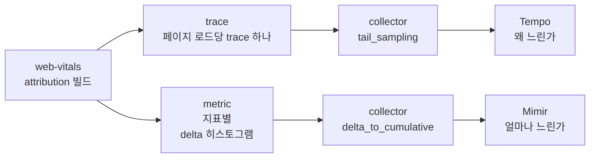

## Table of Contents

## 값만 남는 RUM

앱 웹뷰 안에서 열리는 홈 화면의 LCP p75가 나빠졌다는 것은 대시보드로 알 수 있었다. 그런데 어떤 요소가 LCP였는지는 어디에도 남아 있지 않았다. 사내 공용 RUM 라이브러리는 web-vitals의 `onLCP` 콜백에서 `rating`, `value`, `id`만 꺼내 보내고 `entries[].element`는 버리고 있었다. 기존 대시보드는 Prometheus 라벨로 미리 집계한 값이라 요소 이름을 담을 자리 자체가 없었다. 느리다는 것까지는 알 수 있어도, 무엇이 느린지는 직접 재현해 보기 전에는 알 수 없는 상태였다.

그래서 web-vitals의 attribution 빌드로 Core Web Vitals(이하 CWV) 다섯 지표의 원인 분해 값을 직접 재고, OpenTelemetry(이하 OTel)로 두 곳에 나눠 보내기로 했다. 원인 분석용 trace는 Grafana Tempo로, 운영 모니터링용 metric은 Grafana Mimir로 보낸다. 측정 자체는 어렵지 않았다. 어려웠던 것은 측정한 값이 대시보드까지 가는 길이었다. 값은 브라우저 안에서, 브라우저를 떠나는 순간에, collector에서, 저장소에서 조회할 때 사라졌고, 그 어느 지점에서도 오류는 나지 않았다. 이 글은 LCP 값 하나가 브라우저에서 Grafana 패널까지 가는 경로를 따라가며 값이 사라진 지점을 하나씩 기록한 것이다.

작업에는 처음부터 몇 가지 제약이 있었다. 먼저 collector 이후의 관측 인프라는 여러 팀이 같이 쓰는 공용 인프라라서 내가 설정을 바꿀 수 없었다. 이 인프라의 collector 끝단에는 tail sampling이 걸려 있고, trace에서 metric을 만들어 주는 spanmetrics는 리소스 부담 때문에 받지 않는다. 운영 metric의 라벨은 정해진 몇 개만 허용되고, 요소 selector처럼 값의 종류가 끝없이 늘어나는 라벨은 금지다. 사내 공용 RUM 라이브러리도 다른 서비스가 함께 쓰고 있어서 고칠 수 없었고, 기존 대시보드를 위해 같은 값을 계속 보내야 했다. 그리고 화면은 iOS와 Android 앱의 웹뷰 안에서 열린다. 이 글에 나오는 판단은 대부분 이 제약 중 하나에서 나왔다.

> 사내 작업은 2026년 8월 말부터 10월 중순까지 사내 검증 환경(sandbox)에서 했다. 글의 수치는 공개 재현 환경([blog-experiments/cwv-otel-grafana](https://github.com/yceffort/blog-experiments/tree/cwv-otel-grafana-v1/cwv-otel-grafana))에서 다시 잰 값을 기본으로 하고, 재현할 수 없는 iOS 웹뷰의 동작만 사내 검증 환경에서 잰 값을 출처를 밝혀 인용한다.
>
> 재현 환경의 버전은 web-vitals 6.2.3, OTel JS 2.12.0(OTLP exporter 0.223.0), OpenTelemetry Collector contrib 0.162.0, Tempo 3.1.0, Mimir 3.2.2, Grafana 13.2.4다. 브라우저는 Playwright 1.64.1의 Chromium 156을 썼다. 버전 차이를 확인할 때는 OTel JS 1.30.1(exporter 0.57.2)과 Tempo 2.10.8을 함께 띄웠다. 인용한 소스는 모두 이 버전의 태그로 고정했다.

## 두 갈래로 나눈 이유

trace 하나로 모든 질문에 답할 수 있다면 가장 간단했을 것이다. 페이지 로드 하나를 trace 하나로 만들고, 그 아래에 지표마다 span을 하나씩 달고, attribution 값을 속성으로 실으면 TraceQL로 무엇이든 거를 수 있다. 실제로 원인을 찾는 데는 이 방식이 가장 편했다. 문제는 운영이었다. 앞서 말한 공용 인프라는 브라우저가 페이지 로드마다 보내는 trace 양을 감당하도록 설계되어 있지 않았고, trace에서 metric을 뽑는 spanmetrics도 받지 않았다. 그래서 trace는 검증 환경에서만 수집하고, 운영에서는 브라우저가 직접 metric을 만들어 보내는 구조가 됐다.



두 경로는 같은 측정 소스에서 나온다. Next.js의 `useReportWebVitals`는 Next.js가 자체 번들한 web-vitals 사본으로 값을 재기 때문에, 이 훅과 직접 설치한 web-vitals를 섞어 쓰면 같은 페이지 로드라도 값과 `id`가 어긋난다. 두 저장소의 값을 `id`로 이어 붙이려면 측정 소스가 하나여야 해서, web-vitals 콜백 하나에서 trace와 metric을 함께 기록하도록 했다.

trace는 페이지 로드 하나가 trace 하나다. 지표 span의 길이를 지표 값으로 맞췄는데, 이렇게 해 두면 TraceQL의 `quantile_over_time(duration, .75)`가 그대로 지표의 p75가 된다. CLS는 점수라서 1000을 곱해 ms로 넣었다. 그러면 TraceQL이 초 단위로 돌려주는 값이 그대로 CLS 점수로 읽힌다. 속성에는 attribution 값을 모두 싣는다. LCP라면 요소 selector, 리소스 URL, 그리고 LCP를 네 단계로 나눈 시간이다.

metric은 지표마다 히스토그램 하나다. 브라우저는 수명이 짧고 탭마다 따로 세기 때문에 누적값을 들고 있을 주체가 없다. 그래서 delta temporality로 보내고, 누적으로 바꾸는 일은 collector에 맡긴다. 버킷 경계에는 web-vitals의 good, poor 기준값을 반드시 넣었다.

```ts
// cwv-otel-grafana/demo-web/src/telemetry/buckets.ts
export const BUCKETS: Record<Metric['name'], number[]> = {
  TTFB: [100, 200, 400, 600, 800, 1000, 1400, 1800, 2500, 4000],
  FCP: [400, 800, 1200, 1500, 1800, 2400, 3000, 4000, 6000],
  LCP: [500, 1000, 1500, 2000, 2500, 3000, 4000, 5000, 7000, 10000],
  INP: [50, 100, 150, 200, 300, 400, 500, 750, 1000, 2000],
  CLS: [0.01, 0.025, 0.05, 0.1, 0.15, 0.25, 0.5, 1],
};
```

경계에 2500이 있으면 `le="2500"` 버킷 하나를 전체 건수로 나눈 값이 보간 없이 정확한 good 비율이 된다. 경계 사이 값은 버킷 안에서 선형 보간으로 추정되므로, p75가 자주 걸리는 구간은 촘촘하게 두었다. 라벨은 화면 이름(`page.route`), 탐색 종류, 등급, INP의 입력 종류처럼 값의 종류가 정해진 것만 쓴다. 라벨 조합 하나가 시리즈 하나라서, selector를 라벨로 넣으면 시리즈 수가 화면 요소 수만큼 늘어난다.

다만 metric은 미리 집계해서 보내는 방식이라, 어떤 질문을 던질 수 있는지가 수집하는 시점에 정해진다는 점은 감수해야 한다. Mimir로는 "어느 화면의 LCP p75가 얼마이고 나빠졌는가"에 답할 수 있지만, "그 화면의 LCP 요소가 무엇이었나"에는 답할 수 없다. 그 질문은 검증 환경에서 재현한 다음 Tempo로 좁혀야 한다. 처음 문제였던 "무엇이 LCP인가"가 운영 데이터만으로는 여전히 답할 수 없는 질문으로 남는다는 뜻이고, 이것이 이 인프라에서 낼 수 있는 최선이라고 판단했다.

## 브라우저 안: 지표의 절반은 떠날 때 확정된다

web-vitals는 다섯 지표를 같은 시점에 보고하지 않는다. `reportAllChanges` 없이 쓸 때 보고 시점은 다음과 같다.

| 지표 | 보고 시점                             | 근거 (v6.2.3)   |
| ---- | ------------------------------------- | --------------- |
| TTFB | `load` 뒤 한 번                       | `src/onTTFB.ts` |
| FCP  | 첫 contentful paint 때 한 번          | `src/onFCP.ts`  |
| LCP  | 첫 `keydown`이나 `click`, 또는 hidden | `src/onLCP.ts`  |
| CLS  | hidden 때                             | `src/onCLS.ts`  |
| INP  | hidden 때                             | `src/onINP.ts`  |

LCP는 브라우저가 입력이 들어오면 후보 기록을 멈추기 때문에 그 시점에 확정한다. web-vitals 6.2.3의 코드는 다음과 같다[^1].

```ts
// web-vitals v6.2.3 src/onLCP.ts
const finalizeEventTypes = ['keydown', 'click', 'visibilitychange'];

const finalizeLCP = (event: Event) => {
  if (event.isTrusted && !isFinalized) {
    // Wrap the listener in an idle callback so it's run in a separate
    // task to reduce potential INP impact.
    // https://github.com/GoogleChrome/web-vitals/issues/383
    const metricIdToFinalize = metric.id;
    whenIdleOrHidden(() => {
```

스크롤도 LCP 기록을 멈추는 입력이지만, 같은 파일의 주석에 따르면 프로그램으로 만들어 낼 수 있어서 확정 근거에서 뺐다. CLS는 페이지가 숨겨질 때까지 layout shift를 모은다. 직전 shift와 1초 미만, 세션의 첫 shift와 5초 미만이면 같은 세션 창으로 묶고, 가장 큰 세션 창의 합이 CLS가 된다(`src/lib/LayoutShiftManager.ts`). INP는 가장 긴 상호작용 10개만 들고 있다가, 상호작용 50개마다 가장 긴 것을 하나씩 건너뛴 값을 고른다(`src/lib/InteractionManager.ts`의 `_estimateP98LongestInteraction`). 이 두 지표도 hidden에서 보고한다.

이 표에서 눈여겨볼 것은 보고 시점이다. 다섯 지표 중 CLS는 항상, INP는 상호작용이 있었던 경우에, LCP는 입력 없이 떠나는 경우에 페이지를 떠나는 순간 처음으로 값이 생긴다(상호작용이 한 번도 없으면 INP는 초기값 -1에서 바뀌지 않아 보고되지 않는다). 그러니 "떠나는 순간"에 무엇이 일어나는지가 데이터 품질을 정한다. 그리고 앱 웹뷰에서는 이 순간이 오지 않는 경우가 있었다.

### iOS 웹뷰에서는 hidden이 오지 않는다

사내 검증 환경에서 iOS 앱 웹뷰로 홈 화면에 들어간 뒤 5초 동안 아무것도 누르지 않고 네 가지 방법으로 떠나 봤다. 앱 브릿지가 웹뷰에 알려 주는 일시정지 이벤트(아래 표의 pause)도 함께 기록했다.

| 떠나는 방법           | 받은 신호                            | LCP         |
| --------------------- | ------------------------------------ | ----------- |
| 앱을 백그라운드로     | pause, hidden                        | 있음        |
| 앱 안의 다른 탭으로   | hidden, pause                        | 있음        |
| 앱 전환기에서 앱 종료 | pause만                              | 없음        |
| 새 화면을 push        | pause만(그 전에 탭해서 LCP는 확정됨) | hidden 없음 |

> 사내 검증 환경에서 손으로 재현한 결과다.

앱 전환기에서 앱을 닫거나 웹뷰 위에 새 화면을 띄우면 `visibilitychange`도, `pagehide`도, window `blur`도 오지 않았다. 웹 표준 이벤트로는 떠났다는 것을 알 방법이 없었다. pause는 앱 브릿지 이벤트라 서비스마다 따로 등록해야 해서 확정 근거로 쓰지 않았다. 지원표로 미리 알 수 있는 일도 아니었다. MDN의 브라우저 호환성 데이터(BCD)에는 iOS Safari 14.5부터 `visibilitychange`가 지원된다고 나오지만, 지원표가 알려 주는 것은 이벤트가 있다는 사실이지 이 경로에서 이벤트가 온다는 보장은 아니다.

그래서 LCP를 확정하는 방법을 따로 정해야 했다. 기준은 네 가지였다. 웹 표준 신호만 쓰고, 페이지당 LCP는 하나만 남기고, 느린 페이지의 값을 중간에 자르지 않고, 8초 만에 떠나는 세션도 잡는 것이다.

| 방법                         | 맞지 않은 이유                                                                                             |
| ---------------------------- | ---------------------------------------------------------------------------------------------------------- |
| 고정 10초 뒤 확정            | 8초에 프로세스가 끝나면 타이머가 돌지 않는다                                                               |
| 고정 3~5초 뒤 확정           | LCP가 그보다 느린 페이지는 중간 후보에서 잘려 수치가 좋게 치우친다                                         |
| 후보가 바뀔 때마다 전송      | 페이지당 span이 여러 개가 되어 metric에서 마지막 후보를 고를 수 없다                                       |
| 누락을 받아들임              | 빨리 떠나는 세션이 빠져 iOS 수치가 좋게 치우칠 수 있다                                                     |
| 네트워크 idle 1초, 상한 30초 | 웹소켓과 주기 조회가 있는 화면이라 idle이 잘 오지 않을 것으로 보았고, 상한 30초로는 8초 이탈을 잡지 못한다 |

고른 방법은 후보가 3초 동안 바뀌지 않으면 그 후보로 확정하는 것이다. 새 후보가 오면 타이머를 다시 건다. web-vitals가 먼저 확정하면 그 값을, quiet 타이머가 먼저 끝나면 그 값을 쓰고, 어느 쪽이든 페이지당 한 번만 내보낸다.

```ts
// cwv-otel-grafana/demo-web/src/telemetry/lcp-gate.ts
export function createLcpGate(
  emit: (metric: LCPMetricWithAttribution, finalizedBy: LcpFinalizer) => void,
  quietMs = 3000,
) {
  let settled = false;
  let timer: ReturnType<typeof setTimeout> | undefined;

  const settle = (metric: LCPMetricWithAttribution, by: LcpFinalizer) => {
    if (settled) return;
    settled = true;
    clearTimeout(timer);
    emit(metric, by);
  };

  return {
    candidate(metric: LCPMetricWithAttribution) {
      if (settled) return;
      clearTimeout(timer);
      timer = setTimeout(() => settle(metric, 'quiet'), quietMs);
    },
    final(metric: LCPMetricWithAttribution) {
      settle(metric, 'web-vitals');
    },
  };
}
```

후보는 `onLCP(gate.candidate, { reportAllChanges: true })`로, 정식 확정값은 `onLCP(gate.final)`로 받는다. 구독을 두 번 하는 이유는 `reportAllChanges`를 켜면 확정 시점에 값이 바뀌지 않았을 때 콜백이 다시 불리지 않아서(`src/lib/bindReporter.ts`는 delta가 0이면 보고하지 않는다), 한 구독만으로는 확정 시점을 알 수 없기 때문이다. quiet로 확정하면 곧바로 flush한다. BatchSpanProcessor의 기본 지연이 5초라서 그대로 두면 8초 이탈 전에 나가지 못할 수 있다.

사내 검증 환경의 trace 714개 중 quiet 확정과 정식 확정이 둘 다 있는 327개(Android 294, iOS 33)는 두 값이 모두 같았다. iOS에서 quiet로만 LCP가 생긴 trace는 135개였다. 이 방식에도 한계는 남는다. 후보가 3초 넘게 멈춘 뒤에 더 큰 요소가 그려지면 작은 값이 먼저 확정된다. 검증 환경에서는 관측되지 않았지만 구조상 일어날 수 있다. 마지막 후보 뒤 3초 안에 입력 없이 떠나면 여전히 LCP가 없다.

## 브라우저를 떠나는 순간

이제 값이 생겼으니 보내야 한다. 앞의 표대로라면 CLS와 INP는 떠나는 순간에 생기므로, 떠나는 순간의 전송이 실패하면 이 두 지표가 통째로 빠진다.

### 1.x의 sendBeacon은 실패를 성공으로 보고한다

사내 코드는 OTel JS 1.30.1과 OTLP exporter 0.57.2를 쓰고 있었다. 이 버전의 브라우저 exporter는 `headers` 옵션이 없으면 `navigator.sendBeacon`으로, 있으면 XHR로 보낸다. 재현 환경에서 다른 origin에 가짜 collector를 띄우고 응답을 바꿔 가며 exporter가 보고하는 결과를 봤다.

| exporter                           | collector가 200 | 400         | CORS 거부                  |
| ---------------------------------- | --------------- | ----------- | -------------------------- |
| 0.57.2, `headers` 없음(sendBeacon) | success         | **success** | **success**(서버 수신 0건) |
| 0.57.2, `headers: {}`(XHR)         | success         | failed      | failed                     |
| 0.223.0(keepalive fetch)           | success         | failed      | 5번 시도 후 failed(약 8초) |

> 각 조합을 두 번 돌려 같은 결과를 얻었다. 측정 코드는 `cwv-otel-grafana/experiments/e2-exporter`에 남겼다.

sendBeacon은 요청을 브라우저 큐에 넣었는지만 알려 준다. 0.57.2는 그 값을 그대로 성공으로 보고해서, CORS에 막혀 서버가 한 건도 받지 못해도 exporter에서는 아무 일도 없었던 것처럼 보인다. 사내에서는 평소에는 XHR로 보내 실패가 보이게 하고, 페이지가 숨겨졌을 때만 sendBeacon으로 바꿨다.

최신 버전에서는 이 분기가 사라졌다. 0.204.0부터 `headers`가 있으면 XHR보다 fetch를 먼저 쓰고, 0.211.0에서 XHR 전송이 없어졌고, 0.213.0에서 sendBeacon도 keepalive fetch로 바뀌었다[^2]. 0.223.0의 fetch 전송은 keepalive 요청의 누적 크기(60KiB)와 동시 개수(9개)를 직접 세다가 넘으면 keepalive를 끈다. 실패도 제대로 보고한다. 그런데 떠나는 순간의 함정은 전송 방식이 아니라 flush에 남아 있었다.

### pagehide는 visibilitychange보다 먼저 온다

OTel JS의 BatchSpanProcessor는 페이지가 숨겨질 때 남은 span을 내보내려고 리스너 두 개를 건다. 2.12.0의 코드는 다음과 같다[^3].

```ts
// opentelemetry-js v2.12.0 packages/sdk-trace/src/platform/browser/export/BatchSpanProcessor.ts
document.addEventListener(
  'visibilitychange',
  this._visibilityChangeListener
);

// use 'pagehide' event as a fallback for Safari; see https://bugs.webkit.org/show_bug.cgi?id=116769
document.addEventListener('pagehide', this._pageHideListener);
```

주석의 WebKit 버그는 Safari가 문서를 떠날 때 `visibilitychange`를 보내지 않던 문제다. BCD에도 iOS Safari 14.5 이전에는 그랬다고 적혀 있다. 그런데 `pagehide`는 Window에서 발생하는 이벤트다. 같은 탭에서 링크로 이동할 때 어떤 리스너가 어떤 순서로 불리는지 sessionStorage에 기록해 다음 문서에서 읽어 봤다.

```text
window.capture.beforeunload:visible
window.beforeunload:visible
window.capture.pagehide:visible
window.pagehide:visible
window.capture.visibilitychange:hidden
document.visibilitychange:hidden
window.visibilitychange:hidden
window.capture.unload:hidden
window.unload:hidden
```

> Chromium 156에서 두 번 실행해 같은 결과를 얻었다. `cwv-otel-grafana/experiments/e3-lifecycle`.

`document`에 건 `pagehide` 리스너는 한 번도 불리지 않았다. pagehide는 document를 거치지 않으니 BatchSpanProcessor의 Safari 대비책은 적어도 Chromium에서는 동작하지 않는다. 그리고 순서가 `pagehide`, `visibilitychange` 순이다. pagehide가 올 때 문서는 아직 visible이고, web-vitals는 그다음 `visibilitychange`에서 CLS와 INP를 보고한다.

여기까지는 trace에 별 영향이 없다. 문제는 metric이었다. BatchSpanProcessor처럼 hidden과 pagehide 두 이벤트 모두에서 metric도 flush하자, 떠날 때 보고되는 CLS와 INP가 Mimir에 한 건도 도착하지 않았다. 10초 주기 export가 오기 전에 떠나는 방문을 만들고 방문마다 Mimir의 지표별 건수가 얼마나 늘었는지 셌다.

| flush 시점                  | TTFB | FCP | LCP | INP   | CLS   |
| --------------------------- | ---- | --- | --- | ----- | ----- |
| visibilitychange만          | 1    | 1   | 1   | 1     | 1     |
| pagehide와 visibilitychange | 1    | 1   | 1   | **0** | **0** |

> 모드마다 두 번 실행해 같은 결과를 얻었다. `cwv-otel-grafana/experiments/e7-unload-flush`.

원인은 sdk-metrics의 `forceFlush`가 진행 중인 export를 기다린다는 데 있었다[^4].

```ts
// opentelemetry-js v2.12.0 packages/sdk-metrics/src/export/PeriodicExportingMetricReader.ts
protected async onForceFlush(): Promise<void> {
  // Wait for any in-progress export to finish first so that we never run
  // collect + export concurrently with it.
  await this._awaitOngoingExport();
  // forceFlush SHOULD collect and export the latest metrics. If a concurrent
  // caller already started a fresh export while we were waiting above, await
  // that one instead of starting yet another collect + export cycle;
  // otherwise run our own.
  if (this._ongoingExportPromise) {
    await this._awaitOngoingExport();
  } else {
    await this._runOnce();
  }
  await this._exporter.forceFlush();
}
```

pagehide에서 부른 flush가 TTFB, FCP, LCP를 담은 요청을 먼저 보낸다. 이어서 visibilitychange에서 web-vitals가 CLS와 INP를 기록하고 다시 flush를 부르는데, 이 호출은 첫 요청의 응답이 올 때까지 기다린다. 페이지를 살려 둔 채 두 이벤트를 다른 task로 보내 보면, CLS와 INP를 담은 두 번째 요청은 첫 요청의 응답이 도착한 직후에야 나간다. 실제로 떠나는 문서는 그 응답이 오기 전에 사라지므로, 두 번째 collect가 일어나지 못한다고 보는 것이 E7 결과와 맞는다.

이 대기는 2.9.0에서 들어왔다(#6655). 사내 코드가 쓰던 sdk-metrics 1.30.1의 `onForceFlush`에는 이 대기가 없다. 같은 flush 코드라도 sdk-metrics를 2.9.0 이상으로 올리면 CLS와 INP를 오류 없이 잃게 된다는 뜻이다. trace는 BatchSpanProcessor의 `forceFlush`가 이렇게 기다리지 않아서 같은 조건에서도 도착한다. 재현 환경은 `visibilitychange`에서만 flush하도록 바꿨다.

```ts
// cwv-otel-grafana/demo-web/src/telemetry/setup.ts
// pagehide 에서는 flush 하지 않는다. 문서를 떠날 때 pagehide 가 visibilitychange 보다 먼저 온다.
// sdk-metrics 2.9.0 부터 forceFlush 는 진행 중인 export 의 응답을 기다린 뒤에 다시 collect 한다.
// pagehide 에서 보낸 요청의 응답이 오기 전에 문서가 사라지므로, visibilitychange 에서 막 기록한
// CLS, INP 는 나가지 못한다.
document.addEventListener('visibilitychange', () => {
  if (document.visibilityState === 'hidden') flush();
});
```

pagehide를 빼면 iOS Safari 14.5 이전처럼 떠날 때 `visibilitychange`가 오지 않는 브라우저에서는 주기 export를 기다리던 값이 빠진다. 다만 그런 브라우저에서는 web-vitals도 hidden을 받지 못해 CLS와 INP를 보고하지 않으므로, 잃는 것은 TTFB, FCP, LCP 중 아직 나가지 않은 값이다. CLS와 INP를 매번 잃는 것보다는 이 손실이 작다고 판단했다.

## collector: 혼자 도착한 root는 버려진다

사내 검증 환경에서 처음 trace를 보냈을 때 collector는 `200 {"partialSuccess":{}}`로 응답했는데 Tempo에는 CWV span이 없었다. 같은 페이지 로드에서 자동 계측이 만든 span은 저장되어 있었다. 원인은 공용 collector 끝단의 tail sampling이었다. 판정 시점에 span이 2개 미만인 trace를 버리는 정책이 걸려 있었고, 판정 대기는 15초였다.

이 원인을 찾는 데 오래 걸린 이유는 실험 설계에 있었다. curl로 span을 직접 보내 재현하려 했는데, 대조군으로 쓴 요청도 span이 하나였다. 요청 모양만 맞추고 span 개수를 변수로 보지 않았으니 대조군도 같이 사라졌고, curl 경로 자체가 막혔다고 오해했다. 인프라 팀에 정책을 확인한 뒤 span 개수를 바꿔 보내고 나서야 판정 방식이 보였다. 재현 환경에서 같은 정책(span 2개 이상, 대기 15초)으로 다시 쟀다.

| 경우 | 보낸 순서                                                  | Tempo에 남은 span       |
| ---- | ---------------------------------------------------------- | ----------------------- |
| A    | root와 FCP를 한 요청으로, 90초 뒤 LCP                      | page, fcp, lcp          |
| B    | root 먼저, 5초 뒤 FCP                                      | page, fcp               |
| C    | root만, 90초 뒤 LCP                                        | 없음                    |
| D    | A처럼 보낸 뒤 메모리에서 밀려나고, LCP 하나                | page, fcp(**LCP 유실**) |
| E    | A처럼 보낸 뒤 메모리에서 밀려나고, CLS와 INP를 한 요청으로 | page, fcp, cls, inp     |

> 두 번 실행해 같은 결과를 얻었다. D와 E는 `num_traces`를 5로 줄인 collector에서 다른 trace 10개를 먼저 보내 앞의 trace를 밀어냈다. `cwv-otel-grafana/experiments/e1-tail-sampling`.

A에서 보듯이 판정 대기가 15초라도, 판정 때 살아남은 trace는 90초 뒤에 온 span도 저장된다. 사내 검증 환경에서는 판정 486초 뒤에 도착한 iOS INP span까지 저장됐다. 판정 대기 15초만으로는 설명되지 않는 동작이다. collector 0.162.0의 소스를 보면, 판정 결과를 따로 기억하는 캐시(`decision_cache`)는 기본 크기가 0이라 쓰이지 않는다. 대신 판정이 끝난 trace는 판정 결과를 들고 메모리(`idToTrace`)에 계속 남고, 늦게 온 span은 그 판정대로 처리된다[^5].

```go
// opentelemetry-collector-contrib v0.162.0 processor/tailsamplingprocessor/processor.go (processTrace)
switch finalDecision {
case samplingpolicy.Sampled:
    traceTd := ptrace.NewTraces()
    appendToTraces(traceTd, rss)
    if tsp.useTracestate {
        sampling.WriteEffectiveThreshold(tsp.ctx, traceTd, actualData.FinalThreshold, tsp.telemetry.ProcessorTailSamplingCountSpansWithUnparseableTracestate)
    }
    tsp.forwardSpans(tsp.ctx, traceTd)
case samplingpolicy.NotSampled:
```

메모리에 남는 trace 수는 `num_traces`(기본 50000)가 상한이고, 넘치면 가장 오래된 trace부터 지운다(`waitForSpace`). 지워진 뒤 도착한 span은 처음 보는 trace가 되어 다시 15초 판정을 받는다. 그래서 D처럼 span이 하나면 버려지고, E처럼 둘 이상이 한 요청에 실려 오면 새 trace로 판정받아 저장된다. 사내 collector의 버전은 확인하지 못했지만, 같은 구조라면 486초 뒤의 저장은 검증 환경의 트래픽이 적어서 그 trace가 아직 밀려나지 않았기 때문으로 보는 것이 자연스럽다. 트래픽이 많은 공용 collector라면 늦게 오는 span일수록 밀려난 뒤에 도착할 가능성이 높다. 떠날 때 CLS와 INP가 함께 오는 Android보다, CLS가 없어 INP 하나만 오는 iOS가 더 잃기 쉬운 구조라고 생각한다(재현 환경에서 개수 비율까지 재지는 않았다).

C가 이 정책의 핵심이다. 페이지 시작 시점에 root를 만들어 먼저 보내면 root가 혼자 판정을 받아 trace째 버려지고, 그 뒤에 오는 지표 span도 버려진 판정을 따라간다. 그래서 root를 첫 지표가 나오는 순간에 만들어 그 자리에서 끝내고, 첫 지표 span도 같은 tick에 끝내 BatchSpanProcessor의 같은 배치로 내보낸다.

```ts
// cwv-otel-grafana/demo-web/src/telemetry/page-trace.ts
return function record(name: string, durationMs: number, attributes: Attributes): void {
  if (!parent) {
    const root = tracer.startSpan('cwv.page', { startTime: performance.timeOrigin });
    root.end();
    parent = trace.setSpan(ROOT_CONTEXT, root);
    base = getBaseAttributes();
  }

  const end = performance.timeOrigin + performance.now();
  tracer
    .startSpan(name, { startTime: end - durationMs, attributes: { ...base, ...attributes } }, parent)
    .end(end);
};
```

root의 시작은 `performance.timeOrigin`이라 페이지 시작부터 첫 지표까지의 구간이 된다. 단위 테스트에서 이 규칙을 빼면(root를 끝내지 않으면) root와 첫 span이 같은 export 호출로 나가는지 확인하는 테스트가 실패한다.

## collector: 5분 동안 조용한 시리즈는 누적값을 잊는다

metric에서는 값이 사라지는 대신 덜 세어졌다. 브라우저가 보낸 delta를 collector의 `delta_to_cumulative`가 누적으로 바꿔 Mimir에 쓰는데, 이 프로세서는 일정 시간 샘플이 없는 시리즈의 누적값을 지운다.

```go
// opentelemetry-collector-contrib v0.162.0 processor/deltatocumulativeprocessor/processor.go
case <-tick.C:
    now := time.Now()
    p.stale.Range(func(id identity.Stream, last time.Time) bool {
        if now.Sub(last) > p.cfg.MaxStale {
            p.last.nums.LoadAndDelete(id)
            p.last.hist.LoadAndDelete(id)
            p.last.expo.LoadAndDelete(id)
            p.stale.Delete(id)
        }
        return true
    })
```

`max_stale`의 기본값은 5분이고, 검사는 1분마다 돈다(`time.NewTicker(time.Minute)`). 그래서 실제로 지워지는 시점은 마지막 샘플 뒤 5분에서 6분 사이에서 검사 주기에 따라 갈린다. 지워진 뒤 같은 라벨 조합으로 delta가 오면 누적값은 1부터 다시 시작한다.

재현 환경에서 같은 delta를 기본값(5분) collector와 `max_stale: 15m`으로 늘린 collector에 동시에 보냈다. 0, 1, 2, 4.5분에 한 번씩 보내고, 6분 공백을 두 번 둔 뒤, 1분 뒤와 5.5분 뒤에 다시 보냈다.

| collector             | 보낸 건수 | Mimir에 쓰인 누적값            | `increase()` | `resets()` |
| --------------------- | --------- | ------------------------------ | ------------ | ---------- |
| `max_stale` 5분(기본) | 8         | 1, 2, 3, 4, **1**, **1**, 2, 3 | 6.40         | 1          |
| `max_stale` 15분      | 8         | 1, 2, 3, 4, 5, 6, 7, 8         | 7.47         | 0          |

> 같은 일정으로 두 번 실행해 같은 결과를 얻었다. `cwv-otel-grafana/experiments/e4-delta-expiry`.

6분 공백 뒤에는 두 번 모두 누적값이 지워져 1부터 다시 시작했다. 그런데 Prometheus가 리셋으로 알아챈 것은 4에서 1로 줄어든 첫 번째뿐이다. 두 번째는 1에서 다시 1이 되어 값이 줄지 않았으니 리셋도 증가도 없는 것으로 처리된다. 5.5분 공백은 검사 주기에 걸리지 않아 누적이 이어졌다. 15분 collector의 `increase()`가 8이 아니라 7.47인 것은 첫 샘플 이전 값이 없어 첫 1건을 증가로 세지 못하고 구간 끝까지 외삽하기 때문이고, 이 차이는 만료와 무관하다.

사내 검증 환경에서도 같은 모양이 나왔다. 연속 샘플 쌍 981개 중 간격이 5분 이하인 760쌍은 리셋이 한 번도 없었고, 5분을 넘는 쌍에서 136번 리셋됐다. 나머지 85쌍은 1에서 다시 시작해 값이 같아 보이는 경우와 만료 검사 주기 안쪽에 걸린 경우였다. 같은 라벨이 여러 collector 파드에 나뉘어 따로 누적되므로, 파드 하나가 보는 스트림의 샘플 간격은 전체 트래픽으로 짐작하는 것보다 넓다.

Prometheus의 `increase()`는 8에서 1로 줄어드는 것은 리셋으로 보고 보정하지만, 1에서 다시 1이 되는 것은 증가 0으로 센다. 트래픽이 드문 라벨 조합일수록 이 경우가 많아서 건수가 실제보다 작게 나온다. 분위수와 good 비율은 버킷끼리의 비율이라 영향이 작지만 건수는 크게 틀린다. 사내 검증 환경에서 원본 샘플을 "간격이 320초를 넘으면 값 전체를 새 증가분으로, 이하면 차이를"이라는 규칙으로 다시 더하자, 같은 구간의 Tempo 건수와 맞았다(INP 26과 29, CLS 23과 23, FCP 83과 81, TTFB 84와 82, LCP 71과 68). 그래서 대시보드의 건수 패널에는 "하한값이며 페이지 로드 수로 읽지 않는다"는 설명을 붙였다.

## Tempo: 조회할 때 사라지는 값

### 최근 30분만 보이는 TraceQL metrics

사내 검증 환경에서는 TraceQL metrics의 조회 범위를 몇 시간으로 잡아도 최근 30~40분의 값만 나왔다. 같은 구간을 trace로 검색하면 데이터가 있었다. 사내 Tempo의 버전과 설정은 받지 못해서 그때는 원인을 확인하지 못했다. 그런데 Tempo 3.0 릴리스 노트에 TraceQL metrics의 `query_backend_after` 기본값이 30m에서 15m로 바뀌었다는 항목이 있었다. 30분이라는 숫자가 맞아떨어진다. 그래서 재현 환경에 Tempo 2.10.8을 local-blocks 설정만 바꿔 세 대 띄우고, Tempo 3.1.0과 함께 같은 span을 10초마다 보낸 뒤 최근 60분을 5분 구간으로 셌다.

| Tempo  | local-blocks 설정                                       | 30분보다 오래된 구간 | 최근 30분 |
| ------ | ------------------------------------------------------- | -------------------- | --------- |
| 3.1.0  | (3.x에는 local-blocks가 없다)                           | 30                   | 30        |
| 2.10.8 | 기본값(`filter_server_spans: true`)                     | **0**                | **0**     |
| 2.10.8 | `filter_server_spans: false`, `flush_to_storage: false` | **0**                | 30        |
| 2.10.8 | `filter_server_spans: false`, `flush_to_storage: true`  | 30                   | 30        |

> 5분 구간마다 보낸 span은 30개다. 16:00과 16:23(UTC)에 두 번 조회해 같은 모양을 얻었고, 세 번째 줄은 두 번 모두 조회 시각에서 정확히 30분 전을 경계로 값이 끊겼다. `cwv-otel-grafana/experiments/e5-tempo-metrics`.

`flush_to_storage: false`인 세 번째 줄이 사내에서 본 모양과 같다. 2.10.8의 query-frontend는 조회 구간을 `query_backend_after`(기본 30분)를 기준으로 둘로 나눈다[^6].

```go
// grafana/tempo v2.10.8 modules/frontend/metrics_query_range_sharder.go
cutoff                = time.Now().Add(-s.cfg.QueryBackendAfter)
```

```go
blocks := blockMetasForSearch(s.reader.BlockMetas(tenantID), start, end, func(m *backend.BlockMeta) bool {
    return m.ReplicationFactor == backend.MetricsGeneratorReplicationFactor
})
if len(blocks) == 0 {
    // no need to search backend
    close(reqCh)
    return
```

최근 30분은 metrics-generator의 local-blocks가 메모리와 로컬 디스크에 들고 있는 블록에서 계산한다. 그보다 오래된 구간은 백엔드 저장소에서 찾는데, 이때 metrics-generator가 쓴 블록만 대상으로 삼는다. 일반 쓰기 경로(ingester)가 만든 블록은 `ReplicationFactor`가 0(`DefaultReplicationFactor`)이고 metrics-generator가 만든 블록만 1(`MetricsGeneratorReplicationFactor`)이라서, ingester 블록은 여기에 해당하지 않는다(`tempodb/backend/block_meta.go`). `flush_to_storage: false`면 local-blocks가 블록을 백엔드에 쓰지 않으므로, 30분이 지난 데이터는 trace 검색에는 나와도 TraceQL metrics에는 나오지 않는다. 사내 Tempo의 설정을 확인하지 못했으므로, 같은 원인이었을 가능성이 높다는 데까지만 말할 수 있다.

두 번째 줄은 또 다른 기본값 문제다. 2.10.8의 local-blocks는 `filter_server_spans`가 기본으로 켜져 있고, 이때는 SERVER kind이거나 부모가 없는 span만 남긴다(`modules/generator/processor/localblocks/processor.go`의 `filterBatches`). 브라우저의 지표 span은 root의 자식이고 INTERNAL kind라서 TraceQL metrics에 한 건도 잡히지 않는다. Tempo 3.x에서는 local-blocks가 없어지고 live-store가 최근 구간을, 백엔드가 그 이전을 맡으며 `query_backend_after` 기본값은 15분이 됐다. 재현 환경의 3.1.0은 60분 전체를 돌려줬다.

### 분위수는 2의 거듭제곱 버킷에서 보간한다

span 길이를 지표 값으로 맞춰 두면 `quantile_over_time(duration, .75)`가 곧 p75다. 다만 Tempo의 분위수는 정확한 값이 아니다. 분포를 아는 span을 보내 확인했다. 10초마다 100, 300, 1000, 2500, 4000ms 길이의 span을 돌아가며 보내면 5분 구간에 30개가 쌓이고, 30개 중 23번째인 정확한 p75는 2500ms다. Tempo 3.1.0과 2.10.8 모두 이 구간의 p75를 **1.913초**로 돌려줬다. 표본이 15개뿐인 마지막 구간은 2.147초였다.

계산 방식은 `pkg/traceql/engine_metrics.go`에 있다[^7].

```go
// grafana/tempo v3.1.0 pkg/traceql/engine_metrics.go
// Log2Bucketize rounds the given value to the next powers-of-two bucket.
func Log2Bucketize(v uint64) float64 {
    if v < 2 {
        return -1
    }

    return float64(uint64(1) << (64 - bits.LeadingZeros64(v-1)))
```

```go
    // Exponential interpolation between buckets
    // The current bucket represents the maximum value
    maxV := math.Log2(buckets[bucket].Max)
    var minV float64
    if bucket > 0 {
        // Prior bucket represents the min
        minV = math.Log2(buckets[bucket-1].Max)
    } else {
        // There is no prior bucket, assume powers of 2
        minV = maxV - 1
    }
    return math.Pow(2, minV+(maxV-minV)*interp), bucket
```

span 길이(ns)를 다음 2의 거듭제곱으로 올려 버킷에 넣는다. 100, 300, 1000ms는 각각 2^27, 2^29, 2^30ns 버킷에, 2500ms와 4000ms는 함께 2^32ns(4.295초) 버킷에 들어간다. 23번째 표본은 2^32 버킷의 12개 중 5번째다. 이때 보간의 아래쪽 끝은 바로 앞에 있는 버킷인데, 2^31 버킷은 비어 있어서 목록에 없으므로 2^30이 앞 버킷이 된다. 그래서 2^(30 + 2 × 5/12)ns, 즉 1.913초가 나온다. 표본 15개인 구간은 23번째 대신 12번째 표본을 찾고, 보간 비율이 정확히 절반이라 2^31ns(2.147초)가 된다. 사내 검증 환경에서 표본이 적을 때 1.074초(2^30ns)나 2.147초(2^31ns) 같은 값이 자주 찍힌 것도 이 계산 방식으로 설명된다. 누적 표본 수가 찾는 순번과 정확히 맞아떨어지면 보간 없이 버킷의 상한을 그대로 돌려주기 때문이다.

2.5초는 2^31ns와 2^32ns 사이에 있어서, 이 정밀도로는 p75가 good 경계 안인지 판정할 수 없다. 경계 판정은 경계를 버킷에 넣어 둔 Mimir의 good 비율로 하고, Tempo의 분위수는 "요소 A가 요소 B보다 느린가" 같은 비교에 쓰는 편이 안전하다고 생각한다.

### 분위수에서 빠지는 값

숫자 속성의 분위수는 duration과 다른 함수로 버킷을 만든다[^8].

```go
// grafana/tempo v3.1.0 pkg/traceql/ast_metrics.go
switch t {
case TypeInt:
    if f < 2 {
        return NewStaticNil(), false
    }
    // Bucket is the value rounded up to the nearest power of 2
    return NewStaticFloat(Log2Bucketize(uint64(f))), true
case TypeDuration:
    if f < 2 {
        return NewStaticNil(), false
    }
    // Bucket is log2(nanos) converted to float seconds
    return NewStaticFloat(Log2Bucketize(uint64(f)) / float64(time.Second)), true
default:
    // TODO(mdisibio) - Add support for floats, we need to map them into buckets.
    // Because of the range of floats, we need a native histogram approach.
    return NewStaticNil(), false
}
```

여기서 두 가지가 빠진다. 하나는 double 속성이다. double로 저장된 `span.e5.value_ms`와 CLS의 `span.cwv.value`는 `avg_over_time`은 계산되지만 `quantile_over_time`은 시리즈가 하나도 나오지 않았다. 다른 하나는 2보다 작은 값이다. duration도 `bucketizeDuration`에서 2ns 미만을 빼므로, 길이가 0인 CLS span, 즉 **CLS가 0인 페이지 로드는 TraceQL 분위수에서 빠진다.** 재현 환경에서 35분 동안 쌓인 CLS span 841개 중 0이 아닌 것은 351개였는데, 0을 포함해 구한 p75와 0을 빼고 구한 p75가 0.0246으로 같았다. 같은 35분 동안 Mimir는 840건을 받았고 CLS p75는 0.0088이었다. 같은 페이지 로드를 두 저장소에서 봤는데 Tempo의 CLS p75가 2.8배쯤 나쁘게 나온 것이다. CLS가 0인 페이지가 많을수록 이 차이는 커진다. LCP의 리소스 요청 지연처럼 0이 흔한 속성도 마찬가지다.

조회 구간의 끝도 영향을 준다. Tempo 3.1.0은 결과 구간을 step의 배수 시각에 맞추는데, 조회 끝이 step의 배수가 아니면 마지막 구간을 돌려주지 않았다. 15:47에 30분 step으로 조회하면 15:30 이후 데이터가 통째로 빠지고, 2.10.8은 그 구간도 돌려줬다(두 번 확인했다). Grafana 패널처럼 step이 작으면 잃는 양이 작지만, 스크립트에서 한 시간 step으로 조회하면 가장 최근 한 시간이 0으로 보일 수 있다. 이 글의 Tempo 수치는 모두 조회 끝을 step 배수로 맞춰 쟀다.

빈 구간도 주의해야 한다. `quantile_over_time`은 표본이 없는 구간에도 값이 비어 있는 sample을 돌려주고 Grafana는 이것을 0으로 그린다. `avg_over_time`은 표본이 없는 구간을 아예 빼고 돌려준다. 분위수 패널에서 갑자기 0으로 떨어지는 구간은 빨라진 것이 아니라 표본이 없는 구간이다.

### 숫자 속성은 값에 따라 타입이 바뀐다

대시보드를 만들다 CLS를 일으킨 요소별 건수 패널이 비어 있는 것을 발견했다. 쿼리는 `{name="cwv.cls" && span.cwv.value > 0}`였다. 조건만 바꿔 같은 구간을 세어 보니 결과가 이랬다.

| 조건                                     | 30분 동안 건수 |
| ---------------------------------------- | -------------- |
| `name="cwv.cls"`                         | 812            |
| `name="cwv.cls" && span.cwv.value > 0`   | 0              |
| `name="cwv.cls" && span.cwv.value > 0.0` | 344            |
| `name="cwv.lcp"`                         | 811            |
| `name="cwv.lcp" && span.cwv.value > 0`   | 811            |
| `name="cwv.lcp" && span.cwv.value > 0.0` | 0              |

> Tempo 3.1.0에서 같은 30분 구간을 조건만 바꿔 셌다.

OTel JS는 숫자 속성을 OTLP로 바꿀 때 정수면 `intValue`, 아니면 `doubleValue`로 보낸다[^9].

```ts
// opentelemetry-js experimental/v0.223.0 experimental/packages/otlp-transformer/src/common/internal.ts
if (t === 'number') {
  if (!Number.isInteger(value)) return { doubleValue: value as number };
  return { intValue: value as number };
}
```

같은 `cwv.value` 속성이라도 CLS 0.008은 double로, CLS 0은 int로 저장된다. 그리고 Tempo 3.1.0에서는 정수 리터럴(`> 0`)이 int 값만, 실수 리터럴(`> 0.0`)이 double 값만 걸렀다. 재현 환경의 headless Chromium에서는 LCP 값이 모두 정수라 `> 0`이 전부를 잡았지만, 실제 사용자 브라우저에서 소수 값이 섞이면 `span.cwv.value > 2500` 같은 필터는 일부만 잡을 수 있다. 재현 환경에서는 ms 단위 속성을 모두 `Math.round`로 정수로 맞춰 보낸다. 정수로 맞추면 앞 절의 분위수도 계산된다. CLS처럼 원래 소수인 값은 속성 대신 span 길이(`duration > 0ms`)로 거르고, 분위수도 span 길이로 구한다. CLS를 1000배 해서 span 길이로 넣은 것이 이 지점에서 쓸모가 있었다.

### 한 패널에 쿼리를 여러 개 넣으면 범례를 구분할 수 없다

LCP의 네 단계를 한 패널에 그리려고 `avg_over_time(span.cwv.lcp.time_to_first_byte)`와 `avg_over_time(span.cwv.lcp.element_render_delay)`를 refId를 달리해 넣었더니, Grafana 13.2.4의 Tempo 데이터소스가 돌려준 frame의 refId가 둘 다 `avg_over_time`으로 덮어써져 있었다. 범례가 같은 이름 두 개가 되고, refId로 시리즈를 골라 이름을 바꾸는 override도 쓸 수 없다. 단계마다 패널을 나눠서 그렸다.

## 대시보드 두 개

대시보드는 저장소마다 하나씩 만들었다. Mimir 대시보드는 "지금 얼마나 느리고, 나빠졌고, 어디가 느린가"를, Tempo 대시보드는 "왜 느린가"를 본다. 재현 환경의 대시보드 JSON은 패널을 코드로 만드는 스크립트(`cwv-otel-grafana/grafana/build-dashboards.py`)에서 나온다.


위의 두 줄은 선택한 구간 전체를 하나로 본 값이다. p75는 구간 동안 늘어난 버킷 건수를 합쳐 계산한다.

```promql
histogram_quantile(0.75, sum by (le) (increase(cwv_lcp_milliseconds_bucket{page_route=~"$route"}[$__range])))
```

good 비율은 good 경계 버킷을 전체 건수로 나눈다. 경계를 버킷에 넣어 두었기 때문에 이 값은 보간 없이 정확하다.

```promql
sum(increase(cwv_lcp_milliseconds_bucket{page_route=~"$route", le="2500"}[$__range]))
/
sum(increase(cwv_lcp_milliseconds_count{page_route=~"$route"}[$__range]))
```

p75와 good 비율을 같이 두는 이유는 두 값이 다른 것을 말해 주기 때문이다. p75가 경계 근처에서 흔들릴 때, good 비율을 보면 그 흔들림이 얼마나 많은 페이지 로드에 걸친 문제인지 알 수 있다. 추이는 10분 창으로 고정하고, 화면별과 입력 종류별은 `sum by (le, page_route)`처럼 `by`에 라벨을 더해 나눈다. 맨 아래 표본 수 패널에는 앞 절의 이유로 "하한값이며 페이지 로드 수로 읽지 않는다"는 설명을 붙였다.


Tempo 대시보드 맨 위의 두 패널이 처음 질문에 대한 답이다.

```text
{resource.service.name="demo-web" && name="cwv.lcp"} | count_over_time() by (span.cwv.lcp.target)
{resource.service.name="demo-web" && name="cwv.lcp"} | quantile_over_time(duration, .75) by (span.cwv.lcp.target)
```

요소별 건수로 어떤 요소가 자주 LCP가 되는지, 요소별 p75로 그중 어느 것이 느린지 본다. 재현 환경에서는 제목(`#app>h1`), 늦게 그려지는 본문(`#app>p.hero`), 이미지(`#app>img.hero-image`) 셋으로 갈린다. 데모는 첫 클릭에서 LCP가 확정되므로, 본문이 그려지기 전에 누르면 제목이 LCP가 된다. 그 아래 패널은 LCP와 INP를 단계별 평균으로 나눈 것이고, 단계마다 패널을 따로 둔 것은 앞에서 본 범례 문제 때문이다. "LCP 확정 방식" 패널은 web-vitals와 quiet 타이머 중 어느 쪽이 먼저 확정했는지 보여 준다. quiet는 입력 없이 3초 넘게 머물기만 해도 먼저 확정하므로 이 비율만으로 hidden 누락을 알 수는 없지만, 사내 검증 환경에서는 iOS가 74건 중 43건, Android가 25건 중 19건으로 OS마다 차이가 컸다.

쓰는 순서는 정해 두었다. Mimir에서 나빠진 지표와 화면을 찾고, 검증 환경에서 같은 조건을 재현하며 Tempo로 원인을 좁히고, 고친 뒤 Mimir의 추이로 돌아와 확인한다. 운영 데이터만으로 원인까지 가지 못하는 것은 아쉽지만, 각 저장소가 답할 수 있는 질문을 미리 나눠 두면 무엇을 어디에 실을지도 함께 정해진다.

## 값을 재는 것보다 값이 도착하는 것을 확인하는 일

돌아보면 이 작업에서 측정 자체가 문제였던 적은 거의 없었다. web-vitals는 원인 분해 값까지 정확하게 계산해 주었고, attribution 빌드 하나로 다섯 지표가 모두 나왔다. 값을 잃은 곳은 매번 그 뒤였다. iOS 웹뷰는 확정 신호를 보내지 않았고, exporter는 실패를 성공으로 보고했고, pagehide에도 건 flush는 새 버전에서 CLS와 INP를 버렸고, tail sampling은 혼자 온 root를 버렸고, 누적 변환은 5분 동안 조용한 시리즈를 잊었다. 어느 단계도 오류를 내지 않았다. 각 단계의 기본값은 서버 트래픽에서는 합리적인 선택이었을 것이다. 다만 브라우저가 보내는 데이터는 짧게 살다 떠나는 순간에 몰리고, 라벨 조합마다 드문드문 오기 때문에, 서버를 기준으로 정한 기본값이 맞지 않는 지점이 생긴다고 생각한다.

그래서 각 단계에서 쓸 수 있었던 확인 방법은 하나였다. 보낸 건수와 도착한 건수를 단계마다 세는 것이다. 브라우저에서 기록한 span 수와 Tempo에 저장된 span 수, Mimir의 건수와 Tempo의 건수를 나란히 놓고 어긋나는 곳부터 의심했다. 이 글의 실험도 대부분 그 숫자가 맞지 않는 데서 시작했다. CWV를 직접 수집하려 한다면 대시보드를 먼저 만들기보다, 지표마다 보낸 수와 받은 수를 대조할 수단을 먼저 만들어 두는 편이 결과적으로 시간을 덜 쓰는 길일 가능성이 높다.

[^1]: [web-vitals v6.2.3 `src/onLCP.ts`](https://github.com/GoogleChrome/web-vitals/blob/v6.2.3/src/onLCP.ts#L210-L249)

[^2]: [opentelemetry-js experimental/v0.223.0 `experimental/CHANGELOG.md`](https://github.com/open-telemetry/opentelemetry-js/blob/experimental/v0.223.0/experimental/CHANGELOG.md)의 #5807, #6317, #6391 항목

[^3]: [opentelemetry-js v2.12.0 `packages/sdk-trace/src/platform/browser/export/BatchSpanProcessor.ts`](https://github.com/open-telemetry/opentelemetry-js/blob/v2.12.0/packages/sdk-trace/src/platform/browser/export/BatchSpanProcessor.ts#L36-L42)

[^4]: [opentelemetry-js v2.12.0 `packages/sdk-metrics/src/export/PeriodicExportingMetricReader.ts`](https://github.com/open-telemetry/opentelemetry-js/blob/v2.12.0/packages/sdk-metrics/src/export/PeriodicExportingMetricReader.ts#L259-L273). 이 동작은 [`CHANGELOG.md`](https://github.com/open-telemetry/opentelemetry-js/blob/v2.12.0/CHANGELOG.md)의 2.9.0 항목(#6655)에서 들어왔다.

[^5]: [opentelemetry-collector-contrib v0.162.0 `processor/tailsamplingprocessor/processor.go`](https://github.com/open-telemetry/opentelemetry-collector-contrib/blob/v0.162.0/processor/tailsamplingprocessor/processor.go#L1191-L1199)

[^6]: [grafana/tempo v2.10.8 `modules/frontend/metrics_query_range_sharder.go`](https://github.com/grafana/tempo/blob/v2.10.8/modules/frontend/metrics_query_range_sharder.go#L127-L205)

[^7]: [grafana/tempo v3.1.0 `pkg/traceql/engine_metrics.go`](https://github.com/grafana/tempo/blob/v3.1.0/pkg/traceql/engine_metrics.go#L2323-L2409)

[^8]: [grafana/tempo v3.1.0 `pkg/traceql/ast_metrics.go`](https://github.com/grafana/tempo/blob/v3.1.0/pkg/traceql/ast_metrics.go#L282-L314)

[^9]: [opentelemetry-js experimental/v0.223.0 `otlp-transformer/src/common/internal.ts`](https://github.com/open-telemetry/opentelemetry-js/blob/experimental/v0.223.0/experimental/packages/otlp-transformer/src/common/internal.ts#L74-L77)
