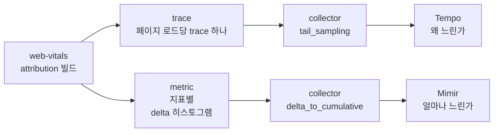

## Table of Contents

## 느린 화면은 알 수 있어도 원인은 알 수 없었다

앱 웹뷰에서 열리는 화면의 LCP p75가 나빠졌다. 대시보드에서 수치는 확인할 수 있었지만, 어떤 요소가 LCP였는지는 남아 있지 않았다. 기존 수집 코드는 web-vitals가 제공하는 `value`, `rating`, `id`만 보냈다. 대시보드에도 정해진 라벨로 집계한 값만 있어서 LCP 요소를 확인하려면 직접 재현해야 했다.

그래서 핵심 웹 지표(Core Web Vitals, 이하 CWV) 수집 코드를 새로 만들었다. web-vitals의 attribution 빌드로 다섯 지표와 원인 분석에 필요한 값을 직접 수집하고, OpenTelemetry(이하 OTel)로 두 곳에 나눠 보낸다. 원인 분석용 trace는 Grafana Tempo로, 운영 모니터링용 metric은 Grafana Mimir로 보낸다. 수집 코드의 구조와 페이지를 떠나는 순간의 전송은 [2편](/2026/10/cwv-send-on-page-leave)에서 다뤘다. 이번에는 전송한 값이 앱 웹뷰와 공용 관측 인프라를 거치면서 어디서 누락됐는지 살펴본다.

collector 이후의 관측 인프라는 여러 팀이 함께 쓰고 있어서 내가 설정을 바꿀 수 없었다. collector의 마지막 처리 단계에는 수집된 span을 보고 trace의 저장 여부를 결정하는 tail sampling이 적용돼 있었다. trace에서 metric을 만드는 spanmetrics는 리소스 부담 때문에 사용할 수 없었다. 운영 metric에는 정해진 라벨만 허용했고, 요소 selector처럼 값의 종류가 계속 늘어나는 라벨은 쓸 수 없었다. 화면이 iOS와 Android 앱의 웹뷰에서 열린다는 점까지 고려해 수집 방식을 정해야 했다.

> 별도로 밝힌 경우를 제외하면 글의 수치는 공개 재현 환경([blog-experiments/cwv-otel-grafana](https://github.com/yceffort/blog-experiments/tree/de1d59f0e390298ec78b7f4c6a8aade1dc4250ae/cwv-otel-grafana), 커밋 `de1d59f` 기준)에서 측정했다. 재현 환경에 없는 iOS 웹뷰의 동작은 실제 앱에서 직접 확인했으며, 해당 부분에 따로 표시했다. 코드 인용도 이 커밋을 기준으로 하고, 초기 구현은 태그 `cwv-otel-grafana-v1`로 구분했다.
>
> 재현 환경의 기본 버전은 web-vitals 6.2.3, OTel JS 2.12.0(OTLP exporter 0.223.0), OpenTelemetry Collector contrib 0.162.0, Tempo 3.1.0, Mimir 3.2.2, Grafana 13.2.4다. 여러 브라우저가 같은 시리즈에 값을 보내는 실험(E9, E10)은 collector contrib 0.163.1에서 측정했다. 0.162.0에서 측정한 E1과 E4도 0.163.1에서 다시 실행해 같은 결과를 얻었다. gateway를 둔 실험(E11)은 Node.js 24.20.0에서 실행했다. 브라우저는 Playwright 1.64.1의 Chromium 156을 사용했고, 버전별 차이를 확인할 때는 Tempo 2.10.8을 함께 실행했다. 인용한 소스는 해당 버전의 태그로 고정했다.

## 원인 분석용 trace와 운영 metric을 나눈 이유

원인을 분석할 때는 페이지 로드 하나를 trace 하나로 만들고, 그 아래에 지표별 span을 두는 방식이 가장 편했다. span에 attribution 값을 속성으로 넣으면 TraceQL로 조건을 걸어 조회할 수 있다. 다만 공용 인프라는 모든 페이지 로드에서 보내는 trace를 감당할 규모로 설계되어 있지 않았고, spanmetrics도 사용할 수 없었다. trace는 운영 전 검증 환경에서만 수집하고, 운영에서는 브라우저가 직접 metric을 만들어 보내기로 했다.



metric은 미리 집계해서 보내므로 수집할 때 정한 항목만 조회할 수 있다. Mimir에서는 화면별 LCP p75와 변화 추이를 확인할 수 있지만, 어떤 요소가 LCP였는지는 알 수 없다. 그 원인은 검증 환경에서 재현한 뒤 Tempo로 찾아야 한다. 운영 데이터만으로 LCP 요소를 확인하지 못하는 한계는 남지만, 공용 인프라의 제약 안에서는 이 구성이 적절하다고 판단했다.

## 웹뷰를 떠날 때 hidden 이벤트가 오지 않았다

2편에서 확인했듯이, 페이지를 떠날 때 처음 보고되는 지표가 있다. FCP가 보고된 페이지 로드의 CLS, 처리된 상호작용이 있는 페이지의 INP, 입력 없이 떠나는 페이지의 LCP가 그렇다. web-vitals는 `visibilitychange` 이벤트에서 hidden 상태를 확인해 이 시점을 감지한다. 그런데 앱 웹뷰에서는 이 이벤트가 오지 않는 경우가 있었다.

iOS 앱 웹뷰에서 화면을 연 뒤 5초 동안 아무것도 누르지 않고, 네 가지 방법으로 화면을 벗어났다. 앱이 웹뷰에 보내는 일시정지 이벤트(아래 표의 pause)도 함께 기록했다. [1편](/2026/10/web-vitals-report-timing)에서 확인한 것처럼 WebKit은 iOS 26.2부터 LCP와 INP를 보고하며, CLS는 보고하지 않는다. 아래 표의 LCP도 iOS 26.2 이상의 웹뷰에서 확인했다.

| 떠나는 방법           | 받은 신호     | LCP                       |
| --------------------- | ------------- | ------------------------- |
| 앱을 백그라운드로     | pause, hidden | 있음                      |
| 앱 안의 다른 탭으로   | hidden, pause | 있음                      |
| 앱 전환기에서 앱 종료 | pause만       | 없음                      |
| 새 화면을 push        | pause만       | 있음(그 전에 탭해서 확정) |

> 실제 앱의 iOS 웹뷰에서 직접 확인한 결과다.

앱 전환기에서 앱을 닫거나 웹뷰 위에 새 화면을 띄우면 `visibilitychange`, `pagehide`, window `blur`가 모두 오지 않았다. 이 경우에는 웹 표준 이벤트로 이탈을 감지할 수 없었다. pause는 서비스마다 따로 등록해야 하는 앱 브릿지 이벤트여서 LCP 확정 조건으로 쓰지 않았다. MDN의 브라우저 호환성 데이터(BCD)에는 iOS Safari 14.5부터 `visibilitychange`를 지원한다고 나오지만, 이런 이탈 경로에서도 이벤트가 발생하는지는 실제 앱에서 확인해야 했다.

LCP를 확정하는 방법에는 네 가지 조건을 두었다. 웹 표준 신호만 사용하고, 페이지당 LCP는 하나만 남겨야 했다. LCP가 늦게 나타나는 페이지에서 중간 후보를 최종값으로 기록해서도 안 되고, 짧게 머물다 떠나는 세션의 값도 수집해야 했다. 짧은 체류의 기준은 8초로 정했다.

| 방법                         | 맞지 않은 이유                                                                                             |
| ---------------------------- | ---------------------------------------------------------------------------------------------------------- |
| 고정 10초 뒤 확정            | 8초에 프로세스가 끝나면 타이머가 돌지 않는다                                                               |
| 고정 3~5초 뒤 확정           | LCP가 그보다 느린 페이지는 중간 후보에서 잘려 수치가 좋게 치우친다                                         |
| 후보가 바뀔 때마다 전송      | 페이지당 span이 여러 개가 되어 metric에서 마지막 후보를 고를 수 없다                                       |
| 누락을 받아들임              | 빨리 떠나는 세션이 빠져 iOS 수치가 좋게 치우칠 수 있다                                                     |
| 네트워크 idle 1초, 상한 30초 | 웹소켓과 주기 조회가 있는 화면이라 idle이 잘 오지 않을 것으로 보았고, 상한 30초로는 8초 이탈을 잡지 못한다 |

처음에는 후보가 3초 동안 바뀌지 않으면 그 값으로 확정했다. 새 후보가 나올 때마다 타이머를 다시 시작하므로, LCP가 늦게 나타나더라도 기다릴 수 있을 것으로 봤다. 대기 시간을 3초로 정한 이유는 8초 안에 전송을 마치려면 마지막 후보 이후에 기다릴 시간이 몇 초뿐이었기 때문이다. web-vitals의 확정과 quiet 타이머 중 먼저 끝난 값만 페이지당 한 번 내보내도록 했다. 이 방식을 재현한 코드는 태그 `cwv-otel-grafana-v1`에 있다.

```ts
// cwv-otel-grafana/demo-web/src/telemetry/lcp-gate.ts (태그 cwv-otel-grafana-v1)
export function createLcpGate(
  emit: (metric: LCPMetricWithAttribution, finalizedBy: LcpFinalizer) => void,
  quietMs = 3000,
) {
  let settled = false;
  let timer: ReturnType<typeof setTimeout> | undefined;

  const settle = (metric: LCPMetricWithAttribution, by: LcpFinalizer) => {
    if (settled) return;
    settled = true;
    clearTimeout(timer);
    emit(metric, by);
  };

  return {
    /** `onLCP(..., { reportAllChanges: true })` 의 후보 */
    candidate(metric: LCPMetricWithAttribution) {
      if (settled) return;
      clearTimeout(timer);
      timer = setTimeout(() => settle(metric, 'quiet'), quietMs);
    },
    /** `onLCP(...)` 의 정식 확정값 */
    final(metric: LCPMetricWithAttribution) {
      settle(metric, 'web-vitals');
    },
  };
}
```

후보는 `onLCP(gate.candidate, { reportAllChanges: true })`로, 정식 확정값은 `onLCP(gate.final)`로 받는다. `reportAllChanges`를 켜면 확정 시점에 값이 바뀌지 않은 경우 콜백이 다시 호출되지 않는다. `src/lib/bindReporter.ts`에서 delta가 0이면 보고하지 않기 때문이다. 후보를 받는 구독만으로는 확정 시점을 알 수 없어서 구독을 따로 두었다. quiet로 확정한 값은 곧바로 flush했다. BatchSpanProcessor의 기본 지연인 5초를 기다리면 8초 만에 떠나는 페이지에서 전송하지 못할 수 있었다.

### quiet 타이머가 늦게 나타난 LCP를 놓쳤다

후보가 3초 동안 바뀌지 않았더라도 이후에 더 큰 요소가 그려질 수 있다. 이 경우를 확인하려고 재현 환경에서 본문을 5초 뒤에 그리는 페이지(`?lcp=5000`)에 입력 없이 7초 머물렀다. 처음 구현한 코드는 LCP를 56ms로 기록했다. 먼저 그려진 제목이 3초 동안 LCP 후보로 유지되자 quiet 타이머가 그 값으로 확정한 것이다. 본문이 그려진 뒤 web-vitals가 보고한 정식값은 이미 확정을 마쳤다는 이유로 버렸다. quiet 확정값도 정식값과 같은 histogram에 넣었기 때문에 Mimir에서는 이 56ms를 정식 확정값과 구분할 수 없었다.

> Playwright 1.64.1의 Chromium 156에서 확인했다. `cwv-otel-grafana/experiments/e12-browser-lifecycle`.

이 결과를 보고 재현 환경의 수집 코드를 바꿨다. quiet 타이머가 끝나면 잠정값으로 내보내되, 이후 web-vitals가 정식값을 보고할 수 있도록 했다.

```ts
// cwv-otel-grafana/demo-web/src/telemetry/lcp-gate.ts
export function createLcpGate(
  emit: (metric: LCPMetricWithAttribution, finalizedBy: LcpFinalizer) => void,
  quietMs = 3000,
) {
  let finalized = false;
  let timer: ReturnType<typeof setTimeout> | undefined;

  return {
    /** `onLCP(..., { reportAllChanges: true })` 의 후보 */
    candidate(metric: LCPMetricWithAttribution) {
      if (finalized) return;
      clearTimeout(timer);
      timer = setTimeout(() => emit(metric, 'quiet'), quietMs);
    },
    /** `onLCP(...)` 의 정식 확정값 */
    final(metric: LCPMetricWithAttribution) {
      if (finalized) return;
      finalized = true;
      clearTimeout(timer);
      emit(metric, 'web-vitals');
    },
  };
}
```

잠정값은 `cwv.lcp.quiet`라는 별도 span으로 남기고 histogram에는 넣지 않는다. 수정한 코드로 같은 페이지를 측정하니 잠정값 72ms와 정식값 5080ms가 각각 기록됐고, histogram에는 5080ms가 들어갔다. 잠정값을 내보낼 때는 trace만 flush한다. metric까지 flush하면 2편에서 확인한 forceFlush의 대기가 발생해, export가 진행 중일 때 페이지를 떠나면 CLS와 INP를 잃을 수 있다.

다만 hidden 이벤트가 오지 않는 웹뷰에서는 여전히 LCP가 누락된다. web-vitals가 정식값을 확정하지 못하면 잠정값만 남으므로 histogram에 넣을 값이 없다. 잠정값을 집계에 활용하려면 이후 정식값이 왔을 때 교체할 수 있어야 한다. 뒤에서 설명할 gateway에는 이 처리를 넣었다. 마지막 후보가 나온 뒤 3초 안에 입력 없이 떠나면 잠정값도 수집하지 못하는 한계는 남는다.

## tail sampling에서 root만 도착한 trace가 누락됐다

처음 trace를 보냈을 때 collector는 `200 {"partialSuccess":{}}`로 응답했지만 Tempo에는 CWV span이 없었다. 같은 페이지 로드에서 자동 계측으로 만든 span은 저장돼 있었다. 공용 collector의 tail sampling은 15초를 기다린 뒤 span이 2개 미만인 trace를 버리도록 설정돼 있었다. 재현 환경에도 같은 정책을 적용해 span을 보내는 순서와 간격에 따라 결과가 달라지는지 확인했다.

| 경우 | 보낸 순서                                                  | Tempo에 남은 span       |
| ---- | ---------------------------------------------------------- | ----------------------- |
| A    | root와 FCP를 한 요청으로, 90초 뒤 LCP                      | page, fcp, lcp          |
| B    | root 먼저, 5초 뒤 FCP                                      | page, fcp               |
| C    | root만, 90초 뒤 LCP                                        | 없음                    |
| D    | A처럼 보낸 뒤 메모리에서 밀려나고, LCP 하나                | page, fcp(**LCP 유실**) |
| E    | A처럼 보낸 뒤 메모리에서 밀려나고, CLS와 INP를 한 요청으로 | page, fcp, cls, inp     |

> 2회 실행해 같은 결과를 얻었다. D와 E는 `num_traces`를 5로 줄인 collector에서 다른 trace 10개를 먼저 보내 기존 trace가 메모리에서 삭제되도록 했다. `cwv-otel-grafana/experiments/e1-tail-sampling`.

A에서는 저장하기로 결정한 trace에 90초 뒤 span을 보내도 저장됐다. collector 0.162.0의 소스에서 그 이유를 확인할 수 있었다. 판정 결과를 저장하는 캐시(`decision_cache`)는 기본 크기가 0이라 사용하지 않는다. 하지만 판정이 끝난 trace와 그 결과는 메모리(`idToTrace`)에 남아 있어서, 늦게 도착한 span에도 기존 판정을 적용한다[^1].

```go
// opentelemetry-collector-contrib v0.162.0 processor/tailsamplingprocessor/processor.go (processTrace)
switch finalDecision {
case samplingpolicy.Sampled:
    traceTd := ptrace.NewTraces()
    appendToTraces(traceTd, rss)
    if tsp.useTracestate {
        sampling.WriteEffectiveThreshold(tsp.ctx, traceTd, actualData.FinalThreshold, tsp.telemetry.ProcessorTailSamplingCountSpansWithUnparseableTracestate)
    }
    tsp.forwardSpans(tsp.ctx, traceTd)
case samplingpolicy.NotSampled:
```

메모리에 유지할 수 있는 trace 수의 상한은 `num_traces`(기본 50000)이며, 이를 넘으면 `waitForSpace`에서 가장 오래된 trace부터 지운다. 삭제된 trace의 span이 도착하면 새 trace로 처리해 다시 15초 뒤 판정한다. D처럼 span이 1개면 버리고, E처럼 2개 이상이 한 요청으로 도착하면 저장한다. A에서 90초 뒤의 span을 저장할 수 있었던 이유는 재현 환경의 트래픽이 적어 trace가 아직 메모리에 남아 있었기 때문이다.

trace를 검증 환경에서만 수집하더라도 collector를 다른 서비스와 함께 쓰므로, 지표를 늦게 보낼수록 해당 trace가 메모리에서 이미 삭제됐을 가능성이 커진다. 페이지를 떠날 때 CLS와 INP를 함께 보내는 Android보다, CLS를 보고하지 않아 INP만 보내는 iOS에서 손실이 더 클 수 있다고 생각한다. 다만 재현 환경에서 두 환경의 손실 비율을 측정하지는 않았다.

C에서는 페이지 시작 시점에 먼저 보낸 root만으로 판정이 끝났다. 이 trace를 버리기로 결정하면 이후 도착한 지표 span도 버린다. 이를 피하려고 첫 지표가 나오는 순간에 root를 만들고 바로 종료했다. 첫 지표 span도 같은 tick에 종료해 BatchSpanProcessor가 같은 배치로 내보내도록 했다.

```ts
// cwv-otel-grafana/demo-web/src/telemetry/page-trace.ts
return function record(name: string, durationMs: number, attributes: Attributes, visitStart = 0): void {
  let visit = visits.get(visitStart);
  if (!visit) {
    const start = performance.timeOrigin + visitStart;
    const root = tracer.startSpan('cwv.page', { startTime: start });
    root.end();
    visit = { parent: trace.setSpan(ROOT_CONTEXT, root), base: getBaseAttributes(), start };
    visits.set(visitStart, visit);
  }

  // 지표 span 은 보고 시각에 끝나고 길이가 값이다. CLS 는 점수를 ms 로 바꾼 길이라 방문 시작(root)보다 앞서
  // 시작할 수 있는데, 그때는 방문 시작에서 시작하도록 span 을 뒤로 민다. 길이는 그대로다.
  const start = Math.max(performance.timeOrigin + performance.now() - durationMs, visit.start);
  tracer
    .startSpan(name, { startTime: start, attributes: { ...visit.base, ...attributes } }, visit.parent)
    .end(start + durationMs);
};
```

처음 로드와 bfcache 복원을 각각 하나의 내비게이션으로 보고, root는 내비게이션마다 만든다. 시작 시각은 web-vitals가 제공하는 `navigationStartTime`이다. web-vitals는 bfcache에서 복원된 페이지의 지표도 새로 측정한다. 문서당 root를 하나만 두면 복원 후의 지표가 처음 로드의 trace에 섞이고, 내비게이션마다 하나씩 기록해야 할 LCP도 버려진다. 재현 환경에서 2개 페이지를 오가며 뒤로 가기와 앞으로 가기로 3회 복원했을 때, 문서마다 root를 두면 root는 2개였고 복원 시점의 LCP 3개가 누락됐다. 내비게이션마다 root를 두면 root가 5개 생성됐다(E12).

root를 바로 종료하는 동작도 단위 테스트로 확인한다. root를 종료하지 않으면 root와 첫 span이 같은 export 호출로 나가는지 검사하는 테스트가 실패한다. 지표 span의 시작 시각은 보고 시각에서 지표 값만큼 거슬러 계산한다. CLS는 점수를 1000배 한 값을 span 길이로 쓰므로 계산한 시작 시각이 내비게이션 시작보다 이를 수 있다. 이때는 자식 span이 root보다 먼저 시작하지 않도록 시작 시각을 내비게이션 시작에 맞추고, 길이는 유지한다.

## 샘플이 5분 넘게 없으면 누적값이 초기화된다

metric 경로에서는 집계한 건수가 보낸 건수보다 적었다. 공용 collector의 `delta_to_cumulative`는 브라우저가 보낸 delta(증분값)를 누적값으로 바꿔 Mimir에 쓴다. 이 과정에서 일정 시간 새 샘플이 없는 시리즈의 누적값을 삭제한다.

```go
// opentelemetry-collector-contrib v0.162.0 processor/deltatocumulativeprocessor/processor.go
case <-tick.C:
    now := time.Now()
    p.stale.Range(func(id identity.Stream, last time.Time) bool {
        if now.Sub(last) > p.cfg.MaxStale {
            p.last.nums.LoadAndDelete(id)
            p.last.hist.LoadAndDelete(id)
            p.last.expo.LoadAndDelete(id)
            p.stale.Delete(id)
        }
        return true
    })
```

`max_stale`의 기본값은 5분이며, 삭제할 시리즈가 있는지는 1분마다 검사한다(`time.NewTicker(time.Minute)`). 따라서 마지막 샘플을 받은 뒤 5분에서 6분 사이에 누적값이 삭제된다. 이후 같은 라벨 조합의 delta가 도착하면 그 값부터 다시 누적한다. 아래 실험은 건수가 1인 delta를 보내므로 1부터 시작한다.

재현 환경에서는 `max_stale`을 기본값인 5분으로 둔 collector와 `max_stale: 15m`으로 늘린 collector에 같은 delta를 동시에 보냈다. 0, 1, 2, 4.5분에 1회씩 보내고, 이후 6분 간격으로 2회 보냈다. 이어서 1분 뒤와 5.5분 뒤에 다시 보냈다.

| collector             | 보낸 건수 | Mimir에 쓰인 누적값            | `increase()` | `resets()` |
| --------------------- | --------- | ------------------------------ | ------------ | ---------- |
| `max_stale` 5분(기본) | 8         | 1, 2, 3, 4, **1**, **1**, 2, 3 | 6.40         | 1          |
| `max_stale` 15분      | 8         | 1, 2, 3, 4, 5, 6, 7, 8         | 7.47         | 0          |

> 같은 일정으로 2회 실행해 같은 결과를 얻었다. `cwv-otel-grafana/experiments/e4-delta-expiry`.

기본 설정에서는 6분 공백 이후 2회 모두 누적값이 삭제돼 1부터 다시 시작했다. Prometheus는 값이 4에서 1로 줄어든 첫 번째만 리셋으로 처리했다. 두 번째는 이전 값과 새 값이 모두 1이어서 리셋이나 증가로 처리하지 않았다. 5.5분 공백에서는 삭제 검사 전에 다음 샘플이 도착해 누적값이 유지됐다.

만료 시간을 15분으로 늘린 collector에서도 `increase()`는 보낸 8건보다 작은 7.47이었다. 첫 샘플 이전의 값이 없어서 첫 1건을 증가분에 포함하지 못하고, 조회 구간 끝까지 외삽하기 때문이다. 이 차이는 누적값 만료와 무관하다.

트래픽이 드문 라벨 조합에서는 누적값이 1로 초기화되는 일이 반복되기 쉽다. 직전 값도 1이면 `increase()`는 증가분을 0으로 계산하므로 집계한 건수가 실제보다 작아진다. collector 인스턴스가 여러 개면 같은 라벨의 샘플도 인스턴스별로 누적한다. 각 인스턴스가 받는 샘플의 간격은 전체 트래픽으로 예상한 것보다 길어진다. 라벨 조합마다 샘플이 하나뿐이면 `increase()`가 비교할 값이 없어 0이 된다. 방문이 드문 블로그에서 이 구성으로 수집했을 때 대시보드가 비어 있던 사례는 4편에서 다룬다.

분위수와 good 비율은 버킷 간 비율로 계산하므로 건수보다 영향이 작다. 건수는 실제와 크게 달라질 수 있어서, 대시보드 패널에 페이지 로드 수로 사용하지 않도록 설명을 붙였다.

## 한 시리즈에 여러 브라우저가 쓸 때

앞의 실험에서는 브라우저 하나가 자기 시리즈에 값을 순서대로 보냈다. 트래픽이 적은 검증 환경에서도 같은 라벨 조합에 여러 브라우저가 동시에 값을 보내는 일은 드물다. 운영에서는 같은 화면, 탐색 종류, 등급에 해당하는 값을 여러 브라우저가 동시에 보낸다. 이 차이가 집계에 영향을 주는 이유는 `delta_to_cumulative`의 누적 처리 코드에서 확인할 수 있다[^2].

```go
// opentelemetry-collector-contrib v0.162.0 processor/deltatocumulativeprocessor/internal/delta/delta.go
func Aggregate[T Type[T]](state, dp T, aggregate func(state, dp T) error) error {
    switch {
    case state.Timestamp() == 0:
        // first sample of series, no state to aggregate with
        dp.CopyTo(state)
        return nil
    case dp.StartTimestamp() < state.StartTimestamp():
        // belongs to older series
        return ErrOlderStart{Start: state.StartTimestamp(), Sample: dp.StartTimestamp()}
    case dp.Timestamp() <= state.Timestamp():
        // out of order
        return ErrOutOfOrder{Last: state.Timestamp(), Sample: dp.Timestamp()}
    }
```

시리즈의 시작 시각은 처음 받은 값의 시작 시각으로 정한다. 이후 값은 시작 시각이 그보다 이르면 안 되고, 샘플 시각은 지금까지 받은 가장 늦은 시각보다 늦어야 한다. 조건을 만족하지 않으면 버린다. 한 프로세스가 자기 시리즈를 순서대로 보낸다고 가정한 처리다. `ErrOlderStart`의 오류 메시지도 "같은 시리즈를 보내는 프로세스가 여러 개인지 확인하라(consider checking for multiple processes sending the exact same series)"고 안내한다.

브라우저에서는 이 가정이 맞지 않는다. 시리즈는 라벨 조합과 resource 속성으로 구분하는데, 재현 환경의 수집 코드는 resource 속성이 `service.name` 하나뿐이다. 같은 라벨 조합을 보내는 모든 브라우저의 값이 한 시리즈에 들어가며, 시각은 각 브라우저의 시계로 기록한다.

먼저 시계가 어긋난 브라우저 3개에서 같은 라벨 조합의 LCP를 1건씩, 3초 간격으로 보냈다. 첫 번째 브라우저의 시계는 정확하고, 두 번째는 2분 느리고, 세 번째는 30초 빠르도록 했다. 재현 환경의 collector는 두 번째 값을 버렸다. collector 로그에는 기록이 없었고, 버린 건수는 자체 메트릭 `otelcol_deltatocumulative_datapoints{error="delta.ErrOlderStart"}`에만 남았다.

> 2회 실행해 같은 결과를 얻었다. `cwv-otel-grafana/experiments/e9-client-clock`.

트래픽에 따른 손실 비율도 확인했다. OTLP 요청을 직접 만들어 여러 브라우저가 한 시리즈에 LCP를 1건씩 보내는 상황을 재현했다. 페이지 로드는 Poisson 과정에 따라 무작위로 발생하고, 각 값은 50\~550ms의 네트워크 지연을 거쳐 도착하도록 했다. 값의 시작 시각은 브라우저의 export 주기를 재현하기 위해 샘플 시각보다 0\~10초 앞에 두었다. 먼저 모든 브라우저의 시계가 정확한 조건에서 측정했다.

| 시리즈 하나에 초당 | 보낸 건수  | `delta_to_cumulative`(재현 환경 구성) | 받은 시각으로 바꿔 delta 그대로 저장 |
| ------------------ | ---------- | ------------------------------------- | ------------------------------------ |
| 1건                | 69, 66     | 14.5%, 9.1%                           | 0%, 0%                               |
| 10건               | 603, 539   | 43.8%, 40.6%                          | 1.5%, 1.3%                           |
| 50건               | 3056, 3023 | 75.4%, 75.1%                          | 7.5%, 6.7%                           |

> 보낸 건수 중 Mimir에서 조회되지 않은 비율이다. 2회 실행한 값을 차례로 적었다. 네트워크 지연의 분포는 실측이 아니라 가정이다. `cwv-otel-grafana/experiments/e10-concurrent-writers`.

시계가 모두 정확해도 도착 순서가 바뀌면 값을 잃었다. 나중에 수집한 값이 네트워크 지연이 짧아 먼저 도착하면 시리즈의 시각이 갱신된다. 이보다 먼저 수집했지만 뒤늦게 도착한 값은 `ErrOutOfOrder`로 버린다. 같은 입력에 앞의 두 규칙을 도착 순서대로 적용해 계산하면, 초당 1건 조건에서는 59건이 남고 시작 시각 조건으로 1건, 도착 순서 조건으로 9건이 제외된다. 시작 시각 조건에 걸린 1건은 먼저 시작한 브라우저의 값이 늦게 도착해 시리즈보다 이른 시작 시각을 가진 경우였다.

계산 결과는 collector 자체 메트릭으로 측정한 건수와 같았다. 7개 시나리오를 2회씩 실행한 결과, 14회 중 12회는 계산값과 측정값이 일치했고 나머지 2회도 각각 1건만 달랐다. 측정한 손실 대부분을 이 두 규칙으로 설명할 수 있었다.

표의 오른쪽 열은 `delta_to_cumulative`를 빼고 Mimir에 delta를 그대로 저장하되, 시각을 collector가 받은 시각으로 바꾼 구성이다. 도착 순서로 인한 손실은 사라졌지만, 초당 10건부터는 같은 밀리초에 받은 표본의 시각이 중복돼 Mimir가 버렸다. 공용 collector에서는 적용할 수 없었던 구성이다. 직접 운영하는 블로그에 이 구성을 적용한 과정은 4편에서 다룬다.

시계가 어긋난 조건에서는 손실이 더 컸다. 초당 2건이 들어오는 시리즈에 시계가 60초 빠른 브라우저 하나를 추가하자 시리즈의 시각이 60초 앞으로 갱신됐고, 이후 60초 동안 들어온 값은 모두 버려졌다. 2회 실행한 결과 Mimir의 누적 시리즈에 각각 60.2초와 60.1초의 공백이 생겼고, 손실 비율은 57.1%와 58.1%였다. 시계가 2시간 빠른 브라우저 하나를 추가했을 때는 이후 7분 동안 한 건도 남지 않았으며, 손실 비율은 98.9%와 98.5%였다. 2시간 빠른 표본 자체도 Mimir에 저장되지 않았다. Mimir는 기본 설정(`-validation.create-grace-period`)에서 현재보다 10분 넘게 앞선 표본을 받지 않기 때문이다.

7분이면 앞에서 확인한 만료 시간인 5분이 지났는데도 시리즈가 초기화되지 않았다. 누적 처리에서 버리는 값도 만료 타이머를 갱신하기 때문이다[^3].

```go
// opentelemetry-collector-contrib v0.162.0 processor/deltatocumulativeprocessor/processor.go (ConsumeMetrics)
// stream is ok and active, update stale tracker
p.stale.Store(id, now)

if !loaded {
    // cached zero was stored, alloc new one
    zero.hist = guard(pmetric.NewHistogramDataPoint())
}

last.use(func(last pmetric.HistogramDataPoint) {
    err = p.aggr.Histograms(last, dp)
    last.CopyTo(dp)
})
```

마지막 수신 시각은 집계 전에 갱신한다. 들어온 값을 모두 버리더라도 계속 수신하는 동안에는 시리즈가 만료되지 않는다. 따라서 트래픽이 이어지면 브라우저의 시계가 앞선 시간만큼 수집 공백도 유지된다.

실제 브라우저의 시계 편차를 참고할 자료도 찾아봤다. 찾을 수 있었던 공개 자료는 2014년에 하루 3억 페이지 로드에서 브라우저의 `Date()`와 서버 시각을 비교한 결과였다[^4]. 시각 차이의 절댓값을 5분 단위로 묶었을 때 90%가 5분 미만, 99%가 115분 미만, 99.9%가 25.5시간 미만이었다. 어긋난 시계 중 약 57%는 서버보다 앞서 있었다.

공개된 백분위 경계와 앞선 시계의 비율을 바탕으로 편차를 생성해 같은 실험을 했다. 편차가 5분 미만인 90%는 0으로 두고, 나머지는 각 구간 안에서 균등하게 뽑았다. 이 조건에서 초당 1건일 때 손실 비율은 92.0%와 95.6%였고, 초당 10건에서는 2회 모두 99.9%였다. 이 수치는 실제 관측 분포를 그대로 적용한 측정값이 아닌, 2014년 자료의 백분위에 맞춰 만든 모델의 결과다. 편차를 0으로 둔 가정이 손실을 최소화한다고 볼 근거도 없으므로 손실 비율의 하한으로 사용할 수는 없다.

이 실험에서는 서버보다 앞선 시각의 값이 처음 도착하면 이후에는 그보다 더 앞선 값만 누적 처리 조건을 통과했다. 이 값들도 대부분 Mimir의 10분 유예를 넘어 저장되지 않았다. Mimir에는 앞선 시각의 값이 도착하기 전에 받은 몇 건만 남았다. 초당 1건에서는 앞선 시각의 값이 언제 도착하는지, 편차가 얼마인지에 따라 손실 비율이 크게 달랐다. 초당 10건에서는 2회 모두 시작 후 몇 초가 지나자 저장되는 값이 없었다.

2014년 자료는 미국, 캐나다, EU 사이트에 치우쳐 있다. 당시에는 네트워크로 시계를 맞추는 지금의 휴대폰보다 시계가 부정확한 PC가 많았을 것으로 추정한다. 따라서 앱 웹뷰의 실제 시계 편차는 이 자료보다 훨씬 작을 가능성이 높다. 다만 앞의 실험처럼 시계가 몇 분 빠른 브라우저 하나만 있어도 그 시간 동안 같은 시리즈의 다른 값이 누락될 수 있다. 그 사이 누적 처리 조건을 통과하는 값은 시계가 더 앞선 브라우저에서 보낸 값뿐이다.

운영 환경의 손실 비율은 측정하지 못했다. 보낸 건수와 받은 건수를 대조하지 않았고, resource 속성과 collector 인스턴스 구성에 따라 스트림을 나누는 방식도 달라질 수 있다. 재현 환경에서 확인한 것은 같은 시리즈에 동시에 값을 보내는 브라우저가 많아질수록 손실이 커진다는 점이다. 트래픽이 적은 검증 환경에서 건수가 일치한 결과만으로는 운영에서도 같은 결과를 얻는다고 보기 어렵다.

### gateway에서 집계한 값을 공용 collector로 보내기

시리즈마다 값을 쓰는 주체(writer)가 하나가 되도록 하면 이 손실을 줄일 수 있을 것으로 봤다. 공용 collector의 설정을 바꾸는 대신 앞에 별도 집계 서버를 두는 방식이다. 재현 환경에 gateway를 만들어 집계 결과와 운영상 제약을 확인했다.

gateway는 문서, 내비게이션, 지표 이름으로 측정 단위를 구분한다. 보고마다 갱신 순서를 나타내는 revision을 붙이고, 기존보다 큰 revision을 받으면 값을 교체한다. 같거나 작은 revision은 버린다. 마지막 갱신 이후 30분 동안 새 보고가 없으면 값을 확정해 시리즈별 누적 히스토그램에 더하고, 주기적으로 collector에 전송한다. 시리즈의 writer는 gateway 하나이며 시각도 gateway에서 정한다.

시리즈를 처음 전송할 때는 값이 0인 샘플을 먼저 보낸다. 라벨 조합마다 샘플이 하나뿐이어서 `increase()`가 증가분을 계산하지 못하는 문제를 피하기 위해서다. 확정한 측정의 key와 아직 collector에 전송하지 않은 표본은 파일에 저장한다. 재시작 후 같은 보고를 다시 받아도 중복으로 세지 않고, 전송하지 못한 표본은 이어서 보낼 수 있도록 했다. 같은 보고를 재현 환경의 delta 경로에도 보내 결과를 비교했다.

| 경우                                  | 보낸 측정 | gateway가 저장 | delta 경로가 저장 |
| ------------------------------------- | --------- | -------------- | ----------------- |
| 같은 라벨 조합 30개를 동시에          | 30        | 30             | 1, 1              |
| 앞 실험의 초당 50건 입력              | 3056      | 3056           | 1199, 1202        |
| 앞 실험의 2014년 분포, 초당 10건 입력 | 1219      | 1219           | 35, 35            |

> 확정 시간을 2초로 줄여 2회 실행했다. gateway의 결과는 두 실행에서 같았고, 버킷 합계도 입력으로 계산한 값과 일치했다. delta 경로는 2회 실행한 값을 차례로 적었다. 여러 버킷에 걸친 값을 보내 등급 라벨에 따라 시리즈가 3개로 나뉘었기 때문에, delta 경로의 손실이 앞의 표보다 작게 나온 것으로 본다. `cwv-otel-grafana/experiments/e11-server-aggregation`.

revision을 두면 같은 id로 다시 보고되는 값도 반영할 수 있다. CLS와 INP는 페이지가 다시 보였다가 숨겨지면 같은 id로 보고된다. histogram은 보고마다 표본을 더하므로 재현 환경의 delta 경로에서는 중복 집계를 피하려고 같은 id의 첫 보고만 센다. 이 경우 사용자가 탭으로 돌아온 뒤 지표가 나빠져도 통계에는 반영되지 않는다.

재현 환경에서 페이지를 숨겼다가 다시 표시하고, 상단에 요소를 추가한 뒤 다시 숨겼다. delta 경로의 CLS는 첫 보고값인 0으로 남았다. gateway는 같은 측정의 revision 1(0)과 revision 2(0.1124)를 받아 마지막 값을 반영했다. 이 실험의 탭 전환은 `visibilityState`를 덮어써 재현했다(E12).

quiet 잠정값도 같은 방식으로 처리한다. 잠정값은 revision 1로, 정식값은 revision 2로 보내면 정식값이 도착했을 때 교체할 수 있다. 잠정값만 받은 측정은 `cwv.lcp.provisional`이라는 별도 시리즈로 집계한다. 정식값을 집계하는 `cwv.lcp`에 섞지 않으면서, hidden 이벤트가 오지 않아 잠정값만 남은 페이지 로드의 건수도 확인할 수 있다. 잠정값만 보낸 25건과 잠정값 이후 정식값도 보낸 25건은 각각 provisional 25건과 정식 25건으로 집계됐다(E11).

gateway를 두면서 생기는 제약도 있다. 값을 확정하기까지 30분을 기다리므로 대시보드 반영도 그만큼 늦고, 확정 이후의 갱신은 반영하지 못한다. 확정 전 측정은 메모리에만 저장해 gateway를 재시작하면 잃는다. 재시작 실험에서는 230건 중 확정 전이던 30건이 누락됐다. 확정한 측정의 key는 파일에 저장하므로 재전송한 100건은 모두 late로 처리했고, 중복 집계하지 않았다.

확정 전 측정의 key는 브라우저가 정한다. 메모리에 유지할 개수에 상한(기본 10만)을 두고, 이를 넘으면 새 측정을 받지 않도록 했다. gateway를 여러 대로 늘리면 같은 시리즈의 writer가 다시 여럿이 될 수 있어서 측정 단위로 분배하는 처리가 필요하다. 이 구성은 측정하지 않았다.

브라우저는 보고 묶음마다 요청을 보내므로 gateway의 응답 속도도 영향을 준다. 응답이 늦어지자 HTTP/1.1에서 origin당 연결 6개를 모두 사용했고, 대기 중이던 요청은 브라우저를 닫을 때 전송되지 못했다(E12). gateway로 공용 인프라의 제약을 일부 해결할 수 있었지만, 집계 상태와 응답 지연을 관리할 서버가 하나 더 필요해졌다.

## Tempo에 저장된 값이 조회 결과에서 빠지는 경우

### 최근 30분만 보이는 TraceQL metrics

공용 Tempo에서는 TraceQL metrics의 조회 범위를 몇 시간으로 잡아도 최근 30~40분의 값만 나왔다. 같은 구간을 trace로 검색하면 데이터가 있었지만, Tempo의 버전과 설정을 알 수 없어 원인은 확인하지 못했다. 이후 Tempo 3.0 릴리스 노트에서 TraceQL metrics의 `query_backend_after` 기본값이 30m에서 15m로 바뀌었다는 항목을 발견했다. 기존 기본값인 30분이 조회 범위와 관련 있을 것으로 보고, 재현 환경에 local-blocks 설정이 다른 Tempo 2.10.8 인스턴스 3개와 Tempo 3.1.0을 띄웠다. 같은 span을 10초마다 보낸 뒤 최근 60분의 데이터를 5분 구간별로 조회했다.

| Tempo  | local-blocks 설정                                       | 30분보다 오래된 구간 | 최근 30분 |
| ------ | ------------------------------------------------------- | -------------------- | --------- |
| 3.1.0  | (3.x에는 local-blocks가 없다)                           | 30                   | 30        |
| 2.10.8 | 기본값(`filter_server_spans: true`)                     | **0**                | **0**     |
| 2.10.8 | `filter_server_spans: false`, `flush_to_storage: false` | **0**                | 30        |
| 2.10.8 | `filter_server_spans: false`, `flush_to_storage: true`  | 30                   | 30        |

> 5분 구간마다 보낸 span은 30개다. 16:00과 16:23(UTC)에 2회 조회해 같은 결과를 얻었다. 세 번째 구성에서는 2회 모두 조회 시각에서 정확히 30분 이전을 경계로 값이 나오지 않았다. `cwv-otel-grafana/experiments/e5-tempo-metrics`.

`flush_to_storage: false`인 세 번째 구성에서 공용 Tempo와 같은 현상이 나타났다. 2.10.8의 query-frontend는 `query_backend_after`(기본 30분)를 기준으로 조회 구간을 나눈다[^5].

```go
// grafana/tempo v2.10.8 modules/frontend/metrics_query_range_sharder.go
cutoff                = time.Now().Add(-s.cfg.QueryBackendAfter)
```

```go
blocks := blockMetasForSearch(s.reader.BlockMetas(tenantID), start, end, func(m *backend.BlockMeta) bool {
    return m.ReplicationFactor == backend.MetricsGeneratorReplicationFactor
})
if len(blocks) == 0 {
    // no need to search backend
    close(reqCh)
    return
```

최근 30분은 metrics-generator의 local-blocks가 메모리와 로컬 디스크에 저장한 블록에서 계산한다. 그보다 오래된 구간은 백엔드 저장소에서 metrics-generator가 쓴 블록만 조회한다. `tempodb/backend/block_meta.go`를 보면 일반 쓰기 경로인 ingester가 만든 블록의 `ReplicationFactor`는 0(`DefaultReplicationFactor`)이고, metrics-generator가 만든 블록은 1(`MetricsGeneratorReplicationFactor`)이다. 위 코드는 값이 1인 블록만 선택하므로 ingester 블록은 조회 대상에서 빠진다.

`flush_to_storage: false`이면 local-blocks가 블록을 백엔드에 저장하지 않는다. 그 결과 30분이 지난 데이터는 trace 검색에는 나오지만 TraceQL metrics에는 나오지 않는다. 공용 Tempo의 설정을 확인하지 못했기 때문에 같은 원인으로 단정할 수는 없지만, 재현 결과로는 이 설정이 원인일 가능성이 높아 보였다.

두 번째 구성에서는 최근 구간에도 값이 없었다. 2.10.8의 local-blocks는 기본적으로 `filter_server_spans`를 켜 두며, 이때 `modules/generator/processor/localblocks/processor.go`의 `filterBatches`는 SERVER kind이거나 부모가 없는 span만 남긴다. 브라우저의 지표 span은 root의 자식이고 INTERNAL kind여서 모두 제외됐다. Tempo 3.x에서는 local-blocks 대신 live-store가 최근 구간을 처리하고, 이전 구간은 백엔드에서 조회한다. `query_backend_after`의 기본값도 15분으로 바뀌었다. 재현 환경의 3.1.0에서는 60분 전체를 조회할 수 있었다.

### 분위수는 2의 거듭제곱 버킷에서 보간한다

span 길이를 지표 값에 맞추면 `quantile_over_time(duration, .75)`로 p75를 구할 수 있다. 다만 Tempo는 원래 값에서 직접 분위수를 구하지 않으므로, 분포를 아는 span을 보내 오차를 확인했다. 10초마다 100, 300, 1000, 2500, 4000ms 길이의 span을 차례로 반복해 보내면 5분 동안 30개가 쌓인다. 이 표본에서 23번째 값인 p75는 2500ms지만, Tempo 3.1.0과 2.10.8은 모두 **1.913초**를 반환했다. 표본이 15개였던 마지막 구간에서는 2.147초가 나왔다.

계산 방식은 `pkg/traceql/engine_metrics.go`에 있다[^6].

```go
// grafana/tempo v3.1.0 pkg/traceql/engine_metrics.go
// Log2Bucketize rounds the given value to the next powers-of-two bucket.
func Log2Bucketize(v uint64) float64 {
    if v < 2 {
        return -1
    }

    return float64(uint64(1) << (64 - bits.LeadingZeros64(v-1)))
```

```go
    // Exponential interpolation between buckets
    // The current bucket represents the maximum value
    maxV := math.Log2(buckets[bucket].Max)
    var minV float64
    if bucket > 0 {
        // Prior bucket represents the min
        minV = math.Log2(buckets[bucket-1].Max)
    } else {
        // There is no prior bucket, assume powers of 2
        minV = maxV - 1
    }
    return math.Pow(2, minV+(maxV-minV)*interp), bucket
```

Tempo는 ns 단위의 span 길이를 다음 2의 거듭제곱으로 올림해 버킷에 넣는다. 100, 300, 1000ms는 각각 2^27, 2^29, 2^30ns 버킷에 들어가고, 2500ms와 4000ms는 2^32ns(4.295초) 버킷에 함께 들어간다. 23번째 표본은 2^32 버킷에 있는 12개 중 5번째다. 보간할 때는 바로 앞 버킷을 하한으로 쓰는데, 2^31 버킷은 비어 있어 목록에 없다. 따라서 2^30을 하한으로 두고 계산하면 2^(30 + 2 × 5/12)ns, 즉 1.913초가 나온다.

표본이 15개인 구간에서는 12번째 표본을 찾는다. 보간 비율이 절반이므로 결과는 2^31ns(2.147초)다. 표본이 적을 때 1.074초(2^30ns)나 2.147초(2^31ns)가 자주 나오는 이유도 이 계산 방식에 있다. 누적 표본 수가 찾는 순번과 일치하면 보간하지 않고 버킷 상한을 그대로 반환한다.

good의 경계인 2.5초는 2^31ns와 2^32ns 사이에 있다. 이 정밀도로는 p75가 경계 안에 있는지 판단하기 어렵다. 경계에 해당하는 버킷을 둔 Mimir의 good 비율로 등급을 확인하고, Tempo의 분위수는 "요소 A가 요소 B보다 느린가"처럼 요소별 차이를 비교할 때 사용하는 편이 적절하다고 생각한다.

### 분위수에서 빠지는 값

숫자 속성의 분위수는 duration과 다른 함수로 버킷을 만든다[^7].

```go
// grafana/tempo v3.1.0 pkg/traceql/ast_metrics.go
switch t {
case TypeInt:
    if f < 2 {
        return NewStaticNil(), false
    }
    // Bucket is the value rounded up to the nearest power of 2
    return NewStaticFloat(Log2Bucketize(uint64(f))), true
case TypeDuration:
    if f < 2 {
        return NewStaticNil(), false
    }
    // Bucket is log2(nanos) converted to float seconds
    return NewStaticFloat(Log2Bucketize(uint64(f)) / float64(time.Second)), true
default:
    // TODO(mdisibio) - Add support for floats, we need to map them into buckets.
    // Because of the range of floats, we need a native histogram approach.
    return NewStaticNil(), false
}
```

이 코드에서는 double 속성과 2보다 작은 값을 제외한다. double로 저장된 `span.e5.value_ms`와 CLS의 `span.cwv.value`는 `avg_over_time`으로 평균을 구할 수 있었지만, `quantile_over_time`에서는 시리즈가 하나도 나오지 않았다. duration도 `bucketizeDuration`에서 2ns 미만을 제외한다. CLS가 0인 페이지 로드는 span 길이도 0이므로 TraceQL 분위수에 포함되지 않는다.

재현 환경에서 35분 동안 수집한 CLS span은 841개였고, 그중 0이 아닌 값은 351개였다. Tempo의 p75는 0.0246이었다. 같은 시간 동안 Mimir는 840건을 받았고 CLS p75는 0.0088이었다. 같은 페이지 로드를 수집했는데 Tempo의 CLS p75가 약 2.8배 높았다. CLS가 0인 페이지가 많을수록 차이가 커지며, LCP의 리소스 요청 지연처럼 0이 자주 나오는 속성에서도 같은 문제가 생긴다.

조회 종료 시각에 따라서도 결과가 달라졌다. Tempo 3.1.0은 결과 구간을 step의 배수 시각에 맞추는데, 조회 종료 시각이 여기에 맞지 않으면 마지막 구간을 반환하지 않았다. 15:47에 30분 step으로 조회했을 때는 15:30 이후 데이터가 빠졌다. 같은 조회를 2회 확인했고, 2.10.8에서는 마지막 구간도 반환했다. Grafana 패널처럼 step이 작으면 빠지는 구간도 짧지만, 스크립트에서 1시간 step으로 조회하면 최근 1시간이 0으로 보일 수 있다. 이 글의 Tempo 수치는 모두 조회 종료 시각을 step의 배수에 맞춰 측정했다.

표본이 없는 구간을 표시하는 방식도 함수마다 다르다. `quantile_over_time`은 값이 비어 있는 sample을 반환하고 Grafana는 이를 0으로 표시한다. `avg_over_time`은 해당 구간을 결과에서 제외한다. 따라서 분위수 패널에 나타나는 0은 표본이 없어서 표시된 값일 수 있다.

### 숫자 속성은 값에 따라 타입이 바뀐다

대시보드를 만들면서 CLS를 일으킨 요소별 건수 패널이 비어 있는 것을 발견했다. 사용한 쿼리는 `{name="cwv.cls" && span.cwv.value > 0}`였다. 같은 구간에서 조건만 바꿔 건수를 비교했다.

| 조건                                     | 30분 동안 건수 |
| ---------------------------------------- | -------------- |
| `name="cwv.cls"`                         | 812            |
| `name="cwv.cls" && span.cwv.value > 0`   | 0              |
| `name="cwv.cls" && span.cwv.value > 0.0` | 344            |
| `name="cwv.lcp"`                         | 811            |
| `name="cwv.lcp" && span.cwv.value > 0`   | 811            |
| `name="cwv.lcp" && span.cwv.value > 0.0` | 0              |

> Tempo 3.1.0에서 같은 30분 구간을 조건만 바꿔 셌다.

OTel JS는 숫자 속성을 OTLP로 바꿀 때 정수면 `intValue`, 아니면 `doubleValue`로 보낸다[^8].

```ts
// opentelemetry-js experimental/v0.223.0 experimental/packages/otlp-transformer/src/common/internal.ts
if (t === 'number') {
  if (!Number.isInteger(value)) return { doubleValue: value as number };
  return { intValue: value as number };
}
```

같은 `cwv.value` 속성이라도 CLS가 0.008이면 double로, 0이면 int로 저장된다. Tempo 3.1.0에서는 정수 리터럴(`> 0`)을 쓰면 int 값만, 실수 리터럴(`> 0.0`)을 쓰면 double 값만 조회됐다. TraceQL 엔진 자체는 int와 double을 모두 숫자로 비교한다[^9]. 하지만 그 전에 vParquet 블록에서 속성을 읽는 `createAttributeIterator`가 리터럴 타입에 따라 int 열(`ValueInt`)과 double 열(`ValueDouble`) 중 하나에만 조건을 적용한다[^10]. 다른 열의 값은 비교 연산에 도달하지 못한다.

이를 확인하려고 같은 3.1.0에 동일한 속성의 값이 각각 int 5와 double 5.5인 span 2개를 보냈다. `>`, `>=`, `=`, `!=`, `<` 모두 정수 리터럴에서는 int 값만, 실수 리터럴에서는 double 값만 반환했다. 두 조건을 `||`로 묶거나 `!= nil`로 조회해야 두 값이 모두 나왔다.

재현 환경의 headless Chromium에서는 LCP 값이 모두 정수여서 `> 0`으로 전부 조회할 수 있었다. 실제 사용자 브라우저에서 소수 값이 섞이면 `span.cwv.value > 2500` 같은 필터로는 일부가 빠질 수 있다. 재현 환경에서는 ms 단위 속성을 모두 `Math.round`로 정수로 변환해 보내고, 이 속성으로 분위수도 계산한다. CLS처럼 소수로 기록하는 값은 span 길이(`duration > 0ms`)로 필터링하고 분위수도 구한다. CLS 점수를 1000배 해서 span 길이로 기록해 둔 덕분에 같은 방법으로 조회할 수 있었다.

### 같은 함수의 쿼리들이 하나의 refId로 표시됐다

LCP의 네 단계를 한 패널에 표시하려고 `avg_over_time(span.cwv.lcp.time_to_first_byte)`와 `avg_over_time(span.cwv.lcp.element_render_delay)`에 서로 다른 refId를 붙여 넣었다. 그런데 Grafana 13.2.4의 Tempo 데이터소스가 반환한 frame은 refId가 모두 `avg_over_time`으로 바뀌어 있었다. 범례 이름이 같아졌고, refId로 시리즈를 선택해 이름을 바꾸는 override도 사용할 수 없었다. 각 단계를 별도 패널로 나눠 표시했다.

## Mimir에서 변화를 확인하고 Tempo로 원인을 찾는다

대시보드는 저장소마다 하나씩 만들었다. Mimir에서는 지표의 변화와 느린 화면을 확인하고, Tempo에서는 그 원인을 분석한다. 재현 환경의 대시보드 JSON은 `cwv-otel-grafana/grafana/build-dashboards.py` 스크립트로 생성한다. Mimir 대시보드의 수집 경로 변수(`source`)에서 gateway로 집계한 값(`cwv-gateway`, 기본값)과 delta 경로의 값(`demo-web`)을 선택할 수 있다. gateway에서 잠정값만 받은 LCP는 `cwv_lcp_provisional`로 따로 집계하므로 아래 패널에는 포함하지 않는다.

화면은 앞서 명시한 커밋의 대시보드에 재현 환경의 데모 방문 400회를 수집한 뒤, 해당 20분 구간을 선택해 캡처했다. Mimir의 수집 경로는 `cwv-gateway`로 설정했다.


상단의 두 행은 선택한 전체 구간을 기준으로 계산한다.


p75는 해당 구간의 버킷별 증가분을 합산해 계산한다.

```promql
histogram_quantile(0.75, sum by (le) (increase(cwv_lcp_milliseconds_bucket{job="$source", page_route=~"$route"}[$__range])))
```


good 비율은 good 경계에 해당하는 버킷의 건수를 전체 건수로 나눈 값이다. 경계값을 버킷에 포함해 두었기 때문에 보간 없이 계산할 수 있다.

```promql
sum(increase(cwv_lcp_milliseconds_bucket{job="$source", page_route=~"$route", le="2500"}[$__range]))
/
sum(increase(cwv_lcp_milliseconds_count{job="$source", page_route=~"$route"}[$__range]))
```

p75가 등급 경계 근처에서 변할 때는 good 비율도 함께 본다. 경계 안에 있는 페이지 로드가 전체에서 얼마나 되는지 확인할 수 있어 p75의 변화만 볼 때보다 영향을 받는 범위를 파악하기 쉽다.


추이 패널은 선택한 조회 구간과 관계없이 각 시점의 최근 10분 데이터를 기준으로 p75를 계산하도록 했다.


화면별 또는 입력 종류별 p75는 `sum by (le, page_route)`처럼 `by`에 해당 라벨을 추가해 계산한다.


맨 아래 표본 수 패널에는 수집 경로별로 다른 설명을 붙였다. delta 경로는 누적값 만료와 동시 전송에 따른 손실 때문에 실제보다 적게 집계하므로 페이지 로드 수로 사용할 수 없다. gateway 경로는 앞의 실험에서 값이 빠지지 않았지만, `increase()`가 마지막 샘플부터 조회 시각까지 외삽하므로 실제보다 크게 계산한다. 새로 생성된 시리즈에서는 조회 시점에 따라 오차도 크게 달라졌다. 같은 조건에서 동시에 보낸 30건을 각각 30.65와 45.71로 집계했다(E11).

10초마다 값을 전송하고 시리즈가 계속 유지되는 재현 환경의 gateway에서는 1시간 구간의 오차가 0.3% 안팎일 것으로 계산했다. 이 조건의 오차를 직접 측정하지는 않았다.


Tempo 대시보드 상단에는 LCP 요소를 확인할 수 있는 두 패널을 두었다.


```text
{resource.service.name="demo-web" && name="cwv.lcp"} | count_over_time() by (span.cwv.lcp.target)
{resource.service.name="demo-web" && name="cwv.lcp"} | quantile_over_time(duration, .75) by (span.cwv.lcp.target)
```

요소별 건수로 어떤 요소가 자주 LCP가 되는지 확인하고, 요소별 p75로 소요 시간을 비교한다. 재현 환경에서는 제목(`#app>h1`), 늦게 그려지는 본문(`#app>p.hero`), 이미지(`#app>img.hero-image`)로 나뉜다. 데모에서는 첫 클릭으로 LCP가 확정되므로 본문이 그려지기 전에 클릭하면 제목이 LCP가 된다.


그 아래 두 행에서는 LCP와 INP의 단계별 평균을 확인할 수 있다. 앞에서 설명한 범례 문제 때문에 단계마다 패널을 나눴다. INP 행의 단계별 평균 아래에는 대상별 p75와 CLS를 일으킨 요소를 확인하는 패널도 두었다.


마지막 행의 "LCP final vs quiet provisional" 패널에서는 정식값과 quiet 잠정값의 span 건수를 나란히 표시한다. quiet 잠정값은 입력 없이 3초 넘게 머무는 페이지에서도 먼저 보고될 수 있다. 따라서 잠정값이 있다는 사실만으로 hidden 이벤트가 누락됐다고 판단할 수는 없다. 이 건수는 잠정값이 보고된 페이지 중 정식값이 오지 않은 페이지 로드 수의 상한으로만 사용한다.

운영에서는 Mimir로 나빠진 지표와 화면을 찾은 뒤, 검증 환경에서 같은 조건을 재현하며 Tempo로 원인을 분석한다. 수정 후에는 Mimir에서 지표가 개선됐는지 확인한다. 운영 데이터만으로 원인을 찾을 수 없는 제약은 있지만, 대시보드별로 확인할 내용과 다음 조사 과정을 구분할 수 있었다.

## 보낸 건수와 저장된 건수를 비교하며 확인한 것

이번 작업에서는 브라우저가 측정한 값을 전송하고 저장한 뒤에도 집계와 조회 과정에서 일부가 빠질 수 있다는 점을 확인했다. 공용 인프라의 설정을 바꿀 수 없어, 각 단계에 보낸 건수와 저장되거나 조회된 건수를 비교하며 원인을 찾았다. 성공 응답을 받았다는 사실만으로는 값이 모두 반영됐는지 알 수 없었다.

브라우저의 데이터는 페이지를 떠날 때 몰려서 전송되고, 라벨 조합에 따라 드물게 도착하기도 한다. 동시에 여러 브라우저가 각자의 시계로 기록한 값을 한 시리즈에 보낸다. 한 프로세스가 값을 순서대로 전송하는 조건과 달라서, 검증 환경의 적은 트래픽으로는 드러나지 않는 손실이 있었다. 운영에 적용할 때도 같은 시리즈로 동시에 보내는 부하를 재현해 건수를 비교할 필요가 있다고 생각한다. 이 글에서 측정한 손실 비율을 그대로 운영 환경의 수치로 볼 수는 없다.

gateway에서 집계한 뒤 전송하면 재현 환경에서 확인한 동시 전송 손실을 없앨 수 있었다. 다만 집계가 늦게 반영되고, 확정 전 상태는 재시작할 때 잃으며, 서버의 응답 지연도 관리해야 한다. 공용 인프라의 제약 안에서 이 방식을 적용할지는 수집할 수 있는 데이터의 범위와 별도 집계 서버를 운영할 부담을 함께 보고 판단해야 할 것 같다.

[^1]: [opentelemetry-collector-contrib v0.162.0 `processor/tailsamplingprocessor/processor.go`](https://github.com/open-telemetry/opentelemetry-collector-contrib/blob/v0.162.0/processor/tailsamplingprocessor/processor.go#L1191-L1199)

[^2]: [opentelemetry-collector-contrib v0.162.0 `processor/deltatocumulativeprocessor/internal/delta/delta.go`](https://github.com/open-telemetry/opentelemetry-collector-contrib/blob/v0.162.0/processor/deltatocumulativeprocessor/internal/delta/delta.go#L46-L66). E9와 E10을 잰 0.163.x의 소스(v0.163.0 태그)도 이 파일과 `processor.go`가 0.162.0과 같다.

[^3]: [opentelemetry-collector-contrib v0.162.0 `processor/deltatocumulativeprocessor/processor.go`](https://github.com/open-telemetry/opentelemetry-collector-contrib/blob/v0.162.0/processor/deltatocumulativeprocessor/processor.go#L124-L143)

[^4]: Gervase Markham, ["[cabfpub] Clock skew data"](https://lists.cabforum.org/pipermail/public/2014-November/020810.html), CA/B Forum public 메일링 리스트, 2014-11-03. 익명의 제보자가 측정한 자료를 전달한 글이고, 원 사이트가 응답하지 않으면 [웹 아카이브 사본](https://web.archive.org/web/20240723215943/https://lists.cabforum.org/pipermail/public/2014-November/020810.html)으로 볼 수 있다.

[^5]: [grafana/tempo v2.10.8 `modules/frontend/metrics_query_range_sharder.go`](https://github.com/grafana/tempo/blob/v2.10.8/modules/frontend/metrics_query_range_sharder.go#L127-L205)

[^6]: [grafana/tempo v3.1.0 `pkg/traceql/engine_metrics.go`](https://github.com/grafana/tempo/blob/v3.1.0/pkg/traceql/engine_metrics.go#L2323-L2409)

[^7]: [grafana/tempo v3.1.0 `pkg/traceql/ast_metrics.go`](https://github.com/grafana/tempo/blob/v3.1.0/pkg/traceql/ast_metrics.go#L282-L314)

[^8]: [opentelemetry-js experimental/v0.223.0 `otlp-transformer/src/common/internal.ts`](https://github.com/open-telemetry/opentelemetry-js/blob/experimental/v0.223.0/experimental/packages/otlp-transformer/src/common/internal.ts#L74-L77)

[^9]: [grafana/tempo v3.1.0 `pkg/traceql/ast.go`](https://github.com/grafana/tempo/blob/v3.1.0/pkg/traceql/ast.go#L1015-L1021). `Static.compare`는 타입이 다르더라도 둘 다 숫자면 float로 바꿔 비교한다.

[^10]: [grafana/tempo v3.1.0 `tempodb/encoding/vparquet4/block_traceql.go`](https://github.com/grafana/tempo/blob/v3.1.0/tempodb/encoding/vparquet4/block_traceql.go#L3079-L3121). 조건 리터럴이 int면 `attrIntPreds`에, float면 `attrFltPreds`에 들어가고, 각각 int 열과 double 열의 iterator에만 걸린다.
