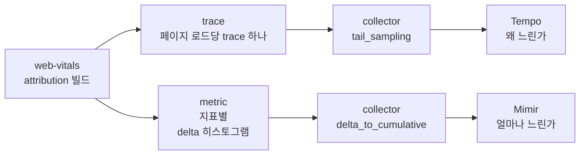

## Table of Contents

## 값만 남는 RUM

앱 웹뷰 안에서 열리는 홈 화면의 LCP p75가 나빠졌다는 것은 대시보드로 알 수 있었다. 그런데 어떤 요소가 LCP였는지는 어디에도 남아 있지 않았다. 사내 공용 RUM 라이브러리는 web-vitals의 `onLCP` 콜백에서 `rating`, `value`, `id`만 꺼내 보내고 `entries[].element`는 버리고 있었다. 기존 대시보드는 Prometheus 라벨로 미리 집계한 값이라 요소 이름을 담을 자리 자체가 없었다. 느리다는 것까지는 알 수 있어도, 무엇이 느린지는 직접 재현해 보기 전에는 알 수 없는 상태였다.

그래서 web-vitals의 attribution 빌드로 Core Web Vitals(이하 CWV) 다섯 지표의 원인 분해 값을 직접 재고, OpenTelemetry(이하 OTel)로 두 곳에 나눠 보내기로 했다. 원인 분석용 trace는 Grafana Tempo로, 운영 모니터링용 metric은 Grafana Mimir로 보낸다. 수집 코드의 모양과 페이지를 떠나는 순간의 전송은 [2편](/2026/10/cwv-send-on-page-leave)에서 다뤘다. 이 글은 그렇게 보낸 값이 앱 웹뷰와 공용 관측 인프라를 지나는 동안 사라진 지점을 다룬다.

작업에는 처음부터 몇 가지 제약이 있었다. 먼저 collector 이후의 관측 인프라는 여러 팀이 같이 쓰는 공용 인프라라서 내가 설정을 바꿀 수 없었다. 이 인프라의 collector 끝단에는 tail sampling이 걸려 있고, trace에서 metric을 만들어 주는 spanmetrics는 리소스 부담 때문에 받지 않는다. 운영 metric의 라벨은 정해진 몇 개만 허용되고, 요소 selector처럼 값의 종류가 끝없이 늘어나는 라벨은 금지다. 사내 공용 RUM 라이브러리도 다른 서비스가 함께 쓰고 있어서 고칠 수 없었고, 기존 대시보드를 위해 같은 값을 계속 보내야 했다. 그리고 화면은 iOS와 Android 앱의 웹뷰 안에서 열린다. 이 글의 절은 대부분 이 제약 중 하나에서 나왔다.

> 사내 작업은 2026년 8월 말부터 10월 중순까지 사내 검증 환경(sandbox)에서 했다. 글의 수치는 공개 재현 환경([blog-experiments/cwv-otel-grafana](https://github.com/yceffort/blog-experiments/tree/main/cwv-otel-grafana))에서 다시 잰 값을 기본으로 하고, 재현할 수 없는 iOS 웹뷰의 동작만 사내 검증 환경에서 잰 값을 출처를 밝혀 인용한다.
>
> 재현 환경의 버전은 web-vitals 6.2.3, OTel JS 2.12.0(OTLP exporter 0.223.0), OpenTelemetry Collector contrib 0.162.0, Tempo 3.1.0, Mimir 3.2.2, Grafana 13.2.4다. 여러 브라우저가 한 시리즈에 쓰는 실험(E9, E10)은 collector contrib 0.163.1에서 쟀고, 0.162.0에서 잰 E1과 E4도 0.163.1에서 다시 돌려 같은 결과를 얻었다. 브라우저는 Playwright 1.64.1의 Chromium 156을 썼다. 버전 차이를 확인할 때는 Tempo 2.10.8을 함께 띄웠다. 인용한 소스는 모두 이 버전의 태그로 고정했다.

## 두 갈래로 나눈 이유

trace 하나로 모든 질문에 답할 수 있다면 가장 간단했을 것이다. 페이지 로드 하나를 trace 하나로 만들고, 그 아래에 지표마다 span을 하나씩 달고, attribution 값을 속성으로 실으면 TraceQL로 무엇이든 거를 수 있다. 실제로 원인을 찾는 데는 이 방식이 가장 편했다. 문제는 운영이었다. 앞서 말한 공용 인프라는 브라우저가 페이지 로드마다 보내는 trace 양을 감당하도록 설계되어 있지 않았고, trace에서 metric을 뽑는 spanmetrics도 받지 않았다. 그래서 trace는 검증 환경에서만 수집하고, 운영에서는 브라우저가 직접 metric을 만들어 보내는 구조가 됐다.



metric은 미리 집계해서 보내는 방식이라, 어떤 질문을 던질 수 있는지가 수집하는 시점에 정해진다는 점은 감수해야 한다. Mimir로는 "어느 화면의 LCP p75가 얼마이고 나빠졌는가"에 답할 수 있지만, "그 화면의 LCP 요소가 무엇이었나"에는 답할 수 없다. 그 질문은 검증 환경에서 재현한 다음 Tempo로 좁혀야 한다. 처음 문제였던 "무엇이 LCP인가"가 운영 데이터만으로는 여전히 답할 수 없는 질문으로 남는다는 뜻이고, 이것이 이 인프라에서 낼 수 있는 최선이라고 판단했다.

## 웹뷰는 떠났다고 알려 주지 않는다

2편에서 본 것처럼 CLS는 항상, INP는 상호작용이 있었던 경우에, LCP는 입력 없이 떠나는 경우에 페이지를 떠나는 순간 처음으로 값이 생긴다. web-vitals가 그 순간을 알아채는 신호는 `visibilitychange`의 hidden이다. 그런데 앱 웹뷰에서는 이 신호가 오지 않는 경우가 있었다.

사내 검증 환경에서 iOS 앱 웹뷰로 홈 화면에 들어간 뒤 5초 동안 아무것도 누르지 않고 네 가지 방법으로 떠나 봤다. 앱이 웹뷰에 알려 주는 일시정지 이벤트(아래 표의 pause)도 함께 기록했다.

| 떠나는 방법           | 받은 신호                            | LCP         |
| --------------------- | ------------------------------------ | ----------- |
| 앱을 백그라운드로     | pause, hidden                        | 있음        |
| 앱 안의 다른 탭으로   | hidden, pause                        | 있음        |
| 앱 전환기에서 앱 종료 | pause만                              | 없음        |
| 새 화면을 push        | pause만(그 전에 탭해서 LCP는 확정됨) | hidden 없음 |

> 사내 검증 환경에서 손으로 재현한 결과다.

앱 전환기에서 앱을 닫거나 웹뷰 위에 새 화면을 띄우면 `visibilitychange`도, `pagehide`도, window `blur`도 오지 않았다. 웹 표준 이벤트로는 떠났다는 것을 알 방법이 없었다. pause는 앱 브릿지 이벤트라 서비스마다 따로 등록해야 해서 확정 근거로 쓰지 않았다. 지원표로 미리 알 수 있는 일도 아니었다. MDN의 브라우저 호환성 데이터(BCD)에는 iOS Safari 14.5부터 `visibilitychange`가 지원된다고 나오지만, 지원표가 알려 주는 것은 이벤트가 있다는 사실이지 이 경로에서 이벤트가 온다는 보장은 아니다.

그래서 LCP를 확정하는 방법을 따로 정해야 했다. 기준은 네 가지였다. 웹 표준 신호만 쓰고, 페이지당 LCP는 하나만 남기고, 느린 페이지의 값을 중간에 자르지 않고, 8초 만에 떠나는 세션도 잡는 것이다.

| 방법                         | 맞지 않은 이유                                                                                             |
| ---------------------------- | ---------------------------------------------------------------------------------------------------------- |
| 고정 10초 뒤 확정            | 8초에 프로세스가 끝나면 타이머가 돌지 않는다                                                               |
| 고정 3~5초 뒤 확정           | LCP가 그보다 느린 페이지는 중간 후보에서 잘려 수치가 좋게 치우친다                                         |
| 후보가 바뀔 때마다 전송      | 페이지당 span이 여러 개가 되어 metric에서 마지막 후보를 고를 수 없다                                       |
| 누락을 받아들임              | 빨리 떠나는 세션이 빠져 iOS 수치가 좋게 치우칠 수 있다                                                     |
| 네트워크 idle 1초, 상한 30초 | 웹소켓과 주기 조회가 있는 화면이라 idle이 잘 오지 않을 것으로 보았고, 상한 30초로는 8초 이탈을 잡지 못한다 |

고른 방법은 후보가 3초 동안 바뀌지 않으면 그 후보로 확정하는 것이다. 새 후보가 오면 타이머를 다시 건다. web-vitals가 먼저 확정하면 그 값을, quiet 타이머가 먼저 끝나면 그 값을 쓰고, 어느 쪽이든 페이지당 한 번만 내보낸다.

```ts
// cwv-otel-grafana/demo-web/src/telemetry/lcp-gate.ts
export function createLcpGate(
  emit: (metric: LCPMetricWithAttribution, finalizedBy: LcpFinalizer) => void,
  quietMs = 3000,
) {
  let settled = false;
  let timer: ReturnType<typeof setTimeout> | undefined;

  const settle = (metric: LCPMetricWithAttribution, by: LcpFinalizer) => {
    if (settled) return;
    settled = true;
    clearTimeout(timer);
    emit(metric, by);
  };

  return {
    candidate(metric: LCPMetricWithAttribution) {
      if (settled) return;
      clearTimeout(timer);
      timer = setTimeout(() => settle(metric, 'quiet'), quietMs);
    },
    final(metric: LCPMetricWithAttribution) {
      settle(metric, 'web-vitals');
    },
  };
}
```

후보는 `onLCP(gate.candidate, { reportAllChanges: true })`로, 정식 확정값은 `onLCP(gate.final)`로 받는다. 구독을 두 번 하는 이유는 `reportAllChanges`를 켜면 확정 시점에 값이 바뀌지 않았을 때 콜백이 다시 불리지 않아서(`src/lib/bindReporter.ts`는 delta가 0이면 보고하지 않는다), 한 구독만으로는 확정 시점을 알 수 없기 때문이다. quiet로 확정하면 곧바로 flush한다. BatchSpanProcessor의 기본 지연이 5초라서 그대로 두면 8초 이탈 전에 나가지 못할 수 있다.

사내 검증 환경의 trace 714개 중 quiet 확정과 정식 확정이 둘 다 있는 327개(Android 294, iOS 33)는 두 값이 모두 같았다. iOS에서 quiet로만 LCP가 생긴 trace는 135개였다. 이 방식에도 한계는 남는다. 후보가 3초 넘게 멈춘 뒤에 더 큰 요소가 그려지면 작은 값이 먼저 확정된다. 검증 환경에서는 관측되지 않았지만 구조상 일어날 수 있다. 그리고 quiet로 확정한 값도 정식값과 같은 histogram에 들어가므로, Mimir에서는 둘을 구분할 수 없다. 어느 쪽이 확정했는지는 trace의 `cwv.lcp.finalized_by` 속성에만 남는다. 마지막 후보 뒤 3초 안에 입력 없이 떠나면 여전히 LCP가 없다.

## tail sampling: 혼자 도착한 root는 버려진다

사내 검증 환경에서 처음 trace를 보냈을 때 collector는 `200 {"partialSuccess":{}}`로 응답했는데 Tempo에는 CWV span이 없었다. 같은 페이지 로드에서 자동 계측이 만든 span은 저장되어 있었다. 원인은 공용 collector 끝단의 tail sampling이었다. 판정 시점에 span이 2개 미만인 trace를 버리는 정책이 걸려 있었고, 판정 대기는 15초였다.

이 원인을 찾는 데 오래 걸린 이유는 실험 설계에 있었다. curl로 span을 직접 보내 재현하려 했는데, 대조군으로 쓴 요청도 span이 하나였다. 요청 모양만 맞추고 span 개수를 변수로 보지 않았으니 대조군도 같이 사라졌고, curl 경로 자체가 막혔다고 오해했다. 인프라 팀에 정책을 확인한 뒤 span 개수를 바꿔 보내고 나서야 판정 방식이 보였다. 재현 환경에서 같은 정책(span 2개 이상, 대기 15초)으로 다시 쟀다.

| 경우 | 보낸 순서                                                  | Tempo에 남은 span       |
| ---- | ---------------------------------------------------------- | ----------------------- |
| A    | root와 FCP를 한 요청으로, 90초 뒤 LCP                      | page, fcp, lcp          |
| B    | root 먼저, 5초 뒤 FCP                                      | page, fcp               |
| C    | root만, 90초 뒤 LCP                                        | 없음                    |
| D    | A처럼 보낸 뒤 메모리에서 밀려나고, LCP 하나                | page, fcp(**LCP 유실**) |
| E    | A처럼 보낸 뒤 메모리에서 밀려나고, CLS와 INP를 한 요청으로 | page, fcp, cls, inp     |

> 두 번 실행해 같은 결과를 얻었다. D와 E는 `num_traces`를 5로 줄인 collector에서 다른 trace 10개를 먼저 보내 앞의 trace를 밀어냈다. `cwv-otel-grafana/experiments/e1-tail-sampling`.

A에서 보듯이 판정 대기가 15초라도, 판정 때 살아남은 trace는 90초 뒤에 온 span도 저장된다. 사내 검증 환경에서는 판정 486초 뒤에 도착한 iOS INP span까지 저장됐다. 판정 대기 15초만으로는 설명되지 않는 동작이다. collector 0.162.0의 소스를 보면, 판정 결과를 따로 기억하는 캐시(`decision_cache`)는 기본 크기가 0이라 쓰이지 않는다. 대신 판정이 끝난 trace는 판정 결과를 들고 메모리(`idToTrace`)에 계속 남고, 늦게 온 span은 그 판정대로 처리된다[^1].

```go
// opentelemetry-collector-contrib v0.162.0 processor/tailsamplingprocessor/processor.go (processTrace)
switch finalDecision {
case samplingpolicy.Sampled:
    traceTd := ptrace.NewTraces()
    appendToTraces(traceTd, rss)
    if tsp.useTracestate {
        sampling.WriteEffectiveThreshold(tsp.ctx, traceTd, actualData.FinalThreshold, tsp.telemetry.ProcessorTailSamplingCountSpansWithUnparseableTracestate)
    }
    tsp.forwardSpans(tsp.ctx, traceTd)
case samplingpolicy.NotSampled:
```

메모리에 남는 trace 수는 `num_traces`(기본 50000)가 상한이고, 넘치면 가장 오래된 trace부터 지운다(`waitForSpace`). 지워진 뒤 도착한 span은 처음 보는 trace가 되어 다시 15초 판정을 받는다. 그래서 D처럼 span이 하나면 버려지고, E처럼 둘 이상이 한 요청에 실려 오면 새 trace로 판정받아 저장된다. 사내 collector의 버전은 확인하지 못했지만, 같은 구조라면 486초 뒤의 저장은 검증 환경의 트래픽이 적어서 그 trace가 아직 밀려나지 않았기 때문으로 보는 것이 자연스럽다. 트래픽이 많은 공용 collector라면 늦게 오는 span일수록 밀려난 뒤에 도착할 가능성이 높다. 떠날 때 CLS와 INP가 함께 오는 Android보다, CLS가 없어 INP 하나만 오는 iOS가 더 잃기 쉬운 구조라고 생각한다(재현 환경에서 개수 비율까지 재지는 않았다).

C가 이 정책의 핵심이다. 페이지 시작 시점에 root를 만들어 먼저 보내면 root가 혼자 판정을 받아 trace째 버려지고, 그 뒤에 오는 지표 span도 버려진 판정을 따라간다. 그래서 root를 첫 지표가 나오는 순간에 만들어 그 자리에서 끝내고, 첫 지표 span도 같은 tick에 끝내 BatchSpanProcessor의 같은 배치로 내보낸다.

```ts
// cwv-otel-grafana/demo-web/src/telemetry/page-trace.ts
return function record(name: string, durationMs: number, attributes: Attributes): void {
  if (!parent) {
    const root = tracer.startSpan('cwv.page', { startTime: performance.timeOrigin });
    root.end();
    parent = trace.setSpan(ROOT_CONTEXT, root);
    base = getBaseAttributes();
  }

  const end = performance.timeOrigin + performance.now();
  tracer
    .startSpan(name, { startTime: end - durationMs, attributes: { ...base, ...attributes } }, parent)
    .end(end);
};
```

root의 시작은 `performance.timeOrigin`이라 페이지 시작부터 첫 지표까지의 구간이 된다. 단위 테스트에서 이 규칙을 빼면(root를 끝내지 않으면) root와 첫 span이 같은 export 호출로 나가는지 확인하는 테스트가 실패한다.

## 누적 변환: 5분 동안 조용한 시리즈는 누적값을 잊는다

metric에서는 값이 사라지는 대신 덜 세어졌다. 브라우저가 보낸 delta를 공용 collector의 `delta_to_cumulative`가 누적으로 바꿔 Mimir에 쓰는데, 이 프로세서는 일정 시간 샘플이 없는 시리즈의 누적값을 지운다.

```go
// opentelemetry-collector-contrib v0.162.0 processor/deltatocumulativeprocessor/processor.go
case <-tick.C:
    now := time.Now()
    p.stale.Range(func(id identity.Stream, last time.Time) bool {
        if now.Sub(last) > p.cfg.MaxStale {
            p.last.nums.LoadAndDelete(id)
            p.last.hist.LoadAndDelete(id)
            p.last.expo.LoadAndDelete(id)
            p.stale.Delete(id)
        }
        return true
    })
```

`max_stale`의 기본값은 5분이고, 검사는 1분마다 돈다(`time.NewTicker(time.Minute)`). 그래서 실제로 지워지는 시점은 마지막 샘플 뒤 5분에서 6분 사이에서 검사 주기에 따라 갈린다. 지워진 뒤 같은 라벨 조합으로 delta가 오면 누적값은 1부터 다시 시작한다.

재현 환경에서 같은 delta를 기본값(5분) collector와 `max_stale: 15m`으로 늘린 collector에 동시에 보냈다. 0, 1, 2, 4.5분에 한 번씩 보내고, 6분 공백을 두 번 둔 뒤, 1분 뒤와 5.5분 뒤에 다시 보냈다.

| collector             | 보낸 건수 | Mimir에 쓰인 누적값            | `increase()` | `resets()` |
| --------------------- | --------- | ------------------------------ | ------------ | ---------- |
| `max_stale` 5분(기본) | 8         | 1, 2, 3, 4, **1**, **1**, 2, 3 | 6.40         | 1          |
| `max_stale` 15분      | 8         | 1, 2, 3, 4, 5, 6, 7, 8         | 7.47         | 0          |

> 같은 일정으로 두 번 실행해 같은 결과를 얻었다. `cwv-otel-grafana/experiments/e4-delta-expiry`.

6분 공백 뒤에는 두 번 모두 누적값이 지워져 1부터 다시 시작했다. 그런데 Prometheus가 리셋으로 알아챈 것은 4에서 1로 줄어든 첫 번째뿐이다. 두 번째는 1에서 다시 1이 되어 값이 줄지 않았으니 리셋도 증가도 없는 것으로 처리된다. 5.5분 공백은 검사 주기에 걸리지 않아 누적이 이어졌다. 15분 collector의 `increase()`가 8이 아니라 7.47인 것은 첫 샘플 이전 값이 없어 첫 1건을 증가로 세지 못하고 구간 끝까지 외삽하기 때문이고, 이 차이는 만료와 무관하다.

사내 검증 환경에서도 같은 모양이 나왔다. 연속 샘플 쌍 981개 중 간격이 5분 이하인 760쌍은 리셋이 한 번도 없었고, 5분을 넘는 쌍에서 136번 리셋됐다. 나머지 85쌍은 1에서 다시 시작해 값이 같아 보이는 경우와 만료 검사 주기 안쪽에 걸린 경우였다. 같은 라벨이 여러 collector 파드에 나뉘어 따로 누적되므로, 파드 하나가 보는 스트림의 샘플 간격은 전체 트래픽으로 짐작하는 것보다 넓다.

Prometheus의 `increase()`는 8에서 1로 줄어드는 것은 리셋으로 보고 보정하지만, 1에서 다시 1이 되는 것은 증가 0으로 센다. 트래픽이 드문 라벨 조합일수록 이 경우가 많아서 건수가 실제보다 작게 나온다. 라벨 조합마다 샘플이 하나뿐이면 `increase()`가 짝을 찾지 못해 아예 0이 되는데, 방문이 드문 블로그에 이 구성을 올렸다가 대시보드가 통째로 빈 이야기는 4편에서 다룬다. 분위수와 good 비율은 버킷끼리의 비율이라 영향이 작지만 건수는 크게 틀린다. 사내 검증 환경에서 원본 샘플을 "간격이 320초를 넘으면 값 전체를 새 증가분으로, 이하면 차이를"이라는 규칙으로 다시 더하자, 같은 구간의 Tempo 건수와 맞았다(INP 26과 29, CLS 23과 23, FCP 83과 81, TTFB 84와 82, LCP 71과 68). 그래서 대시보드의 건수 패널에는 "하한값이며 페이지 로드 수로 읽지 않는다"는 설명을 붙였다.

## 검증 환경에서 맞았던 건수

다시 더한 건수가 Tempo와 맞았을 때는 metric 경로의 손실을 다 설명했다고 생각했다. 그런데 이 대조는 검증 환경에서 한 것이다. 검증 환경은 트래픽이 적어서, 같은 라벨 조합에 여러 브라우저가 동시에 쓰는 일이 드물었을 것이다. 운영에서는 같은 화면, 같은 탐색 종류, 같은 등급의 값을 수많은 브라우저가 동시에 보낸다. `delta_to_cumulative`가 delta를 누적값에 더하는 코드를 보면 이 차이가 중요해진다[^2].

```go
// opentelemetry-collector-contrib v0.162.0 processor/deltatocumulativeprocessor/internal/delta/delta.go
func Aggregate[T Type[T]](state, dp T, aggregate func(state, dp T) error) error {
    switch {
    case state.Timestamp() == 0:
        // first sample of series, no state to aggregate with
        dp.CopyTo(state)
        return nil
    case dp.StartTimestamp() < state.StartTimestamp():
        // belongs to older series
        return ErrOlderStart{Start: state.StartTimestamp(), Sample: dp.StartTimestamp()}
    case dp.Timestamp() <= state.Timestamp():
        // out of order
        return ErrOutOfOrder{Last: state.Timestamp(), Sample: dp.Timestamp()}
    }
```

시리즈의 시작 시각은 처음 받은 값의 시작 시각으로 정해지고, 그 뒤로 받는 값은 시작 시각이 그보다 이르면 안 되고, 시각은 지금까지 받은 가장 늦은 시각보다 늦어야 한다. 이 규칙을 어긴 값은 버린다. 한 프로세스가 자기 시리즈를 차례로 보내는 서버라면 당연히 지켜지는 규칙이다. `ErrOlderStart`의 오류 메시지도 "같은 시리즈를 보내는 프로세스가 여러 개인지 확인하라(consider checking for multiple processes sending the exact same series)"고 안내한다. 브라우저에서는 이 가정이 맞지 않는다. 시리즈는 라벨 조합과 resource 속성으로 정해지는데, 재현 환경의 수집 코드는 resource 속성이 `service.name` 하나뿐이라 같은 라벨 조합의 값을 보내는 브라우저가 모두 한 시리즈에 쓴다. 그리고 값의 시각은 각 브라우저가 자기 시계로 찍는다.

먼저 시계가 어긋난 브라우저 3개가 같은 라벨 조합으로 LCP를 한 건씩, 3초 간격으로 보내 봤다. 시계는 첫째가 맞고, 둘째가 2분 늦고, 셋째가 30초 빠르다. 재현 환경의 collector는 둘째 값을 버렸다. collector 로그에는 아무것도 남지 않았고, 버린 건수는 collector 자체 메트릭 `otelcol_deltatocumulative_datapoints{error="delta.ErrOlderStart"}`에만 남았다.

> 두 번 실행해 같은 결과를 얻었다. `cwv-otel-grafana/experiments/e9-client-clock`.

그렇다면 트래픽이 많을 때는 얼마나 버릴까. 브라우저 대신 OTLP 요청을 직접 만들어, 여러 브라우저가 한 시리즈에 LCP를 한 건씩 보내는 상황을 흉내 냈다. 페이지 로드는 무작위로(Poisson 과정으로) 일어나고, 각 값은 50~550ms 사이의 네트워크 지연을 거쳐 도착한다. 먼저 모든 브라우저의 시계가 정확히 맞는 경우를 봤다.

| 시리즈 하나에 초당 | 보낸 건수  | `delta_to_cumulative`(재현 환경 구성) | 받은 시각으로 바꿔 delta 그대로 저장 |
| ------------------ | ---------- | ------------------------------------- | ------------------------------------ |
| 1건                | 69, 66     | 14.5%, 9.1%                           | 0%, 0%                               |
| 10건               | 603, 539   | 43.8%, 40.6%                          | 1.5%, 1.3%                           |
| 50건               | 3056, 3023 | 75.4%, 75.1%                          | 7.5%, 6.7%                           |

> 보낸 건수 중 Mimir에서 조회되지 않은 비율이다. 두 번 실행한 값을 차례로 적었다. 네트워크 지연의 분포는 실측이 아니라 가정이다. `cwv-otel-grafana/experiments/e10-concurrent-writers`.

시계가 모두 맞아도 값을 잃는다. 늦게 수집된 값이 지연이 짧아 먼저 도착하면 시리즈의 시각이 그 값으로 올라가고, 그보다 일찍 수집됐지만 늦게 도착한 값은 `ErrOutOfOrder`로 버려진다. 같은 입력에 위의 두 규칙만 도착 순서대로 적용해 계산하면, 초당 1건에서 남는 값 59건, 시작 시각으로 버리는 값 1건, 순서로 버리는 값 9건이 나온다. collector 자체 메트릭으로 센 실측과 정확히 같았고, 초당 10건과 50건도 몇 건 차이였다. 손실이 이 두 규칙만으로 설명된다는 뜻이다. 오른쪽 열은 `delta_to_cumulative`를 빼고 Mimir에 delta를 그대로 저장하면서 시각을 collector가 받은 시각으로 바꾼 구성이다. 순서 문제는 사라지지만 초당 10건부터 같은 밀리초에 받은 값끼리 같은 시각의 표본이 되어 Mimir가 버린다. 공용 collector에서는 고를 수 없었던 구성이고, 직접 운영하는 블로그에서 이 구성을 고른 이야기는 4편에서 다룬다.

시계가 어긋나면 손실은 훨씬 커진다. 초당 2건이 들어오는 시리즈에 시계가 60초 빠른 브라우저 하나를 섞자, 그 값이 시리즈의 시각을 60초 앞으로 옮겼고 그 뒤 60초 동안 들어온 값은 모두 버려졌다. Mimir에 남은 누적 시리즈에는 두 번 모두 60초 남짓의 공백이 생겼다(60.2초, 60.1초, 잃은 비율 57.1%, 58.1%). 시계가 2시간 빠른 브라우저 하나를 섞으면 그 뒤 7분 동안 한 건도 남지 않았다(98.9%, 98.5%). 그 2시간 빠른 값 자체도 Mimir에 남지 않았는데, Mimir는 기본적으로 10분보다 먼 미래의 표본을 받지 않기 때문이다(`-validation.create-grace-period`).

7분은 앞 절의 만료 시간(5분)보다 길다. 그런데도 시리즈가 지워지고 새로 시작하지 않은 것은, 버린 값도 만료 타이머를 갱신하기 때문이다[^3].

```go
// opentelemetry-collector-contrib v0.162.0 processor/deltatocumulativeprocessor/processor.go (ConsumeMetrics)
// stream is ok and active, update stale tracker
p.stale.Store(id, now)

if !loaded {
    // cached zero was stored, alloc new one
    zero.hist = guard(pmetric.NewHistogramDataPoint())
}

last.use(func(last pmetric.HistogramDataPoint) {
    err = p.aggr.Histograms(last, dp)
    last.CopyTo(dp)
})
```

집계하기 전에 마지막으로 값을 받은 시각을 기록하므로, 값이 계속 들어오는 동안에는 모두 버려지더라도 시리즈가 살아 있다. 앞선 시계가 만든 공백은 트래픽이 있는 한 그 시계가 앞선 만큼 그대로 이어진다.

그렇다면 실제 브라우저의 시계는 얼마나 어긋나 있을까. 찾을 수 있었던 공개 자료는 2014년에 하루 3억 페이지 로드에서 브라우저의 `Date()`와 서버 시각을 비교한 것이었다[^4]. 5분 단위로 묶은 절댓값으로 90%가 5분 미만, 99%가 115분 미만, 99.9%가 25.5시간 미만이었고, 어긋난 시계의 약 57%가 앞서 있었다. 이 분포에서 편차를 뽑아 같은 실험을 하자 초당 1건에서 92.0%, 95.6%를, 초당 10건에서 두 번 모두 99.9%를 잃었다. 공개된 것은 백분위 경계와 앞선 쪽의 비율뿐이라, 5분 미만의 90%는 편차를 0으로 두고 나머지 구간 안에서는 고르게 뽑는 식으로 빈 곳을 가정으로 채웠다. 그러니 이 값은 2014년 백분위에 맞춘 가정 모델의 결과이지 관측된 분포에서 잰 손실은 아니다. 편차를 0으로 둔 쪽이 손실을 가장 적게 만든다는 보장도 없어서, 하한으로 읽을 수도 없다. 처음으로 앞선 시계가 들어오면 그 뒤로는 그보다 더 앞선 시계만 통과하고, 그런 값은 대부분 10분 유예를 넘어 Mimir가 다시 거부한다. 결과적으로 Mimir에는 앞선 시계가 들어오기 전의 몇 건만 남았다. 초당 1건에서는 앞선 시계가 언제, 얼마나 앞서 들어오느냐에 따라 잃는 비율이 크게 달라지고, 초당 10건에서는 두 번 모두 시리즈가 처음 몇 초 뒤부터 멈춰 있었다.

2014년 자료는 미국, 캐나다, EU 사이트에 치우쳐 있고, 시계를 네트워크로 맞추는 지금의 휴대폰보다 시계가 틀린 PC가 많던 시절의 값일 것이다. 앱 웹뷰의 실제 분포는 이보다 훨씬 좁을 가능성이 높다. 다만 앞의 실험에서 보듯이 분포가 좁더라도 몇 분 앞선 시계 하나가 섞이면 그 몇 분 동안 시리즈 전체가 멈추고, 그 사이에 남는 값은 시계가 더 앞선 브라우저의 값뿐이다.

이 결과가 사내 운영에서도 그대로 일어났는지는 확인하지 못했다. 운영 데이터로 보낸 건수와 받은 건수를 대조한 적이 없고, 운영 collector가 스트림을 어떻게 나누는지(resource 속성, 파드 구성)도 확인하지 않았다. 확실하게 말할 수 있는 것은, 검증 환경에서 건수가 맞았다는 사실이 이 손실이 없다는 근거는 되지 못한다는 점이다. 이 손실은 같은 시리즈에 동시에 쓰는 브라우저가 많을수록 커지는데, 검증 환경은 그 조건을 만들지 못한다.

## Tempo: 조회할 때 사라지는 값

### 최근 30분만 보이는 TraceQL metrics

사내 검증 환경에서는 TraceQL metrics의 조회 범위를 몇 시간으로 잡아도 최근 30~40분의 값만 나왔다. 같은 구간을 trace로 검색하면 데이터가 있었다. 사내 Tempo의 버전과 설정은 받지 못해서 그때는 원인을 확인하지 못했다. 그런데 Tempo 3.0 릴리스 노트에 TraceQL metrics의 `query_backend_after` 기본값이 30m에서 15m로 바뀌었다는 항목이 있었다. 30분이라는 숫자가 맞아떨어진다. 그래서 재현 환경에 Tempo 2.10.8을 local-blocks 설정만 바꿔 세 대 띄우고, Tempo 3.1.0과 함께 같은 span을 10초마다 보낸 뒤 최근 60분을 5분 구간으로 셌다.

| Tempo  | local-blocks 설정                                       | 30분보다 오래된 구간 | 최근 30분 |
| ------ | ------------------------------------------------------- | -------------------- | --------- |
| 3.1.0  | (3.x에는 local-blocks가 없다)                           | 30                   | 30        |
| 2.10.8 | 기본값(`filter_server_spans: true`)                     | **0**                | **0**     |
| 2.10.8 | `filter_server_spans: false`, `flush_to_storage: false` | **0**                | 30        |
| 2.10.8 | `filter_server_spans: false`, `flush_to_storage: true`  | 30                   | 30        |

> 5분 구간마다 보낸 span은 30개다. 16:00과 16:23(UTC)에 두 번 조회해 같은 모양을 얻었고, 세 번째 줄은 두 번 모두 조회 시각에서 정확히 30분 전을 경계로 값이 끊겼다. `cwv-otel-grafana/experiments/e5-tempo-metrics`.

`flush_to_storage: false`인 세 번째 줄이 사내에서 본 모양과 같다. 2.10.8의 query-frontend는 조회 구간을 `query_backend_after`(기본 30분)를 기준으로 둘로 나눈다[^5].

```go
// grafana/tempo v2.10.8 modules/frontend/metrics_query_range_sharder.go
cutoff                = time.Now().Add(-s.cfg.QueryBackendAfter)
```

```go
blocks := blockMetasForSearch(s.reader.BlockMetas(tenantID), start, end, func(m *backend.BlockMeta) bool {
    return m.ReplicationFactor == backend.MetricsGeneratorReplicationFactor
})
if len(blocks) == 0 {
    // no need to search backend
    close(reqCh)
    return
```

최근 30분은 metrics-generator의 local-blocks가 메모리와 로컬 디스크에 들고 있는 블록에서 계산한다. 그보다 오래된 구간은 백엔드 저장소에서 찾는데, 이때 metrics-generator가 쓴 블록만 대상으로 삼는다. 일반 쓰기 경로(ingester)가 만든 블록은 `ReplicationFactor`가 0(`DefaultReplicationFactor`)이고 metrics-generator가 만든 블록만 1(`MetricsGeneratorReplicationFactor`)이라서, ingester 블록은 여기에 해당하지 않는다(`tempodb/backend/block_meta.go`). `flush_to_storage: false`면 local-blocks가 블록을 백엔드에 쓰지 않으므로, 30분이 지난 데이터는 trace 검색에는 나와도 TraceQL metrics에는 나오지 않는다. 사내 Tempo의 설정을 확인하지 못했으므로, 같은 원인이었을 가능성이 높다는 데까지만 말할 수 있다.

두 번째 줄은 또 다른 기본값 문제다. 2.10.8의 local-blocks는 `filter_server_spans`가 기본으로 켜져 있고, 이때는 SERVER kind이거나 부모가 없는 span만 남긴다(`modules/generator/processor/localblocks/processor.go`의 `filterBatches`). 브라우저의 지표 span은 root의 자식이고 INTERNAL kind라서 TraceQL metrics에 한 건도 잡히지 않는다. Tempo 3.x에서는 local-blocks가 없어지고 live-store가 최근 구간을, 백엔드가 그 이전을 맡으며 `query_backend_after` 기본값은 15분이 됐다. 재현 환경의 3.1.0은 60분 전체를 돌려줬다.

### 분위수는 2의 거듭제곱 버킷에서 보간한다

span 길이를 지표 값으로 맞춰 두면 `quantile_over_time(duration, .75)`가 곧 p75다. 다만 Tempo의 분위수는 정확한 값이 아니다. 분포를 아는 span을 보내 확인했다. 10초마다 100, 300, 1000, 2500, 4000ms 길이의 span을 돌아가며 보내면 5분 구간에 30개가 쌓이고, 30개 중 23번째인 정확한 p75는 2500ms다. Tempo 3.1.0과 2.10.8 모두 이 구간의 p75를 **1.913초**로 돌려줬다. 표본이 15개뿐인 마지막 구간은 2.147초였다.

계산 방식은 `pkg/traceql/engine_metrics.go`에 있다[^6].

```go
// grafana/tempo v3.1.0 pkg/traceql/engine_metrics.go
// Log2Bucketize rounds the given value to the next powers-of-two bucket.
func Log2Bucketize(v uint64) float64 {
    if v < 2 {
        return -1
    }

    return float64(uint64(1) << (64 - bits.LeadingZeros64(v-1)))
```

```go
    // Exponential interpolation between buckets
    // The current bucket represents the maximum value
    maxV := math.Log2(buckets[bucket].Max)
    var minV float64
    if bucket > 0 {
        // Prior bucket represents the min
        minV = math.Log2(buckets[bucket-1].Max)
    } else {
        // There is no prior bucket, assume powers of 2
        minV = maxV - 1
    }
    return math.Pow(2, minV+(maxV-minV)*interp), bucket
```

span 길이(ns)를 다음 2의 거듭제곱으로 올려 버킷에 넣는다. 100, 300, 1000ms는 각각 2^27, 2^29, 2^30ns 버킷에, 2500ms와 4000ms는 함께 2^32ns(4.295초) 버킷에 들어간다. 23번째 표본은 2^32 버킷의 12개 중 5번째다. 이때 보간의 아래쪽 끝은 바로 앞에 있는 버킷인데, 2^31 버킷은 비어 있어서 목록에 없으므로 2^30이 앞 버킷이 된다. 그래서 2^(30 + 2 × 5/12)ns, 즉 1.913초가 나온다. 표본 15개인 구간은 23번째 대신 12번째 표본을 찾고, 보간 비율이 정확히 절반이라 2^31ns(2.147초)가 된다. 사내 검증 환경에서 표본이 적을 때 1.074초(2^30ns)나 2.147초(2^31ns) 같은 값이 자주 찍힌 것도 이 계산 방식으로 설명된다. 누적 표본 수가 찾는 순번과 정확히 맞아떨어지면 보간 없이 버킷의 상한을 그대로 돌려주기 때문이다.

2.5초는 2^31ns와 2^32ns 사이에 있어서, 이 정밀도로는 p75가 good 경계 안인지 판정할 수 없다. 경계 판정은 경계를 버킷에 넣어 둔 Mimir의 good 비율로 하고, Tempo의 분위수는 "요소 A가 요소 B보다 느린가" 같은 비교에 쓰는 편이 안전하다고 생각한다.

### 분위수에서 빠지는 값

숫자 속성의 분위수는 duration과 다른 함수로 버킷을 만든다[^7].

```go
// grafana/tempo v3.1.0 pkg/traceql/ast_metrics.go
switch t {
case TypeInt:
    if f < 2 {
        return NewStaticNil(), false
    }
    // Bucket is the value rounded up to the nearest power of 2
    return NewStaticFloat(Log2Bucketize(uint64(f))), true
case TypeDuration:
    if f < 2 {
        return NewStaticNil(), false
    }
    // Bucket is log2(nanos) converted to float seconds
    return NewStaticFloat(Log2Bucketize(uint64(f)) / float64(time.Second)), true
default:
    // TODO(mdisibio) - Add support for floats, we need to map them into buckets.
    // Because of the range of floats, we need a native histogram approach.
    return NewStaticNil(), false
}
```

여기서 두 가지가 빠진다. 하나는 double 속성이다. double로 저장된 `span.e5.value_ms`와 CLS의 `span.cwv.value`는 `avg_over_time`은 계산되지만 `quantile_over_time`은 시리즈가 하나도 나오지 않았다. 다른 하나는 2보다 작은 값이다. duration도 `bucketizeDuration`에서 2ns 미만을 빼므로, 길이가 0인 CLS span, 즉 **CLS가 0인 페이지 로드는 TraceQL 분위수에서 빠진다.** 재현 환경에서 35분 동안 쌓인 CLS span 841개 중 0이 아닌 것은 351개였는데, 0을 포함해 구한 p75와 0을 빼고 구한 p75가 0.0246으로 같았다. 같은 35분 동안 Mimir는 840건을 받았고 CLS p75는 0.0088이었다. 같은 페이지 로드를 두 저장소에서 봤는데 Tempo의 CLS p75가 2.8배쯤 나쁘게 나온 것이다. CLS가 0인 페이지가 많을수록 이 차이는 커진다. LCP의 리소스 요청 지연처럼 0이 흔한 속성도 마찬가지다.

조회 구간의 끝도 영향을 준다. Tempo 3.1.0은 결과 구간을 step의 배수 시각에 맞추는데, 조회 끝이 step의 배수가 아니면 마지막 구간을 돌려주지 않았다. 15:47에 30분 step으로 조회하면 15:30 이후 데이터가 통째로 빠지고, 2.10.8은 그 구간도 돌려줬다(두 번 확인했다). Grafana 패널처럼 step이 작으면 잃는 양이 작지만, 스크립트에서 한 시간 step으로 조회하면 가장 최근 한 시간이 0으로 보일 수 있다. 이 글의 Tempo 수치는 모두 조회 끝을 step 배수로 맞춰 쟀다.

빈 구간도 주의해야 한다. `quantile_over_time`은 표본이 없는 구간에도 값이 비어 있는 sample을 돌려주고 Grafana는 이것을 0으로 그린다. `avg_over_time`은 표본이 없는 구간을 아예 빼고 돌려준다. 분위수 패널에서 갑자기 0으로 떨어지는 구간은 빨라진 것이 아니라 표본이 없는 구간이다.

### 숫자 속성은 값에 따라 타입이 바뀐다

대시보드를 만들다 CLS를 일으킨 요소별 건수 패널이 비어 있는 것을 발견했다. 쿼리는 `{name="cwv.cls" && span.cwv.value > 0}`였다. 조건만 바꿔 같은 구간을 세어 보니 결과가 이랬다.

| 조건                                     | 30분 동안 건수 |
| ---------------------------------------- | -------------- |
| `name="cwv.cls"`                         | 812            |
| `name="cwv.cls" && span.cwv.value > 0`   | 0              |
| `name="cwv.cls" && span.cwv.value > 0.0` | 344            |
| `name="cwv.lcp"`                         | 811            |
| `name="cwv.lcp" && span.cwv.value > 0`   | 811            |
| `name="cwv.lcp" && span.cwv.value > 0.0` | 0              |

> Tempo 3.1.0에서 같은 30분 구간을 조건만 바꿔 셌다.

OTel JS는 숫자 속성을 OTLP로 바꿀 때 정수면 `intValue`, 아니면 `doubleValue`로 보낸다[^8].

```ts
// opentelemetry-js experimental/v0.223.0 experimental/packages/otlp-transformer/src/common/internal.ts
if (t === 'number') {
  if (!Number.isInteger(value)) return { doubleValue: value as number };
  return { intValue: value as number };
}
```

같은 `cwv.value` 속성이라도 CLS 0.008은 double로, CLS 0은 int로 저장된다. 그리고 Tempo 3.1.0에서는 정수 리터럴(`> 0`)이 int 값만, 실수 리터럴(`> 0.0`)이 double 값만 걸렀다. 재현 환경의 headless Chromium에서는 LCP 값이 모두 정수라 `> 0`이 전부를 잡았지만, 실제 사용자 브라우저에서 소수 값이 섞이면 `span.cwv.value > 2500` 같은 필터는 일부만 잡을 수 있다. 재현 환경에서는 ms 단위 속성을 모두 `Math.round`로 정수로 맞춰 보낸다. 정수로 맞추면 앞 절의 분위수도 계산된다. CLS처럼 원래 소수인 값은 속성 대신 span 길이(`duration > 0ms`)로 거르고, 분위수도 span 길이로 구한다. CLS를 1000배 해서 span 길이로 넣은 것이 이 지점에서 쓸모가 있었다.

### 한 패널에 쿼리를 여러 개 넣으면 범례를 구분할 수 없다

LCP의 네 단계를 한 패널에 그리려고 `avg_over_time(span.cwv.lcp.time_to_first_byte)`와 `avg_over_time(span.cwv.lcp.element_render_delay)`를 refId를 달리해 넣었더니, Grafana 13.2.4의 Tempo 데이터소스가 돌려준 frame의 refId가 둘 다 `avg_over_time`으로 덮어써져 있었다. 범례가 같은 이름 두 개가 되고, refId로 시리즈를 골라 이름을 바꾸는 override도 쓸 수 없다. 단계마다 패널을 나눠서 그렸다.

## 대시보드 두 개

대시보드는 저장소마다 하나씩 만들었다. Mimir 대시보드는 "지금 얼마나 느리고, 나빠졌고, 어디가 느린가"를, Tempo 대시보드는 "왜 느린가"를 본다. 재현 환경의 대시보드 JSON은 패널을 코드로 만드는 스크립트(`cwv-otel-grafana/grafana/build-dashboards.py`)에서 나온다.


위의 두 줄은 선택한 구간 전체를 하나로 본 값이다. p75는 구간 동안 늘어난 버킷 건수를 합쳐 계산한다.

```promql
histogram_quantile(0.75, sum by (le) (increase(cwv_lcp_milliseconds_bucket{page_route=~"$route"}[$__range])))
```

good 비율은 good 경계 버킷을 전체 건수로 나눈다. 경계를 버킷에 넣어 두었기 때문에 이 값은 보간 없이 정확하다.

```promql
sum(increase(cwv_lcp_milliseconds_bucket{page_route=~"$route", le="2500"}[$__range]))
/
sum(increase(cwv_lcp_milliseconds_count{page_route=~"$route"}[$__range]))
```

p75와 good 비율을 같이 두는 이유는 두 값이 다른 것을 말해 주기 때문이다. p75가 경계 근처에서 흔들릴 때, good 비율을 보면 그 흔들림이 얼마나 많은 페이지 로드에 걸친 문제인지 알 수 있다. 추이는 10분 창으로 고정하고, 화면별과 입력 종류별은 `sum by (le, page_route)`처럼 `by`에 라벨을 더해 나눈다. 맨 아래 표본 수 패널에는 앞의 두 절의 이유로 "하한값이며 페이지 로드 수로 읽지 않는다"는 설명을 붙였다.


Tempo 대시보드 맨 위의 두 패널이 처음 질문에 대한 답이다.

```text
{resource.service.name="demo-web" && name="cwv.lcp"} | count_over_time() by (span.cwv.lcp.target)
{resource.service.name="demo-web" && name="cwv.lcp"} | quantile_over_time(duration, .75) by (span.cwv.lcp.target)
```

요소별 건수로 어떤 요소가 자주 LCP가 되는지, 요소별 p75로 그중 어느 것이 느린지 본다. 재현 환경에서는 제목(`#app>h1`), 늦게 그려지는 본문(`#app>p.hero`), 이미지(`#app>img.hero-image`) 셋으로 갈린다. 데모는 첫 클릭에서 LCP가 확정되므로, 본문이 그려지기 전에 누르면 제목이 LCP가 된다. 그 아래 패널은 LCP와 INP를 단계별 평균으로 나눈 것이고, 단계마다 패널을 따로 둔 것은 앞에서 본 범례 문제 때문이다. "LCP 확정 방식" 패널은 web-vitals와 quiet 타이머 중 어느 쪽이 먼저 확정했는지 보여 준다. quiet는 입력 없이 3초 넘게 머물기만 해도 먼저 확정하므로 이 비율만으로 hidden 누락을 알 수는 없지만, 사내 검증 환경에서는 iOS가 74건 중 43건, Android가 25건 중 19건으로 OS마다 차이가 컸다.

쓰는 순서는 정해 두었다. Mimir에서 나빠진 지표와 화면을 찾고, 검증 환경에서 같은 조건을 재현하며 Tempo로 원인을 좁히고, 고친 뒤 Mimir의 추이로 돌아와 확인한다. 운영 데이터만으로 원인까지 가지 못하는 것은 아쉽지만, 각 저장소가 답할 수 있는 질문을 미리 나눠 두면 무엇을 어디에 실을지도 함께 정해진다.

## 바꿀 수 없는 기본값 앞에서

돌아보면 이 작업에서 측정 자체가 문제였던 적은 거의 없었다. 값을 잃은 곳은 매번 그 뒤였고, 대부분 내가 바꿀 수 없는 설정의 기본값에서였다. tail sampling은 혼자 온 root를 버렸고, 누적 변환은 5분 동안 조용한 시리즈를 잊었고, 같은 시리즈에 여러 브라우저가 쓰면 순서가 어긋난 값을 버렸고, Tempo는 30분보다 오래된 구간과 0인 값을 분위수에서 뺐다. 어느 단계도 오류를 내지 않았다. 각 기본값은 서버 트래픽에서는 합리적인 선택이었을 것이다. 다만 브라우저가 보내는 데이터는 짧게 살다 떠나는 순간에 몰리고, 라벨 조합마다 드문드문 오면서도, 한 시리즈에 셀 수 없이 많은 브라우저가 각자의 시계로 쓴다. 서버를 기준으로 정한 기본값이 맞지 않는 지점은 거기서 생긴다고 생각한다.

설정을 바꿀 수 없을 때 쓸 수 있었던 확인 방법은 보낸 건수와 도착한 건수를 단계마다 세는 것 하나였다. 이 글의 실험도 대부분 그 숫자가 맞지 않는 데서 시작했다. 다만 앞의 절에서 보았듯이, 숫자가 맞았다는 결과도 그 숫자를 센 조건에서만 유효하다. 검증 환경에서 맞은 건수는 쓰는 브라우저가 적은 조건의 결과였다. 운영과 같은 조건, 즉 많은 브라우저가 같은 시리즈에 동시에 쓰는 부하를 흉내 내어 한 번 더 세어 보기 전에는, metric 경로가 운영 트래픽을 온전히 센다고 말하기 어렵다고 생각한다.

[^1]: [opentelemetry-collector-contrib v0.162.0 `processor/tailsamplingprocessor/processor.go`](https://github.com/open-telemetry/opentelemetry-collector-contrib/blob/v0.162.0/processor/tailsamplingprocessor/processor.go#L1191-L1199)

[^2]: [opentelemetry-collector-contrib v0.162.0 `processor/deltatocumulativeprocessor/internal/delta/delta.go`](https://github.com/open-telemetry/opentelemetry-collector-contrib/blob/v0.162.0/processor/deltatocumulativeprocessor/internal/delta/delta.go#L46-L66). E9와 E10을 잰 0.163.x의 소스(v0.163.0 태그)도 이 파일과 `processor.go`가 0.162.0과 같다.

[^3]: [opentelemetry-collector-contrib v0.162.0 `processor/deltatocumulativeprocessor/processor.go`](https://github.com/open-telemetry/opentelemetry-collector-contrib/blob/v0.162.0/processor/deltatocumulativeprocessor/processor.go#L124-L143)

[^4]: Gervase Markham, ["[cabfpub] Clock skew data"](https://lists.cabforum.org/pipermail/public/2014-November/020810.html), CA/B Forum public 메일링 리스트, 2014-11-03. 익명의 제보자가 측정한 자료를 전달한 글이고, 원 사이트가 응답하지 않으면 [웹 아카이브 사본](https://web.archive.org/web/20240723215943/https://lists.cabforum.org/pipermail/public/2014-November/020810.html)으로 볼 수 있다.

[^5]: [grafana/tempo v2.10.8 `modules/frontend/metrics_query_range_sharder.go`](https://github.com/grafana/tempo/blob/v2.10.8/modules/frontend/metrics_query_range_sharder.go#L127-L205)

[^6]: [grafana/tempo v3.1.0 `pkg/traceql/engine_metrics.go`](https://github.com/grafana/tempo/blob/v3.1.0/pkg/traceql/engine_metrics.go#L2323-L2409)

[^7]: [grafana/tempo v3.1.0 `pkg/traceql/ast_metrics.go`](https://github.com/grafana/tempo/blob/v3.1.0/pkg/traceql/ast_metrics.go#L282-L314)

[^8]: [opentelemetry-js experimental/v0.223.0 `otlp-transformer/src/common/internal.ts`](https://github.com/open-telemetry/opentelemetry-js/blob/experimental/v0.223.0/experimental/packages/otlp-transformer/src/common/internal.ts#L74-L77)
