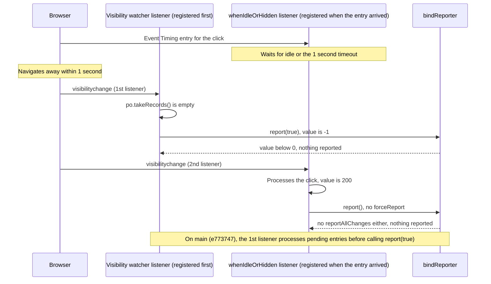

## Table of Contents

## Clicked, but INP Was Not Reported

I built a simple page with a button whose handler takes 200ms, set to navigate to another page 0.3 seconds after the click. Repeating this 10 times in Chromium 156 launched by Playwright, four of the five web-vitals 6.2.3 callbacks, TTFB, FCP, LCP and CLS, fired every time, and INP never fired. Delaying only the departure to 1.5 seconds after the click made INP report in all 10 runs (200ms to 208ms). In both cases the browser handed that click to web-vitals as an [Event Timing](https://developer.mozilla.org/en-US/docs/Web/API/PerformanceEventTiming) entry. The difference was whether the page was hidden before web-vitals processed that entry.

The definitions of Core Web Vitals alone cannot explain this difference. LCP is the time until the largest piece of content is painted, CLS is how much the layout shifted, and INP is how long the screen takes to respond to an interaction. If measurement is left to Google's web-vitals library and only the values received in the callback are sent to the server, the cases where the callback never fired leave no trace in the collected data. web-vitals measures these three metrics plus two supporting ones, TTFB and FCP, so this post covers all five as well.

The fact that INP did not reach the server cannot tell you whether there was no click, or whether there was a click that was never reported. This series collects Core Web Vitals split into OpenTelemetry traces (for root-cause analysis) and metrics (for operational monitoring). Before that, I needed to confirm the conditions under which web-vitals calls the callback.

Understanding the report timing means looking at three places in the code together: `bindReporter`, which filters the value to report, the visibility watcher, which checks whether the page is hidden, and `whenIdleOrHidden`, which defers processing until the browser is idle. In the experiment above, the callback did not fire because of when the INP entry is processed and the order in which the report conditions are checked.

> The reference version is web-vitals [v6.2.3](https://github.com/GoogleChrome/web-vitals/tree/v6.2.3) (released 2026-10-05, commit [`400d019`](https://github.com/GoogleChrome/web-vitals/commit/400d01968abffcd91a6f0307c9aaac97c5f7a76a)), and every quoted source and line number is from that tag. Fixes that landed on main after 6.2.3 are pinned to commit [`e773747`](https://github.com/GoogleChrome/web-vitals/tree/e773747b90f0e8763aed02ba5a74358d628a828c) (2026-10-16) and marked separately. As of 2026-10-18, when this was written, no version containing that fix had been released.
>
> Measurements ran in Chromium 156 (new headless) from Playwright 1.64.1, with Chromium 153 from Playwright 1.63.0 for version comparisons. web-vitals was built from source (the 6.2.3 and 4.2.1 builds were byte-for-byte identical to the npm packages). Clicks were sent through the [Chrome DevTools Protocol](https://chromedevtools.github.io/devtools-protocol/) (CDP), and the key conditions were re-measured with macOS mouse events against a Chrome Beta 157 window with no DevTools attached. The measurement code is in [blog-experiments/cwv-otel-grafana/experiments/e13-report-timing](https://github.com/yceffort/blog-experiments/tree/0426377c2119e32018e064428353e2aa70617fed/cwv-otel-grafana/experiments/e13-report-timing).
>
> Whether a callback fired in a departing document was counted by sending a [`navigator.sendBeacon`](https://developer.mozilla.org/en-US/docs/Web/API/Navigator/sendBeacon) from inside the callback to the measurement script's receiving server. Passing values to the next document through [`sessionStorage`](https://developer.mozilla.org/en-US/docs/Web/API/Window/sessionStorage) cannot observe tab closes. Each page load got a fresh browser context, and each condition was run 5 times in two batches and combined. Playwright's [`click`](https://playwright.dev/docs/api/class-locator#locator-click) moves the mouse over the element before pressing, so there is one `pointermove` before the click and, unless input is added deliberately, nothing after it.

## From Performance Entries to Metric Values

web-vitals takes the performance entries the browser emits through [`PerformanceObserver`](https://developer.mozilla.org/en-US/docs/Web/API/PerformanceObserver), computes the five metrics from them, and hands the values to the callback you supply. The five functions (`onTTFB`, `onFCP`, `onLCP`, `onCLS`, `onINP`) each take a callback and options. The options are `reportAllChanges`, which reports every time the value changes, `reportSoftNavs`, which measures SPA navigations separately, and `durationThreshold`, the observation floor for INP. None of them calls the callback directly. They call it through the `report` function returned by `bindReporter`, covered below.

Performance entries are received in the `observe()` helper that every function shares[^12].

```ts
// web-vitals v6.2.3 src/lib/observe.ts
      const po = new PerformanceObserver((list) => {
        // Delay by a microtask to workaround a bug in Safari where the
        // callback is invoked immediately, rather than in a separate task.
        // See: https://github.com/GoogleChrome/web-vitals/issues/277
        queueMicrotask(() => {
          const entries = list.getEntries();
          // When observing more than one entry type, entries from different
          // types can be delivered out of order, so sort by end time
          // (startTime + duration) to ensure they're in the right order.
          // See: https://github.com/w3c/performance-timeline/issues/224
          if (supportedTypes.length > 1) {
            entries.sort((a, b) => {
              const scoreA = a.startTime + a.duration;
              const scoreB = b.startTime + b.duration;

              return scoreA - scoreB;
            });
          }
          callback(entries as Array<PerformanceEntryMap[K][number]>);
        });
      });

      for (const t of supportedTypes) {
        po.observe({type: t, buffered: true, ...opts});
      }
```

With [`buffered: true`](https://developer.mozilla.org/en-US/docs/Web/API/PerformanceObserver/observe), web-vitals receives entries that accumulated before it ran, even when it starts later than the page load. The blog's collection code in part 4 also relies on this setting to load the OTel SDK late through a dynamic import and still collect LCP and CLS. One caveat: for Event Timing, the browser only buffers entries of 104ms or longer (the default `durationThreshold` set by the spec), so a web-vitals that ran late cannot observe shorter interactions that happened before it. Entry types the browser does not support are filtered out with [`supportedEntryTypes`](https://developer.mozilla.org/en-US/docs/Web/API/PerformanceObserver/supportedEntryTypes_static) and never observed, and if none remain the helper returns `undefined`. That is why `onCLS` does nothing in browsers without `layout-shift` entries.

The metric object is created by `initMetric`[^1]. Its properties are `name`, `value`, `rating`, `delta`, `entries`, `id` and `navigationType`. `value` defaults to -1, and `rating` is initialized to `good` and decided again at report time by each metric's thresholds. `id` takes the form `v6-{Date.now()}-{13 random digits}` and is freshly generated for every metric object. `navigationType` defaults to the `type` of the [`navigation` entry](https://developer.mozilla.org/en-US/docs/Web/API/PerformanceNavigationTiming) (`navigate`, `reload`, `back-forward`). A prerendered page becomes `prerender`, a page discarded under memory pressure and reopened becomes `restore`, and a page restored from bfcache becomes `back-forward-cache`. Each function updates this object's `value` whenever it receives an entry, and calls `report(true)` when it is time to report.

| Metric | good upper bound | poor lower bound |
| ------ | ---------------- | ---------------- |
| TTFB   | 800ms            | 1800ms           |
| FCP    | 1800ms           | 3000ms           |
| LCP    | 2500ms           | 4000ms           |
| CLS    | 0.1              | 0.25             |
| INP    | 200ms            | 500ms            |

INP's computation is more involved than that of the other four metrics[^13]. `onINP` observes two entry types, `event` and [`first-input`](https://w3c.github.io/event-timing/#sec-event-timing-first-input), and applies a [`durationThreshold`](https://developer.mozilla.org/en-US/docs/Web/API/PerformanceObserver/observe#durationthreshold) (default 40ms) to `event` so shorter interactions are never received. Received entries go into `handleEntries`, which does not process them right away but defers to the next idle period through `whenIdleOrHidden`, covered below. The processing itself is done by `InteractionManager._processEntry`, which discards entries that do not belong to an interaction (those with an [`interactionId`](https://developer.mozilla.org/en-US/docs/Web/API/PerformanceEventTiming/interactionId) of 0, such as `mousemove`).

The remaining entries are grouped by `interactionId`, and only the 10 longest are kept, sorted longest first. The INP value is the duration of one entry picked from this list, and the position picked is the interaction count divided by 50, rounded down. Under 50 interactions it is the longest; from 50 to 99 it is the second longest. The source calls this the p98 estimate. The interaction count comes from [`performance.interactionCount`](https://developer.mozilla.org/en-US/docs/Web/API/Performance/interactionCount), and in browsers without that property a polyfill estimates it by dividing the spread between the largest and smallest `interactionId` seen so far by 7. Seven is the step by which Chromium advances `interactionId` for each interaction ([`kIdIncrement = 7`](https://chromium.googlesource.com/chromium/src/+/6af0574b4a37e7b891f833dafbb47beeb337d4f8/third_party/blink/renderer/core/timing/performance_timeline_entry_id_generator.h#28)).

```ts
// web-vitals v6.2.3 src/lib/InteractionManager.ts
  _estimateP98LongestInteraction(navigationType: Metric['navigationType']) {
    const interactionCountForNavigation =
      this._getInteractionCountForNavigation();
    const candidateInteractionIndex = Math.min(
      this._longestInteractionList.length - 1,
      Math.floor(interactionCountForNavigation / 50),
    );
```

After processing entries, `onINP` changes `metric.value` in `updateINPMetric` only when this estimate differs from the current value, and then calls `report()`. That call passes no `forceReport`, the sole argument of `report`. What this argument does is covered with `bindReporter` in the next section. Without `reportAllChanges`, the moment an interaction is processed only updates the value and does not call the callback. The 200ms to 208ms INP in the first experiment is the Event Timing `duration`, which includes both the 200ms handler's execution time and the time until the next frame was painted.

To check the report timing, you have to look at when each function calls `report(true)` and whether `value` has moved off its initial -1 before that. `bindReporter` checks these two conditions.

## The Callback Is Only Called Through bindReporter

Each of the five functions calls the `report` function returned by `bindReporter` at its own moment. Inside that function the report conditions are checked before your callback is called[^1].

```ts
// web-vitals v6.2.3 src/lib/bindReporter.ts
export const bindReporter = <MetricName extends MetricType['name']>(
  callback: (metric: Extract<MetricType, {name: MetricName}>) => void,
  metric: Extract<MetricType, {name: MetricName}>,
  thresholds: MetricRatingThresholds,
  reportAllChanges?: boolean,
) => {
  let prevValue: number;
  let delta: number;
  return (forceReport?: boolean) => {
    if (metric.value >= 0) {
      if (forceReport || reportAllChanges) {
        delta = metric.value - (prevValue ?? 0);

        // Report the metric if there's a non-zero delta or if no previous
        // value exists (which can happen in the case of the document becoming
        // hidden when the metric value is 0).
        // See: https://github.com/GoogleChrome/web-vitals/issues/14
        if (delta || prevValue === undefined) {
          prevValue = metric.value;
          metric.delta = delta;
          metric.rating = getRating(metric.value, thresholds);
          callback(metric);
        }
      }
    }
  };
};
```

The code has three conditions. First it checks `metric.value >= 0`. Since `initMetric` defaults to -1, a metric that never had anything to measure is not reported no matter how many times `report(true)` is called. Only CLS starts at 0 via `initMetric('CLS', 0)`; the other four start at -1. The INP of a page with no interaction is the typical case caught here.

Next is `forceReport || reportAllChanges`. Without `reportAllChanges`, a report is possible only at the moments where each function calls `report(true)`. The last, `delta || prevValue === undefined`, allows the first report even when the value is 0. That is why a page with no layout shift reports CLS 0. After that, a report goes out only when the value changed, so calling `report(true)` again with the same value does not call the callback.

The `metric` the callback receives is the same object every time. `report` overwrites `value`, `delta` and `rating` and passes the same object. The README's batching example uses this property to collect reported metrics in a `Set`[^2]. If the same metric is reported twice, the `Set` keeps a single object, and at flush time it holds the latest value. Code that keeps the object received in the callback and reads it later has to take this into account as well. If the same object was updated in between, the value at the time the callback fired is gone.

## Nothing Painted After Being Hidden Counts

FCP and LCP only take a value when the paint happened before the page was first hidden.

```ts
// web-vitals v6.2.3 src/onFCP.ts
          // Only report if the page wasn't hidden prior to FCP.
          if (entry.startTime < visibilityWatcher.firstHiddenTime) {

// web-vitals v6.2.3 src/onLCP.ts
        // Only report if the page wasn't hidden prior to LCP.
        if (renderTime < visibilityWatcher.firstHiddenTime) {
```

`firstHiddenTime` is managed by the visibility watcher (`getVisibilityWatcher`) shared by every metric. It is set on the first call and then updated by a [`visibilitychange`](https://developer.mozilla.org/en-US/docs/Web/API/Document/visibilitychange_event) listener registered on window in the capture phase[^3].

```ts
// web-vitals v6.2.3 src/lib/getVisibilityWatcher.ts
    // Prefer that, but if it's not available and the document is hidden when
    // this code runs, assume it was hidden since navigation start. This isn't
    // a perfect heuristic, but it's the best we can do until the
    // `visibility-state` performance entry becomes available in all browsers.
    firstHiddenTime = firstVisibilityStateHiddenTime ?? initHiddenTime();

    // Listen for visibility changes so we can handle things like bfcache
    // restores and/or prerender without having to examine individual
    // timestamps in detail and also for onHidden function calls.
    addEventListener('visibilitychange', onVisibilityUpdate, true);
```

`firstVisibilityStateHiddenTime` is the first hidden timestamp found among the [`visibility-state` performance entries](https://developer.mozilla.org/en-US/docs/Web/API/VisibilityStateEntry) the browser records on every visibility change. The timeline starts with one entry at `startTime` 0 carrying the state at document creation, and one more is added each time the state changes[^14]. So a document that started hidden has `hidden` at 0, and `firstHiddenTime` is 0 too. This entry only exists from Chromium 115[^4]. In Firefox and Safari, `initHiddenTime()` stands in: if the document is hidden at the moment the script runs, it is assumed hidden from the start and set to 0; if visible, it is assumed never hidden and set to `Infinity`. So in those two browsers, a page that was briefly hidden and shown again before web-vitals ran is treated as never hidden. I only confirmed this in the source and did not measure it in Firefox or Safari.

A page opened in a background tab was measured in Chromium 156 (`bg-tab2.mjs`). I opened the page as a background tab by passing `background: true` to CDP's [`Target.createTarget`](https://chromedevtools.github.io/devtools-protocol/tot/Target/#method-createTarget), brought the tab to the front after 2 seconds, pressed a 100ms button and closed it. Chromium, however, switched the tab to visible 10ms to 18ms after creating it. I could not find out why. The page was hidden for only about 10ms and every paint happened while it was visible, yet in all 5 runs FCP, LCP and CLS were not reported.

| How it was opened        | `visibility-state` entries | TTFB | FCP | LCP | CLS | INP |
| ------------------------ | -------------------------- | ---- | --- | --- | --- | --- |
| Background tab           | `hidden@0`, `visible@10`   | 5/5  | 0/5 | 0/5 | 0/5 | 5/5 |
| Foreground tab (control) | `visible@0`                | 5/5  | 5/5 | 5/5 | 5/5 | 5/5 |

> Chromium 156 (headed), web-vitals 6.2.3. Values are page loads reported / total page loads. The background tab's `visible` timestamp ranged from 10ms to 18ms.

FCP and LCP are missing because `firstHiddenTime` is 0 and no `startTime` can be smaller than that. CLS is missing along with them because `onCLS` only starts collecting layout shifts after FCP has been reported.

```ts
// web-vitals v6.2.3 src/onCLS.ts
  const visibilityWatcher = getVisibilityWatcher();
  // Start monitoring FCP so we can only report CLS if FCP is also reported.
  // Note: this is done to match the current behavior of CrUX.
  onFCP(
    runOnce(() => {
```

`onINP` and `onTTFB`, on the other hand, never look at `firstHiddenTime`. That is why only TTFB and INP remained for this page load. The result is the same whether the page was hidden for 10ms or 10 minutes, and it has nothing to do with whether the user actually saw the screen. A page prerendered through [Speculation Rules](https://developer.mozilla.org/en-US/docs/Web/API/Speculation_Rules_API) or similar waits for activation in all five functions via `whenActivated` (the [`prerenderingchange`](https://developer.mozilla.org/en-US/docs/Web/API/Document/prerenderingchange_event) event), so if the user never ends up navigating to it, nothing is reported at all. Prerender was only checked in the source.

Browser support produces the same kind of result. According to MDN's browser compatibility data ([browser-compat-data](https://github.com/mdn/browser-compat-data), BCD from here on) 8.1.6, the [`LayoutShift`](https://developer.mozilla.org/en-US/docs/Web/API/LayoutShift) entry exists only in Chromium-based browsers, so CLS is never reported elsewhere, and `PerformanceEventTiming.interactionId` is supported from Firefox 144 and Safari 26.2, so in earlier versions `onINP` returns from its first lines without registering anything. The [`LargestContentfulPaint`](https://developer.mozilla.org/en-US/docs/Web/API/LargestContentfulPaint) entry exists from Firefox 122 and Safari 26.2[^4].

On iOS these constraints have to be considered together. Apart from the alternative engines allowed in the EU, Chrome and Firefox on iOS also use the WebKit engine, so iOS Safari's support table applies to the other iOS browsers as well. Before iOS 26.2, only TTFB and FCP of the five metrics are reported, and the LCP, CLS and INP callbacks never fire at all; from 26.2 on, CLS is still absent. With no `visibility-state` entry, it uses the `initHiddenTime()` estimate seen above, and with no [`requestIdleCallback`](https://developer.mozilla.org/en-US/docs/Web/API/Window/requestIdleCallback), the `whenIdleOrHidden` covered below runs on the next task via `setTimeout`.

The 1 second wait in this post and the INP loss when leaving within it are Chromium behavior. In WebKit, by the source, processing happens on the next task, so the window in which the same problem can occur is far shorter. This was only confirmed with BCD and the source, not measured on an iOS device. The pre-14.5 problem of iOS not delivering `visibilitychange` on departure is covered in part 2, and app webviews giving no departure signal at all in part 3.

Excluding what was painted after the page was hidden is intended behavior that avoids measuring screens the user never saw. Add the differences in browser support, and the counts per metric can differ even when the same pages are measured. CLS counts lower than FCP, or INP lower than LCP, is not by itself enough to conclude that values were lost during collection.

## Each Metric Calls report(true) Somewhere Different

From the source, here is where each of the five functions calls `report(true)`, and the cases where leaving the page before that means no report.

| Metric | Where `report(true)` is called                            | Not reported when                                                                  |
| ------ | --------------------------------------------------------- | ---------------------------------------------------------------------------------- |
| TTFB   | The task after the `load` event                           | Left before `load`                                                                 |
| FCP    | Immediately on receiving the first contentful paint entry | Hidden before the paint                                                            |
| LCP    | Idle after the first `keydown` or `click`, or hidden      | Hidden before the candidate was painted; Firefox before 122 and Safari before 26.2 |
| CLS    | Every time hidden arrives                                 | FCP not reported; non-Chromium browsers                                            |
| INP    | Every time hidden arrives                                 | No processed interaction; browsers without `interactionId`                         |

### TTFB Is Reported After load Even Though Its Value Is Already Decided

TTFB's value is the [`responseStart`](https://developer.mozilla.org/en-US/docs/Web/API/PerformanceResourceTiming/responseStart) of the `navigation` entry, decided the moment the first byte of the response arrives. Yet `onTTFB` waits until the task after the `load` event before reporting. The function's comment says this is so that the other properties of the `navigation` entry are all populated before it is handed over[^5].

```ts
// web-vitals v6.2.3 src/onTTFB.ts
const whenReady = (callback: () => void) => {
  if (document.prerendering) {
    whenActivated(() => whenReady(callback));
  } else if (document.readyState !== 'complete') {
    addEventListener('load', () => whenReady(callback), true);
  } else {
    // Queue a task so the callback runs after `loadEventEnd`.
    setTimeout(callback);
  }
};
```

So leaving before `load` means no TTFB. I built a page whose `load` arrives 3 seconds late because of a single image, and left it after 1 second and after 5 seconds (`reports.mjs`).

| Left after | TTFB | FCP | LCP | CLS |
| ---------- | ---- | --- | --- | --- |
| 1 second   | 0/5  | 5/5 | 5/5 | 5/5 |
| 5 seconds  | 5/5  | 5/5 | 5/5 | 5/5 |

> Chromium 156 (new headless), web-vitals 6.2.3. Values are page loads reported / total page loads.

Even in the 1 second case, `responseStart` read at [`pagehide`](https://developer.mozilla.org/en-US/docs/Web/API/Window/pagehide_event) was already set at 1ms to 3ms. FCP, LCP and CLS were all reported, but TTFB, still waiting for `load`, was never reported.

The later `load` arrives, the more likely TTFB is to be missing, so the TTFB you collect is biased toward page loads that stayed until `load`. On a page where slow server responses push `load` later, I think slow TTFB values are more likely to be the ones dropped. How large this bias actually is, I did not measure.

### LCP Is Finalized After Input or Hidden

The browser emits a new LCP candidate every time it paints a larger element. Without `reportAllChanges`, web-vitals only updates the value as candidates arrive and reports once when it receives a signal that it is over. Those signals are `keydown`, `click` and `visibilitychange`, attached to window in the capture phase[^6].

```ts
// web-vitals v6.2.3 src/onLCP.ts
      const finalizeEventTypes = ['keydown', 'click', 'visibilitychange'];

      const finalizeLCP = (event: Event) => {
        if (event.isTrusted && !isFinalized) {
          // Wrap the listener in an idle callback so it's run in a separate
          // task to reduce potential INP impact.
          // https://github.com/GoogleChrome/web-vitals/issues/383
          const metricIdToFinalize = metric.id;
          whenIdleOrHidden(() => {
            if (!isFinalized) {
              if (!softNavsEnabled) {
                // Do some clean up since these won't be needed anymore.
                po!.disconnect();
                for (const type of finalizeEventTypes) {
                  removeEventListener(type, finalizeLCP, {capture: true});
                }
              }
              // As this is in a whenIdleOrHidden check, whether we're still
              // on the metric you meant to finalize, and ignore if we've moved
              // on in the meantime.
              if (metricIdToFinalize === metric.id) {
                isFinalized = true;
                report(true);
              }
            }
          });
        }
      };
```

Because it checks [`isTrusted`](https://developer.mozilla.org/en-US/docs/Web/API/Event/isTrusted), clicks or key presses synthesized by script do not count as finalize signals. Scrolling is an input that stops the browser from recording candidates, but it can also be generated programmatically, so it was left out of the finalize signals, as the comment at [lines 242 to 244](https://github.com/GoogleChrome/web-vitals/blob/v6.2.3/src/onLCP.ts#L242-L244) of the same file explains. As a result, the LCP of a page load that only scrolled before leaving is reported at hidden (source only). Finalization is not done immediately on input but deferred through `whenIdleOrHidden`, because of a report ([#383](https://github.com/GoogleChrome/web-vitals/issues/383)) that a user callback called while finalizing (an analytics script, say) running inside the click handler inflates that click's INP. How long this wait actually is comes up again below. `metricIdToFinalize` is a guard so that, if an SPA navigation or bfcache restore started a new LCP while waiting for idle, the old metric is not finalized with the new metric's value.

Finalization calls `disconnect()` on the observer without first draining remaining entries with [`takeRecords()`](https://developer.mozilla.org/en-US/docs/Web/API/PerformanceObserver/takeRecords). 5.x had that call, and it was dropped in 6.0.0 along with the SPA navigation support. So a candidate still sitting in the observer queue right before finalization can be lost, and main added the call back ([#811](https://github.com/GoogleChrome/web-vitals/pull/811)). The PR author wrote that they could not reproduce it in a real browser either, and I did not try.

### CLS and INP Are Reported When Hidden

CLS and INP have no finalization step; they call `report(true)` from the function registered with the visibility watcher.

```ts
// web-vitals v6.2.3 src/onCLS.ts
        visibilityWatcher.onHidden(() => {
          handleEntries(
            po.takeRecords() as [LayoutShift | PerformanceSoftNavigation],
          );
          report(true);
        });

// web-vitals v6.2.3 src/onINP.ts
      visibilityWatcher.onHidden(() => {
        handleEntries(
          po.takeRecords() as [
            PerformanceEventTiming | PerformanceSoftNavigation,
          ],
          true, // forceReport after processing all entries
        );
      });
```

Functions registered through `onHidden` are called in turn when the visibility watcher's listener receives hidden. CLS drains what is left in the observer with `takeRecords()`, applies it, and reports right away. INP also drains the remaining entries, but passes them to `handleEntries` together with `true` so that it reports once processing is done. `handleEntries` hands the processing to `whenIdleOrHidden`, so `report(true)` is also called from inside there. To find out why INP went missing in the first experiment, this execution order needs a closer look.

## CLS and INP Can Be Reported Again Every Time the Page Is Hidden

LCP, FCP and TTFB are reported once per navigation. CLS and INP call `report(true)` every time hidden arrives, so if the page becomes visible again, the value changes, and the page is hidden again, it is reported once more under the same `id`. The doc comments of both functions say the callback may be called multiple times in the same page load. CLS and INP can keep changing while the user switches between tabs, and since there is no way to know whether a hidden page will be shown again, the value so far is reported on every hide.

In the reproduction environment from part 3, a page load that went hide, show, insert an element above, hide reported CLS 0 and then 0.1124 under the same `id`[^7]. Playwright's Chromium does not become hidden on tab switches, so this experiment simulated it by overriding [`visibilityState`](https://developer.mozilla.org/en-US/docs/Web/API/Document/visibilityState) and dispatching `visibilitychange`. web-vitals' hidden handling does not check `isTrusted`, so this takes the same code path as the real thing.

The server has to take into account that reports with the same `id` can arrive more than once. Putting every report into a histogram double counts a page load that switched tabs. This series' blog collection code puts only the first report for each `id` into the histogram and uses later ones only to measure how often values change. Using the last value requires storage that can later update the value stored under the same `id`. That setup is covered in part 3.

## The 1 Second Deferred Until Idle

Both LCP finalization and INP processing go through `whenIdleOrHidden`[^8].

```ts
// web-vitals v6.2.3 src/lib/whenIdleOrHidden.ts
export const whenIdleOrHidden = (cb: () => void) => {
  // Cap the requestIdleCallback to 1 sec for very busy apps
  // https://github.com/GoogleChrome/web-vitals/issues/754
  // If not using rIC, then the setTimeout timeout should be 0
  const timeout = 'requestIdleCallback' in globalThis ? 1000 : 0;

  const rIC = globalThis.requestIdleCallback || setTimeout;
  const cIC = globalThis.cancelIdleCallback || clearTimeout;

  // If the document is hidden, run the callback immediately, otherwise
  // race an idle callback with the next `visibilitychange` event.
  if (document.visibilityState === 'hidden') {
    cb();
  } else {
    const wrappedCb = runOnce(cb);

    let idleHandle = -1;
    const onHidden = () => {
      cIC(idleHandle);
      wrappedCb();
    };

    addEventListener('visibilitychange', onHidden, {once: true, capture: true});
    idleHandle = rIC(
      () => {
        removeEventListener('visibilitychange', onHidden, {capture: true});
        wrappedCb();
      },
      {timeout: timeout},
    );
  }
};
```

While the page is visible, it waits for the next idle period with `requestIdleCallback`, and if `visibilitychange` arrives in the meantime it runs immediately without waiting. If the page is already hidden, it runs at once. The reason INP waits for idle is in a comment in `src/onINP.ts`: to wait until all the event entries belonging to one interaction have arrived.

`timeout: 1000` came in with 6.0.0. There was an issue ([#754](https://github.com/GoogleChrome/web-vitals/issues/754)) that on apps whose main thread never rests, idle never comes and the INP in DevTools never updates, so idle is now waited for at most 1 second ([#755](https://github.com/GoogleChrome/web-vitals/pull/755)). The 4.2.1 that Next.js 16.3.5 bundles for [`useReportWebVitals`](https://nextjs.org/docs/app/api-reference/functions/use-report-web-vitals) has no such cap[^9]. In Safari, which lacks `requestIdleCallback`, `setTimeout` stands in, so the deferral only lasts until the next task (source only, not measured in Safari).

I also checked how long the wait is when the main thread is not busy. On a page with a single button and a click handler that does nothing, I registered `requestIdleCallback` at various moments and measured how long it took to be called (`idle-after-input.mjs`, `idle-until-input.mjs`).

| When the idle callback was registered                                 | Time until it fired                       |
| --------------------------------------------------------------------- | ----------------------------------------- |
| Before the first click, no input                                      | 0ms to 1ms                                |
| Inside the click handler                                              | 3ms to 16ms                               |
| In the observer callback that received the click's Event Timing entry | Not until the 3 second timeout (19 of 19) |
| Same observer callback, clicked with macOS mouse events               | Not until the 10 second timeout (5 of 5)  |
| 1 second after the click, no input afterward                          | Not until the 15 second timeout           |
| 1 second after the click, mouse moved 6 seconds later                 | Right after the mouse moved               |

> Except for the fourth row, clicks and mouse moves were injected through CDP. The first three rows gave the same results in Chromium 156 launched by Playwright 1.64.1 (headless and headed) and in Chrome Beta 157 launched directly without Playwright and attached only through CDP (headless and headed). The fourth row was measured on Chrome Beta 157.0.8103.6 with a window open and no DevTools attached, injecting mouse events through macOS's HID event tap (`CGEvent.post(tap: .cghidEventTap)`, the point where physical mouse input enters the window server, nothing to do with browser tabs). The last two rows were measured in Chromium 156.

An idle callback registered inside the click handler fired right away, but one registered after the click finished did not fire until the next input arrived. At first I was repeating clicks at 1.3 second intervals and read it as idle arriving about 1.28 seconds later. It turned out to be the moment the next click went in. Widening the interval to 3.5 seconds pushed the idle callback out by the same amount. The observer callback in which web-vitals receives INP entries runs after the frame following the click is painted, so an idle callback registered there likewise did not run until the next input.

Since this could be an artifact of CDP input, I re-measured by clicking with macOS mouse events in a browser with no DevTools attached. The result was the same. The idle callback registered in the observer callback did not fire until the 10 second timeout in all 5 runs, and no input reached the page in the meantime. In the two runs where the mouse was moved 3 seconds after the click, putting a `pointermove` into the page, it fired right after. Since the browser version could also be a factor, I ran the same scripts again in Chromium 153 from Playwright 1.63.0. The callback registered 1 second after the click fired only when its 15 second timeout ran out (16 seconds after the click), and when the mouse was moved 6 seconds later, it fired 6008ms after the click. The callback registered in the observer callback also did not fire until the 3 second timeout (4 of 4 registered right after receiving the entry, 5 of 5 registered 300ms later). In 153, even a callback registered between clicks with no input only fired about 507ms later, when the next click went in. The same result in 153, 156 and 157 suggests this is not specific to one version, but I could not locate the cause in the Chromium scheduler's code.

This result differs from the control measured in Chrome 155 by another contributor in web-vitals issue [#805](https://github.com/GoogleChrome/web-vitals/issues/805), the issue that reported this post's INP loss (covered in the next section). That measurement says INP was reported every time on an idle page. It does not say when or how the page was hidden after the click. The input used to switch tabs or minimize could have reached the page, but with the measurement conditions unknown I could not determine why the results differ.

What I confirmed goes this far: in three Chromium versions, with two input methods, the idle callback did not fire when there was no further input after the click. Visitors using a mouse often move the cursor after clicking, so the idle callback can run then. On touch screens where no event arrives until the next tap, I expect waiting out the timeout to be more common, but I did not measure on a mobile device.

By this measurement, in 6.2.3 an INP entry is processed at whichever comes first, the next idle or the 1 second timeout. On a page with a busy main thread it uses nearly the whole second, and an idle page uses the whole second too if there is no other input after the click.

## Leave Within That Second and INP Is Not Reported

When the page is hidden, two `visibilitychange` listeners are registered on window in the capture phase. One is the listener the visibility watcher registered when it was first created ([`getVisibilityWatcher.ts` line 88](https://github.com/GoogleChrome/web-vitals/blob/v6.2.3/src/lib/getVisibilityWatcher.ts#L88)), and the other is the one `whenIdleOrHidden` registered when the interaction entry arrived ([`whenIdleOrHidden.ts` line 45](https://github.com/GoogleChrome/web-vitals/blob/v6.2.3/src/lib/whenIdleOrHidden.ts#L45)). Listeners on the same target and phase are called in registration order, so the visibility watcher runs first. The processing then goes as follows.

1. The visibility watcher calls INP's `onHidden` function. `po.takeRecords()` is empty, because the click's entry was already delivered through the observer callback and is waiting for idle (in the measurements below, draining a separate observer at the same moment came back empty every time).
2. `handleEntries(..., true)` is called with the empty list and, since the page is already hidden, runs immediately. `InteractionManager` does not have this click yet, so `metric.value` is still -1 and `report(true)` reports nothing. If an earlier interaction had been processed, its value is reported instead.
3. Then the `whenIdleOrHidden` listener runs the processing it was waiting on. The click is now applied and the value becomes 200, but the `report()` this processing calls has no `forceReport`, so it is filtered out in `bindReporter`.



If the page becomes visible and is hidden again, it is reported then, but a page load that navigated elsewhere or closed the tab has no next hidden. I counted page loads that reported INP while varying when and how the page was left after the click (`run.mjs`). The click handler holds the main thread for 200ms. The busy page chains 45ms tasks back to back through [`MessageChannel`](https://developer.mozilla.org/en-US/docs/Web/API/MessageChannel) for 3 seconds after the click so that no idle period appears. Each condition is the sum of 5 runs in two batches.

| How it left                        | Left after click | 6.2.3 idle page | 6.2.3 busy page | main idle page | main busy page |
| ---------------------------------- | ---------------- | --------------- | --------------- | -------------- | -------------- |
| Click handler sets `location.href` | 0.1s             | 1/10            | 0/10            | 10/10          | 10/10          |
|                                    | 0.3s             | 0/10            | 0/10            | 10/10          | 10/10          |
|                                    | 0.6s             | 1/10            | 0/10            | 10/10          | 10/10          |
|                                    | 1.5s             | 10/10           | 10/10           | 10/10          | 10/10          |
| Link, response in 0.3s             | 0.3s             | 0/10            | 0/10            | 10/10          | 10/10          |
| Link, response in 1.5s             | 1.5s             | 10/10           | 10/10           | 10/10          | 10/10          |
| Link, immediate response           | about 0.005s     | 0/10            | 0/10            | 0/10           | 0/10           |
| Tab close                          | 0.3s             | 0/10            | 0/10            | 10/10          | 10/10          |
|                                    | 1.5s             | 10/10           | 10/10           | 10/10          | 10/10          |

> Measured in Chromium 156 (new headless) from Playwright 1.64.1. Values are page loads reported / total page loads, and every reported INP was 200ms to 208ms. Departure time is measured from the end of the click handler. On the busy page, the chained tasks delay entry delivery and the navigation by a little over 0.1s. main is commit [`e773747`](https://github.com/GoogleChrome/web-vitals/tree/e773747b90f0e8763aed02ba5a74358d628a828c).

Excluding the link with an immediate response, 6.2.3 reported INP in only 2 of the 100 page loads that left within 0.6 seconds of the click, and reported all of those that left after 1.5 seconds. Narrowing the departure time further, leaving at 0.9 seconds reported 3 of 5 on the idle page and 0 of 5 on the busy page, and 1.1 seconds reported all. Whether INP was reported changed around the 1 second timeout. Re-running 6.2.3 alone in Chromium 153 was similar: leaving by navigation at 0.3 seconds reported 1 of 5 on the idle page and 0 on the busy page, leaving by link reported 0 on both, and 1.5 seconds reported all.

The idle-page page loads that reported before the timeout appear to be cases where processing finished after navigation began but before the document was gone. Once in 156 and once in 153, I confirmed the idle callback registered by the same page's observer firing 1ms before `pagehide`, but I could not confirm the cause for the rest. main reported all of them under the same conditions.

The idle and busy pages came out nearly the same because idle does not come without further input after the click. Both conditions processed the entry only after the 1 second timeout. The clicks in this table are CDP input, so I re-measured some of the idle-page navigation conditions by clicking with macOS mouse events in Chrome Beta 157 with no DevTools attached (`inp-os-input.mjs`). 6.2.3 reported 0 of 5 leaving at 0.3 seconds and 5 of 5 leaving at 1.5 seconds, and main reported all 5 leaving at 0.3 seconds. The reported INP was 224ms to 232ms, which appears to include the time until the next frame was painted, since this browser had a window open.

However, if the mouse moves after the click and before leaving, INP is processed in the idle callback at that point, so the loss on idle pages in real traffic may be smaller than this table. On a busy page the main thread keeps running even when the mouse moves, so there should be no such difference, and the result also matches the real Chrome measurement in [#805](https://github.com/GoogleChrome/web-vitals/issues/805).

The link with an immediate response was not reported by either version. In this case `pagehide` came about 5ms after the click handler finished, and draining a separate observer's queue with `takeRecords()` at the moment of hiding showed no click entry (6 of 6). That is, the click entry had not reached the observer before the document was gone. In [#805](https://github.com/GoogleChrome/web-vitals/issues/805), a Chromium developer explained that Event Timing assigns a fallback end time to pending entries and flushes them to observer buffers before delivering `visibilitychange` to the page, so calling `takeRecords()` in a hidden listener should receive them[^16]. This measurement does not match that explanation; the handling may differ on the navigation path, or the entry may not yet have been in a reportable state because the next frame had not been painted. I did not confirm this in Chromium's code. Either way, web-vitals had no entry to receive, so this is a loss no library fix can recover.

The 4.2.1 that Next.js 16.3.5 bundles has no timeout, so it did worse. In the same environment, even leaving 1.5 and 4.5 seconds after the click never reported on either the idle or the busy page (0 of 5 each). Since idle does not come without further input after the click, 4.2.1 never processes a last interaction that was not followed by other input before leaving.

This problem was filed as a web-vitals issue on 2026-10-09 ([#805](https://github.com/GoogleChrome/web-vitals/issues/805))[^10]. The issue author reproduced it in Chromium 141 by simulating hidden, and another contributor confirmed in real Chrome 155 as well that leaving 300ms after a 600ms click on a busy page drops INP. The author's initially proposed fix was to call `report(true)` inside the idle callback when the page is already hidden. The maintainer initially expected it to be a rare case, but pointed out that this fix would report INP twice in a row. The fix was then reworked to collect pending entries in a single list and merged to main on 2026-10-15 ([#809](https://github.com/GoogleChrome/web-vitals/pull/809)). The main changes are two.

```ts
// web-vitals e773747 src/onINP.ts
    const handleEntries = (
      entries: (PerformanceEventTiming | PerformanceSoftNavigation)[],
      forceReport: boolean = false,
    ) => {
      pendingEntries.push(...entries);
      if (forceReport) {
        processPendingEntries(true);
      } else if (!idleQueued) {
        // ...
        idleQueued = true;
        whenIdleOrHidden(() => {
          idleQueued = false;
          processPendingEntries();
        });
      }
    };
```

One is that `onINP` collects entries waiting for idle in `pendingEntries` and processes that list before reporting at hidden. The click gets applied at step 2 above. The other is that the visibility watcher now calls the `onHidden` functions on `pagehide` as well. When leaving a document, `pagehide` comes before `visibilitychange`, so from the next version on, CLS and INP are reported at `pagehide`. `firstHiddenTime` can now also be set from the `pagehide` timestamp.

The second change also affects the flush timing covered in part 2. Part 2's collection code flushes in step with 6.2.3 reporting CLS and INP at `visibilitychange`. Once this fix ships the report timing changes, so the sending order has to be checked again.

Before the fix ships, this loss can be avoided in 6.2.3 by receiving INP alone with `reportAllChanges: true`. Then the `report()` at step 3 passes `bindReporter`, and the callback fires with the click applied. This callback runs in window's capture phase, ahead of `document`'s listeners, so flushing in a `visibilitychange` listener registered on `document` sends that value along too. In the same environment, all 30 page loads (idle and busy pages) that left by navigation, link or tab close 0.3 seconds after the click reported INP. The cost is that a report arrives under the same `id` every time an interaction is processed, so the receiving server has to pick the last value per `id`. The `metric` the callback receives is the same object, so keeping one object per `id` and sending at hidden is enough.

The blog's collection code does not apply this workaround. Applied as-is to a structure that keeps only the first report, it would leave only the first interaction's value, so INP would need separate handling. Expecting a version with the fix to ship soon, I decided to upgrade web-vitals then. So on the blog right now, if the page is left while an interaction entry is waiting for idle processing, INP can be missing or reported with the previous interaction's value. How many page loads that is in real traffic, I did not measure.

## A Page Restored from bfcache Is Measured Differently

A page restored from [bfcache](https://developer.mozilla.org/en-US/docs/Glossary/bfcache) (the cache that brings a page back from memory as-is on back and forward navigation) is treated as a new navigation. All five functions create a metric with a new `id` through `onBFCacheRestore` when the [`persisted`](https://developer.mozilla.org/en-US/docs/Web/API/PageTransitionEvent/persisted) of [`pageshow`](https://developer.mozilla.org/en-US/docs/Web/API/Window/pageshow_event) is true, and `navigationType` becomes `back-forward-cache`[^15].

```ts
// web-vitals v6.2.3 src/lib/bfcache.ts
export const onBFCacheRestore = (cb: onBFCacheRestoreCallback) => {
  addEventListener(
    'pageshow',
    (event) => {
      if (event.persisted) {
        bfcacheRestoreTime = event.timeStamp;
        cb(event);
      }
    },
    true,
  );
};
```

After a restore, what the metrics measure changes as well. The code that computes LCP after a restore is as follows.

```ts
// web-vitals v6.2.3 src/onLCP.ts
        doubleRAF(() => {
          metric.value = performance.now() - event.timeStamp;
          isFinalized = true;
          report(true);
        });
```

LCP and FCP are the time from the restoring `pageshow` until two [`requestAnimationFrame`](https://developer.mozilla.org/en-US/docs/Web/API/Window/requestAnimationFrame) calls later. Which element was painted on the restored screen is not considered. TTFB is created as `initMetric('TTFB', 0, 'back-forward-cache', ...)` and reported as 0. INP counts only interactions after the restore, and if there were interactions but none at or above `durationThreshold` (default 40ms), it reports 8ms instead of the real value.

```ts
// web-vitals v6.2.3 src/lib/InteractionManager.ts
    // If we have a non-zero interactionCountForNavigation but no
    // candidateInteractionIndex, then it's below the 16ms limit
    // so report a dummy 8ms interaction. This is only needed for
    // soft-navs and bfcache restores as `first-input` handles the
    // rest.
    if (
      interactionCountForNavigation &&
      candidateInteractionIndex === -1 &&
      (navigationType === 'soft-navigation' ||
        navigationType === 'back-forward-cache')
    ) {
      return {
        _latency: 8,
        id: -1,
        entries: [],
      };
    }
```

Three values have to be told apart to read this code: 16ms, the minimum duration for which the browser records an Event Timing entry; 40ms, the `durationThreshold` at which web-vitals observes `event` entries; and 8ms, the value reported instead when there is no candidate. The comment says it reports 8ms because the interaction is below the 16ms limit, but the condition for an empty candidate list is that no interaction reached the observer's `durationThreshold` (default 40ms).

The interaction count comes from `performance.interactionCount`, which counts every interaction regardless of duration (supported from Chrome 144, Firefox 144 and Safari 26.2 per BCD 8.1.6). In earlier versions, the polyfill estimates the count from the `interactionId` spacing of entries observed with `durationThreshold: 0`. Since the browser's floor is 16ms, it cannot count interactions shorter than that. With the default settings, any interaction under 40ms after a restore is reported as 8ms regardless of its duration. This does not happen on the initial load, because the `first-input` entry arrives regardless of the threshold and becomes a candidate.

I produced page loads that press a button once on the initial load and leave, then press the same button again on the page restored by going back and leave, 5 times per click handler duration (`reports.mjs`).

| Click handler | Initial load INP | INP after restore | FCP and LCP after restore | TTFB after restore |
| ------------- | ---------------- | ----------------- | ------------------------- | ------------------ |
| 0ms           | 16ms             | **8ms**           | 17.3ms to 37.8ms          | 0                  |
| 20ms          | 24ms             | **8ms**           | 15.6ms to 39.3ms          | 0                  |
| 60ms          | 64ms             | 64ms              | 19.2ms to 37.3ms          | 0                  |

> Chromium 156 (new headless, with the `--disable-back-forward-cache` flag that Playwright adds by default removed), web-vitals 6.2.3. All 15 were restored, and INP and TTFB were identical across the 5 runs of each row.

The clicks reported as 16ms and 24ms on the initial load both became 8ms after the restore, and only the 64ms click, at or above 40ms, was reported as-is. FCP and LCP after the restore were within 1ms of each other in every page load, because both are the time spent waiting two frames from the same `pageshow`.

It is similar when measuring SPA navigations with `reportSoftNavs: true` in Chromium 151 and later, which support the [Soft Navigations API](https://wicg.github.io/soft-navigations/). The README says each navigation reports TTFB as 0, FCP and LCP count only what was newly painted after the navigation, and INP measures only interactions after the navigation[^11]. At the moment the navigation happens, the previous navigation's CLS and INP are reported with their values at that point.

Even under the same metric name, what is measured depends on `navigationType`, so care is needed when combining them into one distribution. On a site with many bfcache restores, a sudden improvement in LCP p75 may be the effect of a larger restore ratio. This series' collection code keeps `navigationType` as a metric label (`navigation.type`) and looks at initial loads separately from the rest.

## Knowing Each Metric's Report Conditions Tells Absence from Loss

There are several reasons a web-vitals callback does not fire. An LCP painted after the page was hidden, or the TTFB of a page that left before `load`, is excluded by the library's report conditions. The INP of a page left right after a click can go missing because of the listener execution order in 6.2.3. For a link with an immediate response, the document was gone before the browser handed over the entry, so there was no value for the library to process at all. To the server these cases all look like "no report", so comparing counts per metric alone cannot tell them apart.

What I measured directly is limited to Chromium. Visibility handling in Firefox and Safari, Safari's `setTimeout` substitute, prerender and the LCP of scroll-only departures were confirmed only in the source. Nothing was measured on a mobile device. The phenomenon of idle not arriving after a click was the same across three Chromium versions and two input methods, but its cause, and why it differs from the control in [#805](https://github.com/GoogleChrome/web-vitals/issues/805), remain unconfirmed.

The code that fixes the INP loss has not shipped yet. Once it does, the report timing of CLS and INP moves to `pagehide` as well. Maintaining the collection code means checking how the report conditions changed when bumping the version, and actually leaving pages to recount reports per metric. Part 2 covers how the values reported this way are sent to the server at the moment the page is left.

[^1]: [web-vitals v6.2.3 `src/lib/bindReporter.ts`](https://github.com/GoogleChrome/web-vitals/blob/v6.2.3/src/lib/bindReporter.ts#L32-L58). The metric object's initial values and the `navigationType` determination are in [`src/lib/initMetric.ts`](https://github.com/GoogleChrome/web-vitals/blob/v6.2.3/src/lib/initMetric.ts#L23-L70), and `id` in [`src/lib/generateUniqueID.ts`](https://github.com/GoogleChrome/web-vitals/blob/v6.2.3/src/lib/generateUniqueID.ts)

[^2]: ["Batch multiple reports together" in the web-vitals v6.2.3 README](https://github.com/GoogleChrome/web-vitals/blob/v6.2.3/README.md#batch-multiple-reports-together)

[^3]: [web-vitals v6.2.3 `src/lib/getVisibilityWatcher.ts`](https://github.com/GoogleChrome/web-vitals/blob/v6.2.3/src/lib/getVisibilityWatcher.ts#L63-L113)

[^4]: [MDN browser-compat-data](https://github.com/mdn/browser-compat-data) 8.1.6, `api.VisibilityStateEntry` (Chrome 115, not supported in Firefox and Safari). In the same data, `LayoutShift` is from Chrome 77 and not supported in Firefox and Safari; `LargestContentfulPaint` is from Chrome 77, Firefox 122 and Safari 26.2; `PerformanceEventTiming.interactionId` is from Chrome 96, Firefox 144 and Safari 26.2; `Performance.interactionCount` is from Chrome 144, Firefox 144 and Safari 26.2. `Window.requestIdleCallback` is from Chrome 47 and Firefox 55, and Safari has it only in preview.

[^5]: [web-vitals v6.2.3 `src/onTTFB.ts`](https://github.com/GoogleChrome/web-vitals/blob/v6.2.3/src/onTTFB.ts#L30-L59)

[^6]: [web-vitals v6.2.3 `src/onLCP.ts`](https://github.com/GoogleChrome/web-vitals/blob/v6.2.3/src/onLCP.ts#L210-L249). The fix adding `takeRecords()` before finalization is [#811](https://github.com/GoogleChrome/web-vitals/pull/811)

[^7]: The tab return scenario in [blog-experiments `cwv-otel-grafana/experiments/e12-browser-lifecycle`](https://github.com/yceffort/blog-experiments/tree/a855b62c575f053ea9d4fb1bfe2fa2ead53d7df8/cwv-otel-grafana/experiments/e12-browser-lifecycle)

[^8]: [web-vitals v6.2.3 `src/lib/whenIdleOrHidden.ts`](https://github.com/GoogleChrome/web-vitals/blob/v6.2.3/src/lib/whenIdleOrHidden.ts#L23-L54). The 1 second cap is [#754](https://github.com/GoogleChrome/web-vitals/issues/754) and [#755](https://github.com/GoogleChrome/web-vitals/pull/755)

[^9]: [Next.js v16.3.5 `packages/next/package.json`](https://github.com/vercel/next.js/blob/v16.3.5/packages/next/package.json), devDependencies `web-vitals: 4.2.1`. 4.2.1's [`src/lib/whenIdle.ts`](https://github.com/GoogleChrome/web-vitals/blob/v4.2.1/src/lib/whenIdle.ts) calls `requestIdleCallback` without a timeout.

[^10]: [web-vitals #805](https://github.com/GoogleChrome/web-vitals/issues/805), fixed in [#809](https://github.com/GoogleChrome/web-vitals/pull/809)

[^11]: ["Report metrics for soft navigations" in the web-vitals v6.2.3 README](https://github.com/GoogleChrome/web-vitals/blob/v6.2.3/README.md#report-metrics-for-soft-navigations)

[^12]: [web-vitals v6.2.3 `src/lib/observe.ts`](https://github.com/GoogleChrome/web-vitals/blob/v6.2.3/src/lib/observe.ts#L38-L79). Event Timing keeping only buffered entries of 104ms or longer is the Performance Timeline buffer rule in the [Event Timing spec](https://w3c.github.io/event-timing/).

[^13]: [web-vitals v6.2.3 `src/lib/InteractionManager.ts`](https://github.com/GoogleChrome/web-vitals/blob/v6.2.3/src/lib/InteractionManager.ts#L30-L170), [`src/lib/polyfills/interactionCountPolyfill.ts`](https://github.com/GoogleChrome/web-vitals/blob/v6.2.3/src/lib/polyfills/interactionCountPolyfill.ts); `onINP`'s `handleEntries` and `updateINPMetric` are in [`src/onINP.ts`](https://github.com/GoogleChrome/web-vitals/blob/v6.2.3/src/onINP.ts#L126-L173)

[^14]: [MDN `VisibilityStateEntry`](https://developer.mozilla.org/en-US/docs/Web/API/VisibilityStateEntry). "The performance timeline will always have a `visibility-state` entry with a `startTime` of 0 and a `name` representing the initial page visibility state."

[^15]: [web-vitals v6.2.3 `src/lib/bfcache.ts`](https://github.com/GoogleChrome/web-vitals/blob/v6.2.3/src/lib/bfcache.ts#L25-L36)

[^16]: The 2026-10-09 discussion in [web-vitals #805](https://github.com/GoogleChrome/web-vitals/issues/805). The Chromium developer's explanation and the Chrome 155 measurement are in the same thread.
