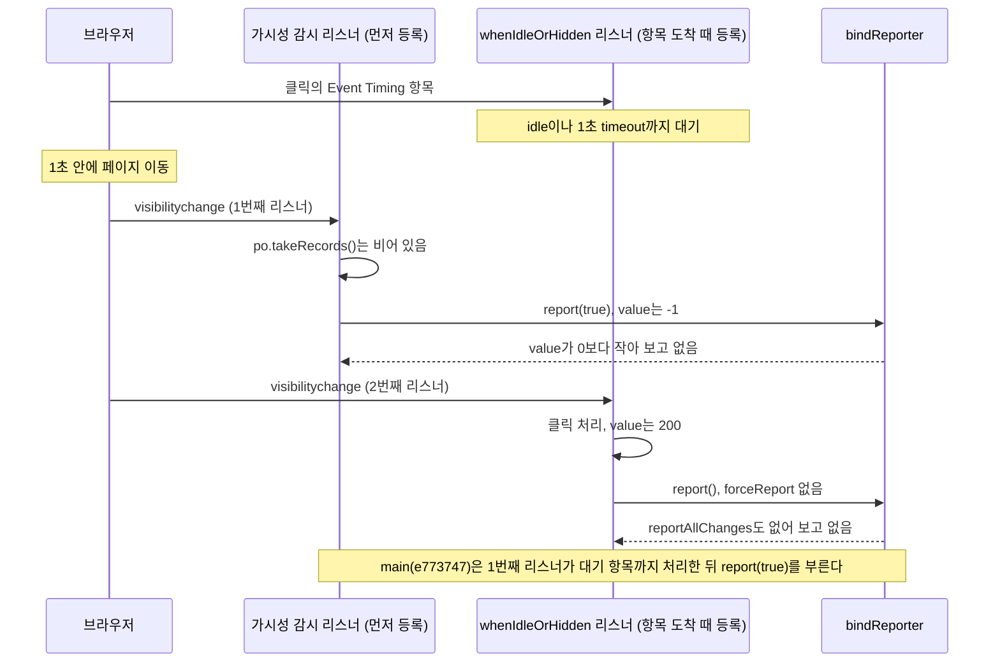

## Table of Contents

## 핵심 웹 지표는 어떻게 측정되는 걸까

핵심 웹 지표(Core Web Vitals)가 무엇인지는 대부분 안다. LCP는 가장 큰 콘텐츠가 그려지기까지의 시간이고, CLS는 레이아웃이 밀린 정도이고, INP는 상호작용에 화면이 응답하기까지의 시간이다. 좋음과 나쁨의 기준값도 외울 정도다. 그런데 그 값이 실제 방문자의 브라우저 안에서 어떻게 만들어져 서버까지 오는지를 떠올려 보면 생각보다 아는 것이 적다. 페이지 로드 하나에서 LCP 후보는 몇 번 바뀌고 그중 어느 값이 보고되는 걸까. 상호작용이 한 번도 없었던 페이지 로드의 INP는 0일까, 아니면 없는 걸까. 탭을 바꿨다가 돌아온 페이지의 CLS는 언제 보고될까. 측정은 대개 Google의 web-vitals 라이브러리에 맡기고, 콜백으로 들어오는 값을 그대로 보내는 데서 끝난다. 콜백이 불리지 않은 페이지 로드는 그래서 아예 보이지 않는다. web-vitals는 세 가지 핵심 지표에 보조 지표인 TTFB와 FCP를 더해 재므로, 이 글도 다섯 지표를 함께 다룬다.

그 콜백이 언제 불리는지 보려고 간단한 페이지를 만들었다. 처리에 200ms가 걸리는 버튼을 한 번 누르고 0.3초 뒤에 다른 페이지로 이동하는 페이지 로드를 Playwright로 띄운 Chromium 156에서 10번 만들었다. web-vitals 6.2.3의 다섯 콜백 중 TTFB, FCP, LCP, CLS는 매번 불렸고, INP는 한 번도 불리지 않았다. 떠나는 시점만 1.5초 뒤로 늦추자 INP가 10번 모두 보고됐다(200ms에서 208ms). 브라우저는 두 경우 모두 그 클릭을 [Event Timing](https://developer.mozilla.org/en-US/docs/Web/API/PerformanceEventTiming) 항목으로 web-vitals에 넘겼다. 다른 점은 web-vitals가 그 항목을 처리하기 전에 페이지가 숨겨졌느냐 하나였다.

값을 받는 서버에서는 이 두 페이지 로드를 구별할 수 없다. INP가 오지 않은 페이지 로드는 상호작용이 한 번도 없었던 페이지 로드와 똑같이 보인다. 그래서 이 시리즈에서 핵심 웹 지표를 OpenTelemetry의 trace(원인 분석용)와 metric(운영 모니터링용)으로 나눠 모으기 전에, web-vitals가 어떤 조건에서 콜백을 부르고 어떤 조건에서 부르지 않는지부터 정리할 필요가 있었다. 콜백을 부를지는 세 곳의 코드가 정한다. 보고할 값을 거르는 `bindReporter`, 페이지가 숨겨졌는지 지켜보는 가시성 감시, 처리를 idle까지 미루는 `whenIdleOrHidden`이다. 위의 INP는 이 세 곳이 어긋나는 순간에 사라진다.

> 기준 버전은 web-vitals [v6.2.3](https://github.com/GoogleChrome/web-vitals/tree/v6.2.3)(2026-10-05 배포, 커밋 [`400d019`](https://github.com/GoogleChrome/web-vitals/commit/400d01968abffcd91a6f0307c9aaac97c5f7a76a))이고, 인용한 소스와 줄 번호는 모두 이 태그 기준이다. 6.2.3 이후 main에 들어온 수정은 커밋 [`e773747`](https://github.com/GoogleChrome/web-vitals/tree/e773747b90f0e8763aed02ba5a74358d628a828c)(2026-10-16)로 고정해 따로 표시했다. 이 글을 쓴 2026-10-18에는 이 수정이 담긴 버전이 배포되지 않았다.
>
> 측정은 Playwright 1.64.1의 Chromium 156(new headless)에서 했고, 버전 차이를 볼 때는 Playwright 1.63.0의 Chromium 153을 함께 썼다. web-vitals는 소스에서 직접 빌드했다(6.2.3과 4.2.1 빌드는 npm 배포본과 바이트 단위로 같았다). 클릭은 [Chrome DevTools Protocol](https://chromedevtools.github.io/devtools-protocol/)(CDP)로 보냈고, 핵심 조건은 DevTools를 붙이지 않은 Chrome Beta 157 창에 macOS 마우스 이벤트로 클릭해 다시 쟀다. 측정 코드는 [blog-experiments/cwv-otel-grafana/experiments/e13-report-timing](https://github.com/yceffort/blog-experiments/tree/0426377c2119e32018e064428353e2aa70617fed/cwv-otel-grafana/experiments/e13-report-timing)에 있다.
>
> 떠나는 문서에서 콜백이 불렸는지는 콜백 안에서 [`navigator.sendBeacon`](https://developer.mozilla.org/en-US/docs/Web/API/Navigator/sendBeacon)으로 측정 스크립트의 수신 서버에 보내서 셌다. [`sessionStorage`](https://developer.mozilla.org/en-US/docs/Web/API/Window/sessionStorage)로 다음 문서에 넘기는 방식은 탭을 닫는 경우를 볼 수 없어서다. 페이지 로드마다 새 브라우저 컨텍스트를 만들었고, 조건마다 5번씩 두 차례 돌려 합쳤다. Playwright의 [`click`](https://playwright.dev/docs/api/class-locator#locator-click)은 마우스를 요소 위로 옮긴 다음 누르므로, 클릭 전에는 `pointermove`가 한 번 들어가고 클릭 뒤에는 따로 입력을 넣지 않는 한 아무 입력도 없다.

## web-vitals가 값을 만드는 길

web-vitals는 브라우저가 [`PerformanceObserver`](https://developer.mozilla.org/en-US/docs/Web/API/PerformanceObserver)로 내보내는 성능 항목을 받아 다섯 지표의 값으로 바꾸고, 그 값을 사용자가 넘긴 콜백으로 전달하는 라이브러리다. 다섯 함수(`onTTFB`, `onFCP`, `onLCP`, `onCLS`, `onINP`)는 모양이 같다. 콜백 하나와 옵션을 받고, 옵션에는 값이 바뀔 때마다 보고하는 `reportAllChanges`, SPA 이동을 따로 재는 `reportSoftNavs`, INP의 관찰 하한인 `durationThreshold`가 있다. 어느 함수도 콜백을 직접 부르지 않고, 뒤에서 볼 `bindReporter`가 돌려준 `report` 함수를 통해서만 부른다.

항목을 받는 자리는 모든 함수가 공유하는 `observe()` 헬퍼다[^12].

```ts
// web-vitals v6.2.3 src/lib/observe.ts
      const po = new PerformanceObserver((list) => {
        // Delay by a microtask to workaround a bug in Safari where the
        // callback is invoked immediately, rather than in a separate task.
        // See: https://github.com/GoogleChrome/web-vitals/issues/277
        queueMicrotask(() => {
          const entries = list.getEntries();
          // When observing more than one entry type, entries from different
          // types can be delivered out of order, so sort by end time
          // (startTime + duration) to ensure they're in the right order.
          // See: https://github.com/w3c/performance-timeline/issues/224
          if (supportedTypes.length > 1) {
            entries.sort((a, b) => {
              const scoreA = a.startTime + a.duration;
              const scoreB = b.startTime + b.duration;

              return scoreA - scoreB;
            });
          }
          callback(entries as Array<PerformanceEntryMap[K][number]>);
        });
      });

      for (const t of supportedTypes) {
        po.observe({type: t, buffered: true, ...opts});
      }
```

[`buffered: true`](https://developer.mozilla.org/en-US/docs/Web/API/PerformanceObserver/observe)라서 web-vitals가 페이지 로드보다 늦게 실행되어도 그 전에 쌓인 항목을 받는다. 4편에서 블로그가 OTel SDK를 동적 import로 늦게 받으면서도 LCP와 CLS를 놓치지 않는 근거가 이 한 줄이다. 다만 Event Timing의 buffered 항목은 브라우저가 104ms(명세가 정한 기본 `durationThreshold`) 이상인 것만 남기므로, 늦게 붙은 web-vitals는 그 전의 짧은 상호작용을 보지 못한다. 브라우저가 지원하지 않는 항목 종류는 [`supportedEntryTypes`](https://developer.mozilla.org/en-US/docs/Web/API/PerformanceObserver/supportedEntryTypes_static)로 걸러서 관찰하지 않고, 하나도 남지 않으면 `undefined`를 돌려준다. 그래서 `onCLS`는 `layout-shift` 항목이 없는 브라우저에서 아무것도 하지 않는다.

지표 객체는 `initMetric`이 만든다[^1]. `name`, `value`, `rating`, `delta`, `entries`, `id`, `navigationType`을 갖는데, `value`의 기본값은 -1이고 `rating`은 보고할 때 채워질 자리라 처음에는 `good`이 들어 있다. `id`는 `v6-{Date.now()}-{13자리 난수}` 형태로 지표 객체마다 새로 만든다. `navigationType`은 [`navigation` 항목](https://developer.mozilla.org/en-US/docs/Web/API/PerformanceNavigationTiming)의 `type`(`navigate`, `reload`, `back-forward`)을 기본으로 하고, prerender된 페이지는 `prerender`, 메모리 부족으로 버려졌다가 다시 열린 페이지는 `restore`, bfcache로 돌아온 페이지는 `back-forward-cache`가 된다. 각 함수는 항목을 받을 때마다 이 객체의 `value`를 고쳐 쓰고, 보고할 때가 되면 `report(true)`를 부른다. `rating`은 지표별 기준값으로 정한다.

| 지표 | good 상한 | poor 하한 |
| ---- | --------- | --------- |
| TTFB | 800ms     | 1800ms    |
| FCP  | 1800ms    | 3000ms    |
| LCP  | 2500ms    | 4000ms    |
| CLS  | 0.1       | 0.25      |
| INP  | 200ms     | 500ms     |

INP는 값이 생기는 길이 다른 넷보다 길다[^13]. `onINP`는 `event`와 [`first-input`](https://w3c.github.io/event-timing/#sec-event-timing-first-input) 두 종류의 항목을 관찰하고, `event`에는 [`durationThreshold`](https://developer.mozilla.org/en-US/docs/Web/API/PerformanceObserver/observe#durationthreshold)(기본 40ms)를 걸어 그보다 짧은 상호작용은 받지 않는다. 받은 항목은 `handleEntries`로 들어오는데, 바로 처리하지 않고 뒤에서 볼 `whenIdleOrHidden`으로 다음 idle까지 미룬다. 처리는 `InteractionManager._processEntry`가 맡고, 상호작용에 속하지 않은 항목([`interactionId`](https://developer.mozilla.org/en-US/docs/Web/API/PerformanceEventTiming/interactionId)가 0인 `mousemove` 같은 것)은 여기서 버린다.

남은 항목은 `interactionId`별로 묶여 가장 긴 10개만 긴 순서로 유지된다. INP 값은 이 목록에서 하나를 고른 길이인데, 고르는 자리는 상호작용 수를 50으로 나눈 몫이다. 50건 미만이면 가장 긴 것, 50건 이상 100건 미만이면 두 번째로 긴 것이 INP가 되고, 소스는 이 계산을 p98 추정이라 부른다. 상호작용 수는 [`performance.interactionCount`](https://developer.mozilla.org/en-US/docs/Web/API/Performance/interactionCount)로 세고, 이 속성이 없는 브라우저에서는 폴리필이 지금까지 본 `interactionId`의 최대와 최소 차이를 7로 나눠 어림한다. 7은 Chromium이 상호작용마다 `interactionId`를 띄우는 간격이다([`kIdIncrement = 7`](https://chromium.googlesource.com/chromium/src/+/6af0574b4a37e7b891f833dafbb47beeb337d4f8/third_party/blink/renderer/core/timing/performance_timeline_entry_id_generator.h#28)).

```ts
// web-vitals v6.2.3 src/lib/InteractionManager.ts
  _estimateP98LongestInteraction(navigationType: Metric['navigationType']) {
    const interactionCountForNavigation =
      this._getInteractionCountForNavigation();
    const candidateInteractionIndex = Math.min(
      this._longestInteractionList.length - 1,
      Math.floor(interactionCountForNavigation / 50),
    );
```

`onINP`는 항목을 처리한 뒤 `updateINPMetric`에서 이 추정값이 지금 값과 다를 때만 `metric.value`를 바꾸고 `report()`를 부른다. 이 `report()`에는 `forceReport`(`report`의 유일한 인자로, 다음 절의 `bindReporter`에서 본다)가 없다. 그래서 `reportAllChanges` 없이 쓰면 상호작용이 처리되는 시점에는 콜백이 불리지 않고, 값만 바뀐 채 기다린다. 처음 본 페이지 로드에서 INP가 200ms에서 208ms로 나온 것은 200ms 핸들러에 다음 화면이 그려지기까지의 시간이 더해진 Event Timing의 `duration`이다.

이렇게 보면 "언제 보고되는가"는 두 질문으로 나뉜다. 각 함수가 `report(true)`를 어디서 부르는가, 그리고 그 전에 `value`가 -1에서 바뀔 기회를 얻는가. 둘 다 거치는 자리가 `bindReporter`다.

## 콜백은 bindReporter를 거쳐서만 불린다

다섯 함수는 값을 계산하는 방법이 서로 다르지만, 사용자가 넘긴 콜백을 직접 부르지는 않는다. 각 함수는 `bindReporter`가 돌려준 `report` 함수를 들고 있다가 보고할 때가 됐다고 판단하면 그 함수를 부르고, 콜백을 부를지는 `report` 안에서 한 번 더 걸러진다[^1].

```ts
// web-vitals v6.2.3 src/lib/bindReporter.ts
export const bindReporter = <MetricName extends MetricType['name']>(
  callback: (metric: Extract<MetricType, {name: MetricName}>) => void,
  metric: Extract<MetricType, {name: MetricName}>,
  thresholds: MetricRatingThresholds,
  reportAllChanges?: boolean,
) => {
  let prevValue: number;
  let delta: number;
  return (forceReport?: boolean) => {
    if (metric.value >= 0) {
      if (forceReport || reportAllChanges) {
        delta = metric.value - (prevValue ?? 0);

        // Report the metric if there's a non-zero delta or if no previous
        // value exists (which can happen in the case of the document becoming
        // hidden when the metric value is 0).
        // See: https://github.com/GoogleChrome/web-vitals/issues/14
        if (delta || prevValue === undefined) {
          prevValue = metric.value;
          metric.delta = delta;
          metric.rating = getRating(metric.value, thresholds);
          callback(metric);
        }
      }
    }
  };
};
```

걸러지는 자리는 세 곳이다. 먼저 `metric.value >= 0`인데, `initMetric`의 기본값이 -1이라서 잴 대상이 한 번도 생기지 않은 지표는 `report(true)`를 몇 번 불러도 여기서 멈춘다. CLS만 `initMetric('CLS', 0)`으로 0에서 시작하고 나머지 넷은 -1에서 시작하므로, 상호작용이 없는 페이지 로드의 INP가 이 조건에 걸리는 대표적인 경우다. 다음은 `forceReport || reportAllChanges`다. `reportAllChanges` 없이 쓰면 각 함수가 `report(true)`를 부르는 순간만 보고 시점이 된다. 마지막 `delta || prevValue === undefined`는 첫 보고를 값이 0이어도 내보낸다. 레이아웃 이동이 한 번도 없는 페이지에서 CLS 0이 보고되는 이유가 이것이고, 그 뒤로는 값이 바뀌었을 때만 나가므로 같은 값으로 `report(true)`를 다시 불러도 아무 일도 일어나지 않는다.

콜백이 받는 `metric`은 매번 같은 객체다. `report`는 `value`, `delta`, `rating`을 덮어쓴 다음 같은 객체를 넘긴다. README의 배치 예제가 보고를 배열이 아니라 `Set`에 모으는 것도 이 성질 덕분에 맞게 동작한다[^2]. 같은 지표가 두 번 보고돼도 `Set`에는 하나만 남고, flush하는 순간 그 객체는 가장 최근 값을 들고 있다. 반대로 콜백에서 받은 객체를 그대로 붙잡아 두었다가 나중에 읽는 코드는, 콜백이 불렸을 때의 값이 아니라 그 뒤에 덮어쓴 값을 읽게 된다.

## 숨겨진 뒤에 그린 것은 세지 않는다

FCP와 LCP는 페이지가 처음 숨겨진 시각보다 먼저 그려졌을 때만 값을 받는다.

```ts
// web-vitals v6.2.3 src/onFCP.ts
          // Only report if the page wasn't hidden prior to FCP.
          if (entry.startTime < visibilityWatcher.firstHiddenTime) {

// web-vitals v6.2.3 src/onLCP.ts
        // Only report if the page wasn't hidden prior to LCP.
        if (renderTime < visibilityWatcher.firstHiddenTime) {
```

`firstHiddenTime`은 모든 지표가 같이 쓰는 가시성 감시(`getVisibilityWatcher`)가 들고 있다. 처음 불릴 때 값을 정하고, 그 뒤로는 window에 capture로 건 [`visibilitychange`](https://developer.mozilla.org/en-US/docs/Web/API/Document/visibilitychange_event) 리스너로 갱신한다[^3].

```ts
// web-vitals v6.2.3 src/lib/getVisibilityWatcher.ts
    // Prefer that, but if it's not available and the document is hidden when
    // this code runs, assume it was hidden since navigation start. This isn't
    // a perfect heuristic, but it's the best we can do until the
    // `visibility-state` performance entry becomes available in all browsers.
    firstHiddenTime = firstVisibilityStateHiddenTime ?? initHiddenTime();

    // Listen for visibility changes so we can handle things like bfcache
    // restores and/or prerender without having to examine individual
    // timestamps in detail and also for onHidden function calls.
    addEventListener('visibilitychange', onVisibilityUpdate, true);
```

`firstVisibilityStateHiddenTime`은 브라우저가 가시성이 바뀔 때마다 남기는 [`visibility-state` 성능 항목](https://developer.mozilla.org/en-US/docs/Web/API/VisibilityStateEntry)에서 찾은 첫 hidden 시각이다. 이 항목은 문서가 만들어질 때 그 시점의 상태로 `startTime` 0인 항목이 하나 먼저 생기고, 그 뒤 상태가 바뀔 때마다 하나씩 추가된다[^14]. 그래서 숨겨진 채로 시작한 문서는 `hidden`이 0에 있고, `firstHiddenTime`도 0이 된다. 이 항목은 Chromium 115부터만 있다[^4]. Firefox와 Safari에서는 `initHiddenTime()`이 대신하는데, 스크립트가 실행되는 순간 숨겨져 있으면 처음부터 숨겨져 있었다고 간주해 0을, 보이면 아직 숨겨진 적이 없다고 간주해 `Infinity`를 넣는다. 그래서 이 두 브라우저에서는 web-vitals가 실행되기 전에 잠깐 숨겨졌다가 돌아온 페이지가 숨겨진 적 없는 페이지로 취급된다. 이 부분은 소스로만 확인했고 Firefox와 Safari에서 재지는 않았다.

백그라운드 탭에서 열린 페이지가 어떻게 되는지는 Chromium 156에서 쟀다(`bg-tab2.mjs`). CDP의 [`Target.createTarget`](https://chromedevtools.github.io/devtools-protocol/tot/Target/#method-createTarget)에 `background: true`를 주어 백그라운드 탭으로 페이지를 열고, 2초 뒤 탭을 앞으로 가져와 100ms짜리 버튼을 누르고 닫았다. 그런데 Chromium은 이 탭을 만든 뒤 10ms에서 18ms 만에 보이는 상태로 바꿨다(이유는 확인하지 못했다). 즉 이 페이지는 처음 10ms 남짓만 숨겨져 있었고, 그려진 것은 모두 보이는 상태에서 그려졌다. 그래도 5번의 결과는 모두 아래 표와 같았다.

| 열린 방법           | `visibility-state` 항목  | TTFB | FCP | LCP | CLS | INP |
| ------------------- | ------------------------ | ---- | --- | --- | --- | --- |
| 백그라운드 탭       | `hidden@0`, `visible@10` | 5/5  | 0/5 | 0/5 | 0/5 | 5/5 |
| 포그라운드 탭(대조) | `visible@0`              | 5/5  | 5/5 | 5/5 | 5/5 | 5/5 |

> Chromium 156(headed), web-vitals 6.2.3. 값은 보고된 페이지 로드 수 / 전체 페이지 로드 수다. 백그라운드 탭의 `visible` 시각은 10ms에서 18ms 사이였다.

FCP와 LCP가 빠진 것은 `firstHiddenTime`이 0이라 어떤 `startTime`도 그보다 작을 수 없기 때문이다. CLS가 같이 빠진 것은 `onCLS`가 FCP가 보고된 다음에야 레이아웃 이동을 모으기 시작하기 때문이다.

```ts
// web-vitals v6.2.3 src/onCLS.ts
  const visibilityWatcher = getVisibilityWatcher();
  // Start monitoring FCP so we can only report CLS if FCP is also reported.
  // Note: this is done to match the current behavior of CrUX.
  onFCP(
    runOnce(() => {
```

반면 `onINP`와 `onTTFB`는 `firstHiddenTime`을 보지 않는다. 그래서 이 페이지 로드에는 TTFB와 INP만 남았다. 숨겨진 시간이 10ms든 10분이든 결과는 같고, 사용자가 실제로 화면을 봤느냐와는 무관하다. [Speculation Rules](https://developer.mozilla.org/en-US/docs/Web/API/Speculation_Rules_API) 등으로 prerender해 둔 페이지는 다섯 함수 모두 `whenActivated`로 활성화를 기다리므로([`prerenderingchange`](https://developer.mozilla.org/en-US/docs/Web/API/Document/prerenderingchange_event) 이벤트), 사용자가 끝내 그 페이지로 가지 않으면 보고가 하나도 없다. prerender는 소스로만 확인했다.

브라우저 지원도 같은 결과를 만든다. MDN의 브라우저 호환성 데이터([browser-compat-data](https://github.com/mdn/browser-compat-data), 이하 BCD) 8.1.6 기준으로 [`LayoutShift`](https://developer.mozilla.org/en-US/docs/Web/API/LayoutShift) 항목은 Chromium 계열에만 있어서 CLS는 다른 브라우저에서 보고되지 않고, `PerformanceEventTiming.interactionId`는 Firefox 144와 Safari 26.2부터 지원하므로 그 전 버전에서는 `onINP`가 함수 첫머리에서 아무것도 등록하지 않고 돌아간다. [`LargestContentfulPaint`](https://developer.mozilla.org/en-US/docs/Web/API/LargestContentfulPaint) 항목은 Firefox 122와 Safari 26.2부터 있다[^4].

iOS는 이 조건이 한꺼번에 걸리는 환경이다. iOS의 Chrome과 Firefox도 WebKit 엔진을 쓰므로(EU에서 허용된 대체 엔진을 빼면) iOS Safari의 지원표가 iOS 전체의 지원표다. iOS 26.2 이전에서는 다섯 지표 중 TTFB와 FCP만 보고되고 LCP, CLS, INP는 콜백 자체가 불리지 않으며, 26.2 이후에도 CLS는 없다. `visibility-state` 항목이 없어 앞에서 본 `initHiddenTime()` 추정을 쓰고, [`requestIdleCallback`](https://developer.mozilla.org/en-US/docs/Web/API/Window/requestIdleCallback)도 없어 뒤에서 볼 `whenIdleOrHidden`이 `setTimeout`으로 다음 task에 실행된다. 즉 이 글의 1초 대기와 그 안에 떠나면 INP를 잃는 문제는 Chromium의 동작이고, WebKit에서는 소스상 다음 task에 처리되어 같은 창이 거의 없다. 이 부분은 BCD와 소스로만 확인했고 iOS 기기에서 재지는 않았다. iOS에서 떠날 때 `visibilitychange`가 오지 않던 14.5 이전 문제는 2편에서, 앱 웹뷰가 떠났다는 신호를 주지 않는 문제는 3편에서 다룬다.

이것들은 버그라기보다 사용자가 보지 않은 화면의 그리기를 세지 않으려는 의도된 동작이다. 다만 결과적으로 같은 페이지 로드 묶음에서도 지표별 건수가 같을 이유가 없다. CLS 건수가 FCP보다 적고, INP가 LCP보다 적은 것만으로는 손실이라고 볼 수 없다.

## 지표마다 report(true)를 부르는 곳이 다르다

다섯 함수가 `report(true)`를 부르는 곳과, 그 전에 페이지를 떠나면 보고되지 않는 경우를 소스에서 정리하면 다음과 같다.

| 지표 | `report(true)`를 부르는 곳                 | 보고되지 않는 경우                                               |
| ---- | ------------------------------------------ | ---------------------------------------------------------------- |
| TTFB | `load` 이벤트 다음 task                    | `load` 전에 떠남                                                 |
| FCP  | 첫 contentful paint 항목을 받은 즉시       | 그리기 전에 숨겨짐                                               |
| LCP  | 첫 `keydown`, `click` 뒤 idle, 또는 hidden | 후보가 그려지기 전에 숨겨짐, Firefox 122와 Safari 26.2 이전      |
| CLS  | hidden이 올 때마다                         | FCP가 보고되지 않음, Chromium 계열이 아닌 브라우저               |
| INP  | hidden이 올 때마다                         | 처리된 상호작용이 없음, `interactionId`를 지원하지 않는 브라우저 |

### TTFB는 이미 정해진 값을 load까지 들고 있다

TTFB의 값은 `navigation` 항목의 [`responseStart`](https://developer.mozilla.org/en-US/docs/Web/API/PerformanceResourceTiming/responseStart)이고, 응답의 첫 바이트가 도착한 순간 정해진다. 그런데 `onTTFB`는 그 값을 `load` 이벤트 다음 task까지 들고 있다가 보고한다. 함수 주석은 `navigation` 항목의 다른 속성까지 모두 채워진 다음에 넘기기 위해서라고 설명한다[^5].

```ts
// web-vitals v6.2.3 src/onTTFB.ts
const whenReady = (callback: () => void) => {
  if (document.prerendering) {
    whenActivated(() => whenReady(callback));
  } else if (document.readyState !== 'complete') {
    addEventListener('load', () => whenReady(callback), true);
  } else {
    // Queue a task so the callback runs after `loadEventEnd`.
    setTimeout(callback);
  }
};
```

그래서 `load` 전에 떠나면 TTFB가 없다. 이미지 하나 때문에 `load`가 3초 뒤에 오는 페이지를 만들고, 1초 뒤와 5초 뒤에 떠나게 했다(`reports.mjs`).

| 떠난 시점 | TTFB | FCP | LCP | CLS |
| --------- | ---- | --- | --- | --- |
| 1초 뒤    | 0/5  | 5/5 | 5/5 | 5/5 |
| 5초 뒤    | 5/5  | 5/5 | 5/5 | 5/5 |

> Chromium 156(new headless), web-vitals 6.2.3. 값은 보고된 페이지 로드 수 / 전체 페이지 로드 수다.

1초 뒤에 떠난 경우도 [`pagehide`](https://developer.mozilla.org/en-US/docs/Web/API/Window/pagehide_event) 시점에 읽은 `responseStart`는 1ms에서 3ms로 이미 정해져 있었지만 TTFB는 한 번도 보고되지 않았다. 같은 페이지 로드에서 FCP, LCP, CLS는 모두 보고됐으므로, 이 묶음만 보면 TTFB만 빠진 것처럼 보인다.

`load`가 늦는 페이지 로드일수록 TTFB가 빠지기 쉬우므로, 모은 TTFB는 `load`까지 머문 페이지 로드로 치우친다. 서버 응답이 느려 `load`까지 늦어지는 페이지라면 느린 TTFB가 더 많이 빠질 가능성이 높다고 생각한다. 이 치우침이 실제로 얼마나 되는지는 재지 않았다.

### LCP는 입력이나 hidden이 끝을 알린다

브라우저는 더 큰 요소를 그릴 때마다 LCP 후보를 새로 낸다. web-vitals는 `reportAllChanges` 없이 쓰면 후보를 받을 때마다 값만 바꿔 두고, 끝났다는 신호를 받으면 한 번 보고한다. 그 신호가 window에 capture로 건 `keydown`, `click`, `visibilitychange`다[^6].

```ts
// web-vitals v6.2.3 src/onLCP.ts
      const finalizeEventTypes = ['keydown', 'click', 'visibilitychange'];

      const finalizeLCP = (event: Event) => {
        if (event.isTrusted && !isFinalized) {
          // Wrap the listener in an idle callback so it's run in a separate
          // task to reduce potential INP impact.
          // https://github.com/GoogleChrome/web-vitals/issues/383
          const metricIdToFinalize = metric.id;
          whenIdleOrHidden(() => {
            if (!isFinalized) {
              if (!softNavsEnabled) {
                // Do some clean up since these won't be needed anymore.
                po!.disconnect();
                for (const type of finalizeEventTypes) {
                  removeEventListener(type, finalizeLCP, {capture: true});
                }
              }
              // As this is in a whenIdleOrHidden check, whether we're still
              // on the metric you meant to finalize, and ignore if we've moved
              // on in the meantime.
              if (metricIdToFinalize === metric.id) {
                isFinalized = true;
                report(true);
              }
            }
          });
        }
      };
```

[`isTrusted`](https://developer.mozilla.org/en-US/docs/Web/API/Event/isTrusted)를 보므로 스크립트로 만든 클릭이나 키 입력은 확정 신호가 되지 않는다. 스크롤은 브라우저가 후보 기록을 멈추는 입력이지만 프로그램으로도 만들 수 있어 확정 신호에서 뺐다고 같은 파일 [242행에서 244행](https://github.com/GoogleChrome/web-vitals/blob/v6.2.3/src/onLCP.ts#L242-L244)의 주석이 설명하고, 그래서 스크롤만 하고 떠난 페이지 로드의 LCP는 hidden에서 보고된다(소스로만 확인했다). 확정은 입력 즉시 하지 않고 `whenIdleOrHidden`으로 미루는데, 확정하면서 부르는 사용자 콜백(분석 스크립트 등)이 클릭 핸들러 안에서 돌면 그 클릭의 INP가 늘어난다는 지적([#383](https://github.com/GoogleChrome/web-vitals/issues/383))이 있었기 때문이다. 이 대기가 실제로 얼마인지는 뒤에서 다시 나온다. `metricIdToFinalize`는 idle을 기다리는 사이에 SPA 이동이나 bfcache 복원으로 새 LCP가 시작됐을 때, 옛 지표를 새 지표의 값으로 확정하지 않으려는 장치다.

확정하면서 관찰자를 `disconnect()`하는데, 그 전에 관찰자에 남아 있는 항목을 [`takeRecords()`](https://developer.mozilla.org/en-US/docs/Web/API/PerformanceObserver/takeRecords)로 꺼내지 않는다. 5.x에는 이 호출이 있었고 6.0.0에서 SPA 이동 지원을 넣으며 빠졌다. 그래서 확정 직전에 관찰자 큐에 남아 있던 후보는 버려질 수 있고, main에서 이 호출을 다시 넣었다([#811](https://github.com/GoogleChrome/web-vitals/pull/811)). 다만 PR 작성자도 실제 브라우저에서 재현하지는 못했다고 적었고, 나도 재현해 보지 않았다.

### CLS와 INP는 숨겨질 때 보고된다

CLS와 INP는 확정이라는 단계가 없고, 가시성 감시에 등록한 함수에서 `report(true)`를 부른다.

```ts
// web-vitals v6.2.3 src/onCLS.ts
        visibilityWatcher.onHidden(() => {
          handleEntries(
            po.takeRecords() as [LayoutShift | PerformanceSoftNavigation],
          );
          report(true);
        });

// web-vitals v6.2.3 src/onINP.ts
      visibilityWatcher.onHidden(() => {
        handleEntries(
          po.takeRecords() as [
            PerformanceEventTiming | PerformanceSoftNavigation,
          ],
          true, // forceReport after processing all entries
        );
      });
```

`onHidden`으로 등록한 함수는 가시성 감시의 리스너가 hidden을 받을 때 차례로 불린다. CLS는 관찰자에 남은 항목을 `takeRecords()`로 꺼내 반영한 다음 바로 보고한다. INP도 남은 항목을 꺼내지만, 그 항목을 `handleEntries`에 넘기면서 처리가 끝나면 보고하라는 표시(`true`)만 붙인다. 앞에서 본 대로 `handleEntries`는 처리를 `whenIdleOrHidden`으로 미루므로, 이 표시가 실제로 `report(true)`가 되는 시점은 그 안이다. 이 차이가 처음 본 INP 손실과 이어진다.

## 숨겨질 때마다 다시 보고된다

LCP, FCP, TTFB는 내비게이션마다 한 번 보고된다. CLS와 INP는 hidden이 올 때마다 `report(true)`가 불리므로, 페이지가 다시 보였다가 값이 바뀐 다음 숨겨지면 같은 `id`로 한 번 더 보고된다. 두 함수의 문서 주석도 같은 페이지 로드에서 콜백이 여러 번 불릴 수 있다고 적고 있다. 탭을 오가는 동안에도 CLS와 INP는 계속 바뀔 수 있는데, 숨겨진 뒤에는 다시 보일지 알 수 없으니 숨겨질 때마다 그때까지의 값을 보고하는 것이다.

3편의 재현 환경에서 숨김, 보임, 위쪽 요소 삽입, 숨김 순서로 만든 페이지 로드는 같은 `id`로 CLS 0과 0.1124를 차례로 보고했다[^7]. Playwright의 Chromium에서는 탭을 바꿔도 hidden이 되지 않아서, 이 실험은 [`visibilityState`](https://developer.mozilla.org/en-US/docs/Web/API/Document/visibilityState)를 덮어쓰고 `visibilitychange`를 보내 흉내 냈다. web-vitals의 hidden 처리는 `isTrusted`를 보지 않으므로 실제와 같은 코드 경로를 탄다.

그래서 받는 서버는 `id`당 보고가 여러 번 올 수 있다는 것을 전제로 해야 한다. 보고마다 histogram에 한 번씩 넣으면 탭을 오간 페이지 로드가 두 번 세어진다. 이 시리즈의 블로그 수집 코드는 `id`마다 처음 온 보고만 histogram에 넣고, 다시 온 보고는 값이 얼마나 자주 바뀌는지 재는 데만 쓴다. 처음 값 대신 마지막 값을 쓰려면 같은 `id`의 값을 나중에 바꿀 수 있는 저장소가 필요한데, 그 구성은 3편에서 다룬다.

## idle까지 미루는 1초

LCP 확정과 INP 처리는 모두 `whenIdleOrHidden`을 거친다[^8].

```ts
// web-vitals v6.2.3 src/lib/whenIdleOrHidden.ts
export const whenIdleOrHidden = (cb: () => void) => {
  // Cap the requestIdleCallback to 1 sec for very busy apps
  // https://github.com/GoogleChrome/web-vitals/issues/754
  // If not using rIC, then the setTimeout timeout should be 0
  const timeout = 'requestIdleCallback' in globalThis ? 1000 : 0;

  const rIC = globalThis.requestIdleCallback || setTimeout;
  const cIC = globalThis.cancelIdleCallback || clearTimeout;

  // If the document is hidden, run the callback immediately, otherwise
  // race an idle callback with the next `visibilitychange` event.
  if (document.visibilityState === 'hidden') {
    cb();
  } else {
    const wrappedCb = runOnce(cb);

    let idleHandle = -1;
    const onHidden = () => {
      cIC(idleHandle);
      wrappedCb();
    };

    addEventListener('visibilitychange', onHidden, {once: true, capture: true});
    idleHandle = rIC(
      () => {
        removeEventListener('visibilitychange', onHidden, {capture: true});
        wrappedCb();
      },
      {timeout: timeout},
    );
  }
};
```

페이지가 보이는 동안에는 `requestIdleCallback`으로 다음 idle을 기다리고, 그 사이에 `visibilitychange`가 오면 기다리지 않고 바로 실행한다. 이미 숨겨져 있으면 즉시 실행한다. INP가 idle을 기다리는 이유는 `src/onINP.ts`의 주석에 있다. 한 상호작용에 딸린 이벤트 항목이 모두 도착할 때까지 기다리려는 것이다.

`timeout: 1000`은 6.0.0에서 들어왔다. 메인 스레드가 쉬지 않는 앱에서는 idle이 오지 않아 DevTools의 INP가 갱신되지 않는다는 이슈([#754](https://github.com/GoogleChrome/web-vitals/issues/754))가 있었고, 그래서 idle을 최대 1초만 기다리게 했다([#755](https://github.com/GoogleChrome/web-vitals/pull/755)). Next.js 16.3.5가 [`useReportWebVitals`](https://nextjs.org/docs/app/api-reference/functions/use-report-web-vitals)용으로 번들하는 4.2.1에는 이 상한이 없다[^9]. `requestIdleCallback`이 없는 Safari에서는 `setTimeout`이 대신하므로 다음 task까지만 미뤄진다(소스로만 확인했고 Safari에서 재지는 않았다).

그러면 바쁘지 않은 페이지에서는 idle이 금방 올까. 버튼 하나만 있는 페이지에서 클릭 핸들러는 아무 일도 하지 않게 두고, 여러 시점에 `requestIdleCallback`을 걸어 불리기까지 걸린 시간을 쟀다(`idle-after-input.mjs`, `idle-until-input.mjs`).

| idle 콜백을 건 시점                          | 불리기까지                                |
| -------------------------------------------- | ----------------------------------------- |
| 첫 클릭 전, 입력 없이                        | 0ms에서 1ms                               |
| 클릭 핸들러 안                               | 3ms에서 16ms                              |
| 클릭의 Event Timing 항목을 받은 관찰자 콜백  | 3초 timeout까지 불리지 않음(19번 중 19번) |
| 같은 관찰자 콜백, macOS 마우스 이벤트로 클릭 | 10초 timeout까지 불리지 않음(5번 중 5번)  |
| 클릭 1초 뒤, 그 뒤로 입력 없음               | 15초 timeout까지 불리지 않음              |
| 클릭 1초 뒤, 6초 뒤에 마우스 이동            | 마우스를 움직인 직후                      |

> 넷째 줄을 빼면 클릭과 마우스 이동은 CDP로 넣었다. 첫 세 줄은 Playwright 1.64.1로 띄운 Chromium 156(headless, headed)과, Playwright 없이 직접 띄우고 CDP로만 붙은 Chrome Beta 157(headless, headed)에서 같은 결과가 나왔다. 넷째 줄은 DevTools를 붙이지 않고 창을 띄운 Chrome Beta 157.0.8103.6에 macOS의 HID 이벤트 탭(`CGEvent.post(tap: .cghidEventTap)`, 브라우저 탭이 아니라 물리 마우스의 입력이 창 서버로 들어오는 지점)으로 마우스 이벤트를 넣어 쟀다. 마지막 두 줄은 Chromium 156에서 쟀다.

클릭 핸들러 안에서 건 idle 콜백은 곧바로 불렸지만, 클릭이 끝난 뒤에 건 idle 콜백은 다음 입력이 들어오기 전까지 불리지 않았다. 처음에는 클릭을 1.3초 간격으로 반복하며 재다가 idle이 약 1.28초 뒤에 온다고 읽었는데, 그것은 다음 클릭이 들어간 시각이었다. 간격을 3.5초로 늘리자 idle도 그만큼 늦게 왔다. web-vitals가 INP 항목을 받는 관찰자 콜백은 클릭 다음 화면이 그려진 뒤에 불리므로 이 경우에 해당한다.

CDP로 넣은 입력이라 생긴 현상일 수도 있어서, DevTools를 붙이지 않은 브라우저에 macOS 마우스 이벤트로 클릭해 다시 쟀다. 결과는 같았다. 관찰자 콜백에서 건 idle 콜백은 5번 모두 10초 timeout까지 불리지 않았고, 그동안 페이지에 들어온 입력은 없었다. 클릭 3초 뒤에 마우스를 움직여 페이지에 `pointermove`가 들어간 두 번은 그 직후에 불렸다. 브라우저 버전 때문일 가능성도 있어서 Playwright 1.63.0의 Chromium 153에서 같은 스크립트를 다시 돌렸다. 클릭 1초 뒤에 건 콜백은 15초 timeout이 다 되어서야(클릭 16초 뒤) 불렸고, 6초 뒤에 마우스를 움직인 경우에는 클릭 6008ms 뒤에 불렸다. 관찰자 콜백에서 건 콜백도 3초 timeout까지 불리지 않았다(항목을 받은 직후에 건 4번 중 4번, 300ms 뒤에 건 5번 중 5번). 153에서는 클릭 사이에 입력 없이 건 콜백도 다음 클릭이 들어간 약 507ms 뒤에야 불렸다. 153, 156, 157에서 같은 결과이므로 특정 버전의 현상은 아닌 것으로 보이지만, 원인이 Chromium 스케줄러 어디에 있는지는 코드로 확인하지 못했다.

이 결과는 이 글의 INP 손실을 보고한 web-vitals 이슈 [#805](https://github.com/GoogleChrome/web-vitals/issues/805)(다음 절에서 다룬다)에서 다른 기여자가 Chrome 155로 잰 대조군과 맞지 않는다. 그 측정에서는 한가한 페이지에서 매번 INP가 보고됐다고 적혀 있다. 대조군을 클릭 뒤 언제, 어떤 방법으로 숨겼는지는 나와 있지 않고, 탭 전환이나 최소화에 쓴 입력이 페이지에 들어갔을 수도 있어서 어느 결과가 맞는지 가려내지 못했다. 내가 확인한 것은 세 버전의 Chromium에서 두 가지 입력 방식으로 클릭 뒤 입력이 없을 때 idle이 오지 않았다는 사실까지다. 마우스를 쓰는 방문자는 클릭한 뒤에도 커서를 움직이는 경우가 많으니 그때 idle이 올 것이고, 다음 탭까지 아무 이벤트가 없는 터치 화면에서는 timeout까지 기다리는 경우가 더 많을 것이라고 생각한다(모바일 기기에서는 재지 않았다).

이 측정대로라면 6.2.3에서 INP 항목은 다음 idle이나 1초 timeout 중 먼저 오는 때에 처리된다. 메인 스레드가 바쁜 페이지에서는 1초를 거의 다 채우고, 한가한 페이지도 클릭 뒤에 다른 입력이 없으면 1초를 채운다.

## 그 1초 안에 떠나면 INP가 보고되지 않는다

페이지가 숨겨질 때 window의 capture 단계에는 `visibilitychange` 리스너가 둘 걸려 있다. 하나는 가시성 감시가 처음 만들어질 때 건 리스너([`getVisibilityWatcher.ts` 88행](https://github.com/GoogleChrome/web-vitals/blob/v6.2.3/src/lib/getVisibilityWatcher.ts#L88))이고, 다른 하나는 상호작용 항목이 도착했을 때 `whenIdleOrHidden`이 건 리스너([`whenIdleOrHidden.ts` 45행](https://github.com/GoogleChrome/web-vitals/blob/v6.2.3/src/lib/whenIdleOrHidden.ts#L45))다. 같은 대상, 같은 단계의 리스너는 건 순서대로 불리므로 가시성 감시가 먼저 불린다. 그 다음 일은 이렇게 흘러간다.

1. 가시성 감시가 INP의 `onHidden` 함수를 부른다. `po.takeRecords()`는 비어 있다. 클릭의 항목은 이미 관찰자 콜백으로 전달돼 idle을 기다리는 중이기 때문이다(아래 측정에서 같은 시점에 다른 관찰자로 꺼내 봐도 매번 비어 있었다).
2. 빈 목록으로 `handleEntries(..., true)`가 불리고, 이미 숨겨진 상태라 바로 실행된다. `InteractionManager`에는 아직 이 클릭이 없으므로 `metric.value`는 -1 그대로이고, `report(true)`는 아무것도 보고하지 않는다. 앞서 처리된 상호작용이 있었다면 그 값이 대신 보고된다.
3. 이어서 `whenIdleOrHidden`의 리스너가 기다리던 처리를 실행한다. 이제 클릭이 반영돼 값이 200이 되지만, 이 처리가 부르는 `report()`에는 `forceReport`가 없어 `bindReporter`에서 걸러진다.



페이지가 다시 보였다가 숨겨지면 그때 보고되지만, 다른 페이지로 이동하거나 탭을 닫은 페이지 로드에는 다음 hidden이 없다. 클릭한 뒤 떠나는 시점과 방법을 바꿔 가며 INP가 보고된 페이지 로드를 셌다(`run.mjs`). 클릭 핸들러는 200ms 동안 메인 스레드를 잡는다. 바쁜 페이지는 클릭 뒤 3초 동안 45ms짜리 작업을 [`MessageChannel`](https://developer.mozilla.org/en-US/docs/Web/API/MessageChannel)로 쉬지 않고 이어 붙여 idle이 생기지 않게 했다. 조건마다 5번씩 두 차례 돌린 합계다.

| 떠나는 방법                        | 클릭 뒤 떠난 시점 | 6.2.3 한가한 페이지 | 6.2.3 바쁜 페이지 | main 한가한 페이지 | main 바쁜 페이지 |
| ---------------------------------- | ----------------- | ------------------- | ----------------- | ------------------ | ---------------- |
| 클릭 핸들러가 `location.href` 변경 | 0.1초             | 1/10                | 0/10              | 10/10              | 10/10            |
|                                    | 0.3초             | 0/10                | 0/10              | 10/10              | 10/10            |
|                                    | 0.6초             | 1/10                | 0/10              | 10/10              | 10/10            |
|                                    | 1.5초             | 10/10               | 10/10             | 10/10              | 10/10            |
| 링크, 응답 0.3초                   | 0.3초             | 0/10                | 0/10              | 10/10              | 10/10            |
| 링크, 응답 1.5초                   | 1.5초             | 10/10               | 10/10             | 10/10              | 10/10            |
| 링크, 응답 즉시                    | 약 0.005초        | 0/10                | 0/10              | 0/10               | 0/10             |
| 탭 닫기                            | 0.3초             | 0/10                | 0/10              | 10/10              | 10/10            |
|                                    | 1.5초             | 10/10               | 10/10             | 10/10              | 10/10            |

> Playwright 1.64.1의 Chromium 156(new headless)에서 쟀다. 값은 보고된 페이지 로드 수 / 전체 페이지 로드 수이고, 보고된 INP는 모두 200ms에서 208ms였다. 떠난 시점은 클릭 핸들러가 끝난 뒤부터 잰 값이다. 바쁜 페이지에서는 이어 붙인 작업 때문에 항목 전달과 이동이 0.1초 남짓 늦어진다. main은 커밋 [`e773747`](https://github.com/GoogleChrome/web-vitals/tree/e773747b90f0e8763aed02ba5a74358d628a828c)이다.

응답이 즉시 온 링크를 빼면, 6.2.3은 클릭 뒤 0.6초 안에 떠난 페이지 로드 100번 중 2번만 INP를 보고했고, 1.5초 뒤에 떠난 경우는 모두 보고했다. 경계를 좁혀 보면 0.9초에 떠난 경우는 한가한 페이지 5번 중 3번, 바쁜 페이지 5번 중 0번이 보고됐고, 1.1초는 모두 보고됐다. 1초 timeout 근처에서 갈리는 것이다. Chromium 153에서 6.2.3만 다시 돌린 결과도 같은 모양이었다. 0.3초에 이동으로 떠난 경우는 한가한 페이지 5번 중 1번, 바쁜 페이지 0번, 링크로 떠난 경우는 둘 다 0번, 1.5초 뒤는 모두 보고했다.

한가한 페이지에서 timeout 전에 보고된 페이지 로드는 이동이 시작된 뒤 문서가 사라지기 전에 처리가 끝난 경우로 보인다. 156에서 한 번, 153에서 한 번, 같은 페이지의 관찰자가 건 idle 콜백이 `pagehide` 1ms 전에 불린 것을 확인했지만, 나머지는 원인을 확인하지 못했다. main은 같은 조건에서 모두 보고했다.

한가한 페이지와 바쁜 페이지가 거의 같게 나온 것은 앞 절에서 본 대로 클릭 뒤 다른 입력이 없으면 idle이 오지 않아, 두 페이지 모두 1초 timeout에 기대 처리됐기 때문이다. 이 표의 클릭은 CDP 입력이라, 한가한 페이지에서 이동으로 떠나는 조건 일부를 DevTools를 붙이지 않은 Chrome Beta 157에 macOS 마우스 이벤트로 클릭해 다시 쟀다(`inp-os-input.mjs`). 6.2.3은 0.3초에 떠난 5번 중 0번, 1.5초에 떠난 5번 중 5번을 보고했고, main은 0.3초에 떠난 5번을 모두 보고했다(보고된 INP는 224ms에서 232ms로, 창을 띄운 브라우저라 다음 화면이 그려지기까지의 시간이 더해진 것으로 보인다). 다만 클릭한 뒤 떠나기 전에 마우스를 움직인 페이지 로드는 그때 idle이 와서 INP가 처리되므로, 실제 트래픽에서 한가한 페이지의 손실은 이 표보다 적을 수 있다. 바쁜 페이지는 마우스를 움직여도 메인 스레드가 쉬지 않아 이런 차이가 없을 것이고, 결과도 [#805](https://github.com/GoogleChrome/web-vitals/issues/805)의 실제 Chrome 측정과 맞는다.

응답이 즉시 오는 링크는 두 버전 모두 보고하지 않았다. 이 경우는 클릭 핸들러가 끝나고 약 5ms 만에 `pagehide`가 왔고, 숨겨지는 순간 별도 관찰자의 큐를 `takeRecords()`로 꺼내 봐도 클릭 항목이 없었다(6번 중 6번). 즉 문서가 사라지기 전에 클릭 항목이 관찰자에 들어오지 않았다. [#805](https://github.com/GoogleChrome/web-vitals/issues/805)에서 Chromium 개발자는 Event Timing이 `visibilitychange`를 페이지에 전달하기 전에 대기 중인 항목에 대체 종료 시각을 붙여 관찰자 버퍼로 내보내므로, hidden 리스너에서 `takeRecords()`를 부르면 받을 수 있다고 설명했다[^16]. 이 측정은 그 설명과 맞지 않는데, 이동으로 떠나는 경로에서는 그 처리가 다를 수도 있고 다음 화면이 그려지기 전이라 항목이 아직 보고 가능한 상태가 아니었을 수도 있다. Chromium 코드로 확인하지는 못했다. 어느 경우든 web-vitals가 받을 항목이 없었으니 라이브러리 수정으로는 되찾을 수 없는 손실이다.

Next.js 16.3.5가 번들하는 4.2.1은 timeout이 없어서 결과가 더 나빴다. 같은 환경에서 클릭 뒤 1.5초와 4.5초에 떠난 경우도 한가한 페이지와 바쁜 페이지 모두 한 번도 보고하지 않았다(각 5번 중 0번). 클릭 뒤 다음 입력이 없으면 idle이 오지 않으므로, 4.2.1은 떠나기 전에 다른 입력이 없었던 마지막 상호작용을 아예 처리하지 못한다.

이 문제는 2026-10-09에 web-vitals 이슈로 올라왔다([#805](https://github.com/GoogleChrome/web-vitals/issues/805))[^10]. 이슈 작성자는 Chromium 141에서 hidden을 흉내 낸 재현으로 보고했고, 같은 이슈에서 다른 기여자가 실제 Chrome 155에서 바쁜 페이지의 600ms 클릭 뒤 300ms 만에 떠나면 INP가 빠진다는 것을 확인했다. 작성자가 처음 제안한 수정은 idle 콜백 안에서 페이지가 이미 숨겨져 있으면 `report(true)`를 부르는 한 줄이었다. 메인테이너는 처음에 드문 경우일 것으로 봤지만, 이 한 줄 수정은 INP를 연달아 두 번 보고하게 된다는 점을 짚었고, 작성자가 대기 중인 항목을 한 목록으로 모으는 모양으로 바꿔 2026-10-15에 main에 병합됐다([#809](https://github.com/GoogleChrome/web-vitals/pull/809)). 수정은 두 가지를 바꿨다.

```ts
// web-vitals e773747 src/onINP.ts
    const handleEntries = (
      entries: (PerformanceEventTiming | PerformanceSoftNavigation)[],
      forceReport: boolean = false,
    ) => {
      pendingEntries.push(...entries);
      if (forceReport) {
        processPendingEntries(true);
      } else if (!idleQueued) {
        // ...
        idleQueued = true;
        whenIdleOrHidden(() => {
          idleQueued = false;
          processPendingEntries();
        });
      }
    };
```

하나는 `onINP`가 idle을 기다리는 항목을 `pendingEntries`에 모으고, hidden에서 보고하기 전에 그 목록까지 처리하는 것이다. 위의 2번 단계에서 클릭이 반영된다. 다른 하나는 가시성 감시가 `pagehide`에서도 `onHidden` 함수를 부르게 한 것이다. 문서를 떠날 때는 `pagehide`가 `visibilitychange`보다 먼저 오므로, 다음 버전부터 CLS와 INP는 `pagehide` 시점에 보고된다. `firstHiddenTime`도 `pagehide`의 시각으로 정해질 수 있게 바뀌었다.

두 번째 변경은 2편에서 다룬 전송 순서와도 맞물린다. 2편은 6.2.3이 `visibilitychange`에서 CLS와 INP를 보고한다는 것을 전제로 flush 시점을 골랐다. 그 전제는 이 수정이 배포되면 바뀐다.

수정이 배포되기 전에 6.2.3에서 이 손실을 피하는 방법으로는 INP만 `reportAllChanges: true`로 받는 방법이 있다. 그러면 3번 단계의 `report()`가 `bindReporter`를 통과해, 클릭이 반영된 값으로 콜백이 불린다. 이 콜백은 window의 capture 단계에서 불리고 그 단계는 `document`의 리스너보다 먼저이므로, `document`에 건 `visibilitychange` 리스너에서 flush하면 그 값이 함께 나간다. 같은 환경에서 클릭 뒤 0.3초 만에 이동, 링크, 탭 닫기로 떠난 페이지 로드 30번(한가한 페이지와 바쁜 페이지)이 모두 INP를 보고했다. 대신 상호작용이 처리될 때마다 같은 `id`로 보고가 오므로, 받는 서버는 `id`마다 마지막 값을 골라 보내야 한다. 앞에서 본 것처럼 콜백이 받는 `metric`은 같은 객체라서, `id`별로 객체를 들고 있다가 hidden에서 보내면 된다.

블로그 수집 코드에는 이 우회를 넣지 않았다. 처음 온 보고만 쓰는 구조에 그대로 넣으면 첫 상호작용 값만 남아서 INP만 따로 처리해야 하는데, 수정이 담긴 버전이 곧 나올 것으로 보고 그때 web-vitals를 올리기로 했다. 그러니 지금 블로그에서는 상호작용 항목이 idle 처리를 기다리는 동안 페이지를 떠나면 INP가 빠지거나 그 전 상호작용의 값으로 보고될 수 있다. 실제 트래픽에서 이런 페이지 로드가 얼마나 되는지는 재지 않았다.

## 돌아온 페이지의 값은 다른 것을 잰다

[bfcache](https://developer.mozilla.org/en-US/docs/Glossary/bfcache)(뒤로, 앞으로 가기에서 페이지를 메모리에서 그대로 되살리는 캐시)로 복원된 페이지는 새 내비게이션으로 취급된다. 다섯 함수 모두 `onBFCacheRestore`로 [`pageshow`](https://developer.mozilla.org/en-US/docs/Web/API/Window/pageshow_event)의 [`persisted`](https://developer.mozilla.org/en-US/docs/Web/API/PageTransitionEvent/persisted)가 참일 때 새 `id`의 지표를 만들고, `navigationType`은 `back-forward-cache`가 된다[^15].

```ts
// web-vitals v6.2.3 src/lib/bfcache.ts
export const onBFCacheRestore = (cb: onBFCacheRestoreCallback) => {
  addEventListener(
    'pageshow',
    (event) => {
      if (event.persisted) {
        bfcacheRestoreTime = event.timeStamp;
        cb(event);
      }
    },
    true,
  );
};
```

그런데 이때 보고되는 값은 처음 로드의 값과 같은 것을 재지 않는다.

```ts
// web-vitals v6.2.3 src/onLCP.ts
        doubleRAF(() => {
          metric.value = performance.now() - event.timeStamp;
          isFinalized = true;
          report(true);
        });
```

LCP와 FCP는 복원된 `pageshow`부터 [`requestAnimationFrame`](https://developer.mozilla.org/en-US/docs/Web/API/Window/requestAnimationFrame) 두 번 뒤까지의 시간이다. 복원된 화면에서 어떤 요소가 그려졌는지는 보지 않는다. TTFB는 `initMetric('TTFB', 0, 'back-forward-cache', ...)`으로 만들어져 0으로 보고된다. INP는 복원 이후의 상호작용만 다시 세는데, 상호작용이 있었지만 `durationThreshold`(기본 40ms) 이상인 것이 하나도 없으면 실제 값 대신 8ms를 보고한다.

```ts
// web-vitals v6.2.3 src/lib/InteractionManager.ts
    // If we have a non-zero interactionCountForNavigation but no
    // candidateInteractionIndex, then it's below the 16ms limit
    // so report a dummy 8ms interaction. This is only needed for
    // soft-navs and bfcache restores as `first-input` handles the
    // rest.
    if (
      interactionCountForNavigation &&
      candidateInteractionIndex === -1 &&
      (navigationType === 'soft-navigation' ||
        navigationType === 'back-forward-cache')
    ) {
      return {
        _latency: 8,
        id: -1,
        entries: [],
      };
    }
```

여기에는 기준값이 세 개 섞여 있다. 브라우저가 Event Timing 항목으로 만드는 최소 길이 16ms, web-vitals가 `event` 항목을 관찰하는 하한 `durationThreshold` 40ms, 그리고 후보가 없을 때 대신 보고하는 8ms다. 주석은 16ms 한도 아래라서 8ms를 보고한다고 적지만, 후보 목록이 비는 조건은 관찰자의 `durationThreshold`(기본 40ms) 이상인 상호작용이 하나도 없을 때다. 상호작용 수는 `performance.interactionCount`로 세는데, 이 값은 길이와 상관없이 모든 상호작용을 센다(BCD 8.1.6 기준 Chrome 144, Firefox 144, Safari 26.2부터 지원). 그 전 버전에서는 폴리필이 `durationThreshold: 0`으로 관찰한 항목의 `interactionId` 간격으로 수를 어림하는데, 브라우저가 받는 하한이 16ms라서 그보다 짧은 상호작용은 세지 못한다. 그래서 기본값으로 쓰면 복원 뒤 40ms 미만의 상호작용은 길이와 상관없이 8ms로 보고된다. 처음 로드에서는 `first-input` 항목이 기준값과 상관없이 들어와 후보가 되므로 이런 일이 없다.

처음 로드에서 버튼을 한 번 누르고 떠났다가, 뒤로 가기로 복원된 페이지에서 같은 버튼을 다시 누르고 떠나는 페이지 로드를 클릭 핸들러의 길이별로 5번씩 만들었다(`reports.mjs`).

| 클릭 핸들러 | 처음 로드의 INP | 복원 뒤 INP | 복원 뒤 FCP, LCP  | 복원 뒤 TTFB |
| ----------- | --------------- | ----------- | ----------------- | ------------ |
| 0ms         | 16ms            | **8ms**     | 17.3ms에서 37.8ms | 0            |
| 20ms        | 24ms            | **8ms**     | 15.6ms에서 39.3ms | 0            |
| 60ms        | 64ms            | 64ms        | 19.2ms에서 37.3ms | 0            |

> Chromium 156(new headless, Playwright가 기본으로 넣는 `--disable-back-forward-cache`를 뺐다), web-vitals 6.2.3. 15번 모두 복원됐고, INP와 TTFB는 행마다 5번 모두 같은 값이었다.

처음 로드에서 16ms와 24ms로 보고된 클릭이 복원 뒤에는 둘 다 8ms가 됐고, 40ms 이상인 64ms 클릭만 그대로 보고됐다. 복원 뒤의 FCP와 LCP는 모든 페이지 로드에서 서로 1ms 안쪽으로 붙어 있었다. 둘 다 같은 `pageshow`에서 프레임 두 개를 기다린 시간이기 때문이다.

[Soft Navigations API](https://wicg.github.io/soft-navigations/)를 지원하는 Chromium 151 이상에서 `reportSoftNavs: true`로 SPA 이동을 잴 때도 비슷하다. README는 이동마다 TTFB를 0으로 보고하고, FCP와 LCP는 이동 뒤에 새로 그려진 것만 세며, INP는 이동 뒤의 상호작용만 다시 잰다고 적는다[^11]. 이동이 일어나는 순간 앞 내비게이션의 CLS와 INP는 그 시점 값으로 보고된다.

그래서 `navigationType`이 다른 값을 한 분포에 섞으면, 같은 이름의 지표가 서로 다른 것을 잰 값끼리 섞인다. bfcache 복원이 많은 사이트에서 LCP p75가 갑자기 좋아졌다면, 페이지가 빨라진 것이 아니라 복원 비율이 늘어난 것일 수 있다. 이 시리즈의 수집 코드는 `navigationType`을 metric 라벨(`navigation.type`)로 두고 처음 로드와 나머지를 나눠 본다.

## 보고되지 않은 값은 0도 오류도 아니다

web-vitals의 콜백이 불리지 않은 페이지 로드에는 여러 종류가 섞여 있다. 숨겨진 뒤에 그려진 LCP나 `load` 전에 떠난 페이지 로드의 TTFB처럼 의도대로 빠지는 값이 있고, 클릭 직후 떠난 페이지 로드의 INP처럼 6.2.3의 리스너 순서 때문에 빠지는 값이 있고, 응답이 즉시 온 링크처럼 브라우저가 항목을 넘기기 전에 문서가 사라져 어느 코드로도 손쓸 수 없는 값이 있다. 받는 서버에서는 세 경우가 똑같이 "보고 없음"으로 보인다. 그래서 지표별 건수를 비교해 손실을 찾으려면, 먼저 web-vitals가 각 지표를 어떤 페이지 로드에서 보고하는지 알고 있어야 한다고 생각한다. 그 기준이 없으면 의도된 결측을 손실로 오해하거나, 진짜 손실을 의도된 결측으로 넘기게 된다.

이 글에서 재지 못한 것도 적어 둔다. Firefox와 Safari의 가시성 처리, Safari의 `setTimeout` 대체, prerender, 스크롤만 하고 떠난 LCP는 소스로만 확인했다. 클릭 뒤 idle이 오지 않는 현상은 Chromium 세 버전과 두 입력 방식에서 같았지만 원인은 찾지 못했고, [#805](https://github.com/GoogleChrome/web-vitals/issues/805)의 대조군과 맞지 않는 이유도 밝히지 못했다. 모바일 기기에서는 하나도 재지 않았다. 이 글의 INP 손실은 이슈와 수정까지 나와 있지만 아직 배포되지 않았고, 배포되면 CLS와 INP의 보고 시점이 `pagehide`로 바뀐다. web-vitals 버전을 올릴 때마다 떠나는 페이지 로드를 만들어 지표별 보고를 다시 세어 보는 것이 지금으로서는 가장 확실한 확인 방법일 것이다. 그렇게 보고된 값이 페이지를 떠나는 순간 어떻게 나가는지는 2편에 이어진다.

[^1]: [web-vitals v6.2.3 `src/lib/bindReporter.ts`](https://github.com/GoogleChrome/web-vitals/blob/v6.2.3/src/lib/bindReporter.ts#L32-L58). 지표 객체의 초기값과 `navigationType` 판정은 [`src/lib/initMetric.ts`](https://github.com/GoogleChrome/web-vitals/blob/v6.2.3/src/lib/initMetric.ts#L23-L70), `id`는 [`src/lib/generateUniqueID.ts`](https://github.com/GoogleChrome/web-vitals/blob/v6.2.3/src/lib/generateUniqueID.ts)

[^2]: [web-vitals v6.2.3 README의 "Batch multiple reports together"](https://github.com/GoogleChrome/web-vitals/blob/v6.2.3/README.md#batch-multiple-reports-together)

[^3]: [web-vitals v6.2.3 `src/lib/getVisibilityWatcher.ts`](https://github.com/GoogleChrome/web-vitals/blob/v6.2.3/src/lib/getVisibilityWatcher.ts#L63-L113)

[^4]: [MDN browser-compat-data](https://github.com/mdn/browser-compat-data) 8.1.6의 `api.VisibilityStateEntry`(Chrome 115, Firefox와 Safari 미지원). 같은 데이터에서 `LayoutShift`는 Chrome 77부터이고 Firefox와 Safari는 지원하지 않으며, `LargestContentfulPaint`는 Chrome 77, Firefox 122, Safari 26.2부터, `PerformanceEventTiming.interactionId`는 Chrome 96, Firefox 144, Safari 26.2부터, `Performance.interactionCount`는 Chrome 144, Firefox 144, Safari 26.2부터 지원한다. `Window.requestIdleCallback`은 Chrome 47, Firefox 55부터이고 Safari는 preview에만 있다.

[^5]: [web-vitals v6.2.3 `src/onTTFB.ts`](https://github.com/GoogleChrome/web-vitals/blob/v6.2.3/src/onTTFB.ts#L30-L59)

[^6]: [web-vitals v6.2.3 `src/onLCP.ts`](https://github.com/GoogleChrome/web-vitals/blob/v6.2.3/src/onLCP.ts#L210-L249). 확정 전 `takeRecords()` 수정은 [#811](https://github.com/GoogleChrome/web-vitals/pull/811)

[^7]: [blog-experiments `cwv-otel-grafana/experiments/e12-browser-lifecycle`](https://github.com/yceffort/blog-experiments/tree/a855b62c575f053ea9d4fb1bfe2fa2ead53d7df8/cwv-otel-grafana/experiments/e12-browser-lifecycle)의 탭 복귀 시나리오

[^8]: [web-vitals v6.2.3 `src/lib/whenIdleOrHidden.ts`](https://github.com/GoogleChrome/web-vitals/blob/v6.2.3/src/lib/whenIdleOrHidden.ts#L23-L54). 1초 상한은 [#754](https://github.com/GoogleChrome/web-vitals/issues/754)와 [#755](https://github.com/GoogleChrome/web-vitals/pull/755)

[^9]: [Next.js v16.3.5 `packages/next/package.json`](https://github.com/vercel/next.js/blob/v16.3.5/packages/next/package.json)의 devDependencies `web-vitals: 4.2.1`. 4.2.1의 [`src/lib/whenIdle.ts`](https://github.com/GoogleChrome/web-vitals/blob/v4.2.1/src/lib/whenIdle.ts)는 `requestIdleCallback`을 timeout 없이 부른다.

[^10]: [web-vitals #805](https://github.com/GoogleChrome/web-vitals/issues/805), 수정은 [#809](https://github.com/GoogleChrome/web-vitals/pull/809)

[^11]: [web-vitals v6.2.3 README의 "Report metrics for soft navigations"](https://github.com/GoogleChrome/web-vitals/blob/v6.2.3/README.md#report-metrics-for-soft-navigations)

[^12]: [web-vitals v6.2.3 `src/lib/observe.ts`](https://github.com/GoogleChrome/web-vitals/blob/v6.2.3/src/lib/observe.ts#L38-L79). Event Timing의 buffered 항목이 104ms 이상만 남는 것은 [Event Timing 명세](https://w3c.github.io/event-timing/)의 Performance Timeline 버퍼 규칙이다.

[^13]: [web-vitals v6.2.3 `src/lib/InteractionManager.ts`](https://github.com/GoogleChrome/web-vitals/blob/v6.2.3/src/lib/InteractionManager.ts#L30-L170), [`src/lib/polyfills/interactionCountPolyfill.ts`](https://github.com/GoogleChrome/web-vitals/blob/v6.2.3/src/lib/polyfills/interactionCountPolyfill.ts), `onINP`의 `handleEntries`와 `updateINPMetric`은 [`src/onINP.ts`](https://github.com/GoogleChrome/web-vitals/blob/v6.2.3/src/onINP.ts#L126-L173)

[^14]: [MDN `VisibilityStateEntry`](https://developer.mozilla.org/en-US/docs/Web/API/VisibilityStateEntry). "The performance timeline will always have a `visibility-state` entry with a `startTime` of 0 and a `name` representing the initial page visibility state."

[^15]: [web-vitals v6.2.3 `src/lib/bfcache.ts`](https://github.com/GoogleChrome/web-vitals/blob/v6.2.3/src/lib/bfcache.ts#L25-L36)

[^16]: [web-vitals #805](https://github.com/GoogleChrome/web-vitals/issues/805)의 2026-10-09 논의. Chromium 개발자의 설명과 Chrome 155 측정이 같은 스레드에 있다.
