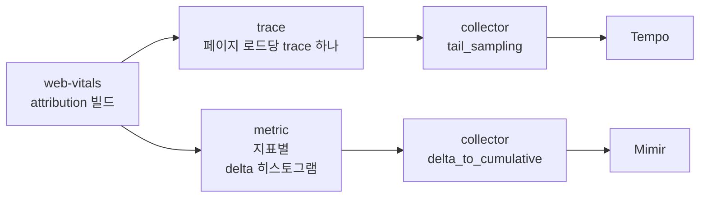

# Core Web Vitals 기초와 Grafana로 보기

지표가 언제 확정되고, 어떤 모양으로 저장해야 그릴 수 있는가

<!-- _class: invert -->

@yceffort

<!--
대상: Lighthouse나 PageSpeed Insights로 LCP, CLS 같은 이름은 들어 봤지만, 실제 사용자 브라우저에서 재서 대시보드로 보는 일은 해 보지 않은 사람.
앞 절반은 지표 자체, 뒤 절반은 Grafana에서 그 지표를 그리는 쿼리다.
수치는 공개 재현 환경(blog-experiments의 cwv-otel-grafana)에서 잰 값이다.
-->

---

## 이 덱에서 쓰는 버전

| 구성                            | 버전                              |
| ------------------------------- | --------------------------------- |
| web-vitals                      | 6.2.3 (소스 인용은 `v6.2.3` 태그) |
| OpenTelemetry JS                | sdk 2.12.0, OTLP exporter 0.223.0 |
| OpenTelemetry Collector contrib | 0.162.0                           |
| Grafana Tempo / Mimir / Grafana | 3.1.0 / 3.2.2 / 13.2.4            |
| 브라우저                        | Playwright 1.64.1의 Chromium 156  |

실험 코드와 대시보드 JSON은 [blog-experiments/cwv-otel-grafana](https://github.com/yceffort/blog-experiments/tree/cwv-otel-grafana-v1/cwv-otel-grafana)에 있다.

---

<!-- _class: invert -->

# 1장. 지표가 재는 것

---

## 다섯 지표

| 지표    | 재는 것                                                                         | good       | poor       |
| ------- | ------------------------------------------------------------------------------- | ---------- | ---------- |
| **LCP** | 화면에서 가장 큰 요소가 그려진 시점                                             | 2.5초 이하 | 4초 초과   |
| **INP** | 입력부터 다음 화면이 그려질 때까지 걸린 시간(페이지 전체에서 거의 가장 느린 것) | 200ms 이하 | 500ms 초과 |
| **CLS** | 예고 없이 밀린 레이아웃의 양(점수)                                              | 0.1 이하   | 0.25 초과  |
| FCP     | 처음으로 글자나 이미지가 그려진 시점                                            | 1.8초 이하 | 3초 초과   |
| TTFB    | 문서 요청부터 응답 첫 바이트까지                                                | 0.8초 이하 | 1.8초 초과 |

위의 세 개가 Core Web Vitals이고, 아래 두 개는 원인을 좁힐 때 같이 본다. 경계값은 web-vitals가 내보내는 `LCPThresholds` 같은 상수와 같다.

---

## 하나의 값이 아니라 분포로 본다

같은 페이지라도 사용자마다 단말, 회선, 캐시 상태가 다르다. 그래서 한 사용자의 LCP가 아니라 **페이지 로드 전체의 75번째 백분위(p75)** 로 판정한다.

- p75가 good 경계 안이면 "페이지 로드의 75% 이상이 good"이라는 뜻이다
- 평균은 느린 소수에 끌려가고, 중앙값은 느린 사용자 4분의 1을 보지 못한다
- 그래서 저장할 때도 **분포를 잃지 않는 모양**이어야 한다. 이게 3장의 히스토그램 이야기로 이어진다

---

## LCP는 네 단계로 나뉜다

```text
문서 요청 ─▶ 첫 바이트 ─▶ LCP 리소스 요청 시작 ─▶ 리소스 응답 끝 ─▶ LCP 요소가 그려짐
           │ TTFB     │ 리소스 요청 지연        │ 리소스 다운로드 │ 렌더링 지연      │
```

| 단계             | attribution 필드       | 길면 의심할 것                               |
| ---------------- | ---------------------- | -------------------------------------------- |
| TTFB             | `timeToFirstByte`      | 서버, CDN, 리다이렉트                        |
| 리소스 요청 지연 | `resourceLoadDelay`    | 이미지를 늦게 발견함(JS가 넣는 이미지, lazy) |
| 리소스 다운로드  | `resourceLoadDuration` | 이미지 크기, 캐시                            |
| 렌더링 지연      | `elementRenderDelay`   | 렌더를 막는 JS와 CSS, 글자 LCP면 대부분 여기 |

네 값의 합이 LCP다(`src/attribution/onLCP.ts:157-183`).

---

## LCP 후보는 계속 바뀐다

```js
new PerformanceObserver((list) => {
  for (const e of list.getEntries()) {
    console.log(Math.round(e.startTime), e.element?.tagName, e.size)
  }
}).observe({type: 'largest-contentful-paint', buffered: true})
```

```text
28    H1   6156      ← 처음에는 제목이 가장 크다
1052  IMG  129600    ← 0.8초 늦게 온 이미지가 더 커서 후보가 바뀐다
```

> 재현 환경 demo-web의 `?lcp=200&img=800`에서 잰 값이다.

브라우저는 더 큰 요소가 그려질 때마다 새 후보를 낸다. 그래서 **언제 멈추고 확정할지**가 따로 필요하다.

---

## LCP는 입력이나 hidden에서 확정된다

```ts
// web-vitals v6.2.3 src/onLCP.ts
const finalizeEventTypes = ['keydown', 'click', 'visibilitychange'];

const finalizeLCP = (event: Event) => {
  if (event.isTrusted && !isFinalized) {
    // Wrap the listener in an idle callback so it's run in a separate
    // task to reduce potential INP impact.
    // https://github.com/GoogleChrome/web-vitals/issues/383
    const metricIdToFinalize = metric.id;
    whenIdleOrHidden(() => {
```

- 사용자가 누르거나 키를 치면 브라우저가 후보 기록을 멈춘다
- 아무것도 하지 않고 떠나면 `visibilitychange`(hidden)에서 확정한다
- 스크롤은 프로그램으로 만들 수 있어서 확정 근거에서 뺐다(같은 파일 주석)

---

## INP는 상호작용 하나의 세 단계

```text
입력 ─▶ 핸들러 시작 ─▶ 핸들러 끝 ─▶ 다음 화면이 그려짐
      │ 입력 지연   │ 처리 시간  │ 다음 화면까지     │
       inputDelay    processingDuration  presentationDelay
```

- 입력 지연이 길면 그때 메인 스레드가 다른 일을 하고 있었다는 뜻이다
- 처리 시간이 길면 핸들러가 무겁다
- 다음 화면까지가 길면 렌더링 비용이 크다

Long Animation Frame을 지원하는 브라우저에서는 어떤 스크립트가 시간을 썼는지까지 나온다(`longestScript`, `totalScriptDuration` 등).

---

## INP는 "거의 가장 느린" 상호작용이다

```ts
// web-vitals v6.2.3 src/lib/InteractionManager.ts
const candidateInteractionIndex = Math.min(
  this._longestInteractionList.length - 1,
  Math.floor(interactionCountForNavigation / 50),
);
```

- 가장 긴 상호작용 **10개**만 들고 있는다(`MAX_INTERACTIONS_TO_CONSIDER`)
- 상호작용이 50개 미만이면 가장 느린 것, 50개마다 하나씩 건너뛴다
- 40ms 미만의 이벤트는 관찰하지 않는다(`durationThreshold` 기본 40)

오래 머무는 페이지에서 우연히 한 번 느렸던 입력 하나 때문에 INP가 튀지 않게 하려는 장치다.

---

## CLS는 세션 창 중 가장 큰 것

```ts
// web-vitals v6.2.3 src/lib/LayoutShiftManager.ts
if (
  this._sessionValue &&
  firstSessionEntry &&
  lastSessionEntry &&
  entry.startTime - lastSessionEntry.startTime < 1000 &&
  entry.startTime - firstSessionEntry.startTime < 5000
) {
```

- 직전 shift와 **1초 미만**, 세션 첫 shift와 **5초 미만**이면 같은 세션 창으로 묶는다
- 페이지 전체에서 합이 가장 큰 세션 창이 CLS다
- 사용자가 입력한 직후의 shift(`hadRecentInput`)는 세지 않는다

---

## 다섯 지표의 보고 시점

| 지표 | 보고 시점 (`reportAllChanges` 없이) |
| ---- | ----------------------------------- |
| TTFB | `load` 뒤 한 번                     |
| FCP  | 첫 contentful paint 때 한 번        |
| LCP  | 첫 입력, 또는 hidden                |
| CLS  | **hidden**                          |
| INP  | **hidden**                          |

CLS는 항상, INP는 상호작용이 있었다면, LCP도 입력 없이 떠나면 **페이지를 떠나는 순간**에 처음 값이 생긴다. 떠나는 순간에 보내지 못하면 이 지표들은 통째로 빠진다. 상호작용이 한 번도 없으면 INP는 보고 자체가 없다.

<!-- 이 덱에서는 깊게 다루지 않지만, 떠나는 순간의 전송 함정(pagehide와 visibilitychange의 순서, sdk-metrics의 forceFlush 대기)은 블로그 글에 정리했다. -->

---

## 중간 점검

사용자가 페이지에 들어와 3초 동안 아무것도 누르지 않고, 그대로 탭을 닫았다. 이때 web-vitals가 값을 처음 보고하는 시점이 **탭을 닫을 때**인 지표를 모두 고르면?

1. TTFB
2. LCP
3. CLS
4. INP

<!-- 정답: 2, 3. LCP는 입력이 없었으니 hidden에서 확정되고, CLS는 원래 hidden에서 보고한다(값은 0이어도 보고한다). INP는 초기값이 -1이고 bindReporter가 0 이상일 때만 보고하므로, 상호작용이 없으면 아예 보고되지 않는다. TTFB는 load 뒤에 이미 보고됐다. -->

---

<!-- _class: invert -->

# 2장. 어떤 모양으로 저장하는가

---

## 질문이 두 종류다

| 질문                                     | 필요한 것                       | 저장소                             |
| ---------------------------------------- | ------------------------------- | ---------------------------------- |
| 얼마나 느린가, 나빠졌는가, 어느 화면인가 | 오래 보관하는 분포, 싼 조회     | **Mimir** (Prometheus 호환 metric) |
| 왜 느린가, 무엇이 LCP였나                | 페이지 로드 하나의 모든 원인 값 | **Tempo** (trace)                  |

한 저장소로 두 질문에 다 답하려고 하면 한쪽이 무너진다.

- metric에 LCP 요소 selector를 라벨로 넣으면 시리즈가 요소 수만큼 늘어난다
- trace를 모든 페이지 로드마다 오래 보관하면 양이 감당되지 않는다

---

## 같은 측정값을 두 갈래로



- 측정 소스는 web-vitals 하나. 두 저장소의 값을 같은 `id`로 이어 붙이기 위해서다
- 브라우저에서 collector까지는 OTLP/HTTP

---

## trace 모양: span 길이를 지표 값으로

```text
cwv.page   (performance.timeOrigin ~ 첫 지표 시점)
├─ cwv.ttfb   길이 = TTFB
├─ cwv.fcp    길이 = FCP
├─ cwv.lcp    길이 = LCP     속성: target, url, 네 단계 시간
├─ cwv.inp    길이 = INP     속성: target, type, 세 단계 시간
└─ cwv.cls    길이 = CLS × 1000 ms   속성: 가장 크게 밀린 요소
```

- span 길이 자체가 지표 값이라 TraceQL의 `duration`이 곧 지표다
- CLS는 점수라서 1000을 곱하면 TraceQL이 초 단위로 돌려준 값이 그대로 CLS 점수가 된다
- attribution 값은 전부 span 속성에 싣는다. trace 쪽은 카디널리티를 신경 쓰지 않아도 된다

---

## metric 모양: 경계를 넣은 히스토그램

```ts
// cwv-otel-grafana/demo-web/src/telemetry/buckets.ts
export const BUCKETS: Record<Metric['name'], number[]> = {
  TTFB: [100, 200, 400, 600, 800, 1000, 1400, 1800, 2500, 4000],
  FCP: [400, 800, 1200, 1500, 1800, 2400, 3000, 4000, 6000],
  LCP: [500, 1000, 1500, 2000, 2500, 3000, 4000, 5000, 7000, 10000],
  INP: [50, 100, 150, 200, 300, 400, 500, 750, 1000, 2000],
  CLS: [0.01, 0.025, 0.05, 0.1, 0.15, 0.25, 0.5, 1],
};
```

```ts
meter.createHistogram('cwv.lcp', {
  unit: 'ms',
  advice: {explicitBucketBoundaries: BUCKETS.LCP},
})
```

**good과 poor 경계(2500, 4000)를 반드시 버킷 경계에 넣는다.** 이유는 다음 장에서.

---

## 히스토그램은 이렇게 저장된다

```text
cwv_lcp_milliseconds_bucket{le="500"}    379
cwv_lcp_milliseconds_bucket{le="1000"}   502
cwv_lcp_milliseconds_bucket{le="2000"}   617
cwv_lcp_milliseconds_bucket{le="2500"}   766   ← 2.5초 이하인 페이지 로드 수
cwv_lcp_milliseconds_bucket{le="4000"}   805
cwv_lcp_milliseconds_bucket{le="+Inf"}   810   ← 전체
cwv_lcp_milliseconds_count               810
cwv_lcp_milliseconds_sum              793398   ← 평균은 sum / count = 980ms
```

- `le`는 "이하"라는 뜻의 누적 버킷이다
- `le="2500"` ÷ 전체 = **good 비율**. 경계가 버킷에 있으니 보간 없이 정확하다
- 경계 사이의 분위수는 버킷 안에서 선형 보간으로 추정된다. p75가 자주 걸리는 구간은 촘촘하게

> 재현 환경에서 30분 동안 늘어난 값(`increase(...[30m])`)이다. 일부 버킷은 생략했다. good 비율은 766 ÷ 810 = 94.6%다.

---

## 라벨은 값의 종류가 정해진 것만

| 라벨               | 예                                   | 넣은 이유                                                |
| ------------------ | ------------------------------------ | -------------------------------------------------------- |
| `page_route`       | home, product                        | 화면별로 나눠 보려고. URL이 아니라 정해진 화면 이름      |
| `navigation_type`  | navigate, reload, back-forward-cache | bfcache 복원은 값이 0에 가깝게 나와서 섞으면 좋아 보인다 |
| `rating`           | good, needs-improvement, poor        | 등급별 건수                                              |
| `interaction_type` | pointer, keyboard                    | INP만                                                    |

라벨 조합 하나가 시리즈 하나다. 요소 selector, 리소스 URL, 사용자 id는 **라벨이 아니라 trace 속성**에 둔다.

---

## 중간 점검

LCP 히스토그램의 버킷 경계를 `[1000, 2000, 3000, 5000]`으로 잡았다. 이 버킷으로 정확하게 구할 수 **없는** 것은?

1. LCP가 3초 이하인 페이지 로드의 비율
2. LCP good 비율(2.5초 이하)
3. 전체 페이지 로드 수
4. LCP 평균

<!-- 정답: 2. 2500이 경계에 없으니 2000과 3000 사이를 보간해야 한다. 평균은 _sum / _count로 정확하게 나온다. -->

---

<!-- _class: invert -->

# 3장. Mimir에서 PromQL로 그리기

---

## p75

```promql
histogram_quantile(
  0.75,
  sum by (le) (
    increase(cwv_lcp_milliseconds_bucket{page_route=~"$route"}[$__range])
  )
)
```

- `increase(...[$__range])`: 대시보드에서 고른 구간 동안 버킷마다 몇 건이 늘었는가
- `sum by (le)`: 다른 라벨(화면, 등급 등)을 합치고 버킷 경계만 남긴다
- `histogram_quantile(0.75, ...)`: 누적 버킷에서 75% 지점을 보간해 찾는다

`by (le)`를 빼먹으면 버킷 구조가 사라져 계산이 되지 않는다.

---

## good 비율

```promql
sum(increase(
  cwv_lcp_milliseconds_bucket{page_route=~"$route", le="2500"}[$__range]
))
/
sum(increase(
  cwv_lcp_milliseconds_count{page_route=~"$route"}[$__range]
))
```

- 분자는 2.5초 이하 버킷, 분모는 전체 건수
- 경계에 2500이 있으니 정확한 값이다
- p75와 같이 보면 좋다. p75가 경계 근처에서 흔들릴 때, good 비율은 그 흔들림이 얼마나 많은 페이지 로드의 문제인지 보여 준다

---

## 추이와 나눠 보기

시간에 따른 p75는 구간을 고정한 창으로 본다.

```promql
histogram_quantile(0.75, sum by (le) (
  increase(cwv_lcp_milliseconds_bucket[10m])))
```

화면별, 입력 종류별로 나누려면 `by`에 라벨을 더한다.

```promql
histogram_quantile(0.75, sum by (le, page_route) (
  increase(cwv_lcp_milliseconds_bucket[$__range])))

histogram_quantile(0.75, sum by (le, interaction_type) (
  increase(cwv_inp_milliseconds_bucket[$__range])))
```

표본이 적은 조합은 p75가 크게 흔들린다. 나눠 볼수록 건수를 같이 확인한다.

---

## Mimir 대시보드


---

## 건수는 하한값으로 읽는다

브라우저는 delta를 보내고, collector의 `delta_to_cumulative`가 누적으로 바꿔 Mimir에 쓴다. 이 프로세서는 **5분 넘게 샘플이 없는 시리즈의 누적값을 지운다**(`max_stale` 기본 5분, 검사는 1분마다).

| collector             | 보낸 건수 | Mimir에 쓰인 누적값            | `increase()` |
| --------------------- | --------- | ------------------------------ | ------------ |
| `max_stale` 5분(기본) | 8         | 1, 2, 3, 4, **1**, **1**, 2, 3 | 6.40         |
| `max_stale` 15분      | 8         | 1, 2, 3, 4, 5, 6, 7, 8         | 7.47         |

> 6분 공백을 두 번 두고 보냈다. 두 번째 만료는 1에서 1이라 Prometheus가 리셋으로 알아채지 못한다.

- 분위수와 good 비율은 버킷끼리의 비율이라 영향이 작다
- `increase()`로 센 **건수는 실제보다 작게** 나온다. 드문 라벨 조합일수록 심하다
- 그래서 건수 패널을 페이지 로드 수로 읽지 않는다

---

<!-- _class: invert -->

# 4장. Tempo에서 TraceQL로 그리기

---

## TraceQL은 span을 고르고, 함수로 metric을 만든다

```text
{ resource.service.name="demo-web" && name="cwv.lcp" }      ← span 고르기
  | quantile_over_time(duration, .75)                        ← 시간 구간마다 계산
```

| 함수                                | 결과                        |
| ----------------------------------- | --------------------------- |
| `count_over_time()`                 | 구간마다 span 개수          |
| `quantile_over_time(duration, .75)` | 구간마다 span 길이의 p75    |
| `avg_over_time(span.속성)`          | 구간마다 숫자 속성의 평균   |
| `... by (span.속성)`                | 속성 값별로 시리즈를 나눈다 |

span 길이가 지표 값이라 `quantile_over_time(duration, .75)`가 곧 LCP p75다.

---

## "무엇이 LCP인가"에 답하기

```text
{ name="cwv.lcp" } | count_over_time() by (span.cwv.lcp.target)
{ name="cwv.lcp" }
  | quantile_over_time(duration, .75) by (span.cwv.lcp.target)
```

```text
span.cwv.lcp.target     건수   p75
#app>p.hero              409   1.935s   ← 늦게 그려지는 본문
#app>h1                  374   0.861s   ← 본문이 그려지기 전에 클릭하면 제목이 LCP
#app>img.hero-image       28   2.342s   ← 이미지
```

> 재현 환경의 같은 30분 구간을 두 쿼리로 조회한 값이다.

- 요소별 건수로 어떤 요소가 자주 LCP가 되는지, 요소별 p75로 그중 무엇이 느린지 본다
- "LCP가 느린 건 아는데 무엇이 LCP인가"는 metric으로는 답할 수 없고 trace로만 답할 수 있다

---

## 단계별 원인

```text
{ name="cwv.lcp" } | avg_over_time(span.cwv.lcp.time_to_first_byte)
{ name="cwv.lcp" } | avg_over_time(span.cwv.lcp.resource_load_delay)
{ name="cwv.lcp" } | avg_over_time(span.cwv.lcp.resource_load_duration)
{ name="cwv.lcp" } | avg_over_time(span.cwv.lcp.element_render_delay)
```

INP도 같다(`input_delay`, `processing_duration`, `presentation_delay`). 느린 페이지 로드 하나를 직접 열어 보고 싶으면 검색 쿼리를 표로 그린다.

```text
{ name="cwv.lcp" && duration > 2.5s }
  | select(span.cwv.lcp.target, span.cwv.lcp.element_render_delay)
```

---

## Tempo 대시보드


---

## Grafana에서 만난 함정 세 가지

**한 패널의 TraceQL metrics 쿼리는 범례를 구분할 수 없다.** Grafana 13.2.4의 Tempo 데이터소스가 쿼리마다 frame refId를 함수 이름(`avg_over_time`)으로 덮어쓴다. 단계마다 패널을 나눴다.

**숫자 속성 비교는 타입을 가린다.** OTel JS는 정수면 `intValue`, 소수면 `doubleValue`로 보낸다. Tempo 3.1.0에서 `span.cwv.value > 0`은 int 값만, `> 0.0`은 double 값만 걸렀다. ms 값은 정수로 맞춰 보낸다.

**분위수는 근사값이고, 빠지는 값이 있다.** 2의 거듭제곱 버킷 사이를 보간해서, 정확한 p75가 2.5초인 분포를 1.913초로 돌려줬다. double 속성의 분위수는 계산되지 않고, 2 미만인 값은 빠진다. 그래서 CLS가 0인 페이지 로드는 TraceQL 분위수에서 빠지고, 같은 35분 동안 CLS p75가 Mimir 0.0088, Tempo 0.0246으로 갈렸다.

---

## Tempo 2.x에서 최근 30분만 보인다면

| 2.10.8 local-blocks 설정                                | 30분보다 오래된 구간 | 최근 30분 |
| ------------------------------------------------------- | -------------------- | --------- |
| 기본값(`filter_server_spans: true`)                     | 0                    | 0         |
| `filter_server_spans: false`, `flush_to_storage: false` | 0                    | 30        |
| `filter_server_spans: false`, `flush_to_storage: true`  | 30                   | 30        |

- 30분(`query_backend_after`)보다 오래된 구간은 **metrics-generator가 백엔드에 쓴 블록에서만** 계산한다
- 기본값은 SERVER kind이거나 부모가 없는 span만 남겨서, 브라우저 지표 span이 빠진다
- 5분 구간마다 보낸 span은 30개. 같은 조건에서 Tempo 3.1.0은 60분 전체를 돌려줬다

---

<!-- _class: invert -->

# 5장. 두 대시보드를 쓰는 순서

---

## 나빠진 것을 찾고, 왜인지 좁히고, 고친 것을 확인한다

1. **Mimir**에서 나빠진 지표와 화면을 찾는다. p75 추이, good 비율, 화면별 p75
2. 같은 조건을 검증 환경에서 재현하고 **Tempo**로 좁힌다. 무엇이 LCP인가, 어느 단계가 긴가
3. 고친 뒤 **Mimir** 추이로 돌아와 확인한다

운영에서는 trace를 모든 페이지 로드마다 남길 수 없는 경우가 많다. Mimir는 "어디가"까지, Tempo는 "왜"까지 답한다고 나눠 두면 각 저장소에 무엇을 실을지도 자연스럽게 정해진다.

---

## 종합 퀴즈

**1.** TraceQL로 LCP p75를 `quantile_over_time(duration, .75)` 하나로 구할 수 있는 이유는?

**2.** INP를 metric 라벨로 `interaction_type`은 넣고 `interaction_target`(selector)은 넣지 않은 이유는?

**3.** 탭을 닫기 직전에 CLS가 기록됐다. 이 값이 대시보드에 나오려면 브라우저에서 무엇이 성공해야 하는가?

**4.** 드문 화면의 LCP 건수가 Tempo보다 Mimir에서 훨씬 적게 나온다. 가장 먼저 의심할 것은?

<!--
1. span 길이를 지표 값으로 맞춰 보냈기 때문이다.
2. 라벨 조합 하나가 시리즈 하나라서 selector를 넣으면 시리즈가 요소 수만큼 늘어난다. selector는 trace 속성에 둔다.
3. hidden(visibilitychange) 시점에 export 요청이 출발해야 한다. 떠나는 순간에만 기회가 있다.
4. collector의 delta_to_cumulative가 5분 넘게 조용한 시리즈를 지워 increase()가 덜 센 것.
-->

---

## 참고

- [web-vitals v6.2.3](https://github.com/GoogleChrome/web-vitals/tree/v6.2.3): `src/onLCP.ts`, `src/lib/InteractionManager.ts`, `src/lib/LayoutShiftManager.ts`, `src/attribution/onLCP.ts`
- [Grafana Tempo: Configure TraceQL metrics](https://grafana.com/docs/tempo/latest/metrics-from-traces/metrics-queries/configure-traceql-metrics/)
- [OpenTelemetry Collector contrib v0.162.0: deltatocumulativeprocessor](https://github.com/open-telemetry/opentelemetry-collector-contrib/tree/v0.162.0/processor/deltatocumulativeprocessor)
- 재현 환경: [blog-experiments/cwv-otel-grafana](https://github.com/yceffort/blog-experiments/tree/cwv-otel-grafana-v1/cwv-otel-grafana)
