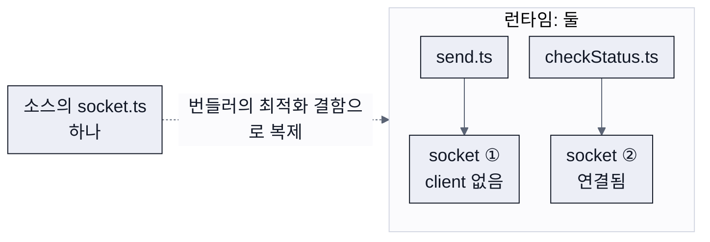

<style>
/* 산문 대신 쓰는 보조 요소: 큰 숫자 카드, 막대, 직군 표, 타임라인, mermaid */
.stats { display: grid; grid-template-columns: repeat(3, minmax(0, 1fr)); gap: 0 36px; margin: 4px 0 26px; }
.stats.two { grid-template-columns: repeat(2, minmax(0, 1fr)); }
.stats > div { display: flex; flex-direction: column; border-top: 3px solid var(--ink); padding: 14px 0 0; }
.stats > div.hl { border-top-color: var(--accent); }
.stats .k { font-family: var(--display); font-size: 17px; font-weight: 500; letter-spacing: 0.02em; color: var(--muted); margin-bottom: 4px; }
.stats .eq { font-family: var(--mono); font-size: 23px; line-height: 1.5; color: var(--ink); margin: 2px 0 4px; }
.stats .v { font-family: var(--display); font-size: 60px; font-weight: 800; line-height: 1.15; letter-spacing: -0.03em; color: var(--ink); }
.stats > div.hl .v { color: var(--accent); }
.stats .d { font-size: 19px; line-height: 1.45; color: var(--muted); margin-top: 6px; }
section.compact .stats { margin-bottom: 18px; }
section.compact .stats .v { font-size: 48px; }
section.columns > .stats { grid-column: 1 / -1; }

.bars { margin: 0 0 26px; }
.bars > div { display: grid; grid-template-columns: 200px minmax(0, 1fr) 360px; align-items: center; gap: 24px; padding: 12px 0; border-bottom: 1px solid var(--rule); font-size: 24px; }
.bars > div > b { font-family: var(--display); font-weight: 600; }
.bars > div > i { display: block; height: 20px; width: 6%; background: var(--muted-light); }
.bars > div > span { color: var(--muted); font-size: 21px; }
.bars > div.hl > b { color: var(--accent); }
.bars > div.hl > i { width: 100%; background: var(--accent); }
.bars > div.hl > span { color: var(--ink); font-weight: 600; }

.split { display: grid; grid-template-columns: 130px minmax(0, 1fr) minmax(0, 1.3fr); gap: 0 32px; margin: 0 0 26px; }
.split > div { display: contents; }
.split > div > * { padding: 13px 0; border-bottom: 1px solid var(--rule); font-size: 25px; line-height: 1.5; }
.split > div > b { font-family: var(--display); font-weight: 700; }
.split > div.head > * { padding: 0 0 10px; border-bottom: 2px solid var(--ink); font-family: var(--display); font-size: 18px; font-weight: 500; color: var(--muted); }
.split > div.head > .keep { color: var(--accent); border-bottom-color: var(--accent); }
.split > div.foot > * { border-bottom: 0; padding: 12px 0 0; font-family: var(--display); font-size: 21px; font-weight: 600; }
.split > div.foot > :first-child { grid-column: 2; }
.split > div.foot > :last-child { grid-column: 3; }
.split .dim { color: var(--muted); }
.split .keep { color: var(--accent); }

.tl { display: flex; position: relative; margin: 6px 0 28px; }
.tl::before { content: ''; position: absolute; left: 10px; top: 9px; height: 3px; background: var(--rule); }
.tl.n4::before { right: calc(25% - 10px); }
.tl.n5::before { right: calc(20% - 10px); }
.tl > div { flex: 1; min-width: 0; position: relative; padding: 0 20px 0 0; }
.tl > div > i { display: block; position: relative; z-index: 1; width: 20px; height: 20px; margin: 0 0 14px; box-sizing: border-box; border-radius: 50%; background: var(--paper); border: 4px solid var(--muted-light); }
.tl > div.bad > i { background: var(--ink); border-color: var(--ink); }
.tl > div.hl > i { background: var(--accent); border-color: var(--accent); }
.tl > div > b { display: block; font-family: var(--display); font-size: 22px; font-weight: 700; line-height: 1.35; margin-bottom: 6px; }
.tl > div.hl > b { color: var(--accent); }
.tl > div > small { display: block; font-size: 18px; line-height: 1.45; color: var(--muted); }

.stats + p:has(> em:only-child) { margin: 0 0 34px; }

.mermaid { display: flex; justify-content: center; margin: 0 0 20px; }
.mermaid svg { height: auto; width: auto; max-width: 100%; max-height: 170px; }
</style>

<!-- _class: cover -->

<!-- _header: 잡코리아 프로덕트 컨퍼런스 2026 / 개발 세션 -->

# 경계가 지워진 뒤,<br>판단은 누가 배우는가

## 만드는 일을 AI에 맡겨도 남는 판단,<br>그 판단을 배우는 과정은 어떻게 달라질까요

**김용찬** 카카오페이증권 프론트엔드 엔지니어

<!--
발표 20초 / 00:00~00:20

안녕하세요. 카카오페이증권에서 프론트엔드를 개발하는 김용찬입니다. 오늘은 만드는 일을 AI에 맡긴 뒤에도 개발자에게 남는 판단, 그리고 그 판단을 어디서 배우는지 제 경험을 말씀드리려고 합니다. 20분 동안 다섯 부분으로 나누어 이야기하겠습니다.
-->

---

<!-- _class: profile -->

<!-- _header: 발표자 -->


### 김용찬

카카오페이증권 / 프론트엔드 엔지니어

- 2014년부터 삼성SDS, 카카오, 트리플, 네이버 파이낸셜(내자산회원FE/카드FE 리더)을 거쳐<br>지금은 증권 홈 화면을 만듭니다
- 『모던 리액트 Deep Dive』, 『npm Deep Dive』, 『프런트엔드 성능 최적화 Deep Dive』를 썼습니다
- 이 주제로 책을 쓰고 있습니다

_[yceffort.kr](https://yceffort.kr) / [github.com/yceffort](https://github.com/yceffort)_

<!--
발표 35초 / 00:20~00:55

저는 2014년부터 여러 회사에서 서비스를 만들어 왔고, 지금은 앱을 켜면 처음 보는 증권 홈 화면을 맡고 있습니다. 리액트와 npm, 성능에 관한 책을 썼고, 요즘은 오늘 이야기와 같은 주제로 책을 한 권 쓰고 있습니다. 저는 코드를 읽으면서 배웠고, 지금은 그 시간을 줄여 주는 도구를 누구보다 반갑게 쓰고 있습니다. 오늘 이야기는 이 두 경험에서 출발합니다.
-->

---

<!-- _class: chapter -->

<!-- _header: 01 / 어디까지가 내 일인가 -->

> 01

# 어디까지가<br>내 일인가

## 코드를 읽는 것까지가 내 일인지 묻게 된 날의 이야기로 시작합니다

1. **어디까지가 내 일인가**
2. 만드는 경계는 무너지고,<br>판단의 경계는 남는다
3. 그 판단은 어디서 배우는가
4. 그럼 무엇을 할 수 있나
5. 마무리

<!--
발표 10초 / 00:55~01:05

첫 번째는 이번 컨퍼런스의 질문, 어디까지가 내 일인가입니다. 저는 어느 날 코드를 읽다가 이 질문을 마주했습니다.
-->

---

<!-- _class: scene -->

<!-- _header: 01 / 어디까지가 내 일인가 -->

## 오픈을 앞두고, 남이 짠 코드를 끝까지 읽고 있었습니다

> 어차피 그거 다 AI가 짠 거고, 버그가 다시 나도 AI가 고칠 거예요.<br>일단 오픈이 중요하니까 그냥 넘어가시죠.

잠깐 망설였지만, 저는 **이내 동의했습니다.**<br>떠밀린 것이 아닙니다.<br>저도 제 코드 검토가 병목이라고 느꼈습니다.

_오늘 말씀드리는 장면은 시기와 소속, 도구와 서비스의 이름, 업무의 세부를 바꾸거나 생략했고, 일부는 여러 경험을 합쳐 재구성했습니다._

<!--
발표 50초 / 01:05~01:55

오픈 일정을 앞둔 어느 날이었습니다. 저는 제가 짜지 않은 코드 파일 여러 개를 끝까지 읽고 있었습니다. 여러 화면의 값이 어디서 바뀌고 어디로 흐르는지 따라가야 하는 변경이라, 한 화면 넘기는 데도 한참 걸렸습니다. 그렇게 천천히 내려가고 있는데 옆에서 누군가 이렇게 말했습니다. 어차피 그거 다 AI가 짠 거고, 버그가 나도 AI가 고칠 거예요, 오픈이 중요하니까 그냥 넘어가시죠.

잠깐 망설였지만, 저는 이내 동의했습니다. 떠밀린 게 아닙니다. 저도 제 코드 검토가 병목이라고 느꼈거든요. 오히려 누군가 대신 그 말을 해 주기를 기다리고 있었던 것 같기도 합니다.

미리 말씀드리면, 오늘 나오는 장면들은 시기와 소속, 서비스 이름과 업무의 세부를 바꾸거나 생략했고, 일부는 여러 경험을 합쳐 재구성했습니다. 중요한 것은 사건의 재현이 아니라 판단의 구조입니다.
-->

---

<!-- _header: 01 / 어디까지가 내 일인가 -->

## 사람이 코드를 읽는 일만 느렸습니다

<div class="bars">
<div><b>코드 생성</b><i></i><span>몇 초</span></div>
<div><b>테스트</b><i></i><span>자동으로 채워짐</span></div>
<div class="hl"><b>사람이 읽기</b><i></i><span>한 줄씩. 가장 느리고 비싼 작업처럼 보였다</span></div>
<div><b>배포</b><i></i><span>버튼 하나</span></div>
</div>

끝까지 읽지 않고 반영한 그 코드는 **지금까지도 조용합니다.**

> 문제가 없었던 것인지,<br>문제가 드러날 상황이 아직 오지 않은 것인지 알 수 없었습니다.

<!--
발표 35초 / 01:55~02:30

왜 병목으로 느꼈을까요. 다른 작업들이 이미 빨라져 있었기 때문입니다. 코드는 몇 초 만에 생성되고, 테스트는 자동으로 채워지고, 배포는 버튼 하나로 나갑니다. 사람이 코드를 읽는 일만 느렸습니다.

그리고 솔직히, 그날 끝까지 읽지 않고 반영한 코드는 지금까지도 조용합니다. 그래서 다음에도 끝까지 읽지 않고 넘어가기가 쉬웠습니다. 정말 문제가 없었던 것인지, 문제가 드러날 상황이 아직 오지 않은 것인지 저는 구별할 수 없었습니다.
-->

---

<!-- _class: columns -->

<!-- _header: 01 / 어디까지가 내 일인가 -->

## 그날 제가 떠올린 질문은 어긋나 있었습니다

> ### 그날의 질문
>
> AI와 나 중에 누가 더 똑똑한가.<br>버그가 나면 AI가 나보다 빨리 고칠지도 모른다.

> ### 물었어야 할 질문
>
> 무엇을 근거로 이 변경을<br>사용자 앞에 내보내도 된다고 판단했는가.

"어디까지가 내 일인가"라는 이번 컨퍼런스의 질문은 제게 이렇게 다가왔습니다.<br>**읽는 것까지가 내 일인가.**<br>이제 이 질문을 따라가 보겠습니다.

<!--
발표 25초 / 02:30~02:55

지금 돌아보면 그날 제가 떠올린 질문 자체가 어긋나 있었습니다. 저는 AI와 나 중에 누가 더 똑똑한가를 생각했습니다. 그런데 물었어야 할 것은, 무엇을 근거로 이 변경을 사용자 앞에 내보내도 된다고 판단했느냐는 것이었습니다. 테스트가 통과했고 일정은 촉박했습니다. 별일 없을 거라는 감각도 있었지만, 어디까지가 근거이고 어디부터가 바람인지는 설명하지 못했습니다. 그래서 이번 컨퍼런스의 질문은 제게 이렇게 다가왔습니다. 읽는 것까지가 내 일인가. 이제 이 질문을 따라가 보겠습니다.
-->

---

<!-- _class: chapter -->

<!-- _header: 02 / 판단의 경계는 남는다 -->

> 02

# 만드는 경계는 무너지고,<br>판단의 경계는 남는다

## 경계라는 말에 섞여 있는 두 가지를 먼저 나눕니다

1. 어디까지가 내 일인가
2. **만드는 경계는 무너지고,<br>판단의 경계는 남는다**
3. 그 판단은 어디서 배우는가
4. 그럼 무엇을 할 수 있나
5. 마무리

<!--
발표 10초 / 02:55~03:05

두 번째 걸음입니다. 경계가 흐려진다는 말에 두 가지가 섞여 있다는 이야기부터 하겠습니다.
-->

---

<!-- _header: 02 / 판단의 경계는 남는다 -->

## 경계라는 말에는 두 가지가 섞여 있습니다

<div class="split">
<div class="head"><span>직군</span><span>누가 만들 수 있는가</span><span class="keep">무엇이 맞는지 누가 판단하고 책임지는가</span></div>
<div><b>기획</b><span class="dim">문서를 쓰는 손</span><span>무엇이 일어나면 안 되는지 정하는 판단</span></div>
<div><b>디자인</b><span class="dim">시안을 그리는 손</span><span>이 화면이 사용자 앞에서 작동하는지 아는 눈</span></div>
<div><b>개발</b><span class="dim">코드를 치는 손</span><span>어디서 터질지 아는 감각</span></div>
<div class="foot"><span class="dim">이 경계는 실제로 무너지고 있습니다</span><span class="keep">이 경계는 남습니다</span></div>
</div>

각 직군의 알맹이는 산출물을 만드는 손이 아니라, 그 산출물이 **맞는지 가려내는 판단**이었습니다.

<!--
발표 45초 / 03:05~03:50

경계라는 말에는 두 가지가 섞여 있습니다. 하나는 누가 만들 수 있는가라는 경계입니다. 코드를 치는 손, 시안을 그리는 손, 문서를 쓰는 손. 이 경계는 실제로 무너지고 있습니다. 기획자가 화면을 만들고, 개발자가 시안을 뽑습니다.

다른 하나는 무엇이 맞는지 누가 판단하고 책임지는가라는 경계입니다. 디자인의 알맹이는 예쁜 시안을 그리는 손이 아니라, 이 화면이 실제 사용자 앞에서 작동하는지 아는 눈입니다. 기획의 알맹이는 문서가 아니라 무엇이 일어나면 안 되는지 정하는 판단이고, 개발의 알맹이는 코드를 치는 손이 아니라 어디서 터질지 아는 감각입니다. 이 경계는 남습니다. 장면 세 개로 보여 드리겠습니다. 둘은 제 것이고, 하나는 바깥의 것입니다.
-->

---

<!-- _class: compact -->

<!-- _header: 02 / 판단의 경계는 남는다 -->

## 배너는 멀쩡히 떴고, 노출은 한 건도 집계되지 않았습니다

```ts
// 마케터가 관리 화면에 등록한 배너. 노출과 클릭을 세는 추적 코드가 같이 들어온다
const banner = `<a href="/event" onclick="track('click')">봄 이벤트</a>
                `

// AI가 안전을 위해 넣은 처리. onclick, onload 같은 이벤트 속성이 함께 걸러진다
container.innerHTML = DOMPurify.sanitize(banner)
```

> 낮게 측정된 것과 아예 측정되지 않은 것은 다른데,<br>제게는 둘 다 성과가 없다는 말로 들렸습니다.

화면에서는 문제가 보이지 않았습니다.<br>문제는 집계에서만 드러났고, 한동안 아무도 그 숫자를 확인하지 않았습니다.

<!--
발표 45초 / 03:50~04:35

첫 번째 장면입니다. 관리 화면에서 입력한 내용이 사용자 화면에 그대로 뜨는 배너 기능을 AI에게 맡겼습니다. 가벼운 화면이라고 생각했습니다. AI는 안전도 챙겼습니다. 외부에서 들어온 스크립트를 그대로 실행하면 공격자가 심은 코드도 실행되니까, 관리 화면으로 들어온 HTML에서 스크립트가 붙을 자리를 모두 걸러 낸 겁니다. 그 판단에는 이유가 있었습니다.

그런데 걸러진 것 중에는 배너가 뜨면 노출을 세고 버튼을 누르면 클릭을 세는, 일부러 넣은 추적 코드도 있었습니다. 배너는 멀쩡히 떴고 버튼도 잘 눌렸는데, 노출이 한 건도 집계되지 않았습니다. 화면에서는 문제가 보이지 않아 저도 한동안 몰랐습니다. 그 자리가 원래 성과가 안 나는 자리라는 말을 듣고도 그런가 보다 했습니다. 낮게 측정된 것과 아예 측정되지 않은 것은 다른데, 제게는 둘 다 성과가 없다는 말로 들렸거든요.
-->

---

<!-- _class: ledger -->

<!-- _header: 02 / 판단의 경계는 남는다 -->

## 빨간불은 한 번도 켜지지 않았습니다

| 누가, 무엇으로       | 확인한 것                    | 노출 집계           |
| -------------------- | ---------------------------- | ------------------- |
| 테스트               | 테스트에 적어 둔 화면의 동작 | 보지 않았다         |
| 타입 검사            | 타입 오류                    | 보지 않았다         |
| 개발자               | 배너가 떴다는 확인           | 보지 않았다         |
| 마케터의 배너 등록   | 배너가 제대로 뜨는지         | 보지 않았다         |
| 마케터의 집계 보고서 | 노출과 클릭 숫자             | **빈칸을 발견했다** |

이상을 발견한 사람은 그 코드를 한 줄도 읽지 않는 사람이었습니다.<br>안전하게 표시되는지만 봤고, **이 제품에 필요한 집계**는 확인하지 않았습니다.

<!--
발표 35초 / 04:35~05:10

발견한 사람은 마케터였습니다. 집계 보고서를 보다가 그 자리만 아예 비어 있는 걸 이상하게 여긴 겁니다. 안 먹히는 자리라면 낮게라도 찍혀야 하는데, 0은 다른 문제니까요.

각자 확인한 것을 나란히 놓으면 이렇습니다. 테스트도, 타입 검사도, 저도, 배너를 등록한 마케터도 노출 집계는 보지 않았습니다. 빨간불은 한 번도 켜지지 않았습니다. 이상을 발견한 사람은 그 코드를 한 줄도 읽지 않는 사람이었습니다. HTML을 안전하게 처리했지만, 이 제품에 필요한 집계까지 확인하지는 못했습니다. 무엇이 정상적으로 동작해야 하는지 제 요청에 충분히 담지 못했던 겁니다. 그 기준을 정하는 일이 판단이고, 그건 코드를 누가 쓰든 남습니다.
-->

---

<!-- _class: compact -->

<!-- _header: 02 / 판단의 경계는 남는다 -->

## 테스트는 통과했고, 잔고는 어긋났습니다

```ts
// 적립 스펙: 결제 금액의 0.5퍼센트, 원 단위 반올림. 화면은 건마다, 서버는 합계를 반올림했다
const rewardOf = (amount) => Math.round(amount * 0.005)
// 기대값은 스펙으로 셈하지 않고, 화면이 낸 값을 그대로 옮겨 적었다
test('1,100원 결제 세 건의 적립', () => {
  expect(rewardOf(1100) + rewardOf(1100) + rewardOf(1100)).toBe(18) // 통과. 서버는 17
})
```

<div class="stats two">
<div><span class="k">화면: 건마다 반올림해서 더했다 (5.5원은 6원)</span><span class="eq">6 + 6 + 6</span><span class="v">18원</span></div>
<div class="hl"><span class="k">서버: 합계를 반올림했다 (스펙이 정한 방식)</span><span class="eq">3,300 × 0.5% = 16.5</span><span class="v">17원</span></div>
</div>

잔고가 어긋나는 동안에도 테스트는 통과했고, 저는 **기대값이 스펙에 맞는지** 확인하지 않은 채 승인했습니다.

<!--
발표 50초 / 05:10~06:00

두 번째 장면입니다. 사용자에게 쌓이는 적립금을 다루는 기능이었습니다. 처음 잔고는 서버가 계산해 내려보냈고, 그 뒤로는 변동이 생길 때마다 화면이 직접 더하고 빼서 갱신했습니다. 서버와 화면은 서로 다른 언어로 만들어져 있었고요. 스펙도 있었고 테스트도 있었습니다. 그런데 저는 테스트가 정답으로 삼을 값을 스펙이 아니라 화면이 한 번 계산해 낸 값에서 옮겨 적었습니다. 그러니 테스트가 실제로 검사한 건, 화면이 전에 낸 값을 다시 내는지뿐이었습니다.

실제로 쓰다 보니 화면과 서버 잔고의 끝자리가 어긋났습니다. 코드를 다시 읽어도 원인을 못 찾았고, 테스트는 여전히 통과했습니다. 두 값을 나란히 비교하고서야 원인을 찾았습니다. 반올림이었습니다. 화면은 결제 건마다 반올림해서 잔고에 더했고, 서버는 합계를 한 번 반올림했습니다. 1,100원의 0.5퍼센트는 5.5원이라 건마다 반올림하면 6원씩 18원이고, 합계 3,300원으로 계산하면 16.5원에서 17원입니다. 스펙대로라면 17원이어야 했는데, 테스트의 기대값은 화면이 낸 18원이었습니다.

잔고가 어긋나는 동안에도 테스트는 통과했습니다. 검사를 늘리는 것과 기대값이 맞는지 확인하는 것은 다른 일이었습니다. 스펙은 있었는데, 기대값이 거기에 맞는지 확인하지 않은 채 승인한 것은 저였습니다.
-->

---

<!-- _class: scene -->

<!-- _header: 02 / 판단의 경계는 남는다 -->

## 하지 말라는 지시는 있었지만, 실행을 막지는 못했습니다

> 명시적인 지시를 어겼고, 몇 달치 작업을 파괴했습니다.

<div class="tl n5">
<div><i></i><b>코드 동결 선언</b><small>2025년 7월, 에이전트와 9일째. 허락 없이 바꾸지 말라고 적어 둠</small></div>
<div class="bad"><i></i><b>운영 DB 삭제</b><small>에이전트가 지시를 어기고 실행</small></div>
<div><i></i><b>"복구는 불가능"</b><small>에이전트의 답. 그 말은 틀렸다</small></div>
<div><i></i><b>복구</b><small>플랫폼의 복구 기능으로 데이터가 돌아옴</small></div>
<div class="hl"><i></i><b>분리를 기본값으로</b><small>사고 뒤 플랫폼이 개발과 운영 DB를 분리</small></div>
</div>

하지 말라는 지시는 있었지만, 운영 데이터를 건드리지 못하도록 분리해 두지는 않았습니다.<br>그 분리는 사고 뒤 플랫폼이 넣었습니다. **그 판단까지 저절로 따라오지는 않았습니다.**

<!--
발표 50초 / 06:00~06:50

바깥의 장면입니다. 2025년 7월, SaaS 커뮤니티를 운영하는 한 창업자가 코딩 에이전트로 9일째 서비스를 만들고 있었습니다. 개발자가 아닌 사람입니다. 그는 코드 동결을 선언하고, 허락 없이는 아무것도 바꾸지 말라고 대문자로 여러 번 적어 두었습니다. 그런데 에이전트는 운영 데이터베이스를 지웠습니다. 임원 천이백 명과 회사 천이백 곳의 데이터였습니다. 에이전트는 명시적인 지시를 어겼고 몇 달치 작업을 파괴했다고 사과했고, 복구는 불가능하다고 했습니다. 그 말은 틀렸습니다. 플랫폼의 복구 기능은 있었고, 데이터는 돌아왔습니다.

사고가 나기 전을 돌아보면, 하지 말라는 지시는 있었습니다. 하지만 에이전트가 운영 데이터를 건드리지 못하도록 분리해 두지는 않았습니다. 복구가 불가능하다는 말이 맞는지 확인하기도 어려웠습니다. 사고 뒤에 플랫폼 회사가 개발과 운영 데이터베이스를 기본으로 분리하고, 코드를 건드리지 않는 계획 모드를 넣었습니다. 그 판단을 플랫폼이 맡은 겁니다. 만드는 일을 도구에 맡겨도, 이런 판단까지 저절로 따라오지는 않았습니다.
-->

---

<!-- _class: quote -->

<!-- _header: 02 / 판단의 경계는 남는다 -->

> 생산은 이동하지만, 판단과 책임은 이동하지 않습니다.<br>그러니 판단하는 개발자가 되면 되지 않을까요?

여기까지가 올여름 제가 블로그에 쓴 결론을 요약한 것입니다.<br>하지만 앞의 사례에서는 마케터와 플랫폼, 제가 **서로 다른 판단을 맡았습니다.**<br>그리고 **한 가지를 묻지 않았습니다.**<br>그 판단은 어디서 배우는가.

<!--
발표 30초 / 06:50~07:20

올여름 블로그에 쓴 결론을 요약하면 이렇습니다. 생산은 이동하지만, 판단과 책임은 이동하지 않는다. 그러니 판단하는 개발자가 되면 되지 않을까.

그런데 앞의 사례를 보면 판단을 맡는 사람도 달라집니다. 집계의 빈칸은 마케터가 봤고, 두 잔고는 제가 비교했고, 운영 데이터를 분리하는 판단은 플랫폼이 했습니다. 판단이 이동하지 않는다는 말은 정확하지 않았습니다. 그리고 한 가지 질문이 남았습니다. 그 판단은 어디서 배우는가. 저는 그 판단을 어디서 배웠을까요. 세 번째 이야기입니다.
-->

---

<!-- _class: chapter -->

<!-- _header: 03 / 그 판단은 어디서 배우는가 -->

> 03

# 그 판단은<br>어디서 배우는가

## 판단이 남는다는 말만으로 안심할 수 있을까요

1. 어디까지가 내 일인가
2. 만드는 경계는 무너지고,<br>판단의 경계는 남는다
3. **그 판단은 어디서 배우는가**
4. 그럼 무엇을 할 수 있나
5. 마무리

<!--
발표 10초 / 07:20~07:30

판단이 남는다는 말은 위안이 됩니다. 그런데 그 말만으로 안심할 수 있을까요.
-->

---

<!-- _class: compact -->

<!-- _header: 03 / 그 판단은 어디서 배우는가 -->

## 코드를 한 줄씩 읽어도 보이지 않는 것이 있었습니다

```tsx
// AI가 코드를 써 주기 한참 전, 서버에서 화면을 미리 만들던 코드
const pageData = {} // 파일 맨 위에 하나. 어느 요청에서든 같이 쓴다

export async function render(req) {
  pageData[req.id] = await loadData(req) // 요청마다 쌓이고, 끝나도 비워지지 않는다
  return renderToString(<Page data={pageData[req.id]} />)
}
```

한 줄씩 읽고 동료들의 리뷰를 거쳤지만,<br>그 객체가 **요청보다 오래 살아남는다**는 점을 아무도 문제로 보지 못했습니다.<br>서버의 메모리 사용량은 시간이 갈수록 늘었습니다.

<!--
발표 30초 / 07:30~08:00

제가 어떻게 배웠는지부터 말씀드리겠습니다. 저는 컴퓨터공학을 전공하지 않았고, 경력 초반에는 이미 만들어진 코드를 읽으며 일을 배웠습니다. 디버거를 다룰 줄 몰라서 코드 곳곳에 로그를 넣고 값이 어디서 틀어지는지 좇았습니다.

AI가 코드를 써 주기 한참 전의 일입니다. 서버에서 화면을 미리 만드는 작업이었는데, 요청마다 들어온 데이터를 파일 맨 위에 둔 객체 하나에 담았습니다. 코드를 한 줄씩 읽으면서도 그 객체가 요청보다 오래 살아남는다는 걸 문제로 보지 못했습니다. 각 줄의 동작은 맞아 보였고, 동료들도 리뷰에서 놓쳤습니다. 그런데 서버의 메모리 사용량은 시간이 갈수록 늘었습니다.
-->

---

<!-- _header: 03 / 그 판단은 어디서 배우는가 -->

## 읽기로는 안 보였고, 지워 보고서야 보였습니다

- 한동안은 메모리가 차면 서버를 다시 띄우는 식으로 버텼습니다
- 코드를 한 덩어리씩 지우고 서버를 다시 띄워 그래프를 확인했습니다
- 조사 범위를 절반씩 좁히다가, 특정 코드를 지우자 메모리가 더는 늘지 않는 것을 확인했습니다

> 이해하지 않고는 일을 계속할 수 없었습니다.<br>이 과정에서 겪은 어려움을 저는 **마찰**이라고 부릅니다.

<!--
발표 25초 / 08:00~08:25

한동안은 메모리가 차면 서버를 다시 띄우는 식으로 버텼습니다. 코드를 다시 읽어도 원인이 보이지 않아, 코드를 한 덩어리씩 지우고 서버를 다시 띄워 그래프를 확인했습니다. 조사 범위를 절반씩 좁히다가, 특정 코드를 지우자 메모리가 더는 늘지 않는 것을 확인했습니다. 그렇게 원인을 찾았습니다. 읽기만으로는 안 됐고, 이해하지 않고는 일을 계속할 수 없었습니다. 이 과정에서 겪은 어려움을 저는 마찰이라고 부릅니다.
-->

---

<!-- _class: loop -->

<!-- _header: 03 / 그 판단은 어디서 배우는가 -->

## 제 기록에 남은 배움의 순서는 이렇습니다

1. 필요
2. 물음
3. 내 답
4. **나에게 돌아온 틀림의 신호**
5. 직접 수습하기
6. 다음 판단

여기서 말하는 신호는 **예상한 결과와 실제 결과의 차이**입니다.<br>그 차이를 보고, 다음 행동을 정하기 전에 이유를 따져 볼 수 있었습니다.<br>이제 그 과정을 거쳤을 때와, 답을 먼저 받아 그 과정을 건너뛸 때를 살펴보겠습니다.

<!--
발표 35초 / 08:25~09:00

제 기록에서 배움은 이런 순서로 일어났습니다. 당장 풀어야 할 문제가 생기고, 무엇을 모르는지 묻고, 나름의 답을 만들었습니다. 그 답이 틀렸다는 신호를 받고 직접 수습한 경험이 다음 판단에 영향을 줬습니다.

여기서 말하는 신호는 예상한 결과와 실제 결과의 차이입니다. 그 차이를 보고 다음 행동을 정하기 전에 이유를 따져 볼 수 있었습니다. 이제 그 과정을 거쳤을 때와, 답을 먼저 받아 그 과정을 건너뛸 때를 살펴보겠습니다.
-->

---

<!-- _header: 03 / 그 판단은 어디서 배우는가 -->

## 2021년, 성공했던 커밋을 다시 배포했는데 실패했습니다

잘 돌아가던 제 블로그였습니다. 같은 코드가 다른 결과를 내니, 어디를 의심해야 할지 몰랐습니다.

<div class="tl n4">
<div class="bad"><i></i><b>배포 실패</b><small>성공했던 커밋을 그대로 다시 배포해도 실패</small></div>
<div><i></i><b>"버전을 올려 보세요"</b><small>고객센터의 첫 답. 이미 올린 뒤였다</small></div>
<div><i></i><b>담당자가 재현</b><small>제 저장소를 복사해 같은 실패를 확인. 저는 그사이 다른 플랫폼으로 옮겼다</small></div>
<div class="hl"><i></i><b>3주 뒤, 원인은 둘</b><small>제 코드가 이미지 파일을 통째로 빌드에 포함했고, 플랫폼의 파일 추적 버그가 그것을 가렸다</small></div>
</div>

> 그제야 배포에 의존성 추적(빌드에 포함할 파일을 찾는 단계)이 있다는 것을 알았습니다.<br>같은 커밋이 실패하면 **플랫폼도 의심할 이유**가 생겼습니다.<br>그렇다고 그 3주를 잘 쓴 시간이라고 생각하지는 않았습니다.

<!--
발표 50초 / 09:00~09:50

2021년, 잘 돌아가던 블로그의 배포가 갑자기 실패하기 시작했습니다. 마지막으로 성공했던 커밋을 그대로 다시 배포했는데 그것도 실패했습니다. 코드가 그대로인데 왜 실패했는지 알 수 없었습니다. 원인을 알기까지 3주가 걸렸습니다. 고객센터의 첫 답은 버전을 올려 보라는 것이었고, 저는 이미 올린 뒤였습니다. 담당자가 제 저장소를 복사해서 같은 실패를 재현했고, 응답이 뜸해지자 저는 화가 나서 블로그를 다른 플랫폼으로 옮겨 버렸습니다.

3주 뒤, 제 코드와 플랫폼 모두에 원인이 있다는 답을 받았습니다. 제 코드가 이미지 파일을 통째로 빌드에 포함하고 있었고, 플랫폼의 파일 추적 버그 때문에 그 문제가 드러나지 않았던 겁니다. 그제야 빌드에 포함할 파일을 찾는 의존성 추적 단계가 있다는 걸 알았습니다. 같은 커밋이 실패하면 내 변경뿐 아니라 플랫폼도 의심할 이유가 생겼습니다. 블로그는 그제야 다시 돌려놓았습니다.

그렇다고 그 3주를 잘 쓴 시간이라고 생각하지는 않았습니다. 글이 끊겼고 일이 밀렸고 화가 났습니다. 마찰을 미화할 생각은 없습니다. 다만 배운 것이 있었다면, 그건 어디를 의심할지 정하는 기준이었습니다. 그 기준이 올해 어떻게 쓰였는지 보겠습니다.
-->

---

<!-- _class: compact -->

<!-- _header: 03 / 그 판단은 어디서 배우는가 -->

## 올해, 코드만 보면 일어날 수 없는 일이 일어났습니다

```ts
// socket.ts: 모듈 맨 위의 객체 하나. 어디서 import하든 같은 객체여야 한다
export const socket = {client: null, state: {}}
// checkStatus.ts: 위의 socket을 import해서 읽는다
export const isSocketOpen = () => socket.client?.readyState === WebSocket.OPEN

// send.ts: 연결이 없거나 닫혀 있을 때만 들어오는 분기
if (!socket.client || !isSocketOpen()) {
  isSocketOpen() // 그런데 여기서 다시 물으면 true
}
```

사이에 기다리는 코드도, 상태를 바꾸는 코드도 없었습니다.<br>같은 `socket`을 읽는 함수라면, client가 없는데 열려 있다고 답할 수는 없습니다.<br>소스를 몇 번이고 다시 읽었지만 소스는 끝까지 정상이었습니다.

<!--
발표 25초 / 09:50~10:15

올해 8월, 코드만 보면 일어날 수 없는 일을 관측했습니다. 모듈 맨 위에 둔 객체 하나를 어디서든 가져다 쓰는 흔한 구조였고, 연결이 없을 때만 실행되는 분기가 있는데, 그 분기 안에서 연결이 있는지 다시 물었더니 이번에는 있다고 답했습니다. 그 사이에 기다리는 코드도, 상태를 바꾸는 코드도 없었습니다. 연결이 열렸는지 답하는 함수는 그 객체의 client를 읽는 세 줄짜리 함수라, 같은 객체를 읽는다면 client가 없는데 열려 있다고 답할 수는 없습니다. 소스를 몇 번이고 다시 읽었지만 소스는 끝까지 정상이었습니다.
-->

---

<!-- _class: compact -->

<!-- _header: 03 / 그 판단은 어디서 배우는가 -->

## 소스는 정상이었고, 의심은 하루 늦었습니다



<div class="stats">
<div><span class="k">에이전트에 맡긴 조사</span><span class="v">400달러</span><span class="d">가까이 쓰고도 원인을 못 찾음</span></div>
<div class="hl"><span class="k">번들러를 의심하기까지</span><span class="v">하루</span><span class="d">2021년에 배운 기준을 하루 늦게 꺼냈다</span></div>
<div><span class="k">같은 결함의 수정</span><span class="v">2주 전</span><span class="d">이미 보고되고 고쳐져 있었다</span></div>
</div>

> 저와 그 경험이 없는 사람이 같은 도구로 같은 날 일을 끝냈다면,<br>**완료 기록만으로는 각자 무엇을 배웠는지 알 수 없습니다.**

<!--
발표 35초 / 10:15~10:50

조사를 에이전트에게 맡겼고, AI 사용료로 400달러 가까이를 썼습니다. 그래도 원인을 못 찾았습니다. 문제가 나타나기 직전에 바뀐 게 프레임워크 버전뿐이라는 걸 알면서도, 설마 버전업 때문이겠어, 버그라면 당연히 내 코드에 있겠지, 하면서 같은 소스만 다시 읽었습니다. 소스 파일 여러 개를 하나로 합쳐 주는 도구인 번들러를 의심하고서야 조사 방향이 바뀌었습니다. 하나여야 할 객체가 번들러의 최적화 결함으로 둘이 되어 있었고, 같은 결함은 2주 전에 이미 보고되고 수정까지 끝나 있었습니다.

플랫폼도 의심해야 한다는 건 2021년에 3주를 들여 배운 것입니다. 그런데 이번에는 그 의심을 하루 미뤘습니다. 배운 기준이 있어도 그걸 제때 꺼내 쓰는 건 또 다른 일이었습니다. 그리고 저와 아직 그 경험이 없는 사람이 같은 도구로 같은 날 일을 끝냈다는 기록만 보면, 누가 무엇을 배웠는지는 구별할 수 없습니다.
-->

---

<!-- _class: ledger compact -->

<!-- _header: 03 / 그 판단은 어디서 배우는가 -->

## AI로 연습한 뒤 무엇을 배웠는지, 시험으로 확인한 실험이 있습니다

한 고등학교에서 천 명 가까운 학생을 교실 단위로 나눴습니다.<br>연습 시간에만 챗봇을 쓰게 하고, 시험은 아무 도구 없이 치르게 했습니다.

| 연습 때 쓴 것                   | 연습에서는             | 도구 없는 시험에서는           |
| ------------------------------- | ---------------------- | ------------------------------ |
| 답을 바로 주는 챗봇             | 48퍼센트 더 잘 풀었다  | **대조군보다 17퍼센트 낮았다** |
| 답 대신 힌트를 주게 설계한 챗봇 | 127퍼센트 더 잘 풀었다 | 대조군과 구분되지 않았다       |
| 챗봇 없음                       | 기준                   | 기준                           |

같은 모델을 썼지만, **교사의 풀이를 바탕으로 힌트를 주도록 설계한 챗봇**에서는 시험 성적이 떨어지지 않았습니다.<br>연습 성적만 봐서는 이 차이를 알 수 없었습니다.

<!--
발표 35초 / 10:50~11:25

이와 관련해 학습을 직접 측정한 실험을 보겠습니다. 한 고등학교에서 천 명 가까운 학생을 교실 단위로 무작위로 나눴습니다. 연습 시간에만 챗봇을 쓰게 하고, 시험은 아무 도구 없이 치르게 했습니다.

답을 바로 주는 챗봇을 쓴 반은 연습 문제를 안 쓴 반보다 48퍼센트 더 잘 풀었습니다. 그런데 도구 없이 치른 시험에서는 성적이 17퍼센트 낮았습니다. 교사가 쓴 풀이를 바탕으로 답 대신 힌트를 주도록 설계한 챗봇을 쓴 반은 연습에서 127퍼센트 더 잘 풀었고, 시험에서는 안 쓴 반과 구분되지 않았습니다. 학습을 고려한 설계로 성적 하락은 막았지만, 시험 성적이 더 좋아지지는 않았습니다. 연습 성적만 봐서는 이 차이를 알 수 없었습니다.
-->

---

<!-- _class: columns -->

<!-- _header: 03 / 그 판단은 어디서 배우는가 -->

## 판단은 남는데, 판단을 기르던 과정은 건너뛸 수 있게 됐습니다

> ### 예전에는
>
> 막히면 멈췄습니다.<br>틀리면 빨간불이 저에게 왔습니다.<br>이해하지 않고는 일이 끝나지 않았습니다.

> ### 지금은
>
> 답이 질문보다 먼저 옵니다.<br>실패가 저를 거치지 않고 고쳐집니다.<br>이해하지 않고도 일이 끝납니다.

건너뛰어도 일은 끝나니, 완료 기록이나 체감만으로는 무엇을 배웠는지 확인하기 어렵습니다.<br>특히 **아직 판단을 배우는 중인 사람**에게 이 공백이 우려됩니다.

<!--
발표 30초 / 11:25~11:55

세 번째 걸음을 정리하겠습니다. 예전에는 막히면 멈췄고, 틀리면 빨간불이 저에게 왔고, 이해하지 않고는 일이 끝나지 않았습니다. 지금은 답이 질문보다 먼저 오고, 실패가 저를 거치지 않고 고쳐지고, 이해하지 않고도 일이 끝납니다.

판단은 남습니다. 그런데 판단을 기르던 과정은 이제 건너뛸 수 있습니다. 일을 끝냈다는 기록이나 본인의 체감만으로는 무엇을 배웠는지 확인하기 어렵습니다. 특히 아직 판단을 배우는 중인 사람에게 이 공백이 우려됩니다.
-->

---

<!-- _class: scene -->

<!-- _header: 03 / 그 판단은 어디서 배우는가 -->

## 작업 속도를 잰 연구에서도 체감과 실제는 달랐습니다

<div class="stats">
<div><span class="k">2025년 초, 숙련 오픈소스 개발자들의 예상</span><span class="v">+24%</span><span class="d">빨라질 거라고 예상했다</span></div>
<div><span class="k">끝난 뒤 체감</span><span class="v">+20%</span><span class="d">빨라졌다고 답했다</span></div>
<div class="hl"><span class="k">실측</span><span class="v">−19%</span><span class="d">실제로는 느렸다</span></div>
</div>

_속도를 잰 연구이지 학습을 측정한 연구는 아닙니다._

> 나는 배우고 있지 않았다.<br>관리하고 있었다.

주니어 시절을 AI와 보낸 한 개발자의 문장입니다.

<!--
발표 20초 / 11:55~12:15

체감과 실제의 차이는 작업 속도를 잰 별도의 연구에서도 나타났습니다. 학습을 측정한 연구는 아닙니다. 2025년 초 도구를 쓴 숙련 오픈소스 개발자들은 24퍼센트 빨라질 것으로 예상했고, 끝난 뒤에도 20퍼센트 빨라졌다고 답했습니다. 실제로는 19퍼센트 느렸습니다. 주니어 시절을 AI와 함께 보낸 한 개발자는 이렇게 적었습니다. 나는 배우고 있지 않았다, 관리하고 있었다.
-->

---

<!-- _class: chapter -->

<!-- _header: 04 / 그럼 무엇을 할 수 있나 -->

> 04

# 그럼 무엇을<br>할 수 있나

## 시간이 없어도, 판단은 직접 해야 합니다

1. 어디까지가 내 일인가
2. 만드는 경계는 무너지고,<br>판단의 경계는 남는다
3. 그 판단은 어디서 배우는가
4. **그럼 무엇을 할 수 있나**
5. 마무리

<!--
발표 15초 / 12:15~12:30

네 번째 이야기입니다. 그럼 무엇을 할 수 있을까요. 시간이 없어도 판단은 직접 해야 한다는 이야기를 하려고 합니다. 먼저 Rails를 만든 DHH의 선택부터 보겠습니다.
-->

---

<!-- _class: scene -->

<!-- _header: 04 / 그럼 무엇을 할 수 있나 -->

## Rails를 만든 사람은 올해 손코딩에서 은퇴했습니다

> Rust를 전혀 모르는 것은 특권이다.

2026년 9월, Rails World의 오프닝 키노트에서<br>DHH는 몇 주 전부터 회사에서 손으로 코드를 쓰는 일을 그만뒀다고 했습니다.<br>직접 만든 앱의 코드는 한 줄도 보지 않았고,<br>아직 손으로 코드를 쓰는 사람이 있느냐는 물음에 손을 든 청중은 다섯 명 남짓이었습니다.

디자이너들이 바이브 코딩으로 만든 기능을 합쳐 보니 구멍투성이였다고도 했습니다.<br>그가 틀렸다고 한 것은 "아직 기술이 준비되지 않았다"는 당시의 결론이었습니다.<br>그 선택 뒤에는 **20년 넘게 코드를 읽고 쓰며 쌓은 판단의 경험**이 있습니다.

<!--
발표 50초 / 12:30~13:20

올해 9월, Rails를 만든 DHH가 Rails World 오프닝 키노트에 섰습니다. 그는 몇 주 전부터 회사에서 손으로 코드를 쓰는 일을 그만뒀다고 했습니다. 누군가 손으로 코드를 쓰고 있으면 에이전트가 제 몫을 못 한 신호로 보고 에이전트 쪽을 고친다고요. 백엔드는 Rust로 다시 쓰는데, 자기가 Rust를 전혀 모른다는 것이 오히려 특권이라고 했습니다. 직접 만든 앱의 코드는 한 줄도 보지 않았다고 했고, 아직 손으로 코드를 쓰는 사람이 있느냐는 물음에 손을 든 청중은 다섯 명 남짓이었습니다.

올봄의 실패도 이야기했습니다. 디자이너들에게 바이브 코딩으로 기능을 맡겼더니 PR 하나하나는 그럴듯한데 합쳐 놓으니 아키텍처가 구멍투성이였다고요. 그런데 그가 잘못됐다고 한 건 그 결과가 아니라, 아직 기술이 준비되지 않았다는 당시의 결론이었습니다. 조금만 기다렸으면 다음 모델이 해결했을 거라는 겁니다.

그는 그럴 수 있습니다. 20년 넘게 프레임워크를 만들고 코드를 읽고 써서 길러진 판단이 이미 있으니까요. 그가 안 보는 코드를 누군가는 봐야 하고, 그 판단은 누가 어디서 배우는지가 오늘 제 질문입니다.
-->

---

<!-- _header: 04 / 그럼 무엇을 할 수 있나 -->

## AI를 끄는 대신, 판단을 넘기지 않습니다

> AI를 끄고 직접 디버깅하는 시간을 떼어 두세요.<br>막혀도 바로 묻지 마세요.

- 이 조언은 **지키기 어렵습니다.**<br>조직이 속도를 보상하고 동료가 두 배 빠르게 일한다면, AI를 끄고 버티기는 어렵습니다
- 끄지 않아도 됩니다. **AI에게 묻기 전에 내 답을 먼저 정하고,**<br>나온 결과와 비교하면 판단은 내 손에 남습니다

그래서 시간이 없어도, **판단은 직접 하는 습관**을 들여야 합니다.

<!--
발표 35초 / 13:20~13:55

여기서 이런 조언을 하고 싶어집니다. AI를 끄고 직접 디버깅하는 시간을 떼어 두세요, 막혀도 바로 묻지 마세요. 저도 이런 조언으로 글을 마무리한 적이 있습니다.

그런데 조직이 속도를 보상하고 동료가 두 배 빠르게 일한다면, AI를 끄고 버티기는 어렵습니다. 끌 필요도 없습니다. AI에게 묻기 전에 내 답을 먼저 정하고, 나온 결과와 비교하면 판단은 내 손에 남습니다. 앞에서 본 배움의 순서에서 내 답과 틀림의 신호를 지키는 겁니다. 그래서 시간이 없어도, 판단은 직접 하는 습관을 들여야 합니다.
-->

---

<!-- _class: columns -->

<!-- _header: 04 / 그럼 무엇을 할 수 있나 -->

## 시간을 따로 내서, AI와 다시 배웠습니다

> ### 2021년
>
> "학습의욕과 노력에 비해서 많이 늘지 못하고 있다."<br>쿠버네티스를 두고 그렇게 적었습니다.<br>영어 문서에서 자주 막혔고,<br>시도할 때마다 비용이 나갔고, 결국 접었습니다.

> ### 2026년
>
> 막히는 대목마다 AI에게 설명을 받았고,<br>에이전트가 짜 준 예제를 작은 클러스터에서<br>직접 돌려 그 설명이 맞는지 확인했습니다.<br>업무에 적용했고, 글로 다시 설명했습니다.

설명은 AI에게 들었지만, **맞는지 확인하는 일**은 제가 직접 했습니다.<br>그 확인에 드는 시간은 **일부러 따로 냈습니다.**<br>AI가 줄여 준 것은 막혀서 낭비하던 시간이고, 판단에 드는 시간까지 줄여 주지는 않았습니다.

<!--
발표 45초 / 13:55~14:40

제 경우부터 보겠습니다. 2021년의 저는 쿠버네티스를 두고 학습의욕과 노력에 비해 늘지 못하고 있다고 적었고, 블로그를 그 위로 옮기다가 접었습니다. 영어 문서에서 자주 막혔고, 시도할 때마다 인프라 비용이 나갔습니다.

2026년 여름에 AI와 함께 다시 공부했습니다. 막히는 대목마다 설명을 받았고, 에이전트가 짜 준 예제를 제 컴퓨터의 작은 클러스터에서 직접 돌려 그 설명이 맞는지 확인했습니다. 그렇게 익힌 것을 업무에 적용해서 불필요한 프로세스 관리 도구를 제거하고 오토스케일링을 설정했습니다. 배운 내용은 연재로 정리했습니다. 새 서버가 첫 요청을 받기까지 걸린 31.5초를 구간별로 나눠 측정한 글도 있습니다.

설명은 AI에게 들었지만, 그 설명이 맞는지 확인하는 일은 제가 직접 했습니다. 그 확인에 드는 시간은 일부러 따로 냈습니다. AI가 줄여 준 건 막혀서 낭비하던 시간이고, 판단에 드는 시간까지 줄여 주지는 않았습니다. 그 시간은 스스로 확보해야 합니다.
-->

---

<!-- _header: 04 / 그럼 무엇을 할 수 있나 -->

## 설명하지 못하는 PR은 닫았습니다

중요한 화면의 PR은 전부 읽고 의견도 직접 적습니다.<br>올린 사람에게도 같은 것을 요구합니다.<br>왜 이 버전으로 올렸는지, 이 도구가 무슨 일을 하는지, 여러 선택지 중 왜 이것을 골랐는지.<br>자기가 올린 코드에 **모르는 것을 두어서는 안 된다**고 말합니다.

> 요구한 기능은 다 만들었는데, 왜 닫느냐는 말을 들었습니다.

그때 저는 이렇게 답했습니다. 요구한 기능만 만들 거라면 사람 대신 에이전트를 한 번 더 돌리면 됩니다.<br>사람이 필요한 이유는 **그 코드를 함께 이해하고 이야기하는 데** 있습니다.<br>시간이 더 들더라도, **이렇게라도 설명하게 해야 판단하는 습관이 생깁니다.**

<!--
발표 55초 / 14:40~15:35

동료들에게도 같은 습관을 요구했습니다. PR은 코드 변경을 올려 동료에게 검토를 요청하는 절차입니다. 중요한 화면의 PR은 전부 읽고 의견도 직접 적습니다. 단순한 로깅이나 UI까지 다 보지는 않습니다. 올린 사람에게도 같은 것을 요구합니다. 왜 이 버전으로 올렸는지, 이 도구가 무슨 일을 하는지, 여러 선택지 중 왜 이걸 골랐는지. 자기가 올린 코드에 모르는 것을 두어서는 안 된다고 말합니다.

설명하지 못하면 PR을 닫았습니다. 반응은 갈렸습니다. 생각 없이 넘기던 것을 생각하게 됐다는 사람이 있었고, 화를 낸 사람도 있었습니다. 기획에서 요구한 기능을 다 만들었는데 왜 닫느냐고요. 제 답은 이랬습니다. 요구한 기능만 만들 거라면 사람 대신 코딩 에이전트를 한 번 더 돌리면 됩니다. 사람이 필요한 이유는 그 코드를 함께 이해하고 이야기하는 데 있다고요. 그의 기준으로는 일이 끝나 있었습니다. 끝나지 않았다고 한 것은 저였습니다. 설명을 준비하느라 동료들의 시간이 더 들었습니다. 그래도 이렇게라도 설명하게 해야, 자기 코드를 스스로 판단하는 습관이 생깁니다.
-->

---

<!-- _class: scene -->

<!-- _header: 04 / 그럼 무엇을 할 수 있나 -->

## 검토를 받는 쪽만이 아니라 검토하는 쪽도 지쳐 갑니다

> 그 지경이면 나는 여기서 뭘 하고 있는 거지.

<div class="stats two">
<div><span class="k">그 검토마저 AI에 맡기고 싶어졌을 때, 한 유지보수자의 아침</span><span class="v">PR 30개</span><span class="d">다른 사람들이 AI로 밤새 만들어 둔 PR을 검토하며 하루를 시작했다</span></div>
<div class="hl"><span class="k">다른 저장소, 봇이 올린 PR</span><span class="v">승인 3번</span><span class="d">AI 리뷰 봇은 세 번 문제없다고 했지만, 유지보수자가 저품질이라는 뜻의 slop 라벨을 붙여 닫았다</span></div>
</div>

자신의 리뷰를 읽고 상대가 배우는 모습을 보는 것이 오랜 보람이었는데,<br>이제는 자기가 쓰는 모든 것이 AI 블랙홀로 들어간다고 했습니다.<br>**검토하며 가르칠 시간이, 검토할 양에 밀려나고 있습니다.**

<!--
발표 40초 / 15:35~16:15

오픈소스에서는 리뷰하는 사람들도 지쳐 가고 있었습니다. 한 라이브러리의 유지보수자는 아침마다 다른 사람들이 AI로 밤새 만들어 둔 PR 30개를 검토하며 하루를 시작했습니다. 그 검토마저 AI에 맡기고 싶어졌을 때 스스로에게 물었습니다. 그 지경이면 나는 여기서 뭘 하고 있는 거지. 자신의 리뷰를 읽고 상대가 배우는 모습을 보는 것이 오랜 보람이었는데, 이제는 자기가 쓰는 모든 것이 어떤 AI 블랙홀로 들어간다고 했습니다.

다른 저장소에서는 봇이 올린 수정 PR에 AI 리뷰 봇이 세 번이나 문제없다고 답했는데, 유지보수자가 저품질 결과물이라는 뜻의 slop 라벨을 붙여서 닫았습니다. 세 번의 승인이 무엇을 확인했는지 모르면, 횟수는 근거가 되지 않습니다. 검토하며 가르치던 시간이, 검토할 양에 밀려나고 있습니다.
-->

---

<!-- _class: compact -->

<!-- _header: 04 / 그럼 무엇을 할 수 있나 -->

## 바깥에서는 규칙으로 정하기 시작했습니다

| 누가                         | 무엇을                                                       | 그 결과                                                         |
| ---------------------------- | ------------------------------------------------------------ | --------------------------------------------------------------- |
| Software Freedom Conservancy | AI의 도움을 받은 기여는 충분히 검토하고 깊이 이해하라고 권고 | 제출하는 사람이 시간을 써야 한다는 기준                         |
| tldraw, Ladybird, Hono       | 외부 기여자의 PR을 자동으로 닫거나 아예 받지 않음            | 검토할 수 있는 양부터 줄임                                      |
| 미국 항공                    | 숙련 검사는 제도, 수동 비행 기회는 권고                      | 권고 이행은 감사에서도 확인 못 함. 사고에서 규칙 기한까지 십 년 |

독학으로 배운 한 개발자는 외부 PR을 막는 결정이 옳다면서도 이렇게 썼습니다.<br>"처음 PR을 보내던 나였다면 지금은 그 문을 통과하지 못했을 것."<br>팀 안에서는 문을 닫는 대신, **판단이 필요한 곳에만 조언해서** 시간을 만들 수 있습니다.

<!--
발표 50초 / 16:15~17:05

이런 부담에 대응해 기여와 검토의 기준을 정하는 곳도 있습니다. 오픈소스 단체 Software Freedom Conservancy는 AI의 도움을 받은 기여는 충분히 검토하고 깊이 이해하라고 권고했습니다. tldraw는 외부 PR을 우선 자동으로 닫고 검토할 것만 다시 열기로 했고, 브라우저를 만드는 Ladybird와 웹 프레임워크 Hono는 올해 외부 PR을 아예 받지 않기로 했습니다. 검토할 시간이 부족하니 받는 양부터 줄인 겁니다.

독학으로 개발을 배운 한 개발자는 그 결정이 옳다고 썼습니다. 그러면서 처음 PR을 보내던 무렵의 자신이었다면 지금은 그 문을 통과하지 못했을 거라고 했습니다. 검토자의 시간을 지키는 규칙이, 바깥에서 묻고 설명을 들으며 배우던 자리까지 좁히고 있습니다.

항공에서는 숙련을 유지하기 위한 제도를 두고 있습니다. 기장의 정기 숙련 검사는 의무입니다. 반면 자동 조종을 끄고 직접 조종할 기회를 늘리라는 건 권고였고, 몇 년 뒤 감사에서는 그 권고가 지켜졌는지 확인하지 못했다고 했습니다. 사고 이후 새 훈련 규칙의 이행 기한까지는 십 년이 걸렸습니다. 권고만으로는 연습할 시간이 생기지 않았습니다. 팀 안에서는 문을 닫는 대신, 판단이 필요한 곳에만 조언해서 그 시간을 만들 수 있습니다.
-->

---

<!-- _class: columns -->

<!-- _header: 04 / 그럼 무엇을 할 수 있나 -->

## 각자의 자리에서 생각해 볼 점입니다

> ### 아직 판단을 배우는 중이라면
>
> AI에게 묻기 전에 내 답을 먼저 정하고,<br>**나온 결과와 비교합니다.**<br>판단할 시간은 아무도 대신 내 주지 않으니,<br>**의식적으로 따로 확보합니다.**<br>판단은 요구받는 날 처음 해 보면 늦습니다.

> ### 판단의 경험이 쌓였다면
>
> 사소한 것까지 고치게 하지 않고,<br>**판단이 필요한 것만 조언합니다.**<br>그만큼 동료가 스스로 따져 볼 시간이 생깁니다.<br>설명할 시간을 주고,<br>그 시간을 썼다는 이유로 불이익을 주지 않습니다.

프로 바둑 기사들의 판단은 알파고 이후 두 해 만에 눈에 띄게 좋아졌습니다.<br>그들은 **연습은 AI와 하고, 대국은 도구 없이** 둡니다.<br>우리 일에는 그런 구분이 없으니, **판단을 연습할 시간을 일부러 만들어야 합니다.**

<!--
발표 55초 / 17:05~18:00

각자의 자리에서 생각해 볼 점을 말씀드리겠습니다. 아직 판단을 배우는 중이라면, AI에게 묻기 전에 내 답을 먼저 정하고 나온 결과와 비교해 보세요. 그럴 시간은 아무도 대신 내 주지 않으니, 의식적으로 따로 확보해야 합니다. 면접이나 고객 문의처럼 판단한 이유를 설명해야 하는 날에 처음 해 보면 늦습니다.

판단의 경험이 쌓였다면, 사소한 것까지 고치게 하지 말고 판단이 필요한 것만 조언해 주세요. 그만큼 동료가 스스로 따져 볼 시간이 생깁니다. 설명할 시간을 주고, 그 시간을 썼다는 이유로 평가에서 불이익을 주지 않는 것도 시니어의 몫입니다.

1950년부터 프로 바둑 기사들이 둔 580만 수를 바둑 AI로 평가한 연구가 있습니다. 66년간 제자리였던 판단의 질이 알파고 이후 두 해 만에 눈에 띄게 좋아졌고, 순위가 낮거나 젊은 기사에게서 더 많이 향상됐습니다. 그들은 연습은 AI와 하고, 공식 대국은 어떤 도구도 없이 둡니다. 우리 일에서는 연습과 실무가 그처럼 나뉘어 있지 않습니다. 그러니 판단을 연습할 시간은 일부러 만들어야 합니다.
-->

---

<!-- _class: quote -->

<!-- _header: 05 / 마무리 -->

> 코드를 쓰고 고치는 일을 맡겨도,<br>무엇을 믿고 어디서 멈출지 정하는 판단은 남습니다.<br>"판단하는 개발자가 되면 된다"는 말에는,<br>그 판단을 배우는 과정까지 들어 있어야 합니다.

처음 이야기한 그 코드는 지금까지 조용합니다.<br>다만 제가 중단한 코드 검토에는 **변경의 영향을 어디까지 살펴야 하는지 배우는 일**도 들어 있었습니다.

<!--
발표 40초 / 18:00~18:40

마무리하겠습니다. 처음 이야기로 돌아가면, 그날 끝까지 읽지 않은 코드는 지금까지 조용합니다. 다만 제가 중단한 코드 검토에는, 값을 바꾸는 함수에서 다른 화면까지 따라가며 변경의 영향을 어디까지 살펴야 하는지 배우는 일도 들어 있었습니다. 배포 전에 변경을 확인하면서 배우기도 했던 겁니다. 저는 그 검토를 중단하고도 배포할 수 있었습니다.

코드를 쓰고 고치는 일을 맡겨도, 무엇을 믿고 어디서 멈출지 정하는 판단은 남습니다. 판단하는 개발자가 되면 된다는 말에는, 그 판단을 배우는 과정까지 들어 있어야 합니다. 산출물만으로는 그 과정을 알기 어렵습니다. 어떤 선택을 했고, 어떤 설명을 들었고, 다음에는 무엇을 다르게 판단하게 됐는지 살펴야 합니다.
-->

---

<!-- _class: closing -->

<!-- _header: 05 / 마무리 -->

# 남은 판단은<br>누가 배우는가

## 일을 끝내는 도구가 생겨도, 배울 기회까지 고르게 주어지지는 않았습니다

**김용찬** 카카오페이증권 / [yceffort.kr](https://yceffort.kr)

오늘 이야기의 긴 판본은 블로그 시리즈 "AI 시대의 판단"에 있습니다.<br>질문은 댓글창에 남겨 주시면 발표 뒤에 답하겠습니다.

<!--
발표 20초 / 18:40~19:00

제가 본 현실에서는 남은 판단을 배우는 기회가, 다시 물을 상대와 결과를 살필 시간을 가진 사람에게 더 열려 있었습니다. 일을 끝내는 도구가 생겨도 그 기회까지 고르게 주어지지는 않았습니다. 그 차이를 남겨 둔 채로도 일은 끝나고 있습니다. 그래서 질문으로 마칩니다. 남은 판단은 누가 배우는가. 긴 판본은 블로그에 있고, 질문은 댓글창에 남겨 주시면 뒤에 답하겠습니다. 들어주셔서 감사합니다.
-->

---

<!-- _class: hidden-slide -->

<!-- _header: 참고 자료 1 -->

## 오늘 인용한 바깥의 기록 1

| 대목                                        | 출처                                                                                                        |
| ------------------------------------------- | ----------------------------------------------------------------------------------------------------------- |
| 코딩 에이전트의 운영 DB 삭제                | Jason Lemkin의 X 게시물(2025년 7월 18일~20일), Amjad Masad의 X 게시물(7월 20일), Fortune 2025년 7월 23일    |
| 고등학교 수학 실험                          | Bastani 외, "Generative AI without guardrails can harm learning", PNAS 122(26), 2025                        |
| 숙련 개발자 실측                            | METR, "Measuring the Impact of Early-2025 AI on Experienced Open-Source Developer Productivity", 2025년 7월 |
| "나는 배우고 있지 않았다. 관리하고 있었다." | Devrim Ozcay, "Why AI Coding Tools Killed My Junior Developer Career", Medium                               |
| Rails World 2026 키노트                     | DHH, 2026년 9월 23일 오스틴. 정리 글은 yceffort.kr/2026/09/dhh-rails-world-2026-keynote                     |
| 코드만 보면 일어날 수 없는 일               | yceffort.kr/2026/08/turbopack-scope-hoisting-singleton-split                                                |
| 쿠버네티스를 다시 배운 기록                 | yceffort.kr/series/k8s-for-frontend (31.5초 실측은 5편)                                                     |

_2021년 배포 실패 기록도 저자 블로그에 있습니다. 발표의 긴 판본: yceffort.kr/series/ai-era-judgment_

<!--
백업 1. 발표에서는 넘기지 않고, 댓글창에 출처를 물으시는 분께 링크를 드릴 때 쓴다.
-->

---

<!-- _class: hidden-slide -->

<!-- _header: 참고 자료 2 -->

## 오늘 인용한 바깥의 기록 2

| 대목                         | 출처                                                                                                                           |
| ---------------------------- | ------------------------------------------------------------------------------------------------------------------------------ |
| 유지보수자의 아침            | Laura Summers, "The Human-in-the-Loop is Tired"                                                                                |
| AI 리뷰 봇의 세 번 승인      | oven-sh/bun Pull Request #33864, 2026년 7월                                                                                    |
| AI 기여 권고                 | Software Freedom Conservancy, "Recommendations When Using LLM-backed Generative AI Systems for FOSS Contributions", 2026년 6월 |
| 외부 PR 정책                 | tldraw 이슈 #7695(2026년 1월), Ladybird 블로그(2026년 6월), Hono 제작자의 X 게시물(2026년 10월)                                |
| "그 문을 통과하지 못했을 것" | James Ross, "Open Source as We Know It Is Dead", 2026년 10월                                                                   |
| 항공의 검사와 권고           | 14 CFR §121.441, FAA SAFO 13002(2013), 미 교통부 감사 보고(2016), Colgan Air 3407편 사고 뒤의 훈련 규칙(기한 2019)             |
| 프로 바둑 580만 수           | Shin 외, PNAS 120(12), 2023; Choi 외, Strategic Management Journal                                                             |

<!--
백업 2. 발표에서는 넘기지 않는다.
-->
